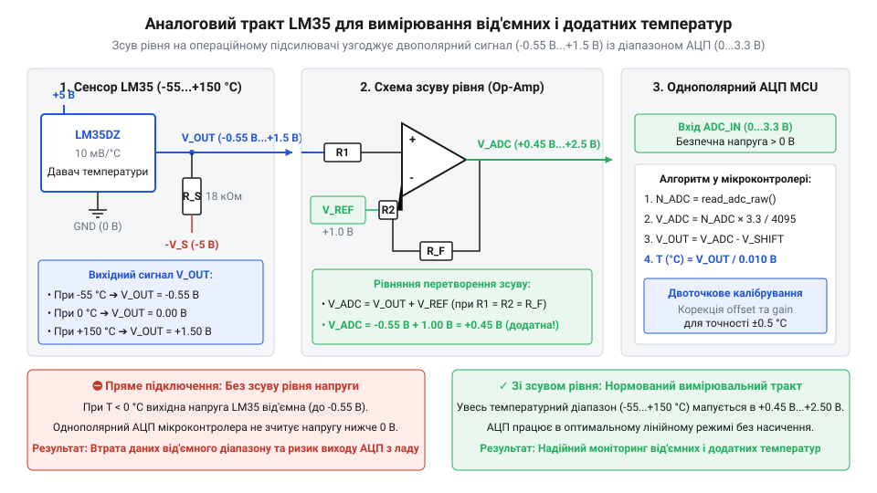
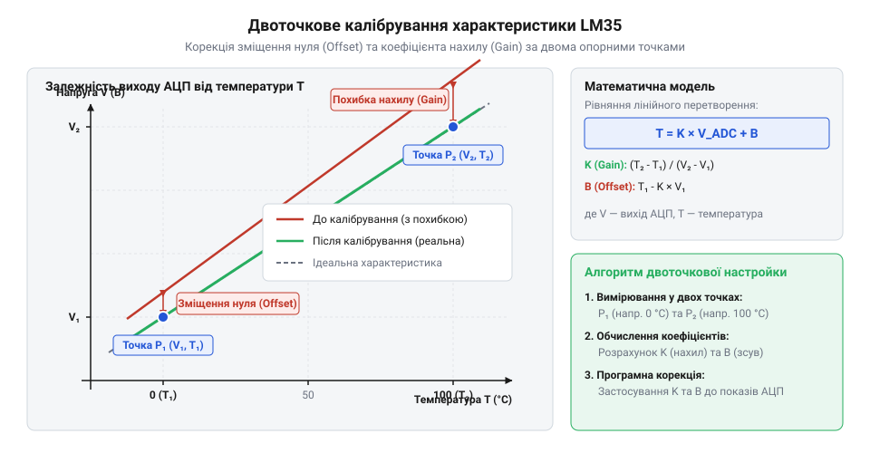

# Проєкт моніторингу повного діапазону температур (-55 °C...+150 °C) із від'ємним зсувом

## Обмеження однополярного підключення давача LM35

Давач LM35 видає напругу, прямо пропорційну температурі в градусах Цельсія, з коефіцієнтом 10 мВ/°C. У стандартній схемі з однополярним живленням його вихідна напруга починається від нуля вольтів і зростає з нагріванням. Це означає, що при +25 °C давач видасть 250 мВ, а при +150 °C — 1,5 В. Така конфігурація працює чудово, доки температура залишається додатною.

Проблема виникає, коли температура падає нижче нуля. За своєю фізикою LM35 мусить формувати від'ємну напругу для від'ємних температур: при -55 °C він має видати -550 мВ. Проте в однополярному включенні вихід давача фізично не здатен опуститися нижче потенціалу землі (0 В). Як наслідок, при температурі, нижчій за +2 °C, вихідна напруга впирається в нуль і припиняє змінюватися, обрізаючи весь від'ємний діапазон. 

Більше того, навіть якби ми забезпечили мінусову напругу на виході давача, підключати її безпосередньо до входу аналого-цифрового перетворювача мікроконтролера не можна. Кожен вивід мікроконтролера захищений внутрішнім діодом, анод якого підключений до землі, а катод — до самого входу. Щойно напруга на вході падає нижче -0,3 В, цей діод зміщується в прямому напрямку і різко відкривається, утворюючи безперешкодний шлях для струму від землі мікроконтролера до джерела від'ємного потенціалу. Оскільки цей контур не має струмообмежувальних елементів, через мікроскопічні провідники кристала починає текти неконтрольований струм короткого замикання, який миттєво перегріває та плавить напівпровідникову структуру, безповоротно випалюючи порт. Саме тому АЦП мікроконтролера розраховані на вимірювання напруги виключно в безпечних межах — від нуля до напруги живлення, зазвичай до 3,3 В.

Щоб безпечно вимірювати повний діапазон температур від -55 °C до +150 °C, нам потрібен спосіб змістити від'ємний потенціал у додатну площину, зробивши його зрозумілим і безпечним для АЦП.

## Електрична схема від'ємного зсуву сигналу

Коли температура опускається нижче нуля, аналоговий датчик температури LM35 має генерувати від'ємну напругу, адже його чутливість становить 10 мВ/°C. Наприклад, при -55 °C він повинен видати -550 мВ. Однак в однополярній системі живлення вихідна ніжка датчика не може самостійно опуститися нижче потенціалу землі. Щоб примусити струм текти у зворотному напрямку і сформувати від'ємну напругу відносно сигнальної землі, необхідний шлях для його відтікання. 

Цей шлях створюють за допомогою резистора підтяжки, який з'єднує вихід давача з джерелом від'ємної напруги. У такій конфігурації вихідний каскад датчика працює у повному діапазоні, струм безперешкодно стікає у від'ємне джерело, і сигнал на виході може опускатися нижче нуля, формуючи чесні -550 мВ. 


*Схема підключення давача LM35 для повного температурного діапазону зі зсувом вихідного сигналу.*

Хоча тепер датчик видає правильний сигнал від -550 мВ до +1500 мВ (для всього діапазону -55...+150 °C), цей сигнал усе ще містить від'ємні значення. Мікроконтролери, які живляться від однополярного джерела (наприклад, 3,3 В), мають АЦП, що не здатний вимірювати напругу, нижчу за землю. Подача -550 мВ на вхід мікроконтролера не тільки не виміряється, але й може вивести його з ладу через відкриття внутрішніх захисних діодів. Отже, вихідний сигнал потрібно зсунути вгору, щоб він став суто додатним і вкладався у безпечні межі АЦП (наприклад, 0...3,3 В).

Завдання зсуву і масштабування виконує суматор на базі операційного підсилювача. Найпростіший спосіб підняти сигнал — додати до нього стабільну опорну напругу. Використовується неінвертуюча схема суматора, яка сумує вихідну напругу LM35 та опорну напругу зсуву. 

Щоб обчислити номінали резисторів для суматора, виходять із крайових значень потрібного діапазону. Припустимо, ми маємо опорну напругу 1,2 В, яку часто формують за допомогою прецизійного джерела типу LM431. Якщо ми просто додамо 1,2 В до сигналу датчика з коефіцієнтом передачі 1:1, діапазон -0,55...1,5 В перетвориться на 0,65...2,7 В. Це суто додатний сигнал, який безпечно вимірюватиметься АЦП мікроконтролера з діапазоном 0...3,3 В.

На практиці схема неінвертуючого суматора будується на двох вхідних резисторах: один підключається від виходу датчика до неінвертуючого входу операційного підсилювача, інший — від джерела опорної напруги до того ж неінвертуючого входу. Напруга на вході операційного підсилювача `V_in` є суперпозицією двох сигналів:

        V_in
        = (V_sensor · R_ref + V_ref · R_sensor) / (R_sensor + R_ref)

Якщо ми обираємо резистори однакового номіналу (`R_sensor = R_ref = R`), тоді напруга на вході стане середнім арифметичним:

        V_in
        = (V_sensor + V_ref) / 2

Оскільки сигнал зменшився вдвічі, операційний підсилювач повинен його підсилити. Зворотний зв'язок операційного підсилювача (резистори `R_f` і `R_g`) налаштовують на коефіцієнт підсилення 2, щоб компенсувати ділення:

        V_out
        = V_in · (1 + R_f / R_g)
        = V_in · 2                 [якщо R_f = R_g]

Після підсилення на 2, отримуємо чисту суму напруг: `V_out = V_sensor + V_ref`. 

Вибір однакових резисторів (наприклад, по 10 кОм із допуском 0,1%) мінімізує похибки, викликані різницею температурних дрейфів. У цьому випадку, якщо опорна напруга `V_ref` становить 1 В, то при -55 °C (`V_sensor` = -0,55 В) напруга на АЦП дорівнюватиме 0,45 В. При +150 °C (`V_sensor` = 1,5 В) напруга становитиме 2,5 В. 

Така схема дозволяє використовувати значну частину діапазону АЦП, залишаючи запас зверху та знизу. Запас знизу (0,45 В) гарантує, що операційний підсилювач не вийде в насичення біля своєї нульової шини живлення, адже навіть так звані підсилювачі @@en|rail-to-rail@@ втрачають лінійність у крайніх мілівольтах біля землі.

Теза для наступних розділів: Читач розуміє принцип зсуву рівня за допомогою операційного підсилювача та опорної напруги, знає як розрахувати номінали резисторів для неінвертуючого суматора та чому важливо залишати запас напруги знизу діапазону АЦП.

## Математика двоточкового калібрування вимірювального тракту

Навіть ідеально розрахована схема в реальності матиме відхилення. Резистори мають допуски номіналів, що змінює коефіцієнт підсилення. Операційний підсилювач має власну напругу зсуву нуля, яка додається до сигналу. Опорна напруга та живлення можуть дрейфувати від температури навколишнього середовища. Усі ці фактори призводять до системної похибки вимірювання, коли розрахована програмою температура відрізняється від справжньої. 

Для компенсації цих похибок застосовують лінійну корекцію, відому як @@en|two-point calibration@@ (двоточкове калібрування). Оскільки характеристика LM35 лінійна, достатньо знайти два коригувальні коефіцієнти: нульове зміщення `offset` та коефіцієнт підсилення `gain`. 

Для калібрування давач поміщають у дві точки з точно відомою температурою: спочатку в холодну (наприклад, танучий лід, 0 °C), потім у гарячу (кипляча вода, 100 °C). Для кожної точки записують реальне значення, яке видав АЦП мікроконтролера. 

Маючи ідеальні (еталонні) значення та фактичні покази АЦП, коефіцієнт підсилення розраховують як відношення різниці еталонних температур до різниці показів АЦП. 

```c|calib
        gain
        = (T_ref2 - T_ref1) / (ADC2 - ADC1)      [відношення ідеальної різниці до виміряної]
```

Зсув нуля розраховується через підстановку знайденого `gain` до рівняння для першої точки.

```c|calib
        offset
        = T_ref1 - (ADC1 × gain)                 [зміщення нульової точки прямої]
```


*Характеристика перетворення напруги в температуру: калібрування вирівнює нахил і компенсує зсув.*

Після обчислення цих двох констант, програма в мікроконтролері зможе перетворювати будь-яке значення АЦП у точну температуру за простою формулою лінійної регресії: `T = (ADC × gain) + offset`. Цей математичний підхід компенсує всі статичні похибки аналогового тракту одночасно.

## Програмна обробка та розрахунок температури

Аналого-цифровий перетворювач мікроконтролера зчитує напругу на виході вимірювального тракту й перетворює її на числове значення. Оскільки ми використовуємо схему зі зсувом рівня, нульовий код АЦП більше не відповідає нулю градусів за Цельсієм. Щоб отримати справжню температуру, програма має врахувати цей зсув та застосувати калібрувальні коефіцієнти.

Спочатку необхідно зчитати сирий код АЦП. Сигнал від аналогових давачів часто містить шуми від роботи самого мікроконтролера та зовнішніх наведень. Щоб зменшити їхній вплив, використовують цифрове усереднення: мікроконтролер робить серію вимірювань, наприклад, 64 або 128 підряд, і обчислює їхнє середнє арифметичне значення. Це згладжує випадкові відхилення.

Далі усереднений код перетворюється на напругу. Для цього код множать на опорну напругу АЦП і ділять на максимальне значення коду (наприклад, 1023 для 10-бітного АЦП). Опорна напруга має бути максимально стабільною, адже будь-яке її коливання прямо вплине на результат. 

Знаючи напругу на вході АЦП, програма обчислює температуру, використовуючи лінійне рівняння `y = kx + b`, де `x` — обчислена напруга, `k` — коефіцієнт підсилення (@@en|gain@@), а `b` — нульовий зсув (@@en|offset@@). Ці два коефіцієнти ми отримали раніше під час математичної компенсації системних похибок за двома точками. Застосування їх на етапі розрахунку дозволяє автоматично коригувати як апаратний зсув рівня для від'ємних температур, так і похибки самого датчика та резисторів. 

У результаті мікроконтролер отримує значення температури в повному діапазоні, яке готове для виведення на екран або подальшої обробки, причому від'ємні температури відображатимуться коректно.

## Збирання, налагодження та перевірка схеми

Коли теоретичні розрахунки та програмний код готові, схему збирають на макетній платі для перевірки в реальних умовах. Фізичний монтаж вимагає уваги до деталей, оскільки довгі дроти макетної плати працюють як антени, збираючи електромагнітні завади.

Першим кроком після подачі живлення є інструментальна перевірка опорних напруг за допомогою мультиметра. Напруга живлення датчика LM35 та опорна напруга зміщення мають точно відповідати розрахунковим. Якщо опорна напруга нестабільна, це призведе до хитання показів температури. Для стабілізації використовують керамічні блокувальні конденсатори ємністю 0.1 мкФ, встановлені якнайближче до виводів живлення датчика та мікроконтролера.

Наступним кроком перевіряють вимірювальний тракт. Датчик нагрівають, наприклад, торкаючись його пальцем, і контролюють зміну напруги на виході схеми зсуву. Вона має плавно зростати. Потім датчик охолоджують (можна використати шматочок льоду в ізоляції) і переконуються, що напруга зменшується, залишаючись при цьому додатною, що підтверджує правильну роботу зсуву рівня для від'ємних температур.

Останній етап налагодження — виявлення та усунення шумів і температурного дрейфу. Якщо покази мікроконтролера «стрибають», варто перевірити якість контактів на макетній платі, розділити землі цифрової та аналогової частин схеми або збільшити кількість вимірювань для програмного усереднення. Тільки після того, як покази стануть стабільними й відповідатимуть контрольному термометру в усьому діапазоні, схему можна вважати готовою до перенесення на друковану плату.