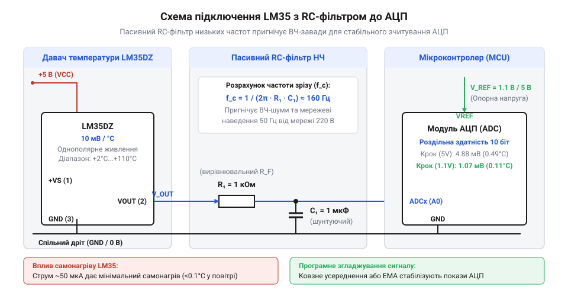

# Проєкт вимірювача додатних температур на мікроконтролері з однополярним живленням

<preknowlist>
- [KY-013 — аналоговий давач температури (термістор)](root:cat-hw-sensors/ky-013-thermistor) — Принцип формування аналогового напругового сигналу, залежного від температури, та базові засади його зчитування аналого-цифровим перетворювачем.
</preknowlist>

## Нестабільність аналогового вимірювання температури мікроконтролером

Пряме підключення аналогового давача LM35DZ до АЦП мікроконтролера за однополярного живлення +5 В викликає стрибки показів на 2–5 °C. Причина — мала амплітуда сигналу: чутливість LM35 становить лише 10 мВ/°C. За кімнатної температури 25 °C вихідна напруга сенсора дорівнює 250 мВ. У такому масштабі імпульсна завада амплітудою 20–30 мВ спотворює вимірювання на 2–3 °C.

Шум спричиняють цифрове ядро мікроконтролера та імпульсні перетворювачі на спільній шині 5 В. Перемикання вентилів створює високочастотні пульсації струму та підстрибування землі (англ. @@en|ground bounce@@, від англ. *ground* — земля, та *bounce* — відскок), зміщуючи потенціал аналогової землі. Крім того, довгі провідники вловлюють наведення мережі 50 Гц.

Вихідний каскад LM35DZ містить буферний підсилювач класу AB із низьким опором на постійному струмі. На частотах понад 10 кГц вихідний опір набуває індуктивного характеру. Підключення паразитної ємності лінії безпосередньо до виводу давача зміщує фазу в колі зворотного зв'язку, провокуючи паразитну генерацію (від грец. *parasitos* — нахлібник) на сотнях кілогерців.

Оцифрування аналогово-цифровим перетворювачем (англ. @@en|analog-to-digital converter@@, скорочено @@en|ADC@@, від грец. *analogos* — відповідний, та лат. *digitus* — палець, лічба) послідовного наближення (англ. @@en|successive approximation register@@, скорочено @@en|SAR@@, від англ. *successive* — послідовний, та *approximation* — наближення) додає динамічну заваду. Вбудований пристрій вибірки та зберігання (англ. @@en|sample-and-hold@@, скорочено @@en|S&H@@, від англ. *sample* — вибірка, та *hold* — утримувати) комутує конденсатор ємністю 10–14 пФ до аналогового входу, формуючи імпульсний струм заряду. На відміну від схем, де [аналоговий термістор KY-013](root:cat-hw-sensors/ky-013-thermistor) працює у високовольтному дільнику, слабкий сигнал LM35 вимагає апаратного узгодження, без якого [програмне зчитування та обробка сигналів LM35](root:cat-hw-sensors/lm35-software-adc-reading) дає зашумлені відліки. Детальніше про внутрішні процеси та розрахунок часу встановлення напруги можна дізнатися в матеріалі про [динаміку пристрою вибірки та зберігання SAR АЦП](root:cat-hw-sensors/sar-adc-sample-and-hold-dynamics).

## Апаратний низькочастотний фільтр сигналу LM35

Спроба придушити шум підключенням конденсатора між виходом LM35 та землею зриває роботу давача. Ємнісне навантаження понад 50 пФ безпосередньо на виводі зменшує запас стійкості за фазою та переводить підсилювач у режим автогенерації.

Для розв'язки ємності між виводом давача і входом АЦП послідовно вмикають ізолюючий резистор R, а конденсатор C встановлюють біля виводу мікроконтролера на лінію аналогової землі AGND. Схема утворює пасивний фільтр низьких частот (англ. @@en|low-pass filter@@, скорочено @@en|LPF@@, від англ. *low* — низький, та *pass* — пропускати) першого порядку. Резистор усуває автоколивання, а конденсатор накопичує заряд для входу @@en|S&H@@ АЦП.


*Принципова схема однополярного ввімкнення LM35 з ізолюючим резистором і конденсатором на вході АЦП для придушення високочастотних шумів без виникнення паразитної генерації.*

Номінал резистора обмежений вимогами АЦП типу @@en|SAR@@: еквівалентний опір джерела не повинен перевищувати 10 кОм, інакше вибірковий конденсатор не встигне зарядитися за час вибірки. Оптимальними є значення R від 1.0 кОм до 2.2 кОм та C від 0.1 мкФ до 1.0 мкФ.

Гранична частота зрізу (англ. @@en|cutoff frequency@@, від англ. *cut off* — відтинати) f_c на рівні -3 дБ розраховується за формулою:

```
f_c = 1 / (2 · π · R · C)
```

де R — опір резистора в омах, C — ємність конденсатора у фарадах, а π ≈ 3.1416.

**Розрахунок граничної частоти зрізу RC-фільтра для резистора 1.5 кОм та конденсатора 1.0 мкФ:**
```
f_c = 1 / (2 · π · R · C)
    = 1 / (2 · 3.1416 · 1500 Ом · 1.0 × 10⁻⁶ Ф)     [підстановка номіналів R = 1.5 кОм та C = 1.0 мкФ]
    ≈ 1 / (9.4248 × 10⁻³ с)                         [обчислення знаменника дробу]
    ≈ 106.1 Гц                                      [гранична частота зрізу на рівні -3 дБ]
```

Частота зрізу 106.1 Гц відсікає високочастотний цифровий шум і послаблює гармоніки мережі 100 Гц. Теплові процеси в корпусі TO-92 мають постійну часу в кілька секунд, тому фільтр не спотворює динаміку температури.

## Оптимізація опорної напруги та роздільності АЦП

За замовчуванням АЦП використовує як опорну напругу (англ. @@en|reference voltage@@, скорочено @@en|Vref@@, від лат. *referre* — зіставляти, та *volt* — вольт) шину живлення VCC = 5.0 В. У 10-бітному АЦП діапазон перетворення розбивається на 1024 кванти від 0 до 1023.

Ціна одного молодшого значущого розряду (англ. @@en|least significant bit@@, скорочено @@en|LSB@@, від англ. *least* — найменший, та *significant* — значущий) становить:
ΔV = 5000 мВ / 1024 ≈ 4.88 мВ. За чутливості LM35 10 мВ/°C крок квантування температури дорівнює:
ΔT = 4.88 мВ / 10 мВ/°C ≈ 0.49 °C. Покази змінюються з грубим кроком 0.5 °C. До того ж коливання напруги 5 В під навантаженням спотворюють результат, а діапазон 0...100 °C використовує лише 205 квантів із 1024 — 80% шкали АЦП втрачається.

Точність підвищує перемикання на внутрішнє стабільне джерело опорної напруги на базі ширини забороненої зони (англ. @@en|bandgap reference@@, від англ. *band* — енергетична зона, та *gap* — щілина) величиною 1.1 В (1100 мВ). При Vref = 1.1 В ціна кванта LSB становить:
ΔV = 1100 мВ / 1024 ≈ 1.07 мВ. Відповідний крок за температурою дорівнює:
ΔT = 1.07 мВ / 10 мВ/°C ≈ 0.107 °C. Роздільна здатність зростає майже вп'ятеро — до 0.1 °C на крок, а шкала 0...100 °C покриває 91% динамічного діапазону АЦП.

**Перерахунок цифрового коду АЦП 233 в напругу при внутрішній опорній напрузі 1.1 В:**
```
V_out = (RAW · V_ref) / 1024
      = (233 · 1100 мВ) / 1024                         [підстановка коду RAW = 233 та V_ref = 1100 мВ]
      = 256300 мВ / 1024                               [множення чисельника]
      ≈ 250.29 мВ                                      [обчислена напруга давача]
```

**Перерахунок напруги давача в температуру за номінальною крутизною 10 мВ/°C:**
```
T = V_out / S
  = 250.29 мВ / 10.0 мВ/°C                             [ділення вихідної напруги на чутливість LM35]
  ≈ 25.03 °C                                           [підсумкове значення температури]
```

Налаштування регістрів і перерахунок коду реалізуються на C та C++:

:::tabs
== C
:::code proj-lm35-single-supply-monitor/c/src/lm35.c 37-51
:::code proj-lm35-single-supply-monitor/c/src/lm35.c 93-121
== C++
:::code proj-lm35-single-supply-monitor/cpp/include/adc_config.hpp 26-38
:::code proj-lm35-single-supply-monitor/cpp/src/lm35_filter.cpp 72-87
:::

Біти REFS1=1 та REFS0=1 у регістрі ADMUX підключають джерело 1.1 В, а подільник ADCSRA задає частоту 125 кГц. Якщо потрібен діапазон понад 110 °C, застосовують [підсилення та узгодження сигналів LM35 на операційних підсилювачах](root:cat-hw-sensors/lm35-operational-amplifier-circuits).

## Програмне згладжування цифрових відліків АЦП

Після апаратної фільтрації у відліках АЦП залишається флікер-шум напівпровідника та мерехтіння молодшого розряду. Без цифрової обробки покази тремтять у межах ±0.2 °C.

Ковзне середнє (англ. @@en|simple moving average@@, скорочено @@en|SMA@@) усереднює вікно з N останніх вибірок за допомогою кільцевого буфера. Воно пригнічує шум, але потребує виділення статичного масиву на N комірок і додаткової індексації.

Менше пам'яті вимагає експоненційне згладжування (англ. @@en|exponential moving average@@, скорочено @@en|EMA@@, від лат. *exponere* — виставляти напоказ, та англ. *moving average* — ковзне середнє) — цифровий фільтр із нескінченною імпульсною характеристикою (англ. @@en|infinite impulse response@@, скорочено @@en|IIR@@, від лат. *infinitus* — необмежений, та *impulsus* — поштовх) першого порядку:

```
y[k] = α · x[k] + (1 - α) · y[k-1]
```

де x[k] — нова вибірка, y[k-1] — попередній вихід фільтра, y[k] — згладжений результат, а α — коефіцієнт згладжування (0 < α ≤ 1).

Фільтр @@en|EMA@@ зберігає лише одне значення попереднього стану y[k-1]. Коефіцієнт α = 0.15 за періоду опитування 100 мс забезпечує оптимальний баланс між згладжуванням та часом відгуку. Щоб уникнути перехідного затягування під час холодного старту, першу вибірку записують напряму: y[0] = x[0].

**Придушення імпульсної завади кроком фільтра EMA з коефіцієнтом α = 0.15:**
Стан дорівнює y[k-1] = 25.0 °C. Вхідна вибірка містить заваду x[k] = 30.0 °C. ```
y[k] = α · x[k] + (1 - α) · y[k-1]
     = 0.15 · 30.0 °C + (1 - 0.15) · 25.0 °C            [підстановка значень α = 0.15, x[k] = 30.0 та y[k-1] = 25.0]
     = 4.5 °C + 0.85 · 25.0 °C                          [обчислення ваг поточної вибірки та історії]
     = 4.5 °C + 21.25 °C                                [підсумовування компонентів]
     = 25.75 °C                                         [відфільтроване вихідне значення]
```

Імпульсний стрибок у 5.0 °C послабився до 0.75 °C і згладився на наступних кроках.

Реалізація фільтрів представлена в драйверах на C та C++:

:::tabs
== C
:::code proj-lm35-single-supply-monitor/c/include/lm35.h 72-80
:::code proj-lm35-single-supply-monitor/c/src/lm35.c 139-160
:::code proj-lm35-single-supply-monitor/c/src/main.c 72-89
== C++
:::code proj-lm35-single-supply-monitor/cpp/include/lm35_filter.hpp 19-36
:::code proj-lm35-single-supply-monitor/cpp/src/lm35_filter.cpp 29-59
:::code proj-lm35-single-supply-monitor/cpp/src/main.cpp 78-95
:::

Функція `lm35_filter_update` на C ініціалізує фільтр першим відліком без затримки, а клас `LM35Filter` на C++ реалізує кільцевий буфер SMA з оновленням суми за час O(1).

```
## Мінімізація похибки самонагріву давача LM35

Після усунення шумів виникає постійний зсув: покази LM35 на 0.1–0.3 °C вищі за дійсні. Його спричиняє самонагрів (англ. @@en|self-heating@@, від англ. *self* — сам, та *heat* — тепло) напівпровідникового кристала робочим струмом.

Сенсор LM35DZ споживає струм спокою (англ. @@en|quiescent current@@, від лат. *quiescere* — спочивати, бути в спокої) I_q близько 56–60 мкА. Розсіювана потужність P_diss за відсутності струму навантаження описується виразом:

```
P_diss = V_supply · I_q
```

де V_supply — напруга живлення у вольтах, а I_q — струм спокою в амперах.

**Розрахунок розсіюваної потужності кристала LM35 за номінального струму спокою 60 мкА:**
```
P_diss = V_supply · I_q
       = 5.0 В · 60 × 10⁻⁶ А                            [підстановка напруги живлення 5.0 В та струму спокою]
       = 0.30 × 10⁻³ Вт                                 [розсіювана електрична потужність]
       = 0.30 мВт                                       [переведення потужності в мілівати]
```

Тепловий опір (англ. @@en|thermal resistance@@, від грец. *therme* — тепло, та лат. *resistere* — чинити опір) θ_ja корпусу TO-92 у нерухомому повітрі становить близько 220 °C/Вт. Температурний перегрів структури дорівнює:

```
ΔT_self = P_diss · θ_ja
```

**Розрахунок перегріву напівпровідникового кристала в нерухомому повітрі:**
```
ΔT_self = P_diss · θ_ja
        = 0.30 × 10⁻³ Вт · 180 °C/Вт                    [підстановка потужності та теплового опору корпусу TO-92]
        = 0.054 °C                                      [температурна похибка власного самонагріву]
```

У нерухомому повітрі перегрів складає близько 0.05 °C. За підвищеної напруги живлення (12–24 В) потужність зростає в кілька разів, а перегрів сягає 0.3 °C. Низькоомне навантаження виходу (наприклад, 1 кОм за напруги 1.0 В) виділяє у вихідному каскаді додаткові 4 мВт, викликаючи перегрів понад 0.7 °C.

Для мінімізації самонагріву вживають таких заходів:
1. Живлення від мінімальної напруги +4.5...+5.0 В без підключення до високовольтних кіл. 2. Підключення виводу GND корпусу TO-92 до широкого мідного полігону плати, що знижує θ_ja до 130 °C/Вт. 3. Розміщення сенсора віддалено від гарячих вузлів із прорізами теплоізоляції на платі. 4. Імпульсне стробування живлення через вивід GPIO: сенсор вмикають лише на 10 мс перед вимірюванням. За інтервалу 1 с коефіцієнт заповнення (англ. @@en|duty cycle@@, від англ. *duty* — служба, робота, та грец. *kyklos* — коло) становить 1%, а самонагрів падає нижче 0.001 °C. 5. Програмне введення адитивної калібрувальної поправки у структурі конфігурації.

Аналогічний захист від перегріву струмом збудження використовує [платиновий термоопір PT100](root:cat-hw-sensors/pt100-rtd) та [цифровий давач температури DS18B20](root:cat-hw-sensors/ds18b20). Для роботи нижче 0 °C за однополярного живлення схему доповнюють діодним зсувом рівня, використовуючи [схеми вимірювання від'ємних температур](root:cat-hw-sensors/lm35-negative-temperature-sensing).