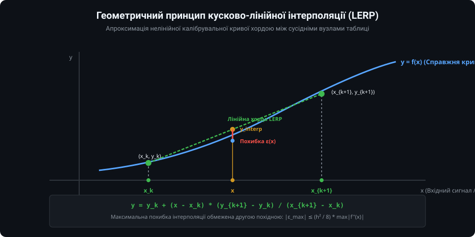
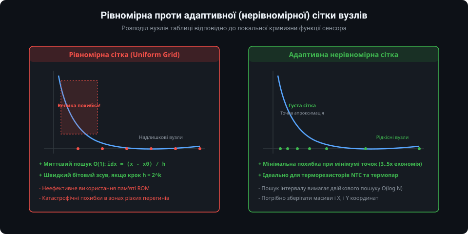
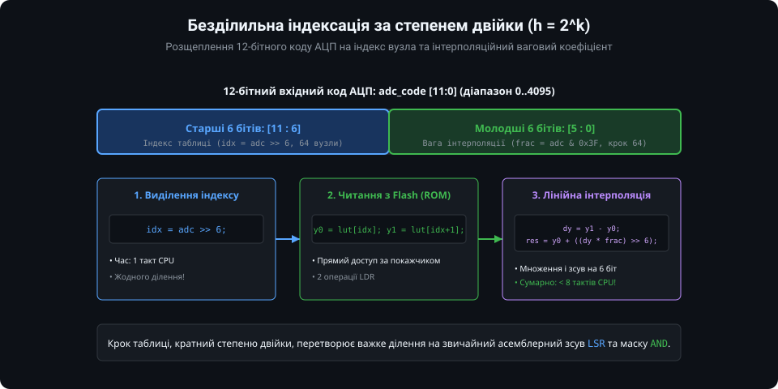
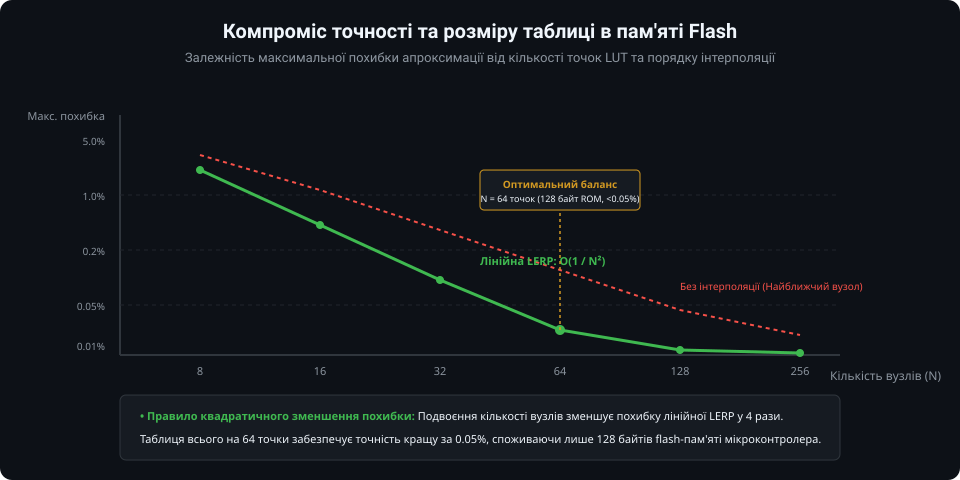
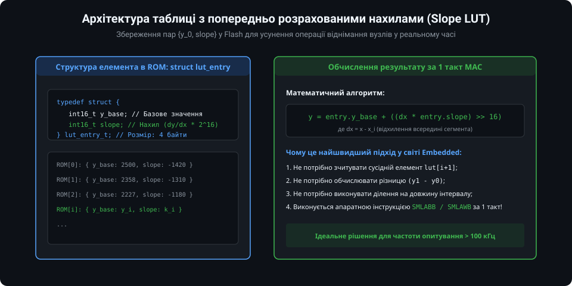

# Таблична апроксимація та методи інтерполяції функцій: поглиблений інженерний аналіз

У високошвидкісних системах керування вбудоване програмне забезпечення повинно гарантувати жорсткий детермінізм часу реакції. Використання трансцендентних математичних бібліотек вносить непередбачувані затримки в обробку переривань. У цьому розділі наведено суворий математичний вивід похибки залишкового члена інтерполяції, порівняльний аналіз вищих порядків апроксимації (сплайни Ерміта), методи стиснення пам'яті в Flash та завершену модульну реалізацію мовою C.

---

### 1. Теорема про залишковий член та аналіз похибок інтерполяції

Нехай функція `f(x)` двічі неперервно диференційовна на відрізку `[x_k, x_{k+1}]`. Побудуємо лінійний інтерполяційний поліном Лагранжа першого степеня `P_1(x)`:



`P_1(x) = y_k + ( (y_{k+1} - y_k) / (x_{k+1} - x_k) ) * (x - x_k)`

За теоремою Коші про залишковий член інтерполяції похибка `R_1(x) = f(x) - P_1(x)` у будь-якій внутрішній точці виражається як:

`R_1(x) = (f''(xi) / 2!) * (x - x_k) * (x - x_{k+1})`

де `xi in [x_k, x_{k+1}]`.

#### Знаходження точки максимальної похибки
Функція `g(x) = (x - x_k) * (x_{k+1} - x)` є параболою, гілки якої спрямовані вниз, а вершина знаходиться рівно посередині між вузлами:
`x_mid = (x_k + x_{k+1}) / 2`

Значення у вершині параболи:
`g(x_mid) = (h / 2) * (h / 2) = h^2 / 4`
де `h = x_{k+1} - x_k`.

Підставляючи максимум `g(x)` у формулу Коші, отримуємо граничну оцінку похибки лінійної інтерполяції:

`|R_1(x)| <= (h^2 / 8) * max_{x in [x_k, x_{k+1}]} |f''(x)|`

#### Практичні висновки для розробника:
1. **Похибка квадратично залежить від кроку `h`:** Збільшення таблиці вдвічі зменшує похибку в 4 рази. Збільшення в 4 рази зменшує похибку в 16 разів.
2. **Вплив другої похідної `f''(x)`:** В областях з високою кривизною (де графік різко змінює нахил, наприклад, у зоні експоненційного росту) похибка пропорційно зростає. Саме друга похідна визначає оптимальну густину розміщення вузлів.

---

### 2. Рівномірні проти нерівномірних сіток та алгоритми пошуку

Вибір топології розбиття інтервалу формує компроміс між швидкістю виконання та обсягом займаної пам'яті:



#### 1. Двійковий пошук інтервалу (Binary Search)
Для нерівномірних адаптивних сіток, де точки `x_0, x_1, ..., x_{N-1}` зберігаються у впорядкованому масиві, пошук індексу виконується методом дихотомії:

```c
uint16_t lut_find_segment_binsearch(const int16_t *x_knots, uint16_t n_knots, int16_t x) {
    if (x <= x_knots[0]) return 0;
    if (x >= x_knots[n_knots - 1]) return n_knots - 2;

    uint16_t low = 0;
    uint16_t high = n_knots - 1;

    while (high - low > 1) {
        uint16_t mid = (low + high) >> 1;
        if (x_knots[mid] > x) {
            high = mid;
        } else {
            low = mid;
        }
    }
    return low;
}
```
Складність пошуку складає суворо `ceil(log2 N)` порівнянь. Для таблиці на 32 точки це рівно **5 операцій**, що гарантує високу передбачуваність часу виконання.

#### 2. Безділильна індексація за степенем двійки
Якщо вхідний параметр (код АЦП) покриває фіксований діапазон (наприклад, 0..4095 для 12-бітного АЦП), рівномірна сітка з кроком `h = 2^k` дозволяє повністю ліквідувати бінарний пошук:



Старші розряди числа формують індекс масиву, а молодші розряди — коефіцієнт зміщення:
- `uint16_t index = adc_code >> K;`
- `uint16_t frac  = adc_code & ((1 << K) - 1);`

---

### 3. Кубічна інтерполяція Ерміта (Cubic Hermite Spline)

Лінійна інтерполяція має суттєвий недолік: у вузлах `x_k` перша похідна `f'(x)` зазнає стрибкоподібного розриву (C^0 неперервність, кускові злами). 

Якщо вихід сенсора подається в контур ПІД-регулятора, диференціальна складова `D = K_d * (de/dt)` при перетині вузла таблиці згенерує різкий стрибок керуючого сигналу (імпульсну заваду). 



Для усунення зламів використовують **кубічні сплайни Ерміта (C1 неперервність)**. У нормалізованих координатах `t = (x - x_k) / h` (`t in [0, 1]`):

`y(t) = h_{00}(t) * y_k + h_{10}(t) * h * m_k + h_{01}(t) * y_{k+1} + h_{11}(t) * h * m_{k+1}`

де базові функції Ерміта:
- `h_{00}(t) = 2*t^3 - 3*t^2 + 1`
- `h_{10}(t) = t^3 - 2*t^2 + t`
- `h_{01}(t) = -2*t^3 + 3*t^2`
- `h_{11}(t) = t^3 - t^2`
- `m_k, m_{k+1}` — дотичні у вузлах (наприклад, за формулою Катмулла-Рома: `m_k = (y_{k+1} - y_{k-1}) / (2*h)`).

Кубічний сплайн забезпечує похибку порядку `O(h^4)`, дозволяючи зменшити розмір таблиці ще у 4–8 разів при бездоганній гладкості першої похідної.

---

### 4. Оптимізація Slope LUT та розміщення в пам'яті Flash

Для систем реального часу з тактовою частотою опитування 50..200 кГц класичний LERP оптимізують за структурою **Slope LUT**:



Замість збереження тільки масиву `y[N]` у таблиці заздалегідь зберігають готові пари `{y_k, slope_k}`, де:
`slope_k = ( (y_{k+1} - y_k) / h ) * 65536` (у форматі Q16.16).

При цьому формулу інтерполяції зведено до стандартного вигляду:
`y = y_k + ((dx * slope_k) >> 16)`

На процесорах із ядром ARM Cortex-M4/M7/M33 ця формула транслюється компілятором у єдину машинну інструкцію **`SMLAWB`** або **`SMLABB`**, яка виконує множення 32-бітного та 16-бітного операнда, зсув праворуч на 16 бітів та додавання 32-бітного акумулятора **за 1 такт процесора**!

---

### 5. Повнофункціональна бібліотека табличної інтерполяції на C

Нижче наведено виробничу бібліотеку з двома режимами: надшвидка рівномірна таблиця з розщепленням 12-бітного коду АЦП (степінь двійки) та адаптивна нерівномірна таблиця з бінарним пошуком.

#### Заголовний файл (`lut_interpolator.h`)

```c
#ifndef LUT_INTERPOLATOR_H
#define LUT_INTERPOLATOR_H

#include <stdint.h>
#include <stdbool.h>

/* Структура попередньо розрахованого вузла Slope LUT */
typedef struct {
    int16_t y_base;  // Значення у вузлі (наприклад, температура в 0.1 °C або 0.01 °C)
    int16_t slope;   // Нахил відрізка у форматі Q16
} lut_slope_node_t;

/* Структура для нерівномірної сітки */
typedef struct {
    const int16_t *x_knots;
    const int16_t *y_knots;
    uint16_t n_knots;
} lut_nonuniform_t;

/* Швидка LERP для 12-бітного АЦП з кроком 64 (64 сегменти по 64 кванти) */
int16_t lut_eval_adc12_pow2(uint16_t adc_code, const int16_t *lut_y);

/* Оцінка за структурою Slope LUT */
int16_t lut_eval_slope(uint16_t adc_code, uint8_t shift_k, const lut_slope_node_t *lut_table);

/* Універсальна LERP для нерівномірної сітки з двійковим пошуком */
int32_t lut_eval_nonuniform(const lut_nonuniform_t *lut, int32_t x);

#endif /* LUT_INTERPOLATOR_H */
```

#### Файл реалізації (`lut_interpolator.c`)

```c
#include "lut_interpolator.h"

/**
 * @brief Надшвидка безділильна інтерполяція для 12-бітного АЦП (0..4095)
 * @details Використовує рівномірний крок h = 64 (2^6). Масив lut_y повинен містити 65 елементів.
 * @param adc_code Вхідне значення АЦП (0..4095)
 * @param lut_y Вказівник на таблицю значень у Flash
 * @return Інтерпольоване значення
 */
int16_t lut_eval_adc12_pow2(uint16_t adc_code, const int16_t *lut_y) {
    if (adc_code >= 4095) {
        return lut_y[64];
    }

    // Старші 6 бітів [11:6] — індекс сегмента
    uint16_t idx = adc_code >> 6;
    // Молодші 6 бітів [5:0] — вага інтерполяції (dx)
    uint16_t frac = adc_code & 0x3F;

    int16_t y0 = lut_y[idx];
    int16_t y1 = lut_y[idx + 1];

    // dy * frac / 64 з симетричним округленням (+ 32)
    int32_t delta = (int32_t)(y1 - y0) * frac + 32;
    return (int16_t)(y0 + (delta >> 6));
}

/**
 * @brief Обчислення за методом Slope LUT (1 такт множення з накопиченням)
 */
int16_t lut_eval_slope(uint16_t adc_code, uint8_t shift_k, const lut_slope_node_t *lut_table) {
    uint16_t idx = adc_code >> shift_k;
    uint16_t mask = (1U << shift_k) - 1U;
    uint16_t dx = adc_code & mask;

    const lut_slope_node_t *node = &lut_table[idx];
    // y = y_base + (dx * slope >> 16)
    int32_t prod = (int32_t)dx * node->slope + 0x8000;
    return (int16_t)(node->y_base + (prod >> 16));
}

/**
 * @brief Двійковий пошук та інтерполяція на нерівномірній сітці
 */
int32_t lut_eval_nonuniform(const lut_nonuniform_t *lut, int32_t x) {
    const int16_t *xk = lut->x_knots;
    const int16_t *yk = lut->y_knots;
    uint16_t n = lut->n_knots;

    // Захист від виходу за межі діапазону (Clamping)
    if (x <= xk[0]) return yk[0];
    if (x >= xk[n - 1]) return yk[n - 1];

    // 1. Двійковий пошук інтервалу O(log2 N)
    uint16_t low = 0;
    uint16_t high = n - 1;

    while (high - low > 1) {
        uint16_t mid = (low + high) >> 1;
        if (xk[mid] > x) {
            high = mid;
        } else {
            low = mid;
        }
    }

    // 2. Лінійна інтерполяція всередині знайденого інтервалу
    int32_t x0 = xk[low];
    int32_t x1 = xk[high];
    int32_t y0 = yk[low];
    int32_t y1 = yk[high];

    int32_t dx = x - x0;
    int32_t span_x = x1 - x0;
    int32_t dy = y1 - y0;

    // Обчислення з захистом від переповнення та округленням
    int64_t num = (int64_t)dy * dx + (span_x >> 1);
    return y0 + (int32_t)(num / span_x);
}
```

---

### Практичні інженерні правила побудови вбудованих таблиць

1. **Кратності 2 для швидких АЦП:** Якщо вхідним сигналом є код АЦП, завжди проектуйте таблицю з кроком `2^k` (наприклад, 16, 32, 64, 128 квантів). Це повністю виключає операцію ділення з контуру обробки.
2. **Розміщення у пам'яті Flash (ROM):** Завжди оголошуйте таблиці з модифікатором `const` (або `PROGMEM` в AVR), щоб вони компілювалися безпосередньо у флеш-пам'ять і не витрачали дорогоцінну оперативну пам'ять (RAM).
3. **Обмеження діапазону (Clamping):** Перш ніж використовувати індекс таблиці, завжди перевіряйте граничні умови (`if (code >= MAX) return table[LAST]`), щоб виключити вихід за межі масиву при апаратних збоях або перенапрузі на вході АЦП.
