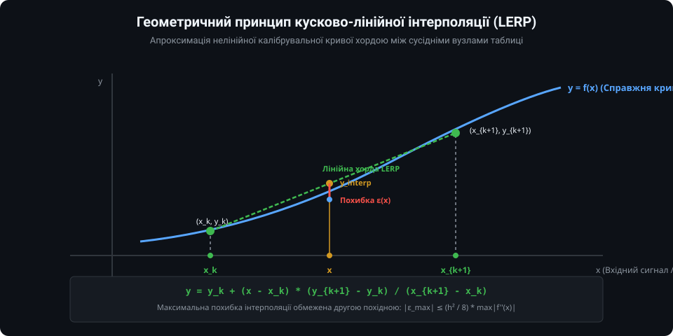
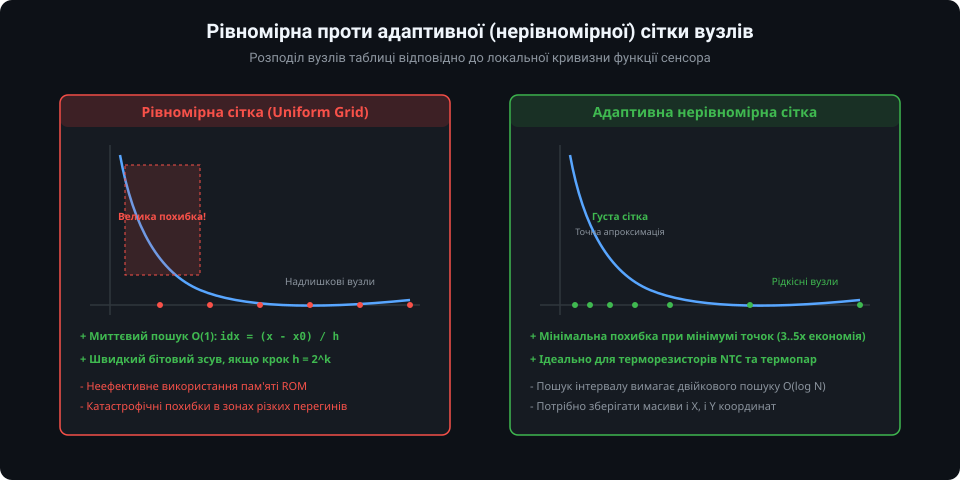
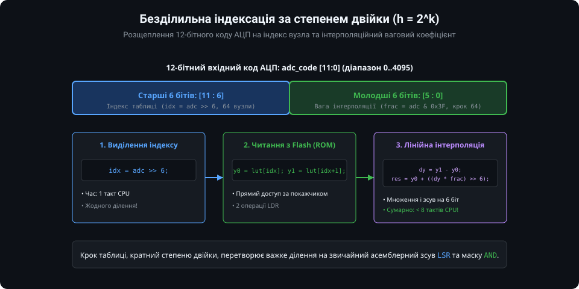
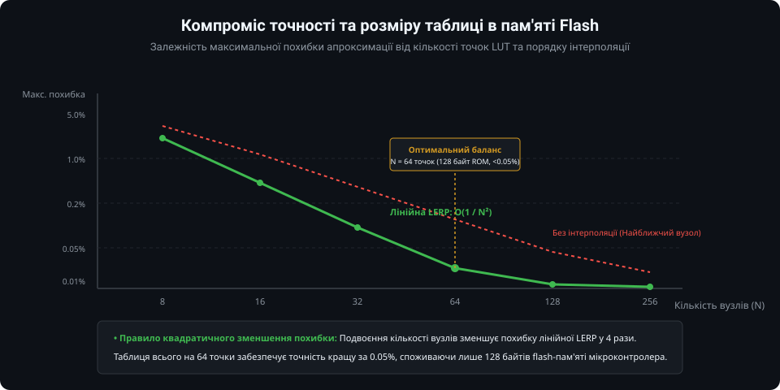
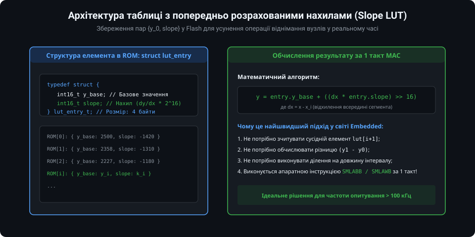

# Таблична апроксимація та методи інтерполяції функцій

Обробка сигналів нелінійних сенсорів (терморезистори NTC, термопари, оптичні фотодавачі, калібрувальні криві розряду акумуляторів) часто вимагає обчислення трансцендентних математичних функцій: експонент, натуральних логарифмів, поліномів високих степенів або тригонометрії. 

Виклик стандартних бібліотечних функцій `math.h` (таких як `exp()`, `log()`, `pow()`) на вбудованих мікроконтролерах без апаратного FPU займає сотні та навіть тисячі тактів ядра процесора. **Таблична апроксимація (Lookup Table, LUT)** у поєднанні з методами інтерполяції є класичним прийомом вбудованої інженерії, що дозволяє розміняти незначний обсяг постійної пам'яті (Flash/ROM) на екстремальне прискорення розрахунків (у 20–100 разів).

---

### 1. Принцип кусково-лінійної інтерполяції (LERP)

Пряма таблична вибірка без інтерполяції (вибір найближчого вузла) створює ступінчастий графік із великою східчастою похибкою. Щоб отримати плавний результат при невеликому розмірі таблиці, застосовують **кусково-лінійну інтерполяцію (Linear Interpolation, LERP)**:



Справжня нелінійна крива сенсора `y = f(x)` розбивається на `N` сегментів із вузлами `(x_k, y_k)`. Всередині кожного сегмента крива замінюється прямолінійним відрізком (хордою). 

Якщо виміряне значення `x` потрапляє між сусідніми вузлами `x_k <= x < x_{k+1}`, шукане значення `y` обчислюється за формулою пропорційного відрізка:
`y = y_k + (x - x_k) * (y_{k+1} - y_k) / (x_{k+1} - x_k)`

- **Похибка апроксимації:** Теоретична максимальна похибка між хордою та опуклою кривою обмежена другою похідною:
  `|e_max| <= (h^2 / 8) * max |f''(x)|`
  де `h = x_{k+1} - x_k` — довжина інтервалу.
- З цієї формули випливає фундаментальне правило: **зменшення кроку сітки `h` у 2 рази зменшує похибку інтерполяції в 4 рази** (квадратичне згасання похибки).

---

### 2. Рівномірна проти адаптивної нерівномірної сітки

Вибір структури розміщення вузлів у пам'яті визначає швидкість пошуку та ефективність використання пам'яті:



1. **Рівномірна сітка (Uniform Grid):** Всі вузли розміщені з однаковим фіксованим кроком `h = const`.
   - *Перевага:* Номер сегмента `k` знаходиться миттєво за одну арифметичну операцію: `k = (x - x_0) / h`. Складність пошуку — `O(1)`.
   - *Недолік:* Нераціональне використання пам'яті. На пологих ділянках кривої зберігається багато зайвих точок, тоді як на ділянках різкої зміни характеристики (наприклад, експоненційний підйом опору NTC при низьких температурах) кроку `h` не вистачає, і похибка стрімко зростає.

2. **Адаптивна нерівномірна сітка (Non-uniform Grid):** Вузли концентруються густо там, де друга похідна `|f''(x)|` велика (крутий вигин кривої), і рідко — на прямих ділянках.
   - *Перевага:* Зменшення кількості точок у 3–5 разів при збереженні однакової максимальної похибки по всьому діапазону.
   - *Недолік:* Неможливо визначити індекс простим діленням; потрібен швидкий двійковий пошук (Binary Search) зі складністю `O(log2 N)`.

---

### 3. Безділильна індексація за степенем двійки (h = 2^k)

Найбільш повільною операцією при інтерполяції на мікроконтролері є обчислення номера інтервалу `k = (x - x_0) / h` та залишку. Якщо обрати крок рівномірної сітки, кратний ступеню двійки (`h = 2^k`, наприклад, 16, 32, 64 або 128), операції ділення та взяття залишку перетворюються на миттєві побітові операції:



Для 12-бітного АЦП (коди 0..4095) при виборі 64 інтервалів (`крок h = 64 = 2^6`):
1. **Індекс вузла:** Старші 6 бітів вхідного значення:
   `idx = adc_code >> 6;` (діапазон 0..63, час: 1 такт CPU);
2. **Ваговий коефіцієнт інтерполяції (dx):** Молодші 6 бітів:
   `frac = adc_code & 0x3F;` (діапазон 0..63, час: 1 такт CPU);
3. **Обчислення значення:**
   `res = y[idx] + (((y[idx+1] - y[idx]) * frac) >> 6);`

Уся процедура інтерполяції містить лише 2 операції зсуву, 1 логічне «І», 2 віднімання та 1 множення. Вона виконується швидше ніж за **10 тактів процесора** без жодного виклику апаратного чи програмного ділення.

---

### 4. Компроміс розміру таблиці та похибки

Вибір кількості вузлів таблиці — це завжди пошук оптимального інженерного компромісу між точністю системи та обсягом займаної пам'яті Flash:



- При використанні простої таблиці без інтерполяції (Nearest Neighbor) для досягнення точності 0.1% потрібна величезна таблиця на 1024–4096 точок (2–8 КБ пам'яті).
- При застосуванні лінійної LERP-інтерполяції таблиця всього на **32–64 точки** (64–128 байтів Flash) забезпечує похибку кращу за 0.05%, що перевершує точність переважної більшості промислових сенсорів.
- Збільшення таблиці понад 128 точок для лінійної інтерполяції зазвичай є безглуздим, оскільки похибка апроксимації стає значно меншою за рівень власних шумів аналогового тракту та АЦП.

---

### 5. Архітектура таблиці з попередньо обчисленими нахилами (Slope LUT)

Для задач екстремальної швидкодії (обробка енкодерів, пряме цифрове керування перетворювачами, частота опитування > 100 кГц) навіть одне додаткове віднімання `(y_{k+1} - y_k)` є небажаним. Для таких систем таблицю оптимізують за структурою **Slope LUT**:



У пам'ять Flash записують структури, що містять базове значення та готовий кутовий коефіцієнт нахилу хорди:
```c
typedef struct {
    int16_t y_base; // Значення у вузлі x_k
    int16_t slope;  // Нахил k = ((y_{k+1} - y_k) / h) * 65536
} lut_entry_t;
```

Формула обчислення набуває класичного вигляду лінійної функції:
`y = entry.y_base + ((dx * entry.slope) >> 16)`

У ядрах ARM Cortex-M ця операція (множення 16x16 зі зсувом та додаванням до бази) реалізується єдиною апаратною командою **`SMLABB` / `SMLAWB` (Signed Multiply Accumulate)** за **1 такт процесора**!

---

### Підсумки та висновки

1. Таблична апроксимація із кусково-лінійною інтерполяцією (LERP) є фундаментальним інструментом лінеаризації сенсорів у вбудованому ПЗ.
2. Вибір довжини інтервалу, кратного степеню двійки (`h = 2^k`), перетворює операції індексації та інтерполяції на швидкі бітові зсуви та маски.
3. Збереження попередньо обчисленого нахилу (Slope LUT) дозволяє розраховувати фізичне значення сенсора за 1 такт апаратної інструкції MAC.
