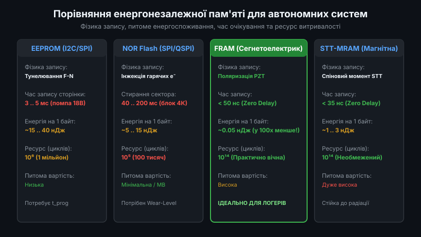
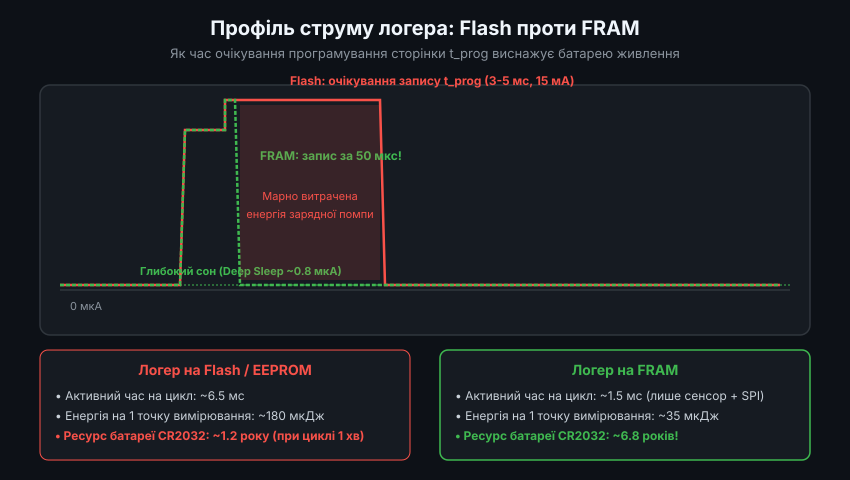
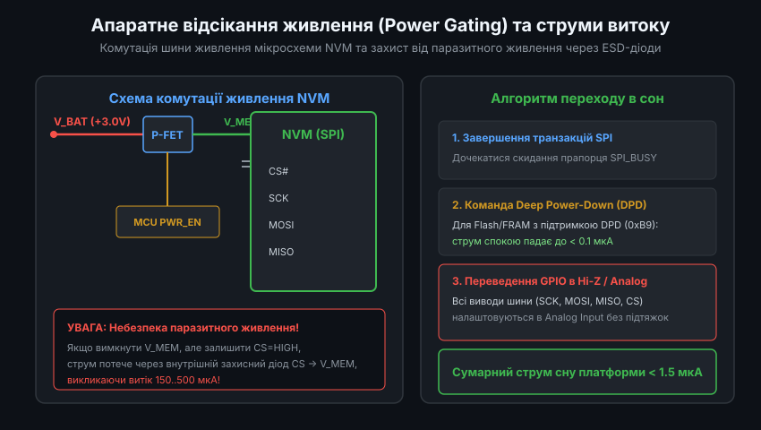
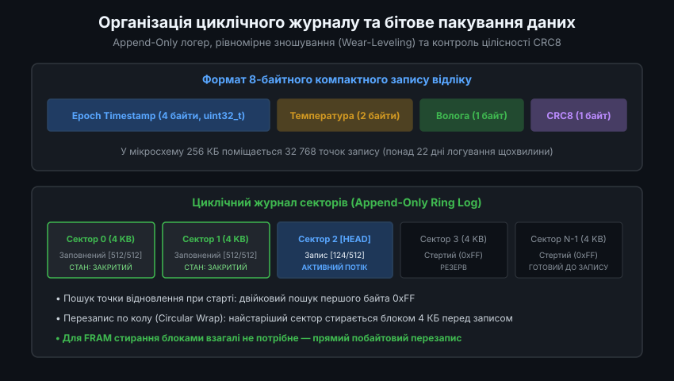
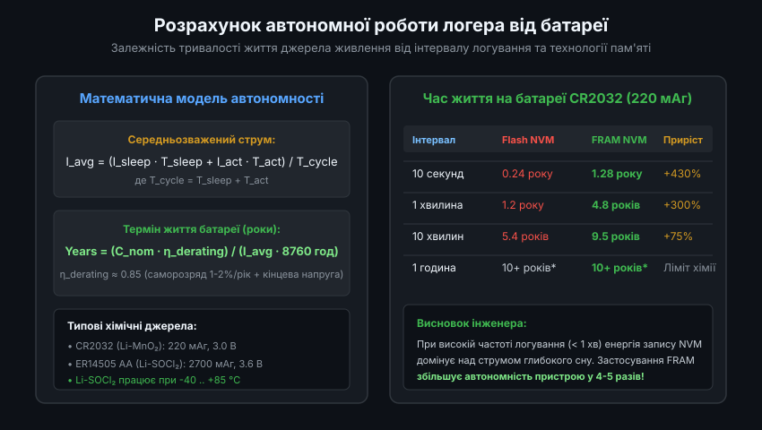

# Енергоефективні накопичувачі даних для автономних логерів: Інженерний аналіз та низькорівнева реалізація

Розробка автономних реєстраторів кліматичних параметрів (температури, вологості, тиску) вимагає суворого балансу між енергоспоживанням, ресурсом перезапису пам'яті та надійністю збереження інформації при раптовому падінні напруги живлення. Для пристроїв із запланованим життєвим циклом від 3 до 10 років від однієї літієвої батареї критичним фактором є не стільки обсяг збережених даних, скільки питома енергія, що витрачається на запис кожного окремого відліку.

---

### 1. Фізичні механізми запису NVM та порівняльний енергетичний аналіз

Енергонезалежна пам'ять (Non-Volatile Memory, NVM) для вбудованих систем поділяється на кілька технологічних родин, кожна з яких володіє принципово різною фізикою запису та стирання інформації.



#### 1.1. EEPROM (Electrically Erasable Programmable Read-Only Memory)
- **Фізичний принцип**: зберігання заряду на плаваючому затворі (Floating Gate). Запис і стирання здійснюються за допомогою квантовомеханічного тунелювання електронів Фаулера-Нордгейма (Fowler-Nordheim Tunneling) крізь надтонкий шар діелектрика SiO2.
- **Енергетика**: для тунелювання потрібна напруга близько 15-18 В. Вбудована зарядна помпа (Charge Pump) вимагає 3-5 мс для запису сторінки, споживаючи від 2 до 5 мА. Енергія на 1 збережений байт становить від 15 до 40 нДж.
- **Ресурс**: деградація оксидного шару обмежує ресурс витривалості до 1 000 000 циклів запису на сектор.

#### 1.2. NOR Flash
- **Фізичний принцип**: інжекція гарячих електронів (Channel Hot Electron Injection) у плаваючий затвор або пастку заряду (Charge Trap). 
- **Енергетика**: посторінковий запис (Page Program 256 байтів) займає від 0.7 до 3.0 мс. Проте прямий перезапис неможливий: біти можна змінити лише з "1" на "0". Зворотне переведення в стан "1" вимагає блокового стирання сектора (зазвичай 4 КБ), що займає від 40 до 200 мс при струмі до 15-20 мА.
- **Ресурс**: типово від 100 000 до 300 000 циклів стирання.

#### 1.3. FRAM (Ferroelectric Random Access Memory)
- **Фізичний принцип**: сегнетоелектрична кристалічна решітка (типово цирконат-титанат свинцю, PZT). Інформація кодується просторовим положенням центрального атома металу в елементарній комірці. Перемикання поляризації відбувається під дією низької напруги живлення (1.8-3.3 В) без використання зарядних помп.
- **Енергетика**: час запису збігається з часом циклу шини пам'яті (<50 нс). Після передачі даних по SPI запис завершується миттєво (Zero Write Delay). Енергія на 1 байт становить близько 0.05 нДж — у 100-800 разів менше за Flash!
- **Ресурс**: понад 10^14 циклів. Якщо записувати відлік кожну секунду, ресурсу FRAM вистачить на понад 3 000 000 років безперервної роботи.

---

### 2. Осцилографічний профіль струму та часові діаграми логування

Для оцінки впливу часу запису на розряд батареї розглянемо часові фази типового сеансу вимірювання кліматичного відліку:



Складові часу активної фази мікроконтролера:
1. **Пробудження від RTC**: стабілізація високочастотного кварцового або RC-генератора (150-300 мкс, струм 2.5 мА).
2. **Опитування сенсора (I2C/SPI)**: наприклад, зчитування BME280 в режимі Forced Mode (близько 1.2 мс при оверсемплінгу x1, струм ~1.8 мА).
3. **Обчислення калібрування**: цілочисельна математика (близько 50 мкс, струм 3.0 мА).
4. **Запис у накопичувач NVM**:
   - **У випадку FRAM**: відправка 8 байтів по шині SPI на частоті 10 МГц займає 6.4 мікросекунди. Загальний час активності NVM разом із вибором чипа CS становить менше 20 мкс. Мікроконтролер миттєво засинає.
   - **У випадку SPI Flash**: передача команди `Page Program (0x02)` займає 15 мкс, але після підняття лінії CS у стан HIGH мікросхема Flash починає внутрішній цикл запису `t_prog` тривалістю від 1.5 до 4.0 мс. Протягом цього часу мікросхема споживає 12-15 мА, а мікроконтролер змушений очікувати в активному стані або періодично опитувати регістр статусу `RDSR (0x05)`.

Сумарна енергія одного відліку для Flash-пам'яті становить близько 160-220 мкДж, тоді як для FRAM — лише 30-40 мкДж (з яких понад 85% йде на роботу самого сенсора та тактового генератора MCU).

---

### 3. Апаратне керування живленням (Power Gating) та витоки через ESD-діоди

Навіть у стані спокою (Standby) зовнішня мікросхема SPI Flash споживає від 5 до 25 мкА, що є неприйнятним для логера з бюджетом струму сну до 2.0 мкА. Для усунення цього струму застосовують апаратне відсікання живлення (Power Gating) за допомогою P-канального MOSFET-ключа.



#### Запобігання паразитним витокам крізь вхідні кола (Phantom Powering)
Найнебезпечнішою помилкою схеми з відсіканням живлення є паразитна передача енергії через внутрішні захисні ESD-діоди мікросхеми NVM. Кожен цифровий вхідний пін (CS#, SCK, MOSI) захищений діодами, увімкненими між шиною землі GND та шиною живлення кристала V_MEM.

Якщо ключ P-MOSFET розімкнено (напруга на V_MEM знята), але мікроконтролер залишає на лініях SPI високий рівень напруги (наприклад, пін CS# підтягнутий до батареї V_BAT = 3.0 В), струм починає протікати за ланцюгом:
`V_BAT -> MCU_GPIO(HIGH) -> ESD_Diode -> V_MEM`

Цей паразитний струм становить від 100 до 800 мкА, що розряджає батарею CR2032 за лічені тижні, а також викликає некоректний стан логіки пам'яті.

Правильна послідовність вимкнення живлення в прошивці мовою C:

```c
#include <stdint.h>
#include "mcu_gpio.h"
#include "mcu_spi.h"

#define PIN_NVM_PWR_EN   GPIO_PIN_4
#define PIN_SPI_CS       GPIO_PIN_5
#define PIN_SPI_SCK      GPIO_PIN_6
#define PIN_SPI_MOSI     GPIO_PIN_7
#define PIN_SPI_MISO     GPIO_PIN_8

void nvm_power_down_safe(void)
{
    // Крок 1: Завершення роботи периферії SPI
    spi_wait_until_idle();

    // Крок 2: Відправка команди Deep Power Down (DPD), якщо пам'ять підтримує її
    gpio_set_low(PIN_SPI_CS);
    spi_transfer_byte(0xB9); // Команда DPD для SPI Flash / FRAM
    gpio_set_high(PIN_SPI_CS);

    // Крок 3: Переведення лінії CS в стан LOW перед зняттям живлення
    gpio_set_low(PIN_SPI_CS);

    // Крок 4: Розмикання P-MOSFET ключа (PWR_EN = HIGH для P-каналу з підтяжкою)
    gpio_set_high(PIN_NVM_PWR_EN);

    // Крок 5: Переведення всіх сигнальних ліній SPI в режим Analog Input (Hi-Z без підтяжок)
    gpio_set_mode(PIN_SPI_CS,   GPIO_MODE_ANALOG);
    gpio_set_mode(PIN_SPI_SCK,  GPIO_MODE_ANALOG);
    gpio_set_mode(PIN_SPI_MOSI, GPIO_MODE_ANALOG);
    gpio_set_mode(PIN_SPI_MISO, GPIO_MODE_ANALOG);
}
```

При такому підході сумарний струм спокою вузла пам'яті у стані сну становить менше 0.05 мкА.

---

### 4. Організація циклічного журналу, вирівнювання зносу та логарифмічний пошук

Для збереження кліматичних даних у NVM використовується двійковий формат запису фіксованого розміру 8 байтів:

```c
#pragma pack(push, 1)
typedef struct {
    uint32_t timestamp;  // Час за стандартом Unix Epoch (UTC секунди)
    int16_t  temp_c100;  // Температура в сотих долях °C (-4000 .. +8500)
    uint8_t  humidity;   // Відносна вологість у відсотках (0 .. 100% RH)
    uint8_t  crc8;       // Контрольна сума CRC-8 для захисту цілісності
} logger_record_t;
#pragma pack(pop)
```



Контрольна сума CRC-8 (поліном 0x07) обчислюється по перших 7 байтах структури, що дозволяє миттєво відхиляти пошкоджені записи при зчитуванні.

#### Швидкий пошук активної позиції запису (Binary Search)
У стертій Flash-пам'яті всі байти мають стан `0xFF`. Перше вільне місце визначається полем `timestamp == 0xFFFFFFFF`. Замість повільного лінійного перебору всіх комірок використовується алгоритм двійкового пошуку зі складністю O(log2 N):

```c
uint32_t nvm_find_next_record_index(uint32_t total_records)
{
    uint32_t low = 0;
    uint32_t high = total_records - 1;
    uint32_t head = 0;

    // Швидка перевірка: якщо перший запис порожній - починаємо з 0
    if (nvm_read_timestamp(0) == 0xFFFFFFFF) {
        return 0;
    }

    // Двійковий пошук першого неочищеного сектора
    while (low <= high) {
        uint32_t mid = low + ((high - low) >> 1);
        uint32_t ts = nvm_read_timestamp(mid);

        if (ts != 0xFFFFFFFF) {
            head = mid + 1; // Запис існує, зміщуємось вправо
            low = mid + 1;
        } else {
            if (mid == 0) break;
            high = mid - 1; // Запис порожній, зміщуємось вліво
        }
    }

    return head % total_records;
}
```

Для пам'яті об'ємом 256 КБ (32 768 записів) двійковий пошук вимагає лише 15 операцій зчитування, займаючи менше 200 мікросекунд при старті системи.

---

### 5. Моделювання терміну служби батареї та вплив хімічного саморозряду

Час автономної роботи розраховується на основі балансу електричного заряду.



Середньозважений струм споживання:
`I_avg = (I_sleep * T_sleep + I_active * T_active) / (T_sleep + T_active)`

Номінальна ємність батареї `C_nom` (мАг) підлягає коригуванню коефіцієнтом деградації `eta_derating`:
`C_eff = C_nom * eta_derating`

Коефіцієнт `eta_derating` (зазвичай 0.75-0.85) враховує три фактори:
1. **Поріг відсікання напруги (Cutoff Voltage)**: наприклад, мінімальна напруга роботи MCU становить 2.0 В, тоді як повністю розряджена CR2032 має напругу 1.8 В (втрата ~10% ємності).
2. **Падіння напруги на внутрішньому опорі ESR**: при імпульсах струму під час роботи сенсора падіння `delta_V = I_pulse * R_internal` може спричинити помилкове спрацьовування захисту BOR (Brown-Out Reset).
3. **Хімічний саморозряд (Self-Discharge)**: для Li-MnO2 (CR2032) становить близько 1-2% на рік при 20 °C, а при підвищенні температури до 40 °C зростає до 4-5% на рік.

#### Порівняльний розрахунок для логера клімату:
- Джерело живлення: батарея CR2032, номінал `220 мАг`, ефективна ємність `C_eff = 185 мАг`.
- Струм глибокого сну: `I_sleep = 1.0 мкА`.
- Інтервал опитування: `T_cycle = 60 секунд`.

**Варіант А (Зовнішня SPI Flash 4 Мбіт):**
- Час активності: `T_active = 5.5 мс`.
- Середній активний струм: `I_active = 12.0 мА`.
- Середній струм: `I_avg = 1.0 мкА + (12000 мкА * 0.0055 с) / 60 с = 1.0 + 1.1 = 2.1 мкА`.
- Час автономної роботи: `185 000 мкА*год / (2.1 мкА * 8760 год) = 10.05 років / 2.1 = ~4.8 років`.

**Варіант Б (Зовнішня SPI FRAM 256 Кбіт):**
- Час активності: `T_active = 1.5 мс`.
- Середній активний струм: `I_active = 3.5 мА`.
- Середній струм: `I_avg = 1.0 мкА + (3500 мкА * 0.0015 с) / 60 с = 1.0 + 0.0875 = 1.088 мкА`.
- Час автономної роботи: `185 000 мкА*год / (1.088 мкА * 8760 год) = ~9.7 років` (фактично обмежується природним терміном старіння літієвого елемента).

Таким чином, використання сегнетоелектричної FRAM та апаратного вимкнення живлення дозволяє подвоїти час роботи автономного реєстратора при тій самій ємності джерела живлення.
