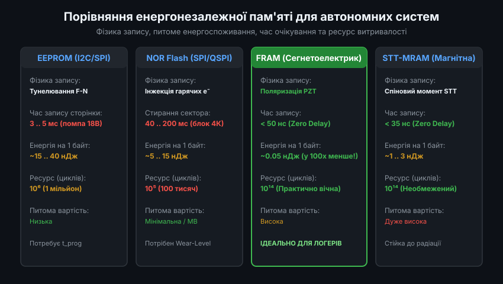
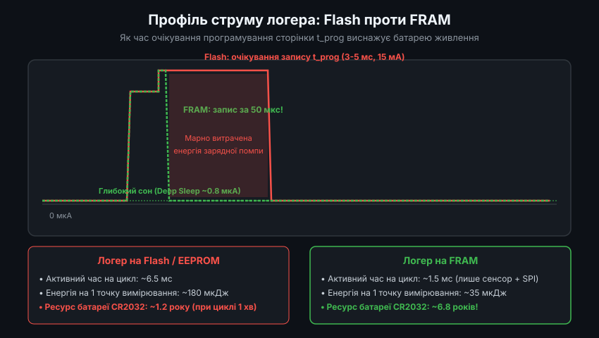
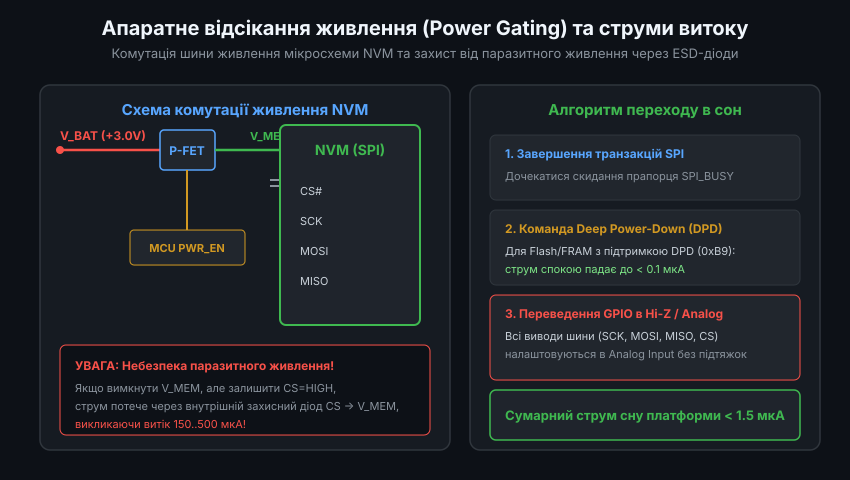
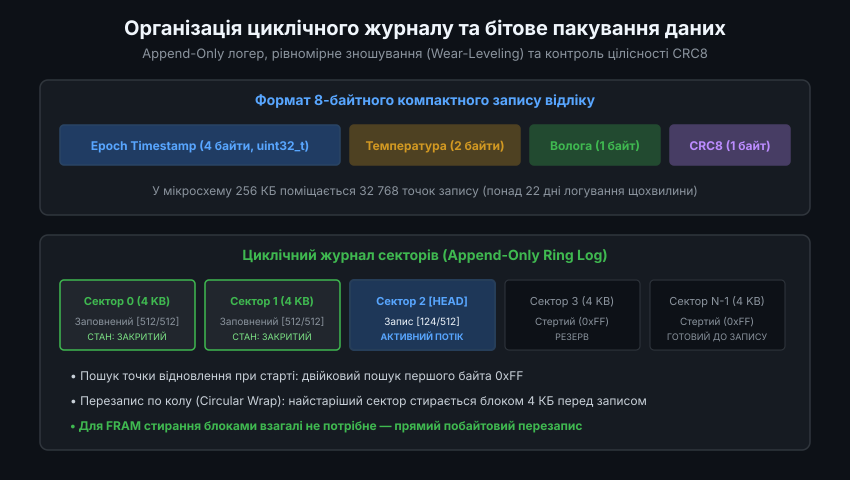
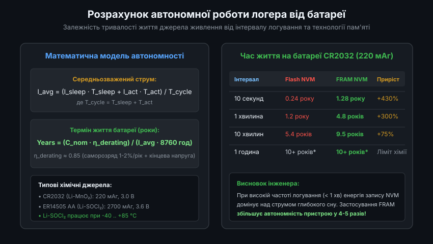

# Енергоефективні накопичувачі даних для автономних логерів

Автономні логери навколишнього середовища (термографи, датчики вологості, польові метеостанції) розробляються з розрахунком на багаторічну роботу від одного компактного хімічного джерела живлення — наприклад, літієвої дискової батареї CR2032 або елемента Li-SOCl2. Оскільки бездротова передача даних часто неможлива або енергетично невигідна, ключовим вузлом системи стає незалежний енергонезалежний накопичувач даних (Non-Volatile Memory, NVM). Правильний вибір фізичного типу пам'яті та архітектури збереження визначає, чи пропрацює пристрій кілька місяців, чи понад 10 років.

---

### 1. Енергетичний бюджет циклу логування та технології NVM

Типовий автономний реєстратор 99% часу проводить у стані глибокого сну (Deep Sleep), де мікроконтролер споживає лише 0.5-2.0 мкА від батареї, а тактування забезпечується низькочастотним годинником реального часу (RTC 32.768 кГц). За сигналом таймера пристрій періодично пробуджується для опитування сенсорів і фіксації нового відліку.

Енергетичні витрати одного циклу вимірювання описуються формулою:
`E_cycle = V_dd * (I_sensor * t_sensor + I_mcu * t_mcu + I_write * t_write)`

У класичних системах операція збереження в пам'ять несподівано стає головним споживачем енергії:
- **EEPROM (I2C/SPI)**: вимагає внутрішньої зарядної помпи високої напруги (~15-18 В) для тунелювання електронів крізь оксидний бар'єр. Час запису однієї сторінки становить 3-5 мс, протягом яких мікросхема споживає до 3-5 мА. Ресурс обмежений 1 мільйоном циклів.
- **NOR Flash (SPI)**: має найнижчу вартість за мегабайт, проте запис можливий лише посторінково (256 байтів, 0.7-3 мс), а перезапис вимагає стирання всього сектора (4 КБ), що займає від 40 до 200 мс при струмі понад 10-15 мА. Ресурс становить лише близько 100 000 циклів.
- **FRAM (Ferroelectric RAM)**: використовує зсув атомів у кристалічній решітці сегнетоелектрика. Запис відбувається на повній швидкості шини SPI без будь-якої затримки (`t_prog < 50 нс`), відсутня помпа високої напруги, питома енергія запису в 100 разів менша за Flash, а ресурс перевищує 10^14 циклів (практично нескінченний).
- **MRAM (Magnetoresistive RAM)**: магнітна пам'ять на основі спінового тунелювання. Поєднує швидкість SRAM із повною енергонезалежністю та нескінченним ресурсом, але має вищу вартість.

---

### 2. Профіль струму логера: Flash проти FRAM

Головною причиною швидкої розрядки батарей у логерах на основі Flash-пам'яті є не стільки обсяг переданих даних, скільки час примусового очікування завершення внутрішнього циклу програмування (`t_prog`).

Під час запису сторінки у Flash-пам'ять мікроконтролер змушений або крутитися в циклі опитування прапорця зайнятості `WIP` (Write-In-Progress), або засинати за таймером на кілька мілісекунд. Протягом усього цього часу сама мікросхема Flash споживає активний струм генератора високої напруги:
- У Flash-пам'яті запис 8-байтного відліку займає близько 3-5 мс, споживаючи близько 150-200 мкДж енергії.
- У FRAM-пам'яті запис виконується безпосередньо в момент передачі байтів по шині SPI на частоті до 20-40 МГц. Одразу після передачі останнього біта пам'ять готова до вимкнення, і мікроконтролер миттєво повертається в глибокий сон. Тривалість активної фази скорочується до 50-100 мікросекунд, а енергія запису знижується до 0.1-0.5 мкДж.

При опитуванні датчика раз на хвилину застосування FRAM збільшує час автономної роботи від однієї дискової батареї CR2032 з 1.2 року до майже 5-7 років.

---

### 3. Апаратне відсікання живлення (Power Gating) та струми витоку

Навіть коли зовнішня мікросхема пам'яті перебуває в режимі очікування (Standby), її внутрішні кола споживають струм спокою (зазвичай від 1 до 15 мкА). Для логера, що розрахований на 5-10 років роботи, такий струм спокою є неприпустимо великим, оскільки він перевищує струм сну самого мікроконтролера.

Для мінімізації витоків застосовують дві взаємодоповнюючі стратегії:

1. **Програмний режим глибокого сну (Deep Power-Down, DPD)**: більшість сучасних мікросхем SPI Flash та FRAM підтримують команду переходу в DPD (байт `0xB9`). У цьому режимі струм спокою мікросхеми падає нижче 0.1 мкА. Перед початком передачі даних виконується команда пробудження (`0xAB`), яка вимагає витримки часу стабілізації (близько 10-30 мкс).
2. **Апаратне відсікання живлення ключем (Power Gating)**: живлення V_MEM подається на чип пам'яті через зовнішній P-канальний польовий транзистор (P-MOSFET), керований виводом GPIO мікроконтролера.

Критично важливо пам'ятати про захист від паразитного живлення: якщо живлення мікросхеми вимкнено через транзистор, але на сигнальних лініях SPI (CS, SCK, MOSI) залишається високий логічний рівень, струм від батареї почне протікати крізь внутрішні захисні ESD-діоди мікросхеми пам'яті. Це спричиняє витік струму сотні мікроампер і може вивести мікроконтролер з ладу. Тому перед вимиканням живлення або входом у сон усі пов'язані виводи GPIO обов'язково переводяться в аналоговий режим (Hi-Z).

---

### 4. Структура циклічного журналу (Circular Append-Only Log) та пакування даних

Оптимальна організація даних на енергонезалежному носії вимагає відмови від складних повноцінних файлових систем (типу FAT), які вимагають частого перезапису системних таблиць секторів і швидко вичерпують ресурс пам'яті.

Замість цього застосовується циклічний журнал типу Append-Only:
- **Бінарне пакування запису**: відмова від збереження текстових ASCII/JSON рядків. Дані упаковуються в компактну 8-байтну структуру: 4 байти під Unix Timestamp (секунди), 2 байти під температуру в сотих частках °C, 1 байт під вологість (0..100%), 1 байт під контрольну суму CRC8 та статус батареї.
- **Послідовний запис (Append-only)**: новий запис завжди додається в кінець попереднього. Це повністю виключає необхідність локального перезапису і забезпечує природне вирівнювання зносу (Wear Leveling) по всій адресовій карті пам'яті.
- **Швидкий пошук голови журналу при перезавантаженні**: оскільки стерті комірки Flash містять байти `0xFF`, при старті пристрою мікроконтролер за допомогою швидкого двійкового пошуку (Binary Search) за лічені мілісекунди знаходить перше вільне поле для запису без повного сканування всієї пам'яті.

---

### 5. Розрахунок терміну служби батареї та вплив хімічного саморозряду

При проектуванні автономних вимірювальних систем інженер повинен оцінити загальний життєвий цикл пристрою з урахуванням ємності батареї, середнього струму споживання та природного хімічного саморозряду.

Розрахунок базується на середньозваженому струмі:
`I_avg = (I_sleep * T_sleep + I_active * T_active) / T_cycle`

Термін служби джерела живлення у роках обчислюється як:
`Years = (C_nom * eta_derating) / (I_avg * 8760)`

де:
- `C_nom` — номінальна ємність батареї (наприклад, 220 мАг для CR2032 або 2700 мАг для літій-тіонілхлоридної Li-SOCl2 типорозміру AA).
- `eta_derating` — коефіцієнт зниження корисної ємності (зазвичай 0.8-0.85), який враховує внутрішній опір при імпульсних навантаженнях, падіння робочої напруги нижче порогу відключення MCU (Brown-Out Reset) та саморозряд батареї (близько 1-2% на рік).
- `8760` — кількість годин у календарному році.

Якщо інтервал реєстрації становить 1 хвилину, логер на базі FRAM та Li-SOCl2 батареї здатен безперервно фіксувати кліматичні параметри понад 10 років без заміни елемента живлення та технічного обслуговування.
