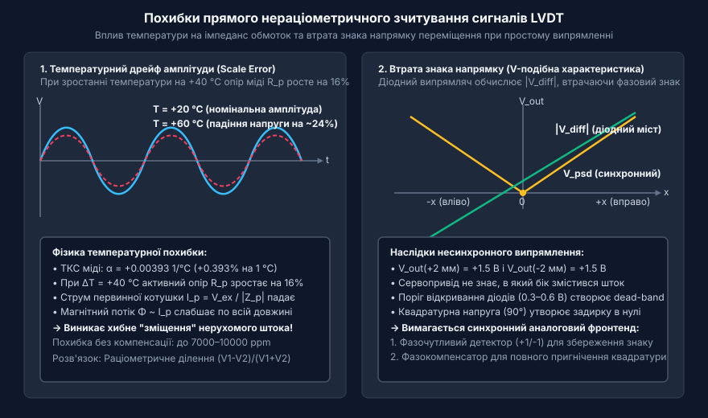
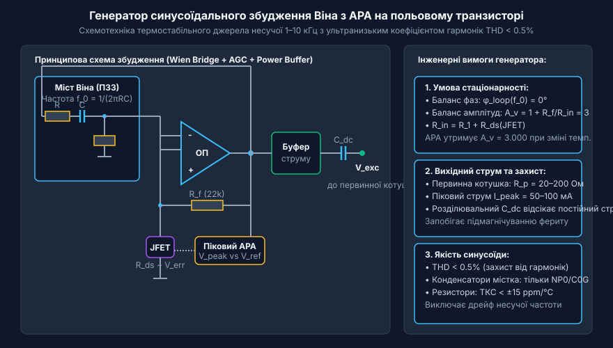
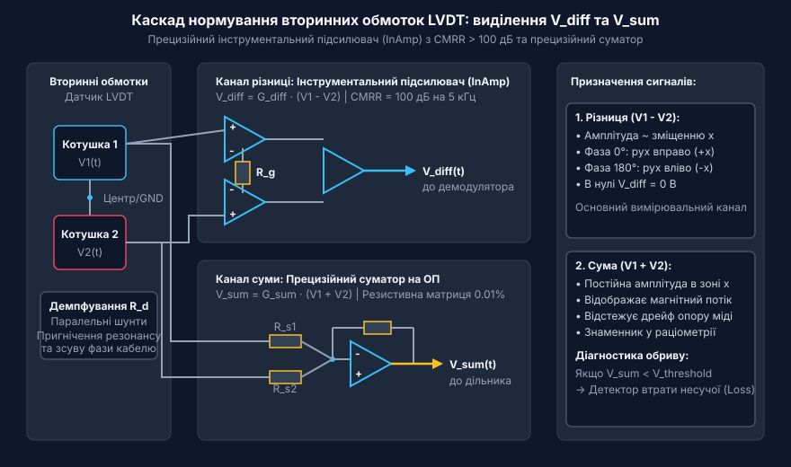
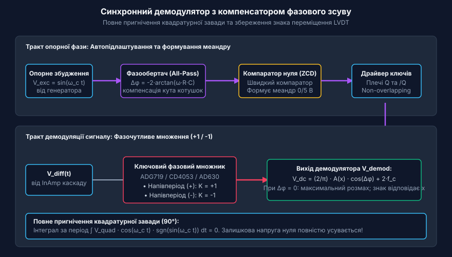
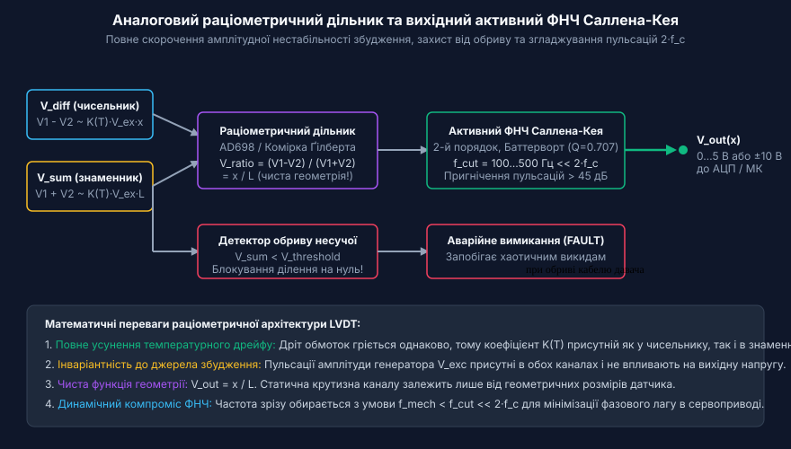

# Аналоговий фронтенд підготовки сигналів LVDT

<preknowlist>
- [Лінійні змінні диференціальні трансформатори LVDT](root:cat-hw-sensors/lvdt-linear-variable-differential-transformers) — фізичний принцип індуктивного перетворення переміщення штока у взаємну індуктивність котушок та виникнення температурного дрейфу опору обмоток
- [Синхронне детектування та фазочутлива демодуляція давачів положення](root:cat-hw-sensors/synchronous-demodulation-for-inductive-transducers) — теоретичні засади фазочутливого множення змінних сигналів для виділення амплітуди й фазового кута несучої
- [Спеціалізовані мікросхеми кондиціонування сигналу LVDT](root:cat-hw-sensors/ad698-signal-conditioner) — базову схемотехнічну структуру монолітних сигнальних процесорів LVDT та архітектуру вбудованих аналогових дільників напруги
</preknowlist>

## Чому пряме вимірювання LVDT дає похибки

Підключення первинної обмотки диференціального трансформатора LVDT (@@en|Linear Variable Differential Transformer@@ — лінійний змінний диференціальний трансформатор) до джерела змінної напруги, а вихідних вторинних обмоток — безпосередньо до амплітудного детектора чи аналогово-цифрового перетворювача (@@en|analog-to-digital converter@@, АЦП) здається найпростішим інженерним рішенням. За кімнатної температури таке прямоточне зчитування створює ілюзію стабільної роботи: під час переміщення феромагнітного штока амплітуда змінної напруги на вторинних котушках змінюється пропорційно зсуву. Проте варто розмістити таку систему в реальній промисловій зоні, де температура навколишнього середовища коливається в межах від -20 °C до +60 °C, як показання позиціонування «пливуть» на кілька відсотків від повної шкали навіть за нерухомого штока. Пряме оцифрування вихідних напруг без спеціалізованої схемотехнічної підготовки перетворює прецизійний вимірювач мікропереміщень на вразливий термометр.

Головна причина амплітудного дрейфу полягає в фізичних властивостях мідного дроту, яким розмотані первинна й вторинні обмотки [трансформаторів LVDT](root:cat-hw-sensors/lvdt-linear-variable-differential-transformers). Мідь має високий температурний коефіцієнт електричного опору (@@en|temperature coefficient of resistance@@, TCR), який становить приблизно `α = 0.00393` 1/°C (або `+0.393%` на кожен градус Цельсія). Повний імпеданс первинної обмотки `Z_p` складається з активного опору мідного дроту `R_p` та індуктивного опору `ω·L_p`:

```
Z_p(T) = sqrt( (R_p0 · (1 + α · ΔT))² + (2 · π · f · L_p)² )
```

Коли температура датчика зростає на 40 °C, активний опір `R_p` збільшується майже на 16%. Якщо первинна обмотка живиться від джерела зі стабільною напругою `V_ex`, то струм первинного кола `I_p = V_ex / |Z_p|` падає зі зростанням температури. Оскільки магнітний потік `Φ` у сердечнику прямо пропорційний струму первинної обмотки `I_p`, згасання струму призводить до пропорційного зменшення напруженості магнітного поля. Як наслідок, електрорушійна сила (ЕРС), що наводиться у вторинних обмотках `V_s1` та `V_s2`, зменшується по всьому діапазоні вимірювання, хоча шток залишається абсолютно нерухомим.

Окрім абсолютного амплітудного дрейфу, пряме амплітудне вимірювання втрачає інформацію про знак напрямку зміщення. Вторинні обмотки датчика LVDT ввімкнені зустрічно-послідовно або описуються окремими напругами `V_s1` та `V_s2`. У центральному (нульовому) положенні штока амплітуди напруг на обох котушках однакові (`V_s1 = V_s2`), а їхня різниця дорівнює нулю. При зсуві штока в додатний бік амплітуда `V_s1` зростає, а `V_s2` зменшується; при зсуві в від'ємний бік — навпаки. Змінна напруга різницевого сигналу `V_diff = V_s1 - V_s2` при зсуві в один бік збігається за фазою з напругою збудження (зсув `0°`), а при зсуві в протилежний бік зміщується за фазою на `180°`. Якщо застосувати простий діодний випрямляч чи піковий детектор, на виході буде отримано лише абсолютне значення амплітуди `|V_s1 - V_s2|`. Таке вимірювання не здатне розрізнити зсув на `+2 мм` від зсуву на `-2 мм`, повністю втрачаючи напрямок переміщення.

Ще однією схемотехнічною перепоною є виникнення квадратурної залишкової напруги (@@en|quadrature voltage@@) у нульовій точці. Через паразиту ємність між первинною та вторинними обмотками, а також технологічну несиметрію магнітних втрат у сердечнику, в точці нульового зсуву різницевий сигнал не спадає строго до нуля. У ньому залишається слабка складова, зсунута за фазою на `90°` відносно несучої. Звичайний амплітудний випрямляч випрямляє цю квадратурну напругу разом із корисним сигналом, створюючи ненульовий вихідний потенціал у нулі та викривляючи лінійність вимірювання на початковій ділянці.

Додатковим деструктивним чинником є фазовий зсув (@@en|phase shift@@), що виникає між первинною напругою збудження та вихідними вторинними напругами. Індуктивна котушка датчика має власну паразитно-розподілену ємність та опір втрат у магнітопроводі. Через це фазовий кут `θ` між струмом збудження й вихідною напругою залежить від частоти несучої (@@en|carrier frequency@@), температури та довжини з'єднувального кабелю. Зміна температурного режиму кабелю чи датчика змінює кут `θ`, що призводить до додаткової фазової похибки при спробах аналогового або цифрового обчислення.


*Зміна амплітуди вторинних напруг LVDT під впливом температури та невизначеність знаку напрямку при прямому діодному випрямленні.*

Параметрична похибка прямого вимірювання наочно ілюструється на математичному прикладі температурного розрахунку:

**Розрахунок температурного дрейфу вихідної напруги за прямого живлення напругою:**

```
[Умова: R_p0 = 100 Ом при T0 = 20 °C, L_p = 15 мГн, f = 5 кГц, V_ex = 3.0 В (СКВ)]
[Резонансна частотна коловий опір: ω = 2 · π · 5000 = 31415.9 рад/с]
[Індуктивний опір: X_L = ω · L_p = 31415.9 · 0.015 = 471.24 Ом]

Z_p(20 °C) = sqrt( 100² + 471.24² )
           = sqrt( 10000 + 222067 )
           = 481.73 Ом                           [Повний імпеданс при 20 °C]

I_p(20 °C) = 3.0 / 481.73
           = 6.228 мА                            [Струм первинної обмотки при 20 °C]

[При нагріванні датчика до T = 60 °C (ΔT = +40 °C):]
R_p(60 °C) = 100 · (1 + 0.00393 · 40)
           = 115.72 Ом                           [Активний опір при 60 °C]

Z_p(60 °C) = sqrt( 115.72² + 471.24² )
           = sqrt( 13391 + 222067 )
           = 485.24 Ом                           [Повний імпеданс при 60 °C]

I_p(60 °C) = 3.0 / 485.24
           = 6.183 мА                            [Струм первинної обмотки при 60 °C]

[Падіння струму та вихідної амплітуди:]
ΔI_p %     = ((6.183 - 6.228) / 6.228) · 100
           = -0.722 %                            [Відносна похибка вимірювання позиції]
```

Отримане падіння амплітуди на `0.722%` створює систематичний зсув позиціонування понад `7220 ppm`, що є неприпустимим для мікрометричних та прецизійних промислових систем. На відміну від кутових трансформаторних давачів, таких як [трансформаторних кутомірів](root:cat-hw-sensors/synchro-and-resolver-transducers) чи [трансформаторів RVDT](root:cat-hw-sensors/rvdt-rotary-variable-differential-transformers), де застосовуються подібні індуктивні принципи, у вимірювачах LVDT лінійний діапазон часто становить одиниці міліметрів, і похибка в частки відсотка виводить систему за межі допуску.

Еволюція аналогових фронтендів LVDT пройшла шлях від дискретних трансформаторних мостів до сучасних інтегрованих мікросхем. Перші фазочутливі детектори на дискретних лампових і транзисторних елементах використовували діодні мости для детектування амплітуди. Вони мали високу чутливість до температурного дрейфу імпедансу котушок і фазових розсувів, описаних для [трансформаторів LVDT](root:cat-hw-sensors/lvdt-linear-variable-differential-transformers). Згодом відбувся перехід від вимірювання абсолютних амплітуд напруг до обчислення відношення різниці й суми сигналів за допомогою фазочутливих аналогових множників. Це дозволило повністю компенсувати амплітудні коливання джерела збудження та температурні зміни опору мідного дроту. Сучасний розробник обирає між дискретними схемами на операційних підсилювачах та монолітними аналоговими фронтендами (@@en|analog front-end@@), спираючись на вимоги до точності й габаритів.

Систематичний амплітудний і фазовий дрейф вимагає від аналогового фронтенду реалізації спеціальних методів підготовки. Для відновлення знаку напрямку та подавлення квадратурного шуму застосовується синхронне детектування за допомогою [демодуляції давачів](root:cat-hw-sensors/synchronous-demodulation-for-inductive-transducers). Повне усунення впливу температурного дрейфу первинного струму досягається завдяки обчисленню співвідношення сигналів, що описується в рамках [раціометричної демодуляції](root:cat-hw-sensors/lvdt-analog-front-end/math-lvdt-ratiometric-demodulation.md). Зрозуміння цих обмежень прямого вимірювання формує базу для проєктування стабільного генератора збудження та тракту обробки.

## Схемотехніка генераторів синусоїдального збудження котушок

Формування стабільного електромагнітного поля у вимірювальному трансформаторі вимагає використання синусоїдального джерела живлення первинної обмотки з високою чистотою спектра та низьким температурним дрейфом. Використання прямокутних чи трикутних сигналів для збудження LVDT є неприпустимим: вищі гармонічні складові перерозподіляються у фазочутливих детекторах, викликають нелінійні спотворення через насичення феромагнітного сердечника та створюють високочастотні наводки в котушках. Синусоїдальний генератор несучої частоти (@@en|carrier frequency@@) повинен забезпечувати коефіцієнт нелінійних спотворень (@@en|total harmonic distortion@@, THD) менше ніж `0.5%` та амплітудну нестабільність не гірше за `50-100 ppm/°C`.

Найпоширенішим схемотехнічним рішенням для дискретної побудови джерела збудження є генератор Віна (@@en|Wien bridge oscillator@@). Основою схеми є прецизійний операційний підсилювач із частотно-вибірковим містом RC у колі позитивного зворотного зв'язку (ПЗЗ) та вузлом автоматичного регулювання амплітуди (АРА; @@en|automatic gain control@@, AGC) у колі негативного зворотного зв'язку (НЗЗ). Частота самозбудження визначається параметрами резонасного містка:

```
f_0 = 1 / (2 · π · R · C)
```

Для забезпечення термостабільності частоти генерованих коливань резистори мосту `R` добираються з металоплівкових типів із ТКС не гіршим за `±15 ppm/°C`, а конденсатори `C` — виключно керамічні з диелектриком NP0/C0G або плівкові поліпропіленові. Використання конденсаторів типу X7R чи Y5V є неприпустимим, оскільки їхній температурний коефіцієнт ємності призводить до зміщення несучої частоти на кілька відсотків при зміні температури.

Для виникнення стабільних незатухаючих синусоїдальних коливань без насичення операційного підсилювача коефіцієнт підсилення операційного підсилювача по напрузі повинен суворо дорівнювати `A_v = 3`. Якщо `A_v > 3`, амплітуда коливань швидко зростає до обмеження напругами живлення, що перетворює синусоїду на прямокутник із високим THD. Якщо `A_v < 3`, коливання згасають.

Оскільки параметри активних елементів зміщуються від температури, стабільне значення `A_v = 3` підтримується за допомогою динамічного вузла АРА на базі польового транзистора із керованим p-n переходом (@@en|junction field-effect transistor@@, JFET). Польовий транзистор працює у триодній (омічній) області як керований напругою опір каналу `R_ds`. Вихідна синусоїдальна напруга генератора випрямляється піковим детектором і порівнюється з опорною постійною напругою. Згенерована напруга помилки подається на затвор JFET, коригуючи опір `R_ds` у колі НЗЗ операційного підсилювача й утримуючи коефіцієнт підсилення строго на межі генерації.

Операційний підсилювач малої потужності не здатний напряму живити низькоомну індуктивну первинну обмотку LVDT, опір якої може становити від 20 Ом до 300 Ом, а піковий струм споживання досягати `50-100 мА`. Для запобігання перегріву чи обмеженню струму вихід операційного підсилювача підключається до вихідного силового драйвера (@@en|power drivers@@). Силовий каскад будується за двотактною емітерною схемою (push-pull) на комплементарних біполярних транзисторах або на спеціалізованому буферному підсилювачі струму. Між виходом буфера та первинною обмоткою встановлюється резистор узгодження `R_iso` та обмежувальний діодний захист для подавлення індуктивних викидів проти-ЕРС при раптових вимкненнях живлення.

Критичною вимогою до вихідного каскаду збудження є відсутність постійної складової струму (@@en|DC bias current@@) у первинній обмотці. Постійний струм створює постійне магнітне підмагнічування феромагнітного штока LVDT, переміщуючи робочу точку на петлі гістерезису. Це призводить до різкої асиметрії вихідних характеристик, додаткової нелінійності та насичення сердечника. Для усунення постійного струму первинна обмотка завжди підключається через розділювальний конденсатор `C_dc` або через узгоджувальний трансформатор.


*Принципова схемотехніка генератора Віна з польовим транзистором у колі АРА та потужним буферним каскадом для живлення первинної обмотки LVDT.*

Альтернативним підходом до стабілізації первинного поля є керування струмом, а не напругою. Якщо перетворити вихідний силовий драйвер на джерело стабільного синусоїдального струму (@@en|voltage-controlled current source@@), струм первинної обмотки `I_p` підтримується постійним незалежно від зміни опору міді `R_p(T)` під впливом температури. Оскільки магнітний потік `Φ` визначається саме струмом `I_p`, генератор струму природним чином компенсує первинний амплітудний дрейф. Проте на практиці більшість промислових систем віддають перевагу джерелам напруги в поєднанні з раціометричною підготовкою сигналів, оскільки джерела струму більш чутливі до високочастотних індуктивних викидів при розриві кіл або зміні частоти.

**Розрахунок елементів генератора синусоїдального збудження Віна:**

```
[Умова: необхідна частота несучої f_0 = 5 кГц, вибрано ємність C1 = C2 = C = 10 нФ]
[Обчислення опору резонасного містка R1 = R2 = R:]

R = 1 / (2 · π · f_0 · C)
  = 1 / (2 · 3.14159265 · 5000 · 10⁻⁸)
  = 1 / 0.000314159
  = 3183.1 Ом                            [Точне розрахункове значення]

[Вибір стандартного прецизійного резистора 1%: R = 3.16 кОм]

f_actual = 1 / (2 · π · 3160 · 10⁻⁸)
         = 5036.5 Гц                      [Фактична частота несучої]

[Розрахунок ділення в колі НЗЗ з JFET: R_f = 2 · (R_in + R_ds_nominal)]
[При R_in = 10 кОм, опір JFET R_ds має перебувати в точці 1 кОм:]
R_f = 2 · (10000 + 1000) = 22 кОм         [Опір у колі зворотного зв'язку]
```

Отриманий синусоїдальний сигнал через симетричний силовий буфер і розділювальний конденсатор живить первинне коло трансформатора. Про проєктування повного аналогового тракту на дискретних компонентах детально йдеться у матеріалах з [дискретного аналогового фронтенду](root:cat-hw-sensors/lvdt-analog-front-end/proj-discrete-lvdt-afe-circuit.md). У разі застосування готових монолітних рішень, таких як у [мікросхемах кондиціонування](root:cat-hw-sensors/ad698-signal-conditioner) чи [мікросхемі AD698](root:cat-hw-sensors/lvdt-analog-front-end/proj-integrated-lvdt-afe-ad698.md), внутрішній генератор вже містить вбудований синусоїдальний автогенератор з АРА. Фізичне узгодження рівнів сигналу та електрична розводка виводів описані у довіднику [апаратний інтерфейс](root:cat-hw-sensors/lvdt-analog-front-end/api-lvdt-afe-hardware-interface.md).

## Підсилення та нормування вторинних сигналів

Вторинні обмотки індуктивного датчика переміщення генерують низькорівневі змінні напруги, амплітуда яких варіюється від десятків мілівольт до кількох вольт залежно від положення феромагнітного штока. При подачі синусоїдального збудження несучої частоти на первинну котушку у двох вторинних секціях наводяться сигнали `V_1(t)` та `V_2(t)`. Зміщення штока змінює коефіцієнти взаємної індуктивності, через що амплітуда однієї напруги зростає, а іншої — зменшується. Проте ці корисні змінні сигнали діють на тлі значної синфазної завади (від англ. common mode, @@en|common-mode voltage@@), яка виникає через ємнісний зв'язок між первинною та вторинними обмоткам, а також через наводки від ліній живлення. Якщо підключити вторинні обмотки безпосередньо до випрямляча або демодулювальних ключів, синфазна напруга спричинить викривлення робочої точки, обмеження сигналу (@@en|clipping@@) та похибку визначення нуля. Завданням каскаду нормування є виділення чистої різницевої та сумарної складових із високим коефіцієнтом пригнічення синфазного сигналу (від лат. rejectio — відкидання, @@en|common-mode rejection ratio@@, CMRR) та масштабування їхніх амплітуд під динамічний діапазон подальшої обробки.

У схемотехніці аналогового фронтенду (@@en|analog front-end@@) вторинні обмотки датчика LVDT підключаються так, щоб отримати дві базові комбінації сигналів: різницеву напругу `V_diff(t) = V_1(t) - V_2(t)` та сумарну напругу `V_sum(t) = V_1(t) + V_2(t)`. Різницевий канал є безпосереднім носієм інформації про величину та напрямок переміщення штока. У центральному положенні штока (нульова точка) амплітуди рівні (`V_1 = V_2`), тому різниця дорівнює нулю. При зміщенні штока в один бік амплітуда `V_diff` зростає у фазі зі збудженням, а при зміщенні в протилежний бік — амплітуда зростає, але фаза сигналу повертається на 180 градусів. Сумарний канал `V_sum`, навпаки, у лінійній зоні датчика має практично постійну амплітуду, оскільки зменшення індуктивності однієї секції компенсується зростанням індуктивності іншої. Цей сигнал відображає поточний рівень магнітного потоку й використовується надалі для раціометричної нормалізації.

Для підсилення та первинного нормування сигналів вторинних обмоток застосовують інструментальний підсилювач (від англ. instrument — прилад, @@en|instrumentation amplifier@@). Використання звичайних операційних підсилювачів (@@en|operational amplifiers@@) у однополярних чи найпростіших диференціальних включеннях є небажаним: вхідний опір плечей виявляється асиметричним, що призводить до розбалансування вторинних обмоток [трансформаторах LVDT](root:cat-hw-sensors/lvdt-linear-variable-differential-transformers) і перетворення синфазної завади на різницевий сигнал похибки. Інструментальний підсилювач на трьох операційних підсилювачах забезпечує надвисокий вхідний опір (порядку 10 гігаом), що повністю виключає струмове навантаження на обмотки датчика, і гарантує пригнічення синфазних завад на рівні 90–110 дБ на несучій частоті.

Однак на високих несучих частотах (від 5 кГц до 10 кГц) коефіцієнт CMRR погіршується через паразитну ємнісну асиметрію з'єднувального кабелю та вхідних кіл. Паразитні ємності жил кабелю `C_p1` та `C_p2` у поєднанні з вихідним опором вторинних обмоток `R_sec` утворюють RC-фільтри нижніх частот. Якщо різниця ємностей `ΔC = |C_p1 - C_p2|` становить всього кілька пікофарад, синфазний сигнал перетворюється на дифференційну заваду похибки:

```text
V_err_cm(t) = V_cm(t) · 2 · π · f_c · R_sec · ΔC                [перетворення синфазного сигналу в різницеву похибку]
```

Для мінімізації цієї похибки паралельно до вторинних обмоток підключають демпфуючі прецизійні резистори `R_d`, які зашунтовують індуктивність обмоток `L_s`, запобігаючи виникненню високовольтних резонансних піків та згладжуючи фазову характеристику вторинного кола.

Розрахунок масштабного коефіцієнта (@@en|scale factor@@) інструментального підсилювача здійснюється виходячи з максимально можливого розмаху різницевого сигналу `V_diff_max` та вхідного діапазону фазочутливого демодулятора. Коефіцієнт підсилення `G_diff` задається одним зовнішнім резистором `R_g`:

```text
V_diff_out(t) = G_diff · (V_1(t) - V_2(t))
G_diff = 1 + (2 · R_f / R_g)            [коефіцієнт підсилення інструментального підсилювача]
```

Паралельно з різницевим каналом будується каскад підсумовування на прецизійному операційному підсилювачі. Схема неінвертуючого або інвертуючого суматора формує сигнал `V_sum_out(t) = G_sum · (V_1(t) + V_2(t))`. Для забезпечення точного відтворення суми застосовують резистивні матриці з допуском не гірше 0.01% та низьким температурним коефіцієнтом опору (наприклад, 5–10 ppm/°C). Важливо, щоб коефіцієнт підсилення сумарного каналу `G_sum` був узгоджений із `G_diff`, аби обидва сигнали перебували у середній зоні лінійності операційних підсилювачів і не заходили в насичення при максимальних відхиленнях штока.

Вибір операційних підсилювачів для каскадів нормування LVDT вимагає суворого врахування трьох критичних параметрів:

1. **Напруга зсуву нуля (@@en|input offset voltage@@, `V_os`) та її температурний дрейф.** Зсув нуля на вході підсилювача створює постійну складову, яка при синхронному детектуванні може зміщувати електричний нуль датчика. Для високоточних систем обирають ОП із `V_os < 50 мкВ` та дрейфом не більше `0.5 мкВ/°C`. 2. **Добуток підсилення на смугу пропускання (@@en|gain bandwidth product@@, GBP).** Операційний підсилювач має власну частотно-залежну фазову затримку. Щоб підсилювач не вносив додаткового фазового зсуву між первинним та вторинним сигналами на несучій частоті `f_c` (наприклад, 5 кГц), його смуга пропускання має перевищувати робочу частоту щонайменше у 100–200 разів при заданому коефіцієнті підсилення `G`. 3. **Вхідні струми зсуву (@@en|input bias current@@, `I_b`).** Оскільки активний опір вторинних обмоток LVDT може становити від сотень ом до кількох кілоом, вхідні струми ОП протікають через цей опір і створюють додаткове падіння напруги, яке викривляє симетрію каналів.

Схематичне компонування каскаду підсилення та нормування зображено нижче.


*Схема нормування сигналів вторинних обмоток LVDT на прецизійному інструментальному підсилювачі та операційних підсилювачах з виділенням різницевого V_1 - V_2 та сумарного V_1 + V_2 каналів.*

Для перевірки параметрів підсилювача та розрахунку задавального резистора інструментального каскаду застосовують розрахунковий алгоритм узгодження смуги та підсилення.

:::tabs
@tab C
:::code lvdt-analog-front-end-d/c/calculate-inamp-stage.c
@tab C++
:::code lvdt-analog-front-end-d/cpp/instrumentationstagecalculator.cpp
:::

Після виділення та підсилення змінних сигналів `V_diff` та `V_sum` вони повністю очищені від синфазних завад і нормалізовані за амплітудою. Це дає змогу перейти до вилучення інформації про напрямок та величину зміщення штока шляхом синхронного детектування.

## Синхронна демодуляція та фазова компенсація

Підсилений різницевий сигнал `V_diff(t)` являє собою амплітудно-модульоване коливання несучої частоти. Амплітуда цієї обвідної пропорційна модулю переміщення штока, а її фаза відносно генератора збудження показує знак відхилення: при зміщенні в один бік від нуля сигнал перебуває у фазі з первинною напругою (0 градусів), а при зміщенні в протилежний бік — у протифазі (180 градусів). Пряме застосування класичних амплітудних випрямлячів на діодах або пікових детекторів тут неможливе з трьох причин. По-перше, діодні випрямлячі втрачають інформацію про знак, випрямляючи обидві напівхвилі в додатну область, через що неможливо відрізнити зміщення `+x` від `-x`. По-друге, падіння напруги на діодах (0.3–0.7 В) утворює величезну «мертву зону» поблизу нульового положення штока, де низькорівневий сигнал взагалі не детектується. По-третє, несинхронне випрямлення пропускає всі зовнішні високочастотні завади та гармоніки. Розв'язанням цієї проблеми є фазочутливий детектор (від грец. phasis — поява, стан, @@en|phase-sensitive detector@@, PSD), який виконує синхронну демодуляцію (@@en|synchronous demodulation@@).

Принцип дії фазочутливого демодулятора полягає у множенні нормованого змінного сигналу `V_diff(t)` на опорний прямокутний або синусоїдальний сигнал `V_ref(t)`, який синхронізовано з несучою частотою первинного збудження. Коли шток зміщений у додатний бік (`x > 0`), сигнал `V_diff(t)` збігається за фазою з `V_ref(t)`. Демодулятор перемикає коефіцієнт передачі каскаду в `+1` під час додатної напівхвилі та в `-1` під час від'ємної напівхвилі, здійснюючи двопівперіодне випрямлення. На виході формується пульсуюча напруга додатної полярності. Якщо шток зміщується у від'ємний бік (`x < 0`), сигнал `V_diff(t)` виявляється у протифазі (зсув 180 градусів). Множення на той самий опорний сигнал `V_ref(t)` дає випрямлену напругу від'ємної полярності. У нульовому положенні штока (`x = 0`) амплітуда `V_diff` дорівнює нулю, і вихідний сигнал дорівнює 0 В.

Математично процес синхронного множення та виділення постійної складової виглядає так:

```text
V_demod(t) = V_diff(t) × sgn(sin(ω_c · t + φ_ref))
           = A(x) · sin(ω_c · t + φ_sec) × sgn(sin(ω_c · t + φ_ref))   [синхронне фазове множення]
V_dc = (2 / π) · A(x) · cos(φ_sec - φ_ref)                             [постійна складова після фільтрації]
```

З математичного виразу видно, що середнє значення випрямленої постійної напруги `V_dc` прямо пропорційне амплітуді `A(x)` та косинусу різниці фаз між вторинним сигналом `φ_sec` та опорним сигналом демодулятора `φ_ref`.

Тут виникає фундаментальна фізична пастка: фазовий зсув (@@en|phase shift@@) у самому датчику. LVDT є реальним трансформатором із комплексом активних та індуктивних опорів. Через активний опір первинної обмотки `R_p` та індуктивність розсіювання вторинний сигнал `V_diff` відстає за фазою від первинної напруги збудження `V_exc` на кут `φ_sensor`:

```text
tan(φ_sensor) ≈ R_p / (ω_c · L_p)                              [фазовий кут датчика LVDT]
```

Якщо як опорний сигнал `V_ref` узяти напругу безпосередньо з генератора збудження первинного кола без компенсації (`φ_ref = 0`), то різниця фаз дорівнюватиме `φ_sensor`. Це спричиняє два важкі наслідки. По-перше, вихідний постійний сигнал зменшується на множник `cos(φ_sensor)`. По-друге, активний опір мідного дроту обмоток змінюється від температури (коефіцієнт температурного опору міді становить близько `+0.393%/°C`). Зміна `R_p` призводить до температурного дрейфу фазового кута `φ_sensor`, що спричиняє температурну похибку вимірювання переміщення, навіть якщо амплітуда збудження залишається стабільною.

Крім того, некомпенсований фазовий зсув або несиметрія ємностей викликає появу квадратурної напруги (@@en|quadrature voltage@@) `V_quad`. Квадратурна складова зсунута на 90 градусів відносно основної несучої й не дорівнює нулю у нейтральному положенні штока. Якщо фаза опорного сигналу `φ_ref` точно узгоджена з основною фазою несучої (`φ_sec - φ_ref = 0`), процес синхронного детектування повністю інтегрує квадратурну складову до нуля за кожен півперіод:

```text
V_quad_dc = (1 / T) · ∫ [V_quad · cos(ω_c · t) · sgn(sin(ω_c · t))] dt = 0     [подавлення квадратурної складової]
```

Це демонструє, що фазова компенсація не лише відновлює максимальний рівень корисного сигналу, а й повністю усуває квадратурну залишкову напругу в нулі.

Для усунення фазової похибки в аналоговий тракт вбудовують фазовий компенсатор (від лат. compensare — зрівноважувати, @@en|all-pass filter@@). Це активний фільтр першого порядку на операційному підсилювачі, який змінює фазу сигналу на несучій частоті від 0 до -180 градусів, не змінюючи його амплітуди. Схема фазообертача підлаштовує фазу опорного сигналу `φ_ref` так, щоб вона точно дорівнювала фазі вторинного сигналу `φ_sec` (`φ_sec - φ_ref = 0`). При цьому `cos(0) = 1`, що забезпечує максимальну чутливість демодулятора. Налаштування фазообертача виконують під час калібрування тракту: змінюють опір потенціометра `R_comp`, спостерігаючи за вихідним рівнем `V_dc` при максимальному ході штока, доки напруга не досягне абсолютного максимуму. Після фазообертача сигнал подається на компаратор переходів через нуль (@@en|zero-crossing detector@@), який формує чистий меандр керування аналоговими ключами.

Апаратна реалізація фазочутливого демодулятора може будуватися на дискретних аналогових ключах (@@en|analog switches@@, наприклад ADG719 чи CD4053), балансних перемножувачах (на кшталт AD630) або спеціалізованих мікросхемах. Застосування аналогових ключів на польових транзисторах забезпечує практично нульову напругу зсуву (`V_off ≈ 0`), що робить їх переважнішими порівняно з аналоговими перемножувачами у високоточних вимірювальних трактах. Схематична структура фазочутливого демодулятора з колом фазової компенсації наведена на малюнку нижче.


*Блок-схема фазочутливого демодулятора з керованими аналоговими ключами, опорним компаратором та колом компенсації фазового зсуву між збудженням і вторинним сигналом.*

Детальний аналіз рівнянь фазової компенсації викладено у [математичній моделі демодуляції](root:cat-hw-sensors/lvdt-analog-front-end/math-lvdt-ratiometric-demodulation.md). Практичну схемотехніку ключових демодуляторів можна вивчити у [проєкті дискретного фронтенду](root:cat-hw-sensors/lvdt-analog-front-end/proj-discrete-lvdt-afe-circuit.md), а використання готових рішень з вбудованим фазовим автопідлаштуванням частоти (@@en|phase-locked loop@@, PLL) розглянуто у [інтегрованому рішенні AD698](root:cat-hw-sensors/lvdt-analog-front-end/proj-integrated-lvdt-afe-ad698.md) та в загальному описі [мікросхемах AD698](root:cat-hw-sensors/ad698-signal-conditioner). Налаштування розводки друкованої плати для мінімізації фазових наводок описано в [апаратному інтерфейсі AFE](root:cat-hw-sensors/lvdt-analog-front-end/api-lvdt-afe-hardware-interface.md). Подібні принципи фазочутливої обробки застосовуються також у [обертових трансформаторах RVDT](root:cat-hw-sensors/rvdt-rotary-variable-differential-transformers), [перетворювачах резольвер-код](root:cat-hw-sensors/resolver-to-digital-converters) та загальній теорії [фазочутливої демодуляції](root:cat-hw-sensors/synchronous-demodulation-for-inductive-transducers).

Для розрахунку елементів фазообертача `R-C` та оцінки втрат амплітуди через фазову неузгодженість використовують наступний програмний модуль.

:::tabs
@tab C
:::code lvdt-analog-front-end-d/c/calculate-phase-compensation.c
@tab C++
:::code lvdt-analog-front-end-d/cpp/phasecompensationcalculator.cpp
:::

У результаті синхронного детектування з компенсацією фази змінна різницева напруга перетворюється на знакову постійну напругу, амплітуда якої чітко відповідає величині зміщення штока, а полярність — напрямку. Цей сигнал готовий до подальшого раціометричного ділення та низькочастотної фільтрації.

## Раціометричне обчислення та вихідна фільтрація

Навіть після успішного проведення [синхронного фазового детектування](root:cat-hw-sensors/synchronous-demodulation-for-inductive-transducers) та випрямлення вихідних змінних напруг вторинних обмоток, пряме вимірювання амплітуди демодульованого сигналу залишається вразливим до зовнішніх дестабілізуючих чинників. Вихідна напруга кожної вторинної обмотки [первинного трансформатора LVDT](root:cat-hw-sensors/lvdt-linear-variable-differential-transformers) прямо пропорційна не лише геометричному зміщенню штока, але й амплітуді струму збудження первинної обмотки та коефіцієнту взаємної індуктивності. При зміні температури навколишнього середовища активний опір мідного дроту обмоток зростає відповідно до коефіцієнта температурного опору (з англійської temperature coefficient of resistance, @@en|temperature coefficient of resistance@@). Це спричиняє падіння струму збудження й відповідне зменшення амплітуд вторинних напруг навіть при нерухомому штоку, утворюючи значну масштабну похибку. Аналогічно, будь-які пульсації або температурний дрейф напруги живлення генератора збудження безпосередньо проникають у вимірювальний тракт.

Для повного усунення цієї залежності в аналогових фронтендах застосовують раціометричне вимірювання (з латинської ratio — відношення, @@en|ratiometric measurement@@). Метод базується на обчисленні відношення різниці амплітуд вторинних обмоток до їхньої суми. Оскільки обидві вторинні котушки розміщені в єдиній магнітній та термічній системі датчика, температурні зміни імпедансу й нестабільність амплітуди збудження однаково впливають на напругу першої обмотки `V1` та другої обмотки `V2`. Отже, сумарний сигнал `V1 + V2` містить повну інформацію про поточний рівень збудження та температурний стан котушок, залишаючись практично нечутливим до лінійного переміщення штока у робочій зоні. Ділення різничного сигналу `V1 - V2` на сумарний `V1 + V2` дозволяє математично скоротити спільні дестабілізуючі множники.

Формування нормованого вихідного сигналу описується виразом, у якому амплітуда збудження `V_exc` та температурний коефіцієнт передачі `K(T)` повністю нейтралізуються:

```
V_out = (V1 - V2) / (V1 + V2)
= (K(T) · V_exc · x) / (K(T) · V_exc · L)      [підстановка амплітудних моделей вторинних обмоток]
= x / L                                         [скорочення спільних дестабілізуючих множників]
```

Тут `x` позначає поточне зміщення штока від нульового положення, а `L` — конструктивну константу максимального робочого ходу датчика. Повний вивід цієї математичної залежності та аналіз компенсації фазових похибок розкрито у матеріалі про [математичну модель раціометрії](root:cat-hw-sensors/lvdt-analog-front-end/math-lvdt-ratiometric-demodulation.md). Рівність показує, що підсумковий сигнал залежить виключно від геометричного положення штока, що гарантує високу інваріантність вимірювального тракту до температурних коливань та нестабільності джерела живлення.

Апаратна реалізація операції ділення здійснюється двома основними шляхами: за допомогою спеціалізованих аналогових перемножувачів-дільників або шляхом подачі сумарного сигналу `V1 + V2` на опорний вхід (@@en|reference input@@) раціометричного АЦП (з англійської analog-to-digital converter, @@en|analog-to-digital converter@@). У мономікросхемних аналогових фронтендах, таких як AD698, вбудований аналоговий дільник на базі мультиплікаторних комірок Ґілберта виконує ділення безпосередньо в аналоговій формі, забезпечуючи високу швидкість відгуку та неперервність сигналу. Архітектуру таких систем детально описано в огляді [спеціалізованих інтегральних мікросхем](root:cat-hw-sensors/ad698-signal-conditioner).


*Схема апаратного раціометричного дільника різниці на суму напруг із наступним активним фільтром нижніх частот Саллена-Кея другого порядку.*

Після проходження раціометричного дільника вихідний сигнал містить корисну постійну складову, пропорційну зміщенню штока, проте на нього накладаються значні високочастотні пульсації на подвійній несучій частоті (@@en|carrier frequency@@) `2 · f_c`, що виникають у процесі синхронного детектування. Для виділення повільнозмінної координати положення штока та забезпечення високого співвідношення сигнал/шум у тракт вмикають активний фільтр нижніх частот (@@en|low-pass filter@@).

Застосування пасивних RC-кіл для вихідної фільтрації є неефективним через повільний спад амплітудно-частотної характеристики (-20 дБ/декаду) та високий вихідний імпеданс, що призводить до спотворення сигналу при підключенні наступних каскадів. Для досягнення крутого спаду АЧХ та низького вихідного опору використовують активний фільтр Саллена-Кея (з англійської Sallen-Key topology, @@en|Sallen-Key filter@@) другого порядку на прецизійному операційному підсилювачі (@@en|operational amplifier@@). Спад АЧХ такого фільтра становить -40 дБ/декаду, що дозволяє глибоко подавити пульсації несучої частоти.

Розрахунок частоти зрізу `f_cutoff` активного фільтра Саллена-Кея виконується за формулою:

```
f_cutoff = 1 / (2 · π · √(R1 · R2 · C1 · C2))
= 1 / (2 · π · R · C)                            [при R1 = R2 = R та C1 = C2 = C]
```

Вибір частоти зрізу являє собою схемотехнічний компроміс між рівнем залишкових пульсацій несучої та динамічною швидкістю системи. Частота зрізу має задовольняти нерівності:

```
f_mech < f_cutoff << 2 · f_carrier
```

де `f_mech` — максимальна частота механічного переміщення штока датчика, а `f_carrier` — несуча частота збудження первинної обмотки. Якщо обрати частоту зрізу занадто низькою, виникає значна фазова затримка (@@en|phase delay@@) сигналу в контурі зворотного зв'язку сервоприводу, що погіршує стійкість системи керування. Якщо ж частоту зрізу підняти занадто високо, залишкові пульсації несучої спричинять трипотіння (@@en|jitter@@) молодших розрядів АЦП. Для стандартної несучої `10 kHz` частоту зрізу фільтра зазвичай обирають у діапазоні від `100 Hz` до `500 Hz`, що забезпечує згасання пульсацій на частоті `20 kHz` понад `45 dB` при збереженні високої динаміки вимірювання. Такий підхід застосовується як для лінійних датчиків, так і для [обертових трансформаторів RVDT](root:cat-hw-sensors/rvdt-rotary-variable-differential-transformers).

Побудова дискретних схем раціометричної обробки та розрахунок номіналів компонентів фільтра розглянуті у проєкті [дискретного аналогового фронтенду](root:cat-hw-sensors/lvdt-analog-front-end/proj-discrete-lvdt-afe-circuit.md), а практичне схемотехнічне проєктування на базі монолітних АФЕ показано в інструкції для [інтегрованого сигнального процесора](root:cat-hw-sensors/lvdt-analog-front-end/proj-integrated-lvdt-afe-ad698.md).

Завершений аналоговий фронтенд (@@en|analog front-end@@) видає на виході повністю нормований, відфільтрований постійний сигнал напруги (наприклад, у стандартному діапазоні `0...5 V` або `±10 V`), прямо пропорційний положенню штока. Це радикально спрощує [інтерфейсу прошивки LVDT](root:cat-hw-sensors/lvdt-dsp-firmware-interface), оскільки мікроконтролеру більше не потрібно виконувати обчислювально місткі алгоритми цифрової демодуляції чи фазового аналізу в реальному часі. Програмі підключеного обчислювача достатньо зчитати відлік АЦП і помножити його на масштабний коефіцієнт (@@en|scale factor@@).

Під час проєктування аналогового тракту необхідно враховувати пастку потенційного ділення на нуль або насичення дільника при обриві котушок датчика. При зникненні сигналу збудження або пошкодженні кабелю сумарна напруга `V1 + V2` прямує до нуля, що викликає хаотичні викиди на виході дільника. Для запобігання цьому у професійних АФЕ обов'язково передбачають компараторний детектор втрати несучої (@@en|carrier loss detector@@), який примусово блокує вихід або переводить сигнал у діагностичний стан при падінні сумарної напруги нижче безпечного порогу. Детальний порядок підключення вихідних каскадів до вхідних кіл мікроконтролера та узгодження імпедансів описує [схему електричних з'єднань](root:cat-hw-sensors/lvdt-analog-front-end/api-lvdt-afe-hardware-interface.md).