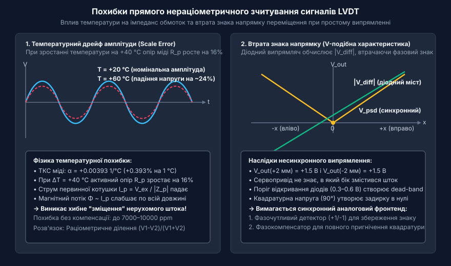
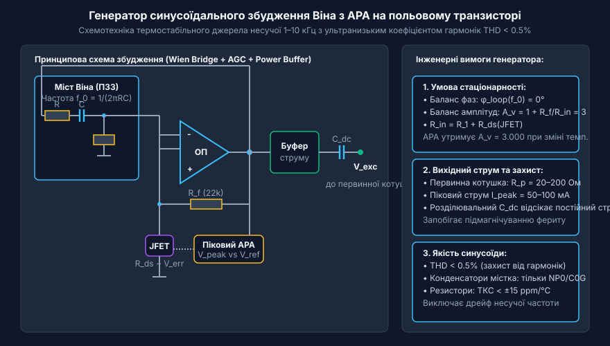
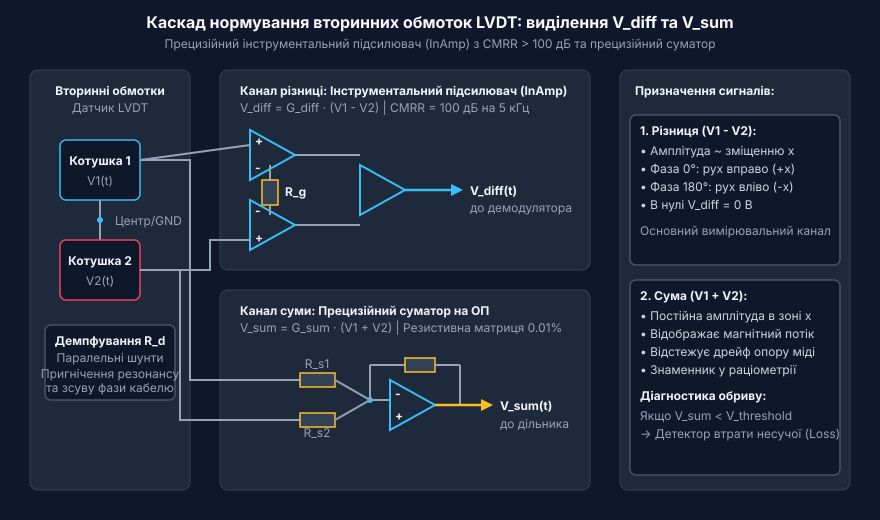
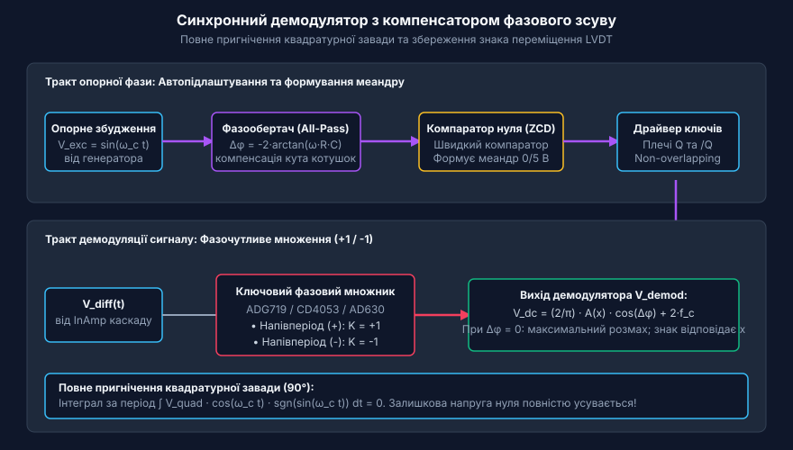
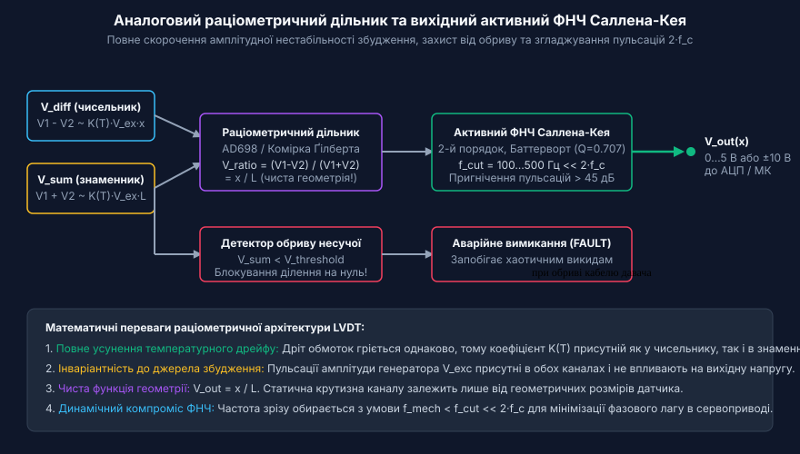

# Аналоговий фронтенд підготовки сигналів LVDT

<preknowlist>
- [Лінійні змінні диференціальні трансформатори LVDT](root:cat-hw-sensors/lvdt-linear-variable-differential-transformers) — фізичний принцип індуктивного перетворення переміщення штока у взаємну індуктивність котушок та виникнення температурного дрейфу опору обмоток.
- [Синхронне детектування та фазочутлива демодуляція давачів положення](root:cat-hw-sensors/synchronous-demodulation-for-inductive-transducers) — теоретичні засади фазочутливого множення змінних сигналів для виділення амплітуди й фазового кута несучої.
- [Спеціалізовані мікросхеми кондиціонування сигналу LVDT](root:cat-hw-sensors/ad698-signal-conditioner) — архітектура монолітних мікросхем кондиціонування сигналів LVDT та вбудовані аналогові дільники напруги.
</preknowlist>

## Проблема прямого зчитування сигналів LVDT

Лінійні змінні диференціальні трансформатори LVDT (@@en|Linear Variable Differential Transformers@@) є базовим інструментом для прецизійного вимірювання лінійних переміщень у важких промислових умовах, авіації та енергетиці. Проте пряме підключення вторинних обмоток LVDT до звичайного амплітудного випрямляча або безпосередньо до входу АЦП мікроконтролера призводить до неприпустимих метрологічних похибок через фундаментальні фізичні обмеження індуктивних систем:

1. **Температурний дрейф опору обмоток (Scale Error)**:
   Обмотки LVDT намотані мідним дротом, який має високий температурний коефіцієнт опору (ТКС): `α = +0.00393` 1/°C. При нагріванні датчика на +40 °C активний опір первинної котушки `R_p` зростає майже на 16%. Оскільки повний імпеданс котушки `Z_p = √(R_p² + (ω L_p)²)` збільшується, струм збудження `I_p = V_ex / |Z_p|` пропорційно зменшується. Це призводить до ослаблення магнітного потоку в сердечнику, і вихідні вторинні напруги падають на 0.7–1.5%, утворюючи систематичну похибку до 7000–10000 ppm навіть за нерухомого штока.

2. **Втрата знака напрямку зміщення**:
   При зміщенні феромагнітного штока вправо вторинна різницева напруга `V_diff = V1 - V2` синфазна з напругою збудження (0°), а при зміщенні вліво — зсувається за фазою на 180°. Звичайний діодний випрямляч чи піковий детектор обчислює абсолютне значення `|V_diff|`, формуючи симетричну V-подібну статичну характеристику. Система втрачає здатність розрізнити зміщення на `+2 мм` від зміщення на `-2 мм`.

3. **Мертва зона та квадратурна напруга в нулі**:
   Пряме падіння напруги на напівпровідникових діодах (0.3–0.6 В) блокує вимірювання малих мікропереміщень. Крім того, паразитна міжвиткова ємність наводить у нейтральній точці залишкову напругу, зсунуту на 90° (квадратурна завада), яка спотворює початкову ділянку шкали.


*Вплив температурного дрейфу струму збудження на амплітуду LVDT та формування V-подібної характеристики при несинхронному детектуванні.*

Для забезпечення мікрометричної точності датчик LVDT потребує спеціалізованого аналогового фронтенду (AFE), який генерує чисту синусоїду збудження, пригнічує синфазні завади, виконує фазочутливу демодуляцію та раціометричне ділення.

## Схемотехніка термостабільного генератора синусоїдального збудження

Формування змінного магнітного поля у первинній обмотці вимагає прецизійного синусоїдального джерела живлення з фіксованою несучою частотою `f_c` (зазвичай від 1 кГц до 10 кГц). Використання прямокутного ШІМ або трикутного сигналу є неприпустимим: вищі гармоніки викликають локальне магнітне насичення феромагнітного осердя, перерозподіляються у фазових детекторах та створюють високочастотні наводки в лініях зв'язку.

Стандартом дискретної схемотехніки є синусоїдальний генератор на основі мосту Віна (@@en|Wien bridge oscillator@@) з колом автоматичного регулювання амплітуди (АРА / AGC):

```
f_0 = 1 / (2 · π · R · C)
```

Для термостабільності частоти резистори `R` обирають металоплівковими з ТКС `< ±15 ppm/°C`, а конденсатори `C` — виключно керамічними NP0/C0G або поліпропіленовими плівковими (використання діелектриків X7R/Y5V заборонено через температурний дрейф ємності).


*Принципова схемотехніка синусоїдального генератора Віна з динамічним JFET-регулюванням коефіцієнта підсилення та потужним буфером струму.*

Для незатухаючої генерації коефіцієнт підсилення операційного підсилювача по напрузі повинен строго дорівнювати `A_v = 3` (`A_v = 1 + R_f / R_in`). Оскільки активні параметри дрейфують від температури, опір `R_in` динамічно коригується каналом польового транзистора (JFET), що працює в омічній області як керований напругою опір `R_ds`. Піковий випрямляч відстежує амплітуду виходу і подає сигнал помилки на затвор JFET, гарантуючи коефіцієнт гармонік THD `< 0.5%`.

Первинна обмотка LVDT має низький опір (20–200 Ом) і споживає струм до 100 мА. Тому вихід ОП посилюється двотактним транзисторним буфером (push-pull). Первинна котушка підключається виключно через розділювальний конденсатор `C_dc`: він блокує постійну складову струму (DC bias), запобігаючи незворотному постійному намагнічуванню феромагнітного штока.

## Нормування вторинних обмоток: виділення сигналів V_diff та V_sum

Вторинні обмотки LVDT генерують низькорівневі змінні сигнали `V1(t)` та `V2(t)`. Вони діють на тлі значної синфазної завади (common-mode voltage), яка наводиться через ємнісний зв'язок між первинною та вторинними котушками, а також лініями промислової мережі.

Для нормалізації сигналів аналоговий фронтенд розділяє тракт на два паралельні канали:
1. **Різницевий канал**: `V_diff(t) = V1(t) - V2(t)` — несе пряму інформацію про амплітуду та знак зміщення штока від нуля.
2. **Сумарний канал**: `V_sum(t) = V1(t) + V2(t)` — у робочій зоні має практично постійну амплітуду, оскільки зростання індуктивності однієї секції врівноважується спадом іншої. Цей сигнал відображає сумарний магнітний потік і використовується як знаменник для температурної нормалізації.


*Схема попереднього підсилення вторинних напруг LVDT на прецизійному інструментальному підсилювачі (InAmp) та суматорі.*

Різницевий сигнал підсилюється трипідсилювальним інструментальним підсилювачем (InAmp). Завдяки вхідним повторювачам він має гігаомний вхідний опір (не навантажує обмотки) та коефіцієнт пригнічення синфазних завад CMRR понад 90–100 дБ на несучій частоті. Масштабний коефіцієнт різниці задається зовнішнім прецизійним резистором `R_g`:

```
G_diff = 1 + (2 · R_f / R_g)
```

Паралельно вторинним обмоткам підключають демпфуючі резистори `R_d`, які шунтують індуктивності розсіювання, запобігаючи резонансним перенапругам та нівелюючи вплив паразитної ємності з'єднувального кабелю. Сумарний канал реалізується на прецизійному інвертуючому суматорі на ОП з резистивною матрицею з допуском 0.01% і ТКС `< 5 ppm/°C`.

## Синхронне детектування та компенсація фазового зсуву обмоток

Через наявність активного опору первинної обмотки `R_p` та індуктивності `L_p` вихідний сигнал вторинних обмоток `V_diff` має власний фазовий зсув `φ_sensor` відносно напруги генератора збудження:

```
tan(φ_sensor) ≈ R_p / (ω_c · L_p)
```

При синхронному детектуванні корисна постійна складова напруги прямо пропорційна косинусу різниці фаз між сигналом давача та опорним сигналом керування ключами:

```
V_dc = (2 / π) · A(x) · cos(φ_sensor - φ_ref)
```

Якщо не компенсувати фазовий зсув датчика (`φ_ref = 0`), вихідний рівень суттєво зменшиться. Ба більше, оскільки опір міді `R_p` дрейфує від температури, фазовий кут `φ_sensor` змінюється, спричиняючи додаткову температурну нестабільність коефіцієнта передачі.


*Структурна схема синхронного детектора: активний фазообертач All-Pass, компаратор нуля ZCD та комутований каскад множення (+1/-1).*

Для розв'язання цієї проблеми в аналоговий тракт вмикають активний фазообертач (All-Pass Filter). Він зсуває фазу опорного синуса від 0° до -180° без зміни амплітуди:

```
Δφ = -2 · arctan(2 π f_c · R_comp · C_comp)
```

Під час регулювання резистора `R_comp` фазу опорного сигналу вирівнюють точно з фазою вторинного сигналу (`φ_ref = φ_sensor`), досягаючи `cos(0) = 1` та максимальної крутизни перетворення. Швидкий компаратор формує з підлаштованого синуса меандр 0/5 В для керування комутатором (ADG719 чи CD4053).

Комутатор поперемінно вмикає коефіцієнт підсилення `+1` та `-1`. Це забезпечує повне знакочутливе двопівперіодне випрямлення: при `x > 0` вихід позитивний, при `x < 0` — негативний. При цьому паразитна квадратурна складова (90°), яка утворюється ємністю кабелю та несиметрією втрат сердечника, повністю інтегрується за період до нуля, ліквідуючи залишкову напругу нуля.

## Раціометричний метод обчислення та вихідна фільтрація

Навіть після ідеального синхронного детектування напруга вторинних обмоток залишається пропорційною амплітуді струму збудження та температурному коефіцієнту магнітного зв'язку `K(T)`. Будь-яке коливання живлення генератора чи прогрів котушок спотворює масштабування вимірювача.

Для досягнення абсолютної інваріантності застосовують раціометричне ділення (від лат. *ratio* — відношення):

```
V_out = (V1 - V2) / (V1 + V2)
      = (K(T) · V_exc · x) / (K(T) · V_exc · L)
      = x / L
```

Оскільки обидві вторинні секції намотані на спільному каркасі, температурні зміни та коливання амплітуди `V_exc` однаково присутні в чисельнику і знаменнику, тому вони повністю математично скорочуються. Вихідний сигнал залежить виключно від геометрії переміщення штока `x` відносно довжини ходу `L`.


*Аналоговий дільник різниці на суму напруг з детектором обриву несучої та вихідним активним ФНЧ Саллена-Кея другого порядку.*

У спеціалізованих мікросхемах, таких як [чип AD698](root:cat-hw-sensors/ad698-signal-conditioner), ділення реалізоване апаратно за допомогою логарифмічних комірок Ґілберта. Для запобігання діленню на нуль при обриві кабелю або відмові генератора до схеми додають компаратор втрати несучої (Carrier Loss Detector): якщо сума `V1 + V2` падає нижче безпечного порогу, формується сигнал FAULT.

Після детектування та ділення сигнал містить корисну постійну складову та пульсації на подвоєній несучій частоті `2 · f_c`. Для їхнього згладжування використовують активний фільтр нижніх частот Саллена-Кея 2-го порядку з характеристикою Баттерворта (`Q = 0.707`):

```
f_cutoff = 1 / (2 · π · √(R1 · R2 · C1 · C2))
```

Частоту зрізу обирають у діапазоні 100–500 Гц (`f_mech < f_cutoff << 2 · f_c`), що забезпечує пригнічення пульсацій подвоєної несучої більш ніж на 45 дБ при фазовому запізненні менше 2–5 мс.

Нижче наведено приклад обчислення параметрів фільтра Саллена-Кея на мові C:

```c
#include <stdio.h>
#include <math.h>

typedef struct {
    double r1;
    double r2;
    double c1;
    double c2;
    double f_cutoff;
    double q_factor;
} SallenKeyFilter;

// Розрахунок компонентів активного фільтра Саллена-Кея Баттерворта 2-го порядку
int calculate_sallen_key_butterworth(double target_f_cut_hz, double c_val_farads, SallenKeyFilter *out_filter) {
    if (target_f_cut_hz <= 0.0 || c_val_farads <= 0.0) {
        return -1;
    }

    // Для добротності Баттерворта Q = 1/sqrt(2) = 0.7071 обираємо співвідношення:
    // C1 = 2 * C2 при однакових резисторах R1 = R2 = R
    out_filter->c2 = c_val_farads;
    out_filter->c1 = 2.0 * c_val_farads;

    // R = 1 / (2 * pi * f_cut * sqrt(C1 * C2)) = 1 / (2 * pi * f_cut * C2 * sqrt(2))
    double r_val = 1.0 / (2.0 * M_PI * target_f_cut_hz * c_val_farads * sqrt(2.0));
    out_filter->r1 = r_val;
    out_filter->r2 = r_val;

    out_filter->f_cutoff = 1.0 / (2.0 * M_PI * sqrt(out_filter->r1 * out_filter->r2 * out_filter->c1 * out_filter->c2));
    out_filter->q_factor = sqrt(out_filter->r1 * out_filter->r2 * out_filter->c1 * out_filter->c2) / 
                           (out_filter->c2 * (out_filter->r1 + out_filter->r2));

    return 0;
}
```

Використання завершеного аналогового фронтенду забезпечує високу термостабільність, нульову мертву зону та повну завадостійкість LVDT у промислових сервоприводах.
