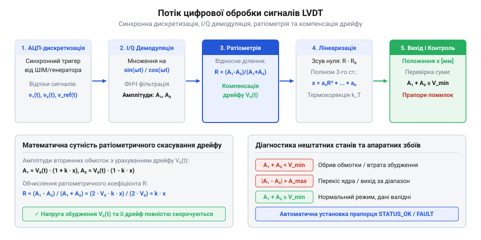
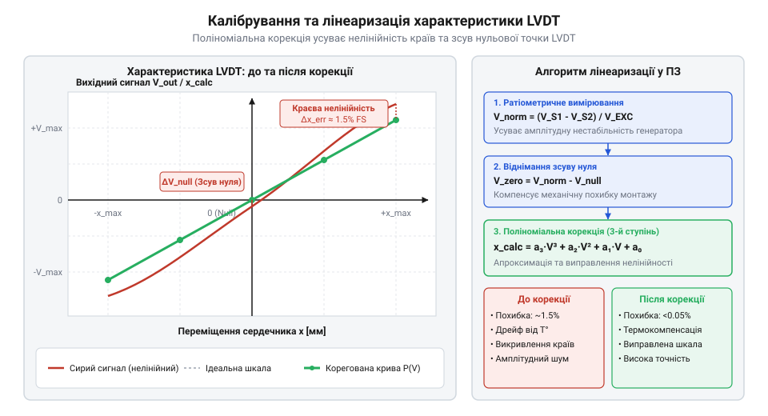

# Програмний інтерфейс обробки та калібрування LVDT у мікроконтролері

<preknowlist>
- [Сельсини та резольвери: обертові трансформаторні кутоміри](root:cat-hw-sensors/synchro-and-resolver-transducers) — Принцип індуктивного трансформаторного перетворення та вимірювання амплітуди обмоток збудження.
</preknowlist>

## Помилки прямого вимірювання сигналів LVDT

Вимірювання лінійного переміщення за допомогою LVDT (@@en|Linear Variable Differential Transformer@@, від лат. *transformare* — перетворювати) у вбудованих системах часто починається зі спроби прямого зчитування амплітуд вторинних обмоток. Інженер подає змінний сигнал на первинну обмотку, випрямляє вихідні напруги вторинних обмоток за допомогою діодних детекторів або вимірює їх пікові значення аналогово-цифровим перетворювачем (@@en|analog-to-digital converter@@, АЦП). Однак такий прямий підхід спричиняє значні системні похибки, через які точність вимірювання падає в рази під час зміни зовнішніх умов. Для детального вивчення схемотехніки генераторів збудження, підсилювачів та фільтрів нормалізації сигналів перед АЦП перегляньте матеріал про [аналоговий фронтенд підготовки сигналів LVDT](root:cat-hw-sensors/lvdt-analog-front-end).

Перша джерельна причина похибки полягає у температурній залежності опору обмоток датчика. Первинна та вторинні котушки LVDT намотані мідним дротом, температурний коефіцієнт опору якого становить приблизно `0.00393 K⁻¹`. Під час нагрівання обмотки на 40 °C її електричний опір зростає майже на 16%. Зміна повного імпедансу первинного кола `Z_{pri} = R_{pri} + j ω L_{pri}` викликає зменшення струму збудження. Як наслідок, амплітуда магнітного потоку в сердечнику падає, і напруги на виході обох вторинних обмоток `U_{S1}` та `U_{S2}` зменшуються, навіть якщо рухомий феромагнітний шток залишається абсолютно нерухомим. Для мікроконтролера це виглядає як хибне переміщення штока.

Друга проблема пов'язана з нестабільністю самої напруги збудження `U_{EXC}`. Якщо генератор опорного сигналу має дрейф амплітуди на 1–2% через нестабільність живлення або температурний дрейф ЦАП, вихідні напруги вторинних обмоток пропорційно змінюються на ті ж 1–2%. При прямому вимірюванні амплітуди неможливо відрізнити фізичний зсув штока від коливань напруги живлення генератора.

Третя перешкода — це фазовий зсув між струмом збудження та вихідними напругами вторинних обмоток, а також поява залишкової напруги нуля (@@en|null voltage@@, від лат. *nullus* — ніякий). Через індуктивність котушок і втрати на вихрові струми у феромагнітному штоку вихідний сигнал зсунутий за фазою відносно опорного генератора. Крім того, міжобмоткові паразитні ємності (@@en|parasitic capacitance@@) та конструктивна асиметрія створюють ємкісні струми витоку. У результаті навіть у точці електричного нуля, коли різниця основних індуктивних напруг дорівнює нулю, на виході залишається квадратурна компонента (@@en|quadrature component@@, від лат. *quadratura* — квадратність, зсув на чверть періоду). Звичайне аналогове випрямлення або неузгоджена за часом дискретизація вимірює загальну амплітуду сумарного сигналу, сприймаючи цю залишкову напругу як хибний зсув штока й утворюючи нелінійну «зону засліплення» біля нуля. До того ж таке вимірювання втрачає інформацію про знак фази, через що система не здатна визначити, у який саме бік від нульової точки змістився шток, оскільки модуль різниці напруг `|U_{S1} - U_{S2}|` є симетричним по обидва боки.

На відміну від цифрових пристроїв, таких як [енкодери кутового та лінійного](root:cat-hw-sensors/optical-and-magnetic-encoders) переміщення, вихідний сигнал LVDT є неперервною аналоговою величиною, чутливою до будь-яких фазових та амплітудних спотворень. Щоб усунути дрейф живлення, температурну нестабільність міді та однозначно визначати напрямок руху, прошивка мікроконтролера має застосовувати синхронну ратіометричну обробку сигналів.

## Синхронна ратіометрична демодуляція та обчислення

Щоб позбутися залежності від амплітуди збудження та температурного змінення опору обмоток, у мікроконтролері реалізують ратіометричний (@@en|ratiometric calculation@@, від лат. *ratio* — відношення) алгоритм. Вторинні напруги `U_{S1}` та `U_{S2}` пропорційні амплітуді збудження `U_{EXC}`, температурному коефіцієнту передачі `k_{temp}` та зміщенню штока `x`:

```
U_S1 = k_temp · U_EXC · (1 + k · x) · cos(ω t + φ)
U_S2 = k_temp · U_EXC · (1 - k · x) · cos(ω t + φ)
```

де `k` — конструктивна чутливість датчика, `ω` — кругова частота збудження, `φ` — фазовий зсув.

Замість аналізу окремих напруг прошивка обчислює різницю та суму сигналів вторинних обмоток. У ратіометричному відношенні різниці до суми амплітуда збудження та температурний коефіцієнт повністю скорочуються:

```
U_diff = U_S1 - U_S2
       = 2 · k_temp · U_EXC · k · x · cos(ω t + φ)     [різниця вторинних напруг]
U_sum  = U_S1 + U_S2
       = 2 · k_temp · U_EXC · cos(ω t + φ)             [сума вторинних напруг]
V_ratio = U_diff ÷ U_sum
        = (2 · k_temp · U_EXC · k · x) ÷ (2 · k_temp · U_EXC)  [скорочення спільних множників]
        = k · x                                         [нормований ратіометричний сигнал]
```

Результат `V_{ratio}` залежить виключно від положення штока `x` та постійного коефіцієнта чутливості `k`. Оскільки зміна температури або напруги живлення однаково змінює і чисельник `U_{diff}`, і знаменник `U_{sum}`, підсумкове значення залишається незмінним. За принципом трансформаторного зв'язку [обертові трансформаторні кутоміри](root:cat-hw-sensors/synchro-and-resolver-transducers) використовують подібну математику синхронної демодуляції, проте LVDT вимірює лінійне зміщення штока за допомогою двох симетричних секцій.

Виділення значень `U_{S1}` та `U_{S2}` здійснюється за допомогою синхронної демодуляції (@@en|synchronous demodulation@@, від грец. *syn* — разом, *chronos* — час та лат. *demodulatio* — скасування модуляції). АЦП здійснює дискретизацію вихідних сигналів строго синхронно з піками синусоїди збудження (`ω · t + φ = 0, 2π...`). Якщо дискретизація виконується з високою частотою, застосовують цифрове множення аналогових відліків `U_S[n]` на дискретні синфазну (@@en|in-phase@@, `I`) та квадратурну (@@en|quadrature@@, `Q`, від лат. *quadratura* — надання квадратної форми) опорні функції:

```
I[n] = U_S[n] · cos(ω · n · T_s)      [перемноження відліку на синфазний опорний косинус]
Q[n] = U_S[n] · sin(ω · n · T_s)      [перемноження відліку на квадратурний опорний синус]
```

Тут `U_S[n]` — значення відліку напруги вторинної обмотки в дискретний момент часу `n`, `T_s` — період дискретизації АЦП, а `ω` — кругова частота збудження. Знак синфазного компонента `I` визначає напрямок зміщення штока відносно нуля. Для придушення подвоєної частоти несучої `2 · ω` отримані послідовності `I[n]` та `Q[n]` пропускають через цифровий ФНЧ (@@en|low-pass filter@@). Частоту зрізу фільтра `f_c` обирають значно меншою за частоту збудження `f_{exc}` (`f_c << f_{exc}`), що забезпечує придушення гармонік несучої щонайменше на `40` dB при збереженні смуги пропускання механічного переміщення штока та мінімальної групової затримки (@@en|group delay@@).


*Послідовний конвеєр перетворення аналогових відліків LVDT у ратіометричну величину положення.*

## Ініціалізація та конфігурація драйвера LVDT

Для забезпечення високої точності дискретизація АЦП повинна бути жорстко прив'язана до гармонійного сигналу збудження. Апаратний таймер мікроконтролера генерує ШІМ або керує ЦАП для формування синусоїди збудження, і цей же таймер через подію тригера (TRGO) запускає подвійне одночасне перетворення АЦП для каналів `S1` та `S2`. Отримані відліки передаються в оперативну пам'ять за допомогою прямого доступу до пам'яті (@@en|direct memory access@@, DMA), мінімізуючи навантаження на процесорне ядро.

Програмний інтерфейс драйвера LVDT будується навколо конфігураційних структур та дескриптора стану. Структура `lvdt_config_t` задає частоту збудження, кількість відліків АЦП на період та діагностичні пороги, а структура `lvdt_calibration_t` містить калібрувальні коефіцієнти.

:::tabs
@tab c|stm32
:::code api-lvdt-dsp-firmware-interface/c/stm32/lvdt-init.c
@tab cpp|stm32
:::code api-lvdt-dsp-firmware-interface/cpp/stm32/lvdtdriver.cpp
:::

Після виклику `lvdt_init()` мікроконтролер налаштовує переривання АЦП або DMA-обробник, у якому за кожним завершеним періодом дискретизації обчислюються поточні значення амплітуд `U_{S1}` та `U_{S2}`.

## Калібрування нульової точки та лінеаризація

Механічний нуль системи рідко збігається з ідеальним електричним нулем LVDT через технологічні допуски під час монтажу. Точка електричного нуля (@@en|null point@@) відповідає стану, коли `U_{S1} = U_{S2}` і ратіометричне значення дорівнює нулю. Для компенсації механічного зміщення застосовують процедуру калібрування нуля `lvdt_calibrate_zero()`, яка фіксує поточне значення ратіо як зміщення `V_{zero}`.

Окрім зміщення нуля, реальна характеристика LVDT має крайову нелінійність. На кінцях робочого ходу штока частина магнітного потоку розсіюється в повітря, через що лінійна залежність викривляється. Для відновлення точності по всьому діапазону застосовують поліноміальну лінеаризацію (@@en|polynomial linearization@@) 3-го степеня.

Обчислення підсумкового фізичного переміщення в міліметрах відбувається за покроковою схемою:

```
x_raw = (V_ratio - V_zero) · K_scale                   [первинне масштабування в мм]
term0 = c0                                             [нульовий член полінома]
term1 = c1 · x_raw                                     [лінійний член полінома]
term2 = c2 · x_raw · x_raw                             [квадратичний член полінома]
term3 = c3 · x_raw · x_raw · x_raw                     [кубічний член полінома]
x_lin = term0 + term1 + term2 + term3                  [підсумкова лінеаризована позиція]
```

Як і коли створюють [датчики кутового положення сервоприводів](root:cat-hw-sensors/servo-feedback-potentiometers-and-magnetic-encoders), калібрування нуля та масштабного коефіцієнта виконується за схожими методиками фіксації крайніх та нульових точок.


*Корекція нелінійної характеристики LVDT за допомогою полінома 3-го степеня для отримання лінійного відгуку штока.*

Нижче наведено реалізацію функцій калібрування та обчислення позиції:

:::tabs
@tab c|stm32
:::code api-lvdt-dsp-firmware-interface/c/stm32/lvdt-calibrate-zero.c
@tab cpp|stm32
:::code api-lvdt-dsp-firmware-interface/cpp/stm32/snippet-4.cpp
:::

## Діагностика несправностей та обробка помилок

Надійність систем автоматичного керування вимагає постійного програмного моніторингу стану LVDT. На відміну від цифрових мікросхем, де [магнітний енкодер кута AS5048](root:cat-hw-sensors/as5048-magnetic-encoder) має вбудовані регістри діагностики магнітного поля, для LVDT усі перевірки цілісності виконуються програмно на основі обчислених амплітуд та ратіометричного відношення.

Алгоритм діагностики реалізує перевірку трьох основних аварійних станів:

1. Втрата сигналу збудження або обрив первинної обмотки (@@en|open circuit@@). Якщо сума напруг `U_{sum} = U_{S1} + U_{S2}` стає меншою за фіксований поріг `min_sum_threshold`, це свідчить про відсутність струму в первинній котушці або вихід з ладу генератора збудження. 2. Обрив вторинної обмотки або асиметрія каналів. Якщо одна з напруг `U_{S1}` або `U_{S2}` падає до нуля при наявності сигналу на іншій, чи якщо модуль розрахованого ратіо перевищує фізичну межу `|V_{ratio}| > max_ratio_limit`, прошивка фіксує апаратно несправну обмотку. 3. Вихід штока за межі робочого діапазону (@@en|out of range@@). Якщо обчислена лінійна позиція `x_{linear}` виходить за межі `[X_{min}, X_{max}]`, механічна тяга обойми пошкоджена або виникло механічне заклинювання.

Функція `lvdt_get_status()` повертає поточну бітову маску помилок для швидкого опитування у системному циклі:

:::tabs
@tab c|stm32
:::code api-lvdt-dsp-firmware-interface/c/stm32/lvdt-get-status.c
@tab cpp|stm32
```cpp|stm32
// Метод перевірки прапорців помилок у C++
uint32_t getFaultMask(const LvdtDriver::Config& config, 
                      LvdtDriver::Status status, 
                      float last_raw_ratio) {
    uint32_t mask = 0;
    if (status == LvdtDriver::Status::ExcitationLost) {
        mask |= (1U << 0);
    }
    if (last_raw_ratio > config.max_ratio_limit || last_raw_ratio < -config.max_ratio_limit) {
        mask |= (1U << 1);
    }
    return mask;
}
```
:::

У разі виявлення будь-якого аварійного прапорця виконавець прошивки повинен перевести виконавчі механізми у безпечний стан та згенерувати переривання помилки.