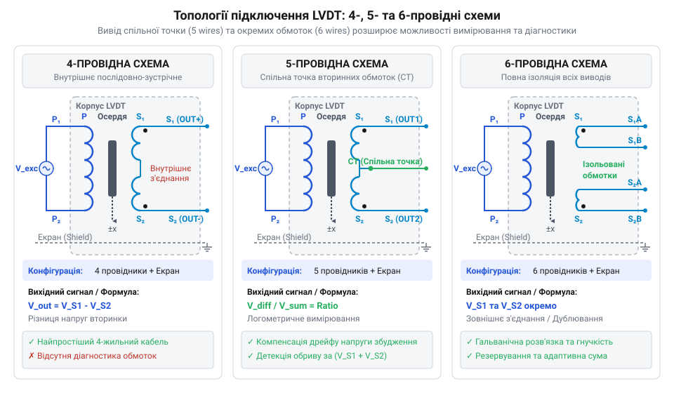
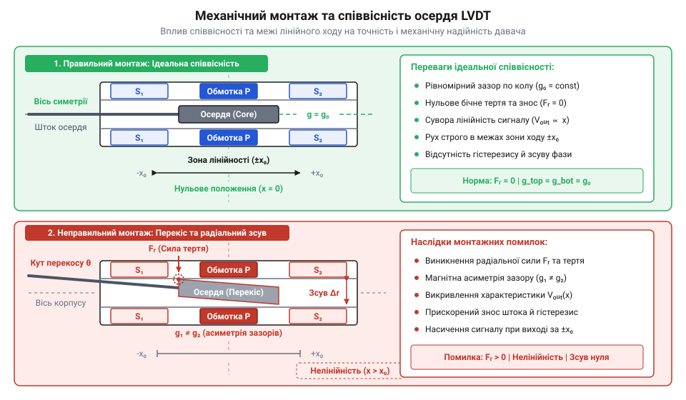

# Електричний та механічний інтерфейс підключення давачів LVDT

<preknowlist>
- [Сельсини та резольвери: обертові трансформаторні кутоміри](root:cat-hw-sensors/synchro-and-resolver-transducers) — принцип трансформаторного зняття сигналу на змінному струмі та фазочутливого визначення положення.
</preknowlist>

## Паразитні наводки та механічне заклинювання

Точне вимірювання лінійного переміщення у промислових системах — від важких гідроциліндрів до прецизійних випробувальних пресів — вимагає високої надійності в умовах вібрацій, пилу та електромагнітних завад. Намагаючись вирішити це завдання за допомогою традиційних [потенціометричних датчиків](root:cat-hw-sensors/servo-feedback-potentiometers-and-magnetic-encoders), інженер швидко зіштовхується з обмеженнями фізичного контакту: ковзний контакт (@@en|wiper contact@@) зношується, створює контактне шумування та швидко виходить з ладу під дією вібраційних навантажень. 

Давач LVDT (@@en|Linear Variable Differential Transformer@@ (від англ. *linear* — лінійний, *variable* — змінний, *differential* — диференціальний, *transformer* — трансформатор)) позбавлений механічного зносу, оскільки базується на безконтактному трансформаторному зв'язку. Подібно до того, як працюють [обертові трансформатори](root:cat-hw-sensors/synchro-and-resolver-transducers), вимірювання положення в LVDT спирається на зміну коефіцієнта взаємоіндукції між обмотками при зсуві рухомого феромагнітного осердя (@@en|core@@).

Проте помилкове сприйняття LVDT як звичайного резистивного чи аналогового давача постійного струму (@@en|DC@@) призводить до непрацездатності всієї вимірювальної системи. Якщо подати на первинну обмотку (@@en|primary winding@@) постійну напругу, індуктивний зв'язок з вторинними обмотками (@@en|secondary windings@@) буде відсутній, і вихідний сигнал дорівнюватиме нулю. LVDT є суто пристроєм змінного струму (@@en|AC@@), який вимагає високостабільного синусоїдального збудження.

Підключення LVDT без урахування фазових параметрів та симетрії викликає серйозні спотворення. Будь-яка асиметрія у з'єднанні вторинних кіл створює зсув фази (@@en|phase shift@@) між збудженням та вихідним сигналом, а також спричиняє температурний дрейф нульової точки. З механічного боку, недотримання співвісності при монтажі осердя (@@en|core@@) відносно внутрішньої гільзи корпусу призводить до появи радіальних сил. Осердя починає тертися об стінки, викликаючи механічний гістерезис (@@en|hysteresis@@), прискорене зношування та механічне заклинювання (@@en|jamming@@) штока. Для коректної роботи LVDT необхідне суворе дотримання як електричної топології обмоток, так і механічних допусків монтажу.

## Топології 4-, 5- та 6-провідних обмоток

Електрична схема LVDT складається з однієї первинної обмотки (@@en|primary winding@@), на яку подається напруга збудження, та двох вторинних обмоток (@@en|secondary windings@@) `S1` і `S2`, розташованих симетрично по боках від первинної. Залежно від того, як вторинні обмотки з'єднані всередині корпусу давача та скільки провідників виведено на зовнішній роз'єм, розрізняють 4-, 5- та 6-провідні топології.


*Електрична топологія підключення обмоток LVDT у 4-, 5- та 6-провідних виконаннях.*

У 4-провідній топології (@@en|4-wire topology@@) вторинні обмотки з'єднані всередині датчика послідовно-зустрічно (@@en|series-opposing connection@@). На зовнішній кабель виводяться два провідники первинної обмотки та два провідники вторинного кола. Вихідна напруга являє собою безпосередньо диференціальну напругу:

```
V_out = V_S1 - V_S2
```

Головною перевагою 4-провідної схеми є мінімальна кількість жил у кабелі та простота комутації. Однак така топологія не дозволяє виміряти напругу кожної вторинної обмотки окремо. Якщо амплітуда джерела збудження плаває або змінюється температура навколишнього середовища, вихідна напруга дрейфує разом із ними, оскільки кондиціонер сигналу (@@en|signal conditioner@@) не має змоги нормувати вихідний сигнал відносно сумарної напруги обмоток.

5-провідна топологія (@@en|5-wire topology@@) вирішує цю проблему шляхом виведення середньої точки з'єднання вторинних обмоток назовні у вигляді центрального відводу (@@en|center tap@@). Кабель містить два провідники первинної обмотки, два виводи країв вторинних обмоток та один провідник центрального відводу, який слугує спільною точкою відліку. Це дозволяє кондиціонеру сигналу (@@en|signal conditioner@@) вимірювати напруги `V_S1` та `V_S2` незалежно й застосовувати відноснометричну демодуляцію (@@en|ratiometric demodulation@@). Розрахунок нормованого сигналу здійснюється за формулою:

```
R = (V_S1 - V_S2) / (V_S1 + V_S2)
```

Завдяки діленню різниці напруг на їхню суму, коефіціент `R` стає повністю незалежним від нестабільності напруги збудження та температурної зміни активного опору мідного провідника обмоток. Докладніше про апаратну реалізацію цього принципу та побудову фазочутливих демодуляторів читайте у статті про [інтегральні кондиціонери сигналу LVDT на прикладі AD698](root:cat-hw-sensors/ad698-signal-conditioner).

6-провідна топологія (@@en|6-wire topology@@) забезпечує повну електричну ізоляцію всіх обмоток. Первинна обмотка та кожна з двох вторинних обмоток мають по два власні виводи. Така схема дає максимальну гнучкість під час підключення до спеціалізованих вимірювальних систем, дозволяючи будувати мостові та диференціальні схеми зчитування без утворення спільних шин заземлення між первинним та вторинними колами.

## Електричні межі збудження та заземлення

Для забезпечення лінійної трансформації переміщення в електричний сигнал первинна обмотка (@@en|primary winding@@) LVDT має живитися чистою синусоїдальною напругою. Типовий діапазон амплітуди напруги збудження становить від 1 до 10 В RMS (@@en|RMS@@ (від англ. *Root Mean Square* — середньоквадратичне значення)). Подача напруги, що перевищує верхню межу, призводить до магнітного насичення феромагнітного осердя (@@en|core@@), перегріву первинної обмотки та викривлення форми хвилі.

Робоча частота носійної (@@en|carrier frequency@@) збудження лежить у межах від 400 Гц до 10 кГц (найчастіше застосовують 1 кГц, 2.5 кГц або 5 кГц). Вибір частоти визначається динамікою механічного процесу: частота збудження повинна щонайменше у 10 разів перевищувати максимальну частоту механічних коливань штока. На відміну від [оптичних енкодерів](root:cat-hw-sensors/optical-and-magnetic-encoders), які видають готові цифрові імпульси, аналоговий вихід LVDT вимагає фазочутливої демодуляції, швидкість якої обмежена частотою збудження.

Первинна обмотка володіє комплексним імпедансом (@@en|impedance@@), який складається з активного опору дрітової обмотки `R_pri` та індуктивного опору `X_L`. Приклад обчислення повного імпедансу для частоти збудження `f_exc = 2500 Гц`, активного опору `R_pri = 120 Ом` та індуктивності `L_pri = 15 мГн`:

```
X_L = 2 · π · f_exc · L_pri
    = 2 · 3.14159 · 2500 · 0.015       [індуктивний опір обмотки]
    = 235.62 Ом

Z_pri = √(R_pri² + X_L²)
      = √(120² + 235.62²)               [теорема Піфагора для імпедансу]
      = √(14400 + 55516.78)
      = 264.42 Ом
```

Отже, джерело збудження в кондиціонері сигналу (@@en|signal conditioner@@) повинне мати низький вихідний імпеданс і бути здатним віддавати струм `I_exc = V_exc / Z_pri` без спотворення синусоїди.

Слабкі амплітуди вторинних обмоток (одиниці мілівольт у поблизу нуля) роблять LVDT чутливим до зовнішніх електромагнітних завад (@@en|EMI@@). Для захисту сигналу використовують екрановану кручену пару (@@en|shielded twisted pair@@). У порівнянні з [магнітними енкодерами](root:cat-hw-sensors/as5048-magnetic-encoder), де цифровий інтерфейс передає дані по завадостійких лініях, аналоговий кабель LVDT вимагає жорсткого дотримання правил заземлення.

Головне правило заземлення екрана кабелю (@@en|cable shield@@) — підключення до точки заземлення **ЛИШЕ В ОДНІЙ ТОЧЦІ** (@@en|single-point grounding@@), зазвичай з боку кондиціонера сигналу (@@en|signal conditioner@@). Екран з боку датчика залишають ізольованим і незадієним. Приєднавши екран з двох боків, ви створюєте замкнений контур заземлення (@@en|ground loop@@). Через різницю потенціалів між корпусом обладнання та шасі контролера цим контуром підуть зрівнювальні струми промислової частоти 50 Гц, які індукують високий рівень завад у вимірювальних жилах.

## Механічний монтаж і зона лінійності

Точність та довговічність вимірювального вузла LVDT безпосередньо залежать від якості механічної інтеграції осердя (@@en|core@@) у корпусі давача. Для правильної експлуатації необхідно враховувати межі зони лінійності, правильно виставляти нульову позицію та контролювати співвісність.


*Механічна схема встановлення осердя LVDT із зонами лінійності та контролем співвісності.*

Номінальна зона лінійності (@@en|Nominal Linear Range@@, NLR) визначає діапазон ходу осердя, у межах якого вихідна напруга строго пропорційна переміщенню з нормованою похибкою (зазвичай ±0.1% – ±0.5%). Якщо осердя виходить за межі NLR, магнітне охоплення обмоток порушується: амплітуда вихідного сигналу починає нелінійно заплощуватися, а чутливість стрімко падає.

Геометричний центр давача називається нульовим положенням (@@en|Null Position@@). У цій точці осердя знаходиться строго симетрично відносно вторинних обмоток `S1` і `S2`, за рахунок чого амплітуди напруг на них однакові (`V_S1 = V_S2`), а диференціальна напруга `V_out = 0`. При переході осердя через нуль фаза вихідного сигналу `V_out` відносно напруги збудження змінюється на 180°. Саме зміна фази дозволяє кондиціонеру сигналу (@@en|signal conditioner@@) визначати напрямок зсуву штока відносно центру.

Найпоширенішою механічною помилкою при монтажі є порушення співвісності (@@en|coaxiality@@) між осердям (@@en|core@@) та внутрішньою направляючою гільзою (@@en|bore sleeve@@) корпусу. Радіальний зазор між осердям і стінкою гільзи становить лише 0.1–0.4 мм. У разі кутового або радіального перекосу виникає бічна сила (@@en|radial force@@), яка притискає осердя до стінки. Це викликає:

1. Механічний гістерезис (@@en|hysteresis@@) та затримку показників при зміні напрямку руху. 2. Прискорене зношування тефлонового або бронзового покриття гільзи. 3. Заклинювання (@@en|jamming@@) штока під час швидких зворотньо-поступальних рухів.

Для усунення радіальних навантажень осердя кріплять до рухомого об'єкта через гнучку муфту (@@en|flexible coupling@@) або шарнірний наконечник (@@en|rod end bearing@@), які компенсують кутові та радіальні неспіввісності.

## Виявлення та усунення інтерфейсних несправностей

Деградація контактів, механічні зсуви чи електромагнітні завади призводять до спотворення показників LVDT. Для швидкої діагностики апаратного інтерфейсу використовують мультиметр (@@en|multimeter@@) та двоканальний осцилограф (@@en|oscilloscope@@) за наступним алгоритмом:

```
1. Вимірювання опору обмоток (Мультиметр)
   ├── Відключити LVDT від кондиціонера сигналу.
   ├── Виміряти R_pri (первинна) та R_S1, R_S2 (вторинні).
   └── Перевірити симетрію: |R_S1 - R_S2| / R_S1 < 0.02.
       ├── R = ∞  => Обрив обмотки (open circuit).
       └── R ≈ 0  => Міжвиткове коротке замикання.

2. Перевірка сигналу збудження (Осцилограф)
   ├── Підключити щуп до виводів первинної обмотки під навантаженням.
   ├── Перевірити амплітуду (1–10 В RMS) та частоту f_exc (400 Гц – 10 кГц).
   └── Переконатися у відсутності викривлення синусоїди.

3. Оцінка нульового положення та залишкової напруги (Осцилограф)
   ├── Встановити осердя у Null Position (V_out мінімальна).
   ├── Перевірити симетрію амплітуд V_S1 та V_S2 і протилежність фаз (180°).
   └── Виміряти залишкову напругу (null voltage).
       └── Високий рівень null voltage => наявність квадратурної складової
           (quadrature component) через вищі гармоніки збудження або EMI.

4. Діагностика механічного перекосу та ходу
   ├── Плавно переміщувати осердя вздовж усього робочого ходу.
   └── Переконатися у відсутності ступенів, стрибків або гістерезису.
       └── Стрибки амплітуди => механічне заклинювання (jamming) осердя.

5. Контроль екранування кабелю
   ├── Перевірити цілісність екрана кабелю (cable shield).
   └── Переконатися, що екран заземлений лише з одного боку.
       └── Наявність 50 Гц завади => контур заземлення (ground loop).
```

Під час вимірювання активного опору обмоток мультиметром (@@en|multimeter@@) значення `R_S1` та `R_S2` повинні збігатися з точністю до 1–2%. Якщо спостерігається значна розбіжність опорів або повний обрив обмотки (@@en|open circuit@@), датчик підлягає заміні.

Під час перевірки на осцилографі (@@en|oscilloscope@@) особливу увагу звертають на залишкову напругу нуля (@@en|null voltage@@). Якщо в нульовій точці (@@en|Null Position@@) диференційна напруга не опускається нижче 1% від повного шкального значення, це свідчить про наявність квадратурної складової (@@en|quadrature component@@) або вищих гармонійних спотворень (@@en|harmonic distortion@@) у синусоїді збудження.

За наявності фазового зсуву або квадратурної напруги кондиціонер сигналу (@@en|signal conditioner@@) не може коректно занулити вихідний сигнал, що вимагає переналаштування фазокомпенсуючого кола або заміни джерела збудження.