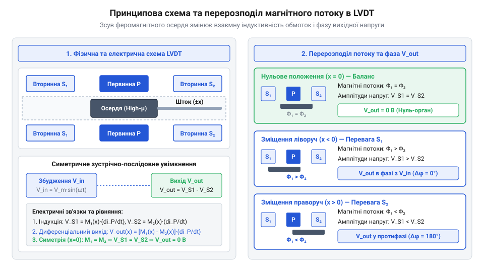
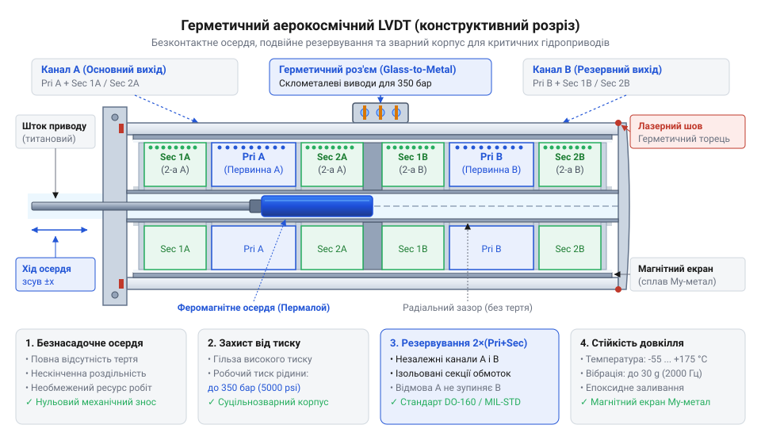

# Історія створення та еволюції LVDT: від індуктивних мостів до аерокосмічних стандартів

<preknowlist>
- [Сельсини та резольвери: обертові трансформаторні кутоміри](root:cat-hw-sensors/synchro-and-resolver-transducers) — Базові принципи електромагнітної індукції у трансформаторних вимірювальних приладах та фазові співвідношення змінного струму.
- [Енкодери кутового та лінійного переміщення](root:cat-hw-sensors/optical-and-magnetic-encoders) — Розуміння концепцій дискретного вимірювання переміщення та відмінностей між аналоговими й цифровими давачами.
</preknowlist>

## Обмеження механічних індикаторів у випробуваннях

У 1930-х роках швидкий розвиток швидкісної авіації, важкої артилерії та турбобудування поставив перед інженерами критичну проблему: як вимірювати мікроскопічні деформації та зсуви конструктивних елементів під час динамічних випробувань. Конструкторам літаків потрібно було спостерігати за вигином крила у вітровому тунелі, а металургам — вимірювати теплове розширення деталей під навантаженням. 

Тогочасна вимірювальна техніка спиралася на два основні інструменти: механічні індикатори годинникового типу та ранні дротові @@de|тензометри@@ (від нім. *Tensometer*, з лат. *tensus* — натягнутий та грецького *metron* — міра). Обидва рішення в умовах високих навантажень і вібрацій виявилися непридатними для точних випробувань.

Механічний індикатор працює за допомогою системи зубчастих коліс та важелів, що перетворюють малий зсув щупа у поворот стрілки на циферблаті. Ця конструкція містить неминучий механічний люфтовий проміжок між зубцями та вимагає постійного притискання щупа до досліджуваного об'єкта. Під час вібраційних випробувань щуп підстрибував і втрачав контакт із поверхнею, а інерція масивних зубчастих коліс спотворювала показання. Постійне сухе тертя в направляючих спричиняло швидкий знос деталей, через що прилад втрачав точність уже після кількох годин інтенсивної роботи.

Дротові @@de|тензометри@@, які кріпилися безпосередньо до поверхні органу випробувань, усували проблему інерції, проте створювали власні виклики. Ранні дротові елементи мали вкрай малу зміну опору під деформацією, що вимагало високочутливих підсилювачів, яких на той час ще не існувало. Крім того, клейові з'єднання деградували від вологості й температури, а самі дроти часто обривалися при перевищенні допустимого діапазону зсуву.

Для систем зворотного зв'язку за положенням інженери пробували використовувати контактні потенціометри, проте їхні повзунки швидко стирали резистивний шар під дією постійної вібрації. Виникла гостра потреба у вимірювальному пристрої нового типу — пристрої, який вимірював би переміщення без фізичного тертя та зносу, мав би високу лінійність вихідного сигналу та не боявся б жорстких вібраційних навантажень. Саме ця криза механічного контакту змусила дослідників звернутися до електромагнітної індукції. Згодом для інших завдань були створені [трансформаторні кутоміри](root:cat-hw-sensors/synchro-and-resolver-transducers), проте для лінійного руху потрібне було власне оригінальне рішення.

## Винахід Шевіца та симетрична диференціальна схема

У роки Другої світової війни потреба у надійних вимірювачах деформацій авіаційних конструкцій досягла піку. Проблему розв'язав американський інженер @@en|Herman Schaevitz@@, який працював над випробуваннями літаків для компанії The Glenn L. Martin Company. У 1943 році Шевіц запропонував відмовитися від змінних опорів та однокотушкових індуктивних мостів на користь триобмоточного трансформатора зі змінним зв'язком. Створений ним пристрій отримав назву лінійний змінний диференціальний трансформатор — @@en|LVDT@@ (від англ. *Linear Variable Differential Transformer*, з лат. *linearis* — лінійний, *variabilis* — змінний, *differentia* — різниця та *transformo* — перетворювати).

Однокотушкові індуктивні давачі, у яких вимірюваний об'єкт змінював повітряний зазор магнітопроводу, мали суттєву ваду: індуктивність котушки змінюється нелінійно відносно відстані зазору. Шевіц усунув цю нелінійність за допомогою симетричної диференціальної топології обмоток та рухомого осердя.


*Принципова схема симетричного диференціального трансформатора: у центрі осердя вихідна напруга дорівнює нулю, а при зсуві її амплітуда зростає пропорційно відхиленню.*

Конструкція @@en|LVDT@@ складається з порожнистого циліндричного каркаса, на який намотано три коаксіальні обмотки. У центрі розташована @@en|первинна обмотка@@, яка живиться змінним струмом опорної частоти. По боках від неї симетрично розміщені дві однакові @@en|вторинна обмотка@@, з'єднані послідовно та зустрічно (в протифазі). Усередині порожнини каркаса вільно переміщується @@en|феромагнітне осердя@@ з високою магнітною проникністю, закріплене на безнасадочному штовхачі з немагнітного матеріалу. Штовхач механічно з'єднується з досліджуваним об'єктом, але саме @@en|феромагнітне осердя@@ не торкається внутрішніх стінок котушки, що повністю виключає механічне тертя.

Фізика роботи цієї симетричної системи базується на явищі взаємоіндукції. Коли @@en|первинна обмотка@@ підключена до джерела змінного струму з напругою `e_in = E_p × sin(ωt)`, вона створює змінне магнітне поле. Це поле індукує електрорушійну силу у двох вторинних обмотках. Оскільки вторинні обмотки ввімкнені зустрічно, підсумкова вихідна напруга `e_out` дорівнює різниці індукованих напруг `e_s1` та `e_s2`:

```
e_out = e_s1 - e_s2
```

Якщо @@en|феромагнітне осердя@@ знаходиться точно по центру каркаса, магнітний потік розподіляється між обома вторинними обмотками суворо симетрично. Взаємоіндуктивності між первинною та кожною з вторинних обмоток рівні (`M_1 = M_2`). У результаті амплітуди індукованих напруг `e_s1` та `e_s2` однакові, а оскільки вони перебувають у протифазі, підсумкова напруга дорівнює нулю:

```
e_s1 = e_s2
e_out = 0
```

Цей стан називається @@en|електричний нуль@@. Коли @@en|феромагнітне осердя@@ зміщується вбік першої вторинної обмотки на відстань `x`, магнітний зв'язок з нею зростає (`M_1` збільшується), а з другою обмоткою — зменшується (`M_2` зменшується). Напруга `e_s1` стає більшою за `e_s2`, і на виході з'являється змінна напруга, амплітуда якої прямо пропорційна величині зміщення `x`, а фаза збігається з фазою первинної напруги. Якщо осердя зміщується в протилежний бік від нуля, напруга `e_s2` перевищує `e_s1`, і вихідна напруга змінює свою фазу на 180 градусів відносно первинної.

Така диференціальна схема забезпечила пристрою Шевіца ключові переваги:
1. Абсолютну відсутність механічного тертя та зносу, оскільки осердя рухається у повітряному зазорі. 2. Нескінченну роздільну здатність (обмежену лише шумом вимірювальних приладів), бо перетворення є неперервним електромагнітним процесом. 3. Чітку визначеність напрямку зсуву за фазою вихідного сигналу та високу лінійність у зоні електричного нуля.

Винахід Шевіца зробив прорив у випробувальній техніці, проте виник новий виклик: вихідний змінний сигнал потрібно було перетворювати на постійну напругу або струм для запису на осцилографи та передачі в індикатори.

## Від лампових демодуляторів до ASIC

Перші системи зчитування сигналу @@en|LVDT@@ у 1940–1950-х роках базувалися на фазочутливих схемах збудження та демодуляції на електронних лампах. Щоб визначити не лише амплітуду зсуву, а й його напрямок, вихідну напругу `e_out` потрібно було порівняти за фазою з опорною напругою первинної обмотки. Для цього застосовувався @@en|фазочутливий демодулятор@@ (від грец. *phasis* — поява та лат. *demodulatio* — розміреність). Детальніше про принцип фазового порівняння та схеми випрямлення змінних сигналів індуктивних давачів читайте в матеріалі про [фазочутливі демодулятори та синхронне випрямлення в аналогових давачах](root:hw-sensing/phase-sensitive-demodulators).

Лампові демодулятори були громіздкими, споживали десятки ват енергії та страждали від фазового зсуву між первинним струмом і вихідною ЕРС. Цей зсув виникав через омічний опір та власну ємність обмоток. Крім того, на низьких частотах збудження (50–60 Гц) реактивний опір обмоток був малим, що призводило до високих втрат на нагрівання та температурного дрейфу активного опору первинної обмотки.

Вирішальним кроком у розвитку схемотехніки @@en|LVDT@@ у 1960-х роках став перехід на підвищені частоти збудження (від 1 кГц до 10 кГц) та застосування напівпровідникових аналогових ключів. Для повного усунення впливу коливань амплітуди живлення та температурної зміни опору обмоток було розроблено @@en|раціометричне зчитування@@ (від лат. *ratio* — пропорція, відношення). Замість вимірювання чистої різниці напруг `e_s1 - e_s2`, електронний блок обчислює відношення різниці до суми вихідних напруг вторинних обмоток:

```
V_ratio = (e_s1 - e_s2) / (e_s1 + e_s2)
```

Оскільки температура та нестабільність генератора однакове видозмінюють амплітуду в обох вторинних обмотках, відношення `V_ratio` залишається суворо постійним і залежить виключно від геометрії положення осердя `x`.

З появою інтегральних мікросхем увесь ланцюг обробки сигналу вдалося розмістити на одному силіцієвому кристалі. Сучасний @@en|ASIC@@ (від англ. *Application-Specific Integrated Circuit* — спеціалізована інтегральна схема) містить у собі високостабільний генератор синусоїдального струму для живлення первинної обмотки, @@en|синхронний випрямляч@@, активний фільтр низьких частот та аналого-цифровий перетворювач. На відміну від систем [дискретного вимірювання](root:cat-hw-sensors/optical-and-magnetic-encoders) переміщення, які потребують постійного підрахунку імпульсів і втрачають точку відліку при збої живлення, @@en|LVDT@@ разом із @@en|ASIC@@ забезпечує миттєве відновлення абсолютного значення координати одразу після ввімкнення.


*Конструкція сучасного аерокосмічного LVDT у герметичному зварному корпусі з подвійним резервуванням обмоток для критичних систем керування польотом.*

Сьогодні аерокосмічний стандарт вимагає від @@en|LVDT@@ безвідмовної роботи в найекстремальніших умовах. У сучасних пасажирських та військових літаках @@en|LVDT@@ відстежують положення штоків гідроциліндрів елеронів, закрилків та клапанів баків. Корпуси таких сенсорів виготовляють із нержавіючої сталі або інвару методом лазерного зварювання, досягаючи повної герметичності (клас захисту IP68/IP69K). Всередині корпус заповнюється термостійким силіконовим або керамічним компаундом, а обмотки дублюються (дводіапазонне або трикратне резервування) для виключення відмови при обриві дроту.

Існує хибне уявлення, ніби @@en|LVDT@@ — це застаріла технологія 1940-х років, яку витісняють оптичні чи магнітні сенсори. Проте у критичних вузлах, де діє радіація, температура понад +200 °C чи прямий контакт із агресивною гідравлічною рідиною, оптичні лінзи мутніють, а [магнітні енкодери](root:cat-hw-sensors/servo-feedback-potentiometers-and-magnetic-encoders) втрачають намагніченість через перевищення точки Кюрі. Прикладом для вимірювання кута є також [магнітний енкодер](root:cat-hw-sensors/as5048-magnetic-encoder), але для лінійного мікропереміщення в жорсткому середовищі саме @@en|LVDT@@ залишається незамінним стандартом завдяки фізичній відсутності зносу та абсолютній надійності.

## Аерокосмічна інтеграція та герметичні стандарти

Перехід авіації середини XX століття від механічних тросових проводів до потужних гідравлічних і електрогідравлічних сервоприводів висунув жорсткі вимоги до надійності вимірювання позиції штока. У критичних вузлах рульових поверхонь — елеронів, керма висоти та напрямку — звичайні [потенціометричні зворотні зв'язки](root:cat-hw-sensors/servo-feedback-potentiometers-and-magnetic-encoders) швидко деградували через механічне стирання резистивної доріжки та брязкіт контакту від безперервної авіаційної вібрації. Поломка давача у системі @@en|fly-by-wire@@ (від англ. *fly-by-wire* — політ по дротах, електродистанційне керування) означала втрату контролю над повітряним судном. Сама відсутність механічного контакту між рухомим осердям і котушками зробила @@en|LVDT@@ природним кандидатом для аерокосмічного стандарту, проте для роботи в екстремальних умовах потрібна була радикальна перебудова конструкції.

Головним проривом у перетворенні лабораторного давача на промисловий та аерокосмічний стандарт стало впровадження полностью герметичного суцільнозварного корпусу. Електричні обмотки поміщають у циліндричну гільзу з корозійностійкої нержавіючої сталі або спеціальних термостійких сплавів, таких як @@en|Inconel@@ (від назви торгової марки *Inconel* — жароміцний нікель-хромовий сплав). Корпус заварюють аргонодуговим або електронно-променевим зварюванням, виключаючи проникнення вологи, авіаційного гасу чи агресивного гідравлічного мастила під тиском до `350 bar`. Для ізоляції обмоток від тиску робочої рідини всередину осердечного каналу запресовують або вварюють тонку немагнітну трубку. Оскільки первинна й вторинна обмотки відокремлені від середовища вимірювання суцільною металевою перегородкою, давач здатний працювати безпосередньо в середовищі робочого тіла гідроциліндрів або у первинному контурі ядерних реакторів.

Механічна довговічність @@en|LVDT@@ визначається способом підвісу осердя. У класичному безнасадочному виконанні феромагнітний циліндр кріпиться до штока вимірювального механізму і переміщується всередині наскрізного отвору з радіальним зазором, взагалі не торкаючись внутрішніх стінок каркаса. За відсутності бокових механічних навантажень термін служби такого елемента не обмежений фізичним зносом і теоретично сягає нескінченності. Якщо ж на з'єднувальний шток діють поперечні зусилля, застосовують напрямні втулки із фторопласту чи штучного рубіну. Вони зменшують тертя до мінімуму та забезпечують середнє напрацювання між відмовами (@@en|MTBF@@, від англ. *Mean Time Between Failures* — середній час між відмовами) на рівні десятків мільйонів годин безперервної роботи.

Для досягнення абсолютної безвідмовності в польотних умовах аерокосмічні @@en|LVDT@@ виготовляють у багатоканальному резервованому виконанні. В одному герметичному корпусі розміщують дві, три або чотири незалежні системи обмоток — дубльовані (дуплексні) чи квадровані (квадруплексні) конфігурації. Їхні осердя механічно зафіксовані на спільному штоку, але електрично та магнітно канали повністю ізольовані один від одного й підключені до окремих обчислювальних блоків системи керування польотом. Якщо один із каналів зазнає обриву обмотки чи короткого замикання, керуюча електроніка миттєво відбраковує його сигнал за допомогою мажоритарного вибору, забезпечуючи безперебійне вимірювання без найменшого стрибка гідравлічного зусилля.

## Розвінчання міфів та межі технології

Попри багатодворічну історію, навколо @@en|LVDT@@ досі існує хибне уявлення як про застарілу аналогову технологію, що витісняється цифровими давачами. Цей міф виникає через нерозуміння фізичної природи взаємоіндуктивності. На відміну від скляних растрових дисків, які використовують [оптичні та магнітні енкодери](root:cat-hw-sensors/optical-and-magnetic-encoders), @@en|LVDT@@ не має дискретної структури. Магнітне поле первинної обмотки безперервно пронизує феромагнітне осердя, тому фізична роздільна здатність (@@en|resolution@@, від лат. *resolutio* — розкладання, розрізнення) індуктивного перетворення є нескінченно малою. Вона не обмежена квантуванням шкали й визначається виключно рівнем власного теплового шуму та роздільною здатністю демодулятора сигналу. У лабораторних вимірювальних системах @@en|LVDT@@ легко фіксує переміщення порядку часток нанометра.

Другий поширений міф стверджє, що @@en|LVDT@@ має низьку точність через лінійні спотворення. У дійсності індуктивний давач забезпечує виняткову лінійність у межах робочого ходу (@@en|stroke@@, від англ. *stroke* — хід поршня чи осердя), однак має чітко визначені фізичні межі. Головним джерелом нелінійності вихідної характеристики є крайові ефекти магнітного поля. Коли осердя виходить за межі симетричної зони вторинних обмоток, частина магнітного потоку розсіюється в навколишньому просторі, спричиняючи відхилення коефіцієнта взаємоіндукції від лінійної залежності. Через це виробники регламентують номінальний хід осердя у зоні, де відхилення від прямої лінії не перевищує `±0.1%`–`±0.5%`.

Фізичні обмеження технології пов'язані з температурними ефектами, частотою збудження та габаритами. Зміна температури навколишнього середовища змінює омічний опір мідного дроту обмоток і магнітну проникність феромагнітного осердя. Хоча симетрична диференціальна схема компенсує первинний температурний зсув нуля, амплітуда вихідного сигналу може дрейфувати, що вимагає застосування раціометричної схемотехніки або термокомпенсаційних елементів. Крім того, швидкодія @@en|LVDT@@ обмежена частотою опорної напруги збудження: за правилом Котельникова частота носійного сигналу повинна щонайменше у 2 рази перевищувати максимальну частоту механічного руху осердя.

Вибір @@en|LVDT@@ завжди є компромісом між безвідмовністю та масогабаритними показниками. Довжина корпусу давача зазвичай у 2–3 рази перевищує максимальний вимірювальний хід осердя, оскільки котушка повинна вміщати осердя навіть при його крайніх відхиленнях. У компактних пристроях, де важлива мініатюризація, замість @@en|LVDT@@ застосовують [магнітний енкодер AS5048](root:cat-hw-sensors/as5048-magnetic-encoder) або інші напівпровідникові рішення. Коли ж вимагається вимірювання обертового руху, а не лінійного переміщення, використовують [обертові трансформаторні кутоміри](root:cat-hw-sensors/synchro-and-resolver-transducers). Проте в зонах високих температур, радіації, надлишкового тиску та підвищеної вібрації @@en|LVDT@@ залишається неперевершеним стандартом, де абсолютна надійність переважає вимоги щодо компактності.