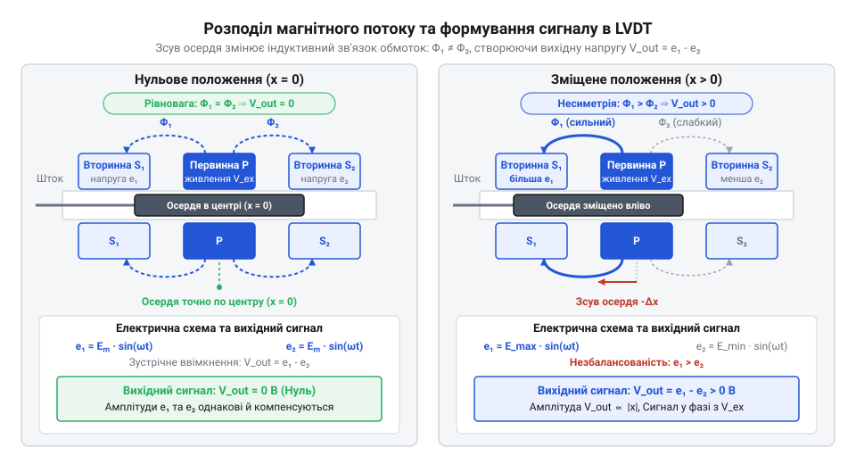
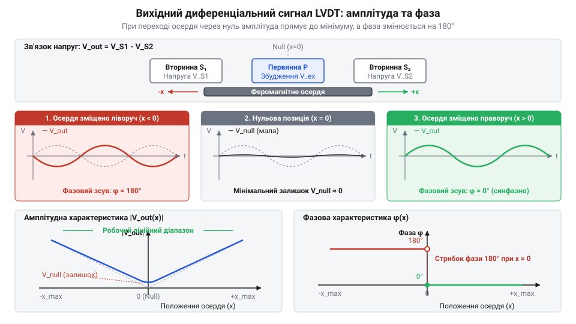
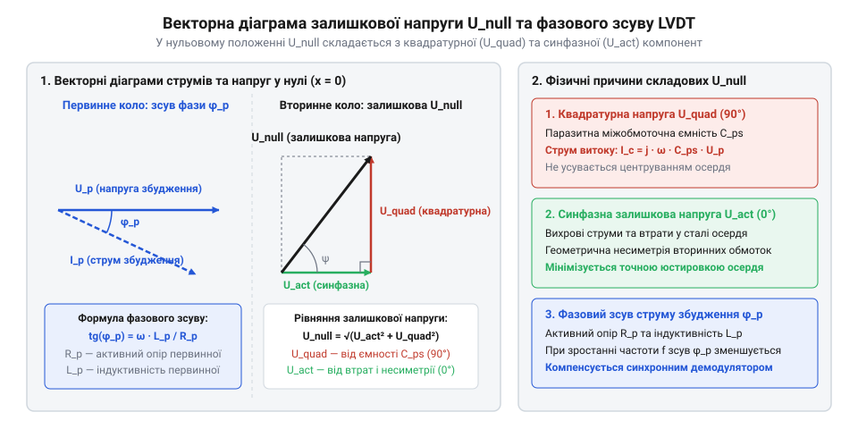
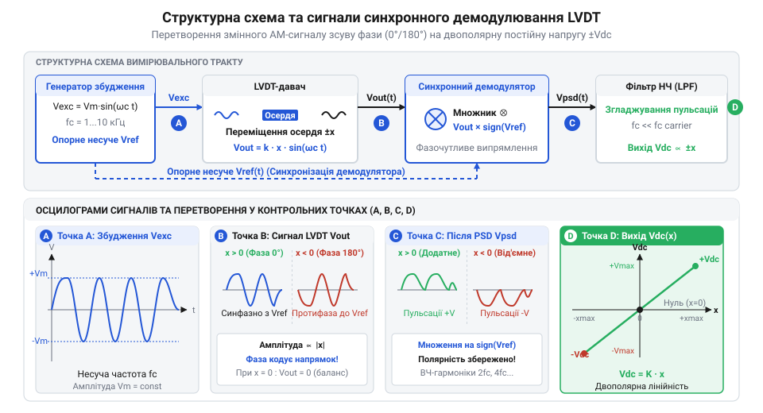
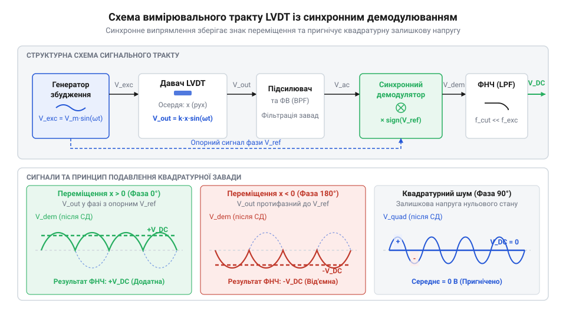

# Лінійні змінні диференціальні трансформатори LVDT

<preknowlist>
- [Сельсини та резольвери: обертові трансформаторні кутоміри](root:cat-hw-sensors/synchro-and-resolver-transducers) — Принципи електромагнітної індукції у змінних трансформаторних перетворювачах та метод фазочутливого зчитування.
- [Датчики кутового положення сервоприводів: потенціометри та магнітні енкодери](root:cat-hw-sensors/servo-feedback-potentiometers-and-magnetic-encoders) — Механічні та електричні недоліки контактних потенціометрів у системах зворотного зв'язку.
</preknowlist>

## Проблема зносу потенціометрів у безперервній автоматиці

У кожній системі автоматичного керування, де виконавчий механізм переміщує деталь, гідравлічний клапан або кермову поверхню, контролеру необхідно безперервно та з високою точністю знати поточне лінійне положення робочого органу. Протягом багатьох десятиліть найпростішим і найдешевшим рішенням для вимірювання лінійного зсуву залишався @@en|потенціометр@@ (від лат. *potentia* — сила та грец. *μέτρον* — міра) — резистивний дільник напруги, у якому рухомий металевий @@en|струмознімач@@ (від англ. *wiper*) ковзає поверхнею резистивного елемента з вуглецевого композиту, провідного пластику або дротового мотання. Фізичний принцип його роботи спирається на пряму залежність електричного опору від довжини провідника: при подачі постійної напруги живлення `V_{in}` на крайні виводи доріжки напруга на рухомому контакті `V_{out}` змінюється лінійно відповідно до координати `x`. Тільки за цією принциповою простотою ховається фундаментальна вразливість — наявність прямого механічного контакту між деталями, що рухаються з високими швидкостями та прискореннями.

Щоб забезпечити надійний електричний контакт між струмознімачем та резистивною доріжкою, конструкція вимагає створення постійного механічного притискного зусилля. Згідно з теорією контактної механіки, це зусилля створює високий @@en|контактний тиск Герца@@ (від прізвища німецького фізика *Heinrich Hertz*), який концентрується на мікроскопічних виступах шорсткості поверхонь. У реальних умовах промислового виробництва, гідросистемах важкої техніки чи авіаційних сервоприводах вимірювальний пристрій працює в середовищі постійних механічних навантажень: високочастотних вібрацій від технологічного обладнання, температурних розширень та мільйонів циклів зворотно-поступального руху. Безперервний рух металевого струмознімача по резистивному шару викликає неминучий @@en|трибологічний знос@@ (від грец. *tribos* — тертя та *logos* — вчення). Сила тертя постійно руйнує резистивний шар, стираючи провідний матеріал до ізолюючої основи, утворюючи поздовжні канавки та накопичуючи дрібнодисперсний струмопровідний або оксидний пил.

Конструктор потенціометричного давача постає перед нерозв'язною дилемою механічного притиску струмознімача:
- Збільшення притискного зусилля зменшує ймовірність відриву контакту під дією зовнішніх вібрацій, але експоненціально прискорює абразивний трибологічний знос доріжки та скорочує механічний ресурс давача. - Зменшення притискного зусилля продовжує термін служби резистивного шару, але робить струмознімач вкрай вразливим до вібраційного відриву, окиснення поверхонь і потрапляння мікрочастинок бруду.

Особливо руйнівним для потенціометричних давачів є режим @@en|мікроколивань@@ (від англ. *dithering*), характерний для замкнених контурів точного регулювання. Для подолання сухого тертя у гідравлічних золотниках або механічних передачах керувальний контролер додає до вихідного сигналу високочастотну гармоніку малого амплітудного розмаху. У результаті струмознімач потенціометра годинами здійснює мікроскопічні коливання на ділянці доріжки довжиною в частки міліметра. На цій обмеженій локальній зоні плівкове покриття руйнується за сотні тисяч мікроциклів, утворюючи місцевий дефект опору («вибоїну»), що повністю спотворює лінійність вимірювальної характеристики.

Фізичне руйнування контактної пари спричиняє комплекс серйозних електричних дефектів:
1. Виникнення @@en|контактного шуму@@ (від англ. *wiper noise*) — високочастотних хаотичних флуктуацій напруги на виході, зумовлених швидкою зміною плями фактичного електричного контакту при ковзанні по мікронерівностях. 2. Нестабільність нульової позиції та зміна нахилу калібрувальної кривої під дією температурного розширення деталей струмознімача та резистивного елемента. 3. Короткочасний розрив електричного кола (від англ. *contact bounce*) під час поштовхів та вібраційних імпульсів, коли струмознімач на кілька мілісекунд відривається від доріжки.

У замкненому контурі сервоприводу раптовий розрив контакту або стрибок контактного шуму викликає катастрофічну реакцію: контролер сприймає випадкове падіння напруги як фізичний зсув робочого органу і видає максимальний керувальний імпульс на привід. Це викликає ударні механічні навантаження, автоколивання системи та потенційну аварію. Намагання вирішити [відмови контактних потенціометрів](root:cat-hw-sensors/servo-feedback-potentiometers-and-magnetic-encoders) шляхом застосування електрооптичних чи магнітних систем також наражається на технічні обмеження: використання [оптичних або магнітних енкодерів](root:cat-hw-sensors/optical-and-magnetic-encoders) вимагає складних цифрових лічильників, [лінійні оптичні енкодери](root:cat-hw-sensors/optical-and-magnetic-encoders) швидко забруднюються мастилом у важкій промисловості, а [вихрострумові давачі переміщення](root:cat-hw-sensors/eddy-current-displacement-sensors) мають занадто малий робочий хід.

Аналіз [історії розвитку LVDT](root:cat-hw-sensors/lvdt-linear-variable-differential-transformers/hist-lvdt-evolution.md) показує, що потреба аерокосмічної галузі у безвідмовних вимірювачах спонукала Германа Шевіца (Herman Schaevitz) розробити трансформаторний сенсор без механічного контакту. Вимога до промислової автоматики сформувалася однозначно: необхідний @@en|безконтактний давач@@, у якому рухомий шток взаємодіє з вимірювальними обмотками виключно через електромагнітне поле, що забезпечує нескінченний механічний ресурс та повну ізоляцію від зовнішнього середовища.

## Конструкція LVDT та перерозподіл магнітного потоку

Ідеальним втіленням концепції безконтактного індуктивного вимірювача став @@en|LVDT@@ (@@en|лінійний змінний диференціальний трансформатор@@, від англ. *Linear Variable Differential Transformer*, від лат. *transformare* — перетворювати) — електромагнітний перетворювач, у якому прямолінійне переміщення механічного штока перерозподіляє магнітні потоки між котушками та модулює амплітуду й фазу змінної напруги. Конструктивно пристрій складається з трьох нерухомих коаксіальних обмоток, розміщених усередині трубчастого каркаса з діелектрика або немагнітної сталі, та рухомого осердя. Уся конструкція поміщається у зовнішній циліндричний екран із матеріалу з високою магнітною проникністю (наприклад, @@en|пермалою@@), що повністю ізолює вимірювальні котушки від зовнішніх паразитних магнітних полів, створюваних електродвигунами чи силовими реле.

По центру циліндричного каркаса розміщена @@en|первинна обмотка@@ (від англ. *primary winding*), яка підключається до зовнішнього джерела змінного струму збудження `v_{ex}(t)`. Обабіч від первинної обмотки симетрично намотано дві однакові @@en|вторинні обмотки@@ (від англ. *secondary windings*), позначувані як `S_1` та `S_2`. Усередині поздовжнього отвору каркаса вільно ковзає циліндричне @@en|феромагнітне осердя@@ (від англ. *ferromagnetic core*), виготовлене з нікель-залізного сплаву з високою початковою магнітною проникністю `μ_r` та низькими втратами на @@en|гістерезис@@ (від грец. *hysteresis* — відставання). Осердя кріпиться до немагнітного штока з нержавіючої сталі або титану, який з'єднується з об'єктом вимірювання. Завдяки наявності радіального повітряного зазору між осердям та внутрішньою поверхнею каркаса котушок механічне тертя відсутнє повністю, а механічний ресурс визначається лише підшипниками зовнішнього спрямовувача штока.


*Конструктивна топологія LVDT: геометричне положення осердя визначає розподіл магнітного потоку та взаємну індуктивність між первинною та вторинними котушками.*

Фізичний механізм перетворення спирається на закон електромагнітної індукції Фарадея та зміну магнітного опору (від англ. *reluctance*) шляхів змінного магнітного поля. Магнітний опір ділянки кола пропорційний її довжині та обернено пропорційний абсолютній магнітній проникності матеріалу:

```
R_m = l / (μ_r · μ_0 · A)
```

де `l` — довжина магнітного шляху, `A` — площа поперечного перерізу, `μ_0` — магнітна стала, а `μ_r` — відносна проникність середовища. Оскільки для повітря `μ_r ≈ 1`, а для феромагнітного осердя `μ_r ≈ 10000`, введення осердя в зону котушки знижує магнітний опір цієї ділянки в тисячі разів.

Коли крізь первинну обмотку протікає змінний струм збудження `i_p(t) = I_p · sin(ω_{ex} · t)` із @@en|несучою частотою@@ `f_{ex}` (зазвичай від 1 кГц до 10 кГц), довкола неї створюється змінний @@en|магнітний потік@@ `Φ_p(t)`. Вибір несучої частоти є результатом технічного компромісу: при низьких частотах (менше 500 Гц) потрібні масивні котушки для забезпечення достатньої індуктивності, а при занадто високих частотах (понад 20 кГц) ростуть втрати на @@en|вихрові струми@@ (від прізвища французького фізика *Léon Foucault*) в осерді та виникає паразитний скін-ефект.

Взаємні індуктивності `M_1(x)` та `M_2(x)` між первинною обмоткою та відповідними вторинними котушками є прямими функціями від геометричного перекриття осердя з кожною з обмоток. Миттєві значення електрорушійних сил (ЕРС), індукованих у вторинних котушках, описуються виразами:

```
e_1(t) = M_1(x) · (d i_p(t) / d t)
= M_1(x) · I_p · ω_{ex} · cos(ω_{ex} · t - ϕ_p)

e_2(t) = M_2(x) · (d i_p(t) / d t)
= M_2(x) · I_p · ω_{ex} · cos(ω_{ex} · t - ϕ_p)
```

де `ϕ_p` — фазовий зсув струму первинної обмотки відносно напруги збудження, зумовлений активним опором та індуктивністю первинного кола.

Розподіл магнітного потоку та амплітуд індукованих напруг залежить від лінійного положення осердя `x`:

1. **Сувора нульова позиція (`x = 0`).** Осердя розташоване суворо симетрично відносно обмоток `S_1` та `S_2`. Магнітні опори обох гілок однакові, тому магнітні потоки `Φ_1` та `Φ_2` рівні. Взаємні індуктивності тотожні: `M_1(0) = M_2(0) = M_0`. В результаті амплітуди індукованих ЕРС на обох вторинних обмотках рівні між собою: `E_1 = E_2`. 2. **Позитивний зсув (`x > 0`).** Осердя зміщується в бік обмотки `S_1`. Об'єм феромагнетика всередині `S_1` зростає, знижуючи магнітний опір і збільшуючи взаємну індуктивність `M_1(x)`. Одночасно об'єм осердя всередині `S_2` зменшується, що знижує `M_2(x)`. Амплітуда ЕРС першої котушки стає більшою за другу: `E_1 > E_2`. 3. **Негативний зсув (`x < 0`).** Осердя зміщується в бік обмотки `S_2`. Взаємна індуктивність `M_2(x)` зростає, а `M_1(x)` падає. Амплітуда ЕРС другої котушки перевищує амплітуду першої: `E_2 > E_1`.

Щоб сформувати єдиний вихідний сигнал, вторинні обмотки з'єднують послідовно-зустрічно. При цьому результуюча вихідна напруга дорівнює різниці індукованих напруг:

```
v_{out}(t) = e_1(t) - e_2(t)
= [M_1(x) - M_2(x)] · I_p · ω_{ex} · cos(ω_{ex} · t - ϕ_p)
```

При симетричному зсуві осердя в межах робочого діапазону різниця взаємних індуктивностей є пропорційною координаті: `[M_1(x) - M_2(x)] = k · x`. Тому амплітуда вихідної напруги `V_{out} = k · I_p · ω_{ex} · |x|` прямо пропорційна модулю переміщення, а її фаза відносно напруги збудження вказує на знак напрямку зсуву: фаза дорівнює 0° при `x > 0` та змінюється на 180° при `x < 0`.

У реальних пристроях у нульовій позиції (`x = 0`) вихідна напруга не стає абсолютним нулем через виникнення @@en|залишкової напруги нульової позиції@@ (від англ. *null voltage*). Вона складається з двох компонент:
- Синфазного залишку, зумовленого невеликою технологічною асиметрією намотки котушок `S_1` та `S_2`. - Квадратурного залишку (зсунутого за фазою на 90°), спричиненого паразитними ємностями між первинною та вторинними обмотками, а також вихровими струмами в металевому корпусі.

Наявність квадратурного нульового залишку унеможливлює використання звичайного амплітудного випрямляча, оскільки він плутатиме квадратурну напругу нульової точки з корисним зсувом осердя.

Глибинний аналіз аналітичних рівнянь електродинаміки та фазових похибок містить [математична модель взаємоіндуктивності](root:cat-hw-sensors/lvdt-linear-variable-differential-transformers/math-lvdt-electromagnetics-and-demodulation.md). Для практичного з'єднання обмоток необхідно вивчити [залізний інтерфейс підключення](root:cat-hw-sensors/lvdt-linear-variable-differential-transformers/api-lvdt-hardware-interface.md), який визначає конфігурацію 4-, 5- та 6-провідних схем. Для відновлення постійної напруги з амплітудно-фазово модульованого сигналу розробляється [аналого-цифровий кондиціонер сигналу](root:cat-hw-sensors/lvdt-linear-variable-differential-transformers/proj-lvdt-precision-conditioner.md) із фазочутливим демодулятором або використовується [програмний алгоритм обробки](root:cat-hw-sensors/lvdt-linear-variable-differential-transformers/api-lvdt-dsp-firmware-interface.md) у DSP.

Аналогічний диференціальний принцип використовується і в інших трансформаторних давачах: для кутових переміщень призначені [диференціальні трансформатори RVDT](root:cat-hw-sensors/rvdt-rotary-variable-differential-transformers), а для точного визначення кутів у важких умовах застосовують [резольвери та сельсини](root:cat-hw-sensors/synchro-and-resolver-transducers).

Завдяки принципу симетричного перерозподілу магнітного потоку давачі LVDT поєднують абсолютний безконтактний вимір, високу лінійність та стійкість до жорстких промислових умов.

## Зустрічне увімкнення обмоток та амплітудно-фазова модуляція

Попередньо було з'ясовано, що під час подачі змінної напруги на @@en|первинну обмотку@@ (від лат. *primarius* — первинний, початковий) у магнітопроводі створюється змінне магнітне поле, яке пронизує @@en|феромагнітне осердя@@ та індукує електрорушійні сили (ЕРС) у двох секціях вторинної котушки. Однак якщо знімати вихідний сигнал окремо з кожної вторинної обмотки, виникає серйозне вимірювальне обмеження: корисна інформація про зміщення становить лише малий відсоток від великої базової індуктивної напруги кожної з котушок. Оцінювання малого переміщення вимагало б обчислення різниці двох великих величин із високим постійним зсувом, що спричиняє низьку роздільну здатність, високу чутливість до наведень та колосальний температурний дрейф. Щоб отримати строгий нульовий рівень у центральній позиції та забезпечити максимально високу чутливість до найменших відхилень, вторинні котушки об'єднують у єдиний диференціальний вимірювальний контур.

Електричне об'єднання двох вторинних обмоток виконують за схемою @@en|послідовно-зустрічного з'єднання@@ (англ. *series-opposed connection*, від лат. *series* — послідовність та *opponere* — протиставляти). При такому з'єднанні кінці або початку обох котушок з'єднують між собою так, щоб індуковані в них ЕРС у будь-який момент часу мали протилежні напрямки.

Конструктивно вимірювальні котушки розташовують симетрично відносно центру циліндричного каркаса. Коли @@en|феромагнітне осердя@@ (виготовлене з високопроникного сплаву @@en|пермалой@@, від англ. *permalloy*, від *permeability* — проникність та *alloy* — сплав) перебуває точно в геометрійному центрі, в так званій @@en|нульовій позиції@@ (від лат. *nullus* — ніякий; у документації позначуваній як Null), магнітний опір обох магнітних шляхів абсолютно однаковісінький. Осердя перекриває однакову довжину першої та другої вторинних котушок. Завдяки цьому @@en|взаємоіндуктивність@@ (від лат. *inductio* — наведення) між первинною та першою вторинною обмоткою `M_1` строго дорівнює взаємоіндуктивності між первинною та другою вторинною обмоткою `M_2`:

```
M_1(0) = M_2(0) = M_0
```

Вираз описує симетрію взаємних індуктивностей у нульовому положенні осердя. Наведені змінними магнітними потоками напруги `V_s1(t)` та `V_s2(t)` мають абсолютно однакову амплітуду й перебувають у фазі відносно струму збудження. Оскільки обмотки увімкнені зустрічно, вихідна різницева напруга `V_out(t)` є різницею миттєвих значений напруг обох секцій:

```
V_out(t) = V_s1(t) - V_s2(t)
         = V_m · sin(ω · t) - V_m · sin(ω · t)    [оскільки V_s1 = V_s2 при x = 0]
         = 0                                      [ідеальна компенсація в нульовій точці]
```

Отриманий вираз показує ідеальний збалансований стан, у якому результуюча амплітуда вихідного сигналу дорівнює нулю незалежно від величини напруги чи частоти живлення первинного кола.

При механічному зміщенні осердя уздовж поздовжньої осі на відстань `x` від нульової точки симетрія розподілу магнітного потоку порушується. Якщо осердя зміщується в бік першої вторинної обмотки (`x > 0`), вона заповнюється феромагнітним матеріалом на більшу довжину. Магнітна проникність середовища всередині першої котушки зростає, а магнітний опір падає, що спричиняє лінійне збільшення взаємоіндуктивності `M_1(x)`. Одночасно осердя виходить із зони другої вторинної котушки, підвищуючи магнітний опір її магнітопроводу та лінійно зменшуючи взаємоіндуктивність `M_2(x)`. У межах робочого діапазону зсуву зміна взаємоіндуктивностей описується лінійним коефіцієнтом пропорційності `k`:

```
M_1(x) = M_0 + k · x
M_2(x) = M_0 - k · x
```

Вирази описують диференціальний перерозподіл зв'язку між первинною та вторинними котушками при лінійному зміщенні осердя. Якщо первинна обмотка заживлюється синусоїдальним струмом `I_p(t) = I_m · sin(ω · t)`, де `ω = 2 · π · f_exc` — колова @@en|несуча частота@@ збудження, наведені у вторинних обмотках напруги визначаються законами електромагнітної індукції як похідні від магнітного потоку за часом:

```
V_s1(t) = - M_1(x) · (d I_p(t) / dt) = - (M_0 + k · x) · I_m · ω · cos(ω · t)
V_s2(t) = - M_2(x) · (d I_p(t) / dt) = - (M_0 - k · x) · I_m · ω · cos(ω · t)
```

Підставивши ці значення в формулу різницевої напруги для зустрічного увімкнення, отримуємо підсумкове рівняння вихідного сигналу давача:

```
V_out(t) = V_s1(t) - V_s2(t)
         = - ((M_0 + k · x) - (M_0 - k · x)) · I_m · ω · cos(ω · t)    [підстановка індукованих напруг]
         = - 2 · k · x · I_m · ω · cos(ω · t)                         [приведення подібних членів]
```

З виведеного рівняння чітко видно, що амплітуда вихідної гармонічної напруги прямо пропорційна величині механічного зміщення `x`. Для глибокого вивчення аналітичних виведень перегляньте [математичну модель трансформаторного перетворення](root:cat-hw-sensors/lvdt-linear-variable-differential-transformers/math-lvdt-electromagnetics-and-demodulation.md), що описує баланс індуктивностей. Фізичне розведення провідників і точні виводи описано у [справнику кабельних з'єднань](root:cat-hw-sensors/lvdt-linear-variable-differential-transformers/api-lvdt-hardware-interface.md), де деталізовано колірне маркування та схеми з 4, 5 та 6 контактами.

Амплітудна пропорційність є лише однією з двох складових інформаційного сигналу LVDT. Значення зміщення `x` є скалярною величиною зі знаком: воно може бути як додатним (`x > 0`), так і від'ємним (`x < 0`) залежно від напрямку руху осердя відносно нульової позиції.

Коли осердя зміщується в від'ємну сторону (`x < 0`), величина `(M_1 - M_2)` стає від'ємною. У тригонометричному описі від'ємний знак перед амплітудою `- A · cos(ω · t)` еквівалентний зміні фази синусоїди на 180 градусів: `A · cos(ω · t + 180°)`. 


*Амплітудно-фазова характеристика вихідного сигналу LVDT: амплітуда має V-подібну форму з мінімумом у нулі, а фаза змінюється на протилежну (180°) при зміні напрямку переміщення.*

Вихідний сигнал @@en|LVDT@@ (від англ. *Linear Variable Differential Transformer* — лінійний змінний диференціальний трансформатор; від лат. *linea* — лінія, *transformare* — перетворювати) являє собою двосмугову амплітудну модуляцію з подавленою несучою (від лат. *modulatio* — розміреність, регулювання), або @@en|амплітудно-фазова модуляція@@ (@@en|АФМ@@). Положення осердя однозначно визначається двома параметрами вихідного синусоїдального сигналу:
1. Модуль зміщення `|x|` пропорційний амплітуді (peak-to-peak) вихідного напругового сигналу. 2. Напрямок зміщення визначається фазовим кутом відносно первинного струму збудження: 0° (синфазно) при зміщенні в бік першої обмотки та 180° (протифазно) при зміщенні в бік другої обмотки.

У цьому полягає пастка підключення давача. Якщо подати сигнал `V_out(t)` на простий амплітудний випрямляч (діодний міст або прецизійний RMS-конвертер), фазова інформація буде втрачена. Простий випрямляч видасть однакову додатну напругу (наприклад, `+1.2 В`) як при зміщенні на `+3 мм`, так і при зміщенні на `-3 мм`. Вимірювальна система не зможе визначити, в який бік змістився механічний шток.

Для відновлення знака координати вимірювальний тракт обов'язково повинен містити фазочутливу схему, яка порівнює фазу вихідного сигналу з фазою опорної напруги збудження. На відміну від [контактних потенціометричних давачів](root:cat-hw-sensors/servo-feedback-potentiometers-and-magnetic-encoders), де напрямок визначається полярністю падіння постійної напруги, індуктивний перетворювач передає напрямок через трансформаторний фазовий зсув. Порівняно з [лінійними оптичними енкодерами](root:cat-hw-sensors/optical-and-magnetic-encoders), які потребують двох зсунутих на 90° оптичних каналів для визначення напрямку, LVDT формує інформацію про напрямок безпосередньо у вихідній фазі єдиного диференціального сигналу.

Аналогічний диференціальний принцип амплітудно-фазової модуляції застосовується також у кутових вимірювачах — [обертових диференціальних трансформаторах](root:cat-hw-sensors/rvdt-rotary-variable-differential-transformers), де замість циліндричного штока використовується кулачковий феромагнітний ротор. Крім того, принцип фазового зчитування перекликається з функціонуванням [обертових трансформаторних кутомірів](root:cat-hw-sensors/synchro-and-resolver-transducers), проте в LVDT модуляція є одновимірною та строго лінійною.

## Залишкова напруга, фаза та температурний дрейф

Ідеальна диференціальна модель передбачає, що у випадках, коли осердя перебуває точно в нульовій позиції (`x = 0`), вихідна напруга `V_out(0)` повністю дорівнює нулю. Однак у фізично реалізованих давачах LVDT в нульовому положенні завжди спостерігається невеликий ненульовий змінний сигнал — @@en|залишкова напруга нульової позиції@@ (англ. *null voltage*, від лат. *nullus* — жоден та прізвища *Volta*).

Наявність залишкової напруги зумовлена чотирма основними фізичними ефектами, які неможливо усунути лише механічним центруванням осердя:

1. Паразитні міжобмоткові ємності. Первинна обмотка знаходиться в безпосередній просторовій близькості до вторинних котушок, утворюючи розподілені міжобмоткові ємності `C_p-s1` та `C_p-s2`. Через ці ємності високочастотний струм збудження протікає у вторинне коло в обхід магнітного потоку. Оскільки струм витоку через ємність випереджає напругу на 90 градусів, він формує реактивну складову — так звану квадратурну складову (від лат. *quadratura* — зсув на чверть періоду) вихідної напруги. 2. Вихрові струми у металі. Змінний магнітний потік індукує локальні @@en|вихрові струми@@ (англ. *eddy currents*) у феромагнітному осерді та зовнішньому екрані з нержавіючої сталі або пермалою. Вихрові струми створюють власне протидіюче магнітне поле, яке через активні втрати в металі має зсув по фазі відносно основного потоку. Це порушує фазове збігання потоків від обох вторинних секцій. 3. Нелінійність магнітного гістерезису. Матеріал осердя має нелінійну криву намагнічування та @@en|магнітний гістерезис@@ (від грец. *hysteresis* — відставання, запізнення). Намагнічування осердя синусоїдальним струмом генерує вищі гармоніки (насамперед 3-тю та 5-ту гармоніку). Через технологічну асиметрію обмоток ці гармонічні складові не компенсуються в нульовій точці. 4. Конструктивна асиметрія обмоток. Технологічні допуски при намотуванні дротів створюють мікроскопічну різницю в кількості витків або радіусі намотування між секціями.


*Векторна діаграма напруг у нульовому положенні LVDT: залишкова напруга Null складається з синфазного залишку та квадратурної складової, зсунутої на 90 градусів відносно струму збудження.*

Вектор залишкової напруги `V_null` розкладається на дві ортогональні компоненти відносно фази первинного струму збудження:
- Синфазна складова `V_inphase` (active component) — виникає через мікроскопічну диспропорцію активних опорів та взаємоіндуктивностей. Вона може бути зведена до нуля незначним механічним зміщенням осердя вздовж осі. - Квадратурна складова `V_quadrature` (reactive component) — зсунута на 90° відносно струму збудження. Вона не може бути зведена до нуля жодним механічним зсувом осердя!

Окрім залишкової напруги, у реальному давачі виникає фазовий зсув між напругою збудження `V_p` та вихідною різницевою напругою `V_out`. Первинна обмотка володіє власним активним опором `R_p` та індуктивністю `L_p`. Повний електричний опір (@@en|імпеданс@@, від лат. *impedire* — перешкоджати) первинного кола становить:

```
Z_p = R_p + j · ω · L_p
```

Струм у первинній обмотці `I_p` відстає від прикладеної напруги збудження `V_p` на фазовий кут `φ`:

```
φ = arctan((ω · L_p) / R_p)
```

Фазовий кут `φ` суттєво залежить від несучої частоти zбудження `f_exc`. На низьких частотах (до 400 Гц) активний опір `R_p` переважає над реактивним опором `ω · L_p`, що створює великий фазовий зсув між струмом і напругою збудження. При збільшенні частоти до 1–10 кГц реактивний опір стає домінуючим (`ω · L_p >> R_p`), і фазовий зсув наближається до оптимального значення. Проте на надвисоких частотах (>20 кГц) зростає вплив паразитних ємностей.

Третьою критичною неідеальністю є @@en|температурний дрейф@@ (від англ. *temperature drift*). Мідний дріт обмоток має високий температурний коефіціент опору (`α_Cu ≈ +0.393% / °C`). При підвищенні температури на 50 °C активний опір `R_p` зростає майже на 20%. Якщо первинне коло заживлюється від джерела напруги `V_p = const`, збільшення опору `R_p` зменшує амплітуду струму збудження `I_p`:

```
I_p = V_p / √(R_p² + (ω · L_p)²)
```

Зменшення струму `I_p` послаблює створений магнітний потік, що призводить до падіння коефіцієнта трансформації та чутливості давача (дрейф крутизни характеристики, @@en|gain drift@@). Крім того, температурне розширення матеріалу каркаса та подовжувального штока осердя викликає механічний дрейф нульової позиції (@@en|zero drift@@).

Для подолання температурного дрейфу чутливості первинну обмотку заживлюють від джерела змінного струму (Constant Current AC Source), а не від джерела напруги. У режимі джерела струму амплітуда `I_p` підтримується суворо незмінною независимо від зміни опору `R_p(T)`, що усуває температурну нестабільність коефіцієнта передачі.

Нейтралізація залишкової квадратурної напруги та фазових похибок досягається застосуванням схеми синхронного демодулювання.


*Структурна схема вимірювального тракту LVDT: генератор синусоїди живить первинну обмотку, різницевий сигнал підсилюється та перемножується з опорною частотою у фазочутливому демодуляторі з наступною ФНЧ-фільтрацією.*

@@en|Синхронне демодулювання@@ (від англ. *synchronous demodulation*, від грец. *synchronos* — одночасний) передбачає перемноження вихідного сигналу `V_out(t)` на опорний сигнал `V_ref(t)`, що має сувору фазову синхронізацію з струмом збудження первинної обмотки.

Синфазна складова сигналу `V_inphase · cos(0°)` після перемноження дає постійну напругу, знак якої визначається фазою (додатний для `x > 0` і від'ємний для `x < 0`). Квадратурна залишкова напруга `V_quadrature · cos(90°)` при перемноженні з синфазним опорним сигналом дає змінну напругу з подвоєною частотою та нульовим середнім значенням. Після проходження через @@en|фільтр низьких частот@@ (@@en|ФНЧ@@) квадратурна складова повністю пригнічується, і на виході формується чистий аналоговий сигнал постійного струму.

У цифрових системах керування фазочутливе демодулювання реалізують безпосередньо у вбудованому програмному забезпеченні мікроконтролера або DSP. Нижче наведено приклад обчислення синфазної та квадратурної складових за результатом аналого-цифрового перетворення:

:::tabs
@tab C (C99)
:::code lvdt-linear-variable-differential-transformers-d/c/generic/demodulate-sample.c
@tab C++ (C++17)
:::code lvdt-linear-variable-differential-transformers-d/cpp/generic/synchronousdemodulator.cpp
:::

Наведений приклад показує, як цифрове перемноження накопичує синфазний сигнал та фільтрує квадратурну похибку за період збудження.

Для вивчення розробки аналогового тракту зчитування рекомендуємо переглянути [практичний проект кондиціонера](root:cat-hw-sensors/lvdt-linear-variable-differential-transformers/proj-lvdt-precision-conditioner.md), де наведено принципові електричні схеми. Алгоритми цифрового оброблення в мікроконтролері розкрито у [довіднику програмного інтерфейсу](root:cat-hw-sensors/lvdt-linear-variable-differential-transformers/api-lvdt-dsp-firmware-interface.md), який описує цифрову фільтрацію та автоматичне калібрування. Історичний контекст впровадження давачів висвітлено в [огляді еволюції технології](root:cat-hw-sensors/lvdt-linear-variable-differential-transformers/hist-lvdt-evolution.md), де описано внесок Германа Шевіца в розробку стійких до вібрацій конструкцій.

Завдяки відсутності механічного тертя LVDT переважають [безконтактні оптичні енкодери](root:cat-hw-sensors/optical-and-magnetic-encoders) у жорстких умовах із вібраціями та брудом. Порівняно з [вихрострумовими давачами переміщення](root:cat-hw-sensors/eddy-current-displacement-sensors), LVDT забезпечують значно більший робочий хід. У системах, де застосовують обробку даних з [магнітного енкодера AS5048](root:cat-hw-sensors/as5048-magnetic-encoder), використання LVDT гарантує повну гальванічну ізоляцію вимірювального штока від електронних кіл.

## Генерація збудження та синхронне демодулювання сигналу

Вихідний сигнал давача LVDT являє собою амплітудно-фазово модульовану зміну напруги несучої частоти. Амплітуда цієї напруги прямо пропорційна величині зміщення феромагнітного осердя від нульового положення, а фазовий зсув (0° або 180° відносно первинного збудження) вказує напрямок переміщення. Звичайний амплітудний детектор (англ. @@en|Envelope Detector@@) на основі діодного моста не здатний обробити такий сигнал: він випрямляє обидві півхвилі у позитивну область, втрачаючи інформацію про знак координати, і додає до вихідного рівня залишкову квадратурну напругу нульової позиції. Щоб виділити напрямок руху й нейтралізувати завади, аналоговий тракт LVDT побудовано на двох фундаментальних вузлах: прецизійному генераторі збудження та синхронному фазочутливому демодуляторі (англ. @@en|Synchronous Demodulator@@, від грец. @@el|σύγχρονος@@ — одночасний).

Стабільність первинного збудження безпосередньо визначає крутизну вимірювальної характеристики LVDT. Первинна обмотка давача має активний опір мідного дроту та індуктивний імпеданс, що змінюються під дією температури й частоти. Якщо заживити первинну обмотку від стандартного джерела напруги, температурне нагрівання міді призведе до зростання її опору, зменшення первинного струму й, як наслідок, до дрейфу амплітуди вихідного сигналу вторинних обмоток. Для запобігання цьому похибковому ефекту генератор збудження конструюють як стабілізоване джерело змінного струму або використовують синусоїдальний автогенератор із системою автоматичного регулювання посилення (англ. @@en|Automatic Gain Control@@, AGC). Несучу частоту обирають у діапазоні від 1 кГц до 10 кГц: нижня межа обмежена динамікою механічного переміщення (частота збудження має щонайменше у 10 разів перевищувати спектр руху осердя), а верхня — втратами на вихрові струми у феромагнітному осерді та гістерезисом пермалою.

Синхронне фазочутливе демодулювання перетворює високочастотну зміну напруги на знакову постійну напругу, пропорційну переміщенню. Операція демодулювання полягає у перемножуванні різницевого сигналу вторинних обмоток `u_sec(t)` на опорний синхронний сигнал `u_ref(t)`, який формується з напруги збудження первинної обмотки:

```
u_demod(t) = u_sec(t) × u_ref(t)
           = U_m × sin(ω·t + φ) × sign(sin(ω·t))    [синхронне фазочутливе множення]
```

Коли осердя зміщене у позитивний бік (`x > 0`), вихідна напруга `u_sec(t)` збігається за фазою з опорним сигналом (`φ = 0°`). Множення двох синхронних синусоїд однієї фази перетворює від'ємні півхвилі на позитивні, утворюючи пульсуючу напругу з постійною складовою зі знаком "+". Якщо осердя переміщується у протилежний бік (`x < 0`), фаза вихідного сигналу змінюється на протилежну (`φ = 180°`). У цьому разі множення позитивної півхвилі опорного сигналу на від'ємну півхвилю вторинного створює пульсуючу напругу з від'ємною постійною складовою зі знаком "-".

Ключовою перевагою синхронного детектування є повне вилучення квадратурної складової залишкової напруги. Як показано в [математичній моделі взаємоіндуктивності](root:cat-hw-sensors/lvdt-linear-variable-differential-transformers/math-lvdt-electromagnetics-and-demodulation.md), залишкова напруга в нульовій позиції складається з синфазної та квадратурної (зсунутої на 90°) компонент. Оскільки інтеграл добутку двох сигналів із фазовим зсувом 90° за період носійного коливання дорівнює нулю, фазочутливий демодулятор повністю відфільтровує квадратурну заваду:

```
U_out_DC = (1 / T) · ∫₀ᵀ U_quad · cos(ω·t) · sign(sin(ω·t)) dt
         = 0                                         [пригнічення квадратурної складової]
```

Після синхронного множника сигнал пропускають через активний фільтр низьких частот (ФНЧ / англ. @@en|Low-Pass Filter@@, LPF). Фільтр зрізає подвоєну несучу частоту `2ω` та вищі гармоніки, залишаючи чистий аналоговий сигнал постійного струму, величина й знак якого точно відповідають положенню осердя.

Завдяки обмоткам давача та комплексному імпедансу коло первинної обмотки створює природний фазовий зсув між струмом збудження та напругою вторинного виходу. Якщо цей зсув не компенсувати, амплітуда після демодулювання зменшується пропорційно косинусу кута фазового розсогласування `cos(Δφ)`. Для усунення цього дрейфу в аналоговий тракт вводять регульований фазообертач або застосовують фазове автопідстроювання частоти (англ. @@en|Phase-Locked Loop@@, PLL).


*Аналоговий тракт обробки сигналу LVDT: синхронне множення відфільтровує квадратурний шум нуля та відновлює знак переміщення осердя.*

Повний вимірювальний тракт кондиціювання сигналу LVDT може реалізовуватися як в аналоговому виконанні на дискретних операційних підсилювачах чи спеціалізованих мікросхемах (наприклад, AD698 або NE592), так і за допомогою цифрової обробки сигналів (DSP / англ. @@en|Digital Signal Processing@@). У цифрових системах синусоїдальне збудження формується за допомогою прямого цифрового синтезу (DDS / англ. @@en|Direct Digital Synthesis@@) або ШІМ із фільтрацією, а вихідні сигнали оцифровуються швидким АЦП. Фізичні параметри підключення 4-, 5- та 6-провідних конфігурацій обмоток описано в [електричному інтерфейсі підключення](root:cat-hw-sensors/lvdt-linear-variable-differential-transformers/api-lvdt-hardware-interface.md), а схемотехнічну реалізацію аналогового кондиціонера подано в [проектуванні прецизійного кондиціонера](root:cat-hw-sensors/lvdt-linear-variable-differential-transformers/proj-lvdt-precision-conditioner.md).

Нижче наведено приклад реалізації цифрового синхронного демодулятора для мікроконтролера, який приймає оцифрований відлік збудження та вторинного сигналу і здійснює фазочутливу фільтрацію:

:::tabs
@tab C
:::code lvdt-linear-variable-differential-transformers-d/c/lvdt-demodulator-init.c
@tab C++
:::code lvdt-linear-variable-differential-transformers-d/cpp/lvdtdemodulator.cpp
:::

Програмні алгоритми какалювання та цифрового очищення сигналу у мікроконтролері детально висвітлені у [програмному інтерфейсі обробки](root:cat-hw-sensors/lvdt-linear-variable-differential-transformers/api-lvdt-dsp-firmware-interface.md). Подібні принципи фазочутливого зчитування використовуються також для [трансформаторних резольверів](root:cat-hw-sensors/synchro-and-resolver-transducers) у кутових вимірюваннях, на відміну від прямого цифрового зчитування, застосованого в [магнітному енкодері AS5048](root:cat-hw-sensors/as5048-magnetic-encoder) або безконтактних [вихорострумових давачів](root:cat-hw-sensors/eddy-current-displacement-sensors) переміщення.