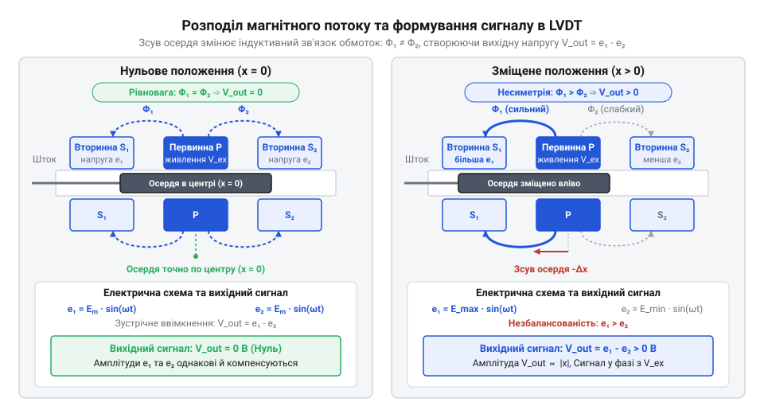
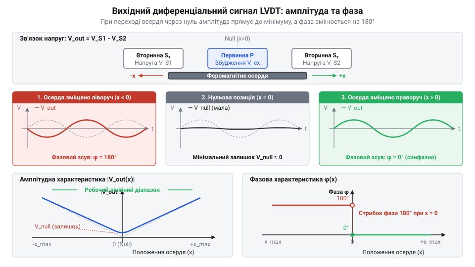
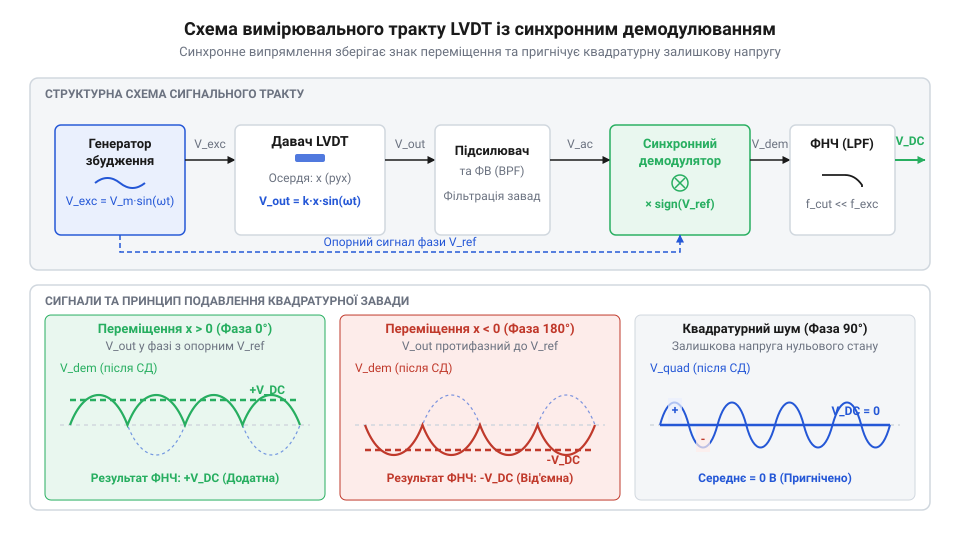

# Лінійні змінні диференціальні трансформатори LVDT

<preknowlist>
- [Датчики кутового положення сервоприводів: потенціометри та магнітні енкодери](root:cat-hw-sensors/servo-feedback-potentiometers-and-magnetic-encoders) — Механічні та електричні недоліки контактних потенціометрів у системах зворотного зв'язку.
- [Сельсини та резольвери: обертові трансформаторні кутоміри](root:cat-hw-sensors/synchro-and-resolver-transducers) — Принципи електромагнітної індукції у змінних трансформаторних перетворювачах та метод фазочутливого зчитування.
</preknowlist>

## Проблема зносу контактних потенціометрів

Для зворотного зв'язку в сервоприводах використовували резистивний @@en|potentiometer@@. У режимі утримання позиції сервосистема здійснює мікроколивання — @@en|dither@@, через що металевий струмознімач (@@en|wiper@@) притискається до доріжки під високим герцівським контактним тиском (@@en|Hertzian contact pressure@@).

Локальне тертя спричиняє трибологічний знос (@@en|tribological wear@@) провідного шару та контактний шум (@@en|wiper noise@@) зі стрибками опору. Під час вібрацій виникає відрив струмознімача (@@en|wiper lift-off@@): опір миттєво зростає, а контролер через це спричиняє аварійний кидок приводу. Ці обмеження [контактних потенціометрів у сервоприводах](root:cat-hw-sensors/servo-feedback-potentiometers-and-magnetic-encoders) вимагають переходу до безконтактного вимірювання.

## Конструкція LVDT та перерозподіл потоку

Давач @@en|LVDT@@ (від англ. *Linear Variable Differential Transformer* — лінійний змінний диференціальний трансформатор) складається з трубчастого каркаса з первинною обмоткою (@@en|primary winding@@), двох симетричних вторинних обмоток (@@en|secondary winding@@) та рухомого феромагнітного осердя в магнітному екрані (@@en|magnetic shield@@).

Первинна обмотка живиться змінним струмом збудження (@@en|excitation current@@). Зміщення осердя змінює магнітний опір (@@en|magnetic reluctance@@, від лат. *reluctari* — чинити опір) шляхів потоку, перерозподіляючи взаємоіндуктивності `M_1` та `M_2` між первинною та вторинними котушками.


*Конструктивна будова LVDT: зміщення осердя змінює магнітні опори колів та перерозподіляє потік між вторинними котушками.*

Індуковані у вторинних котушках ЕРС визначаються виразами:

```
e_1(t) = -M_1 × (d i_p / d t)    [ЕРС першої вторинної обмотки]
e_2(t) = -M_2 × (d i_p / d t)    [ЕРС другої вторинної обмотки]
```

Зсув осердя з нульового положення збільшує один взаємний зв'язок `M` і зменшує інший, пропорційно змінюючи амплітуди вихідних напруг без механічного тертя.

## Зустрічне увімкнення та фазова модуляція

Щоб перетворити зміну двох ЕРС у єдиний сигнал, вторинні обмотки @@en|LVDT@@ з'єднують послідовно-зустрічно (@@en|series-opposing connection@@). Вихідна напруга дорівнює алгебраїчній різниці напруг котушок:

```
v_out(t) = e_1(t) - e_2(t)       [послідовно-зустрічне віднімання ЕРС]
         = (M_1 - M_2) × (d i_p / d t) [винесення струму збудження]
         = k × x × sin(ω t)      [лінійна залежність різниці взаємоіндуктивностей від зсуву x]
```

Тут `k` — чутливість перетворювача, `x` — зсув від нульового положення (@@en|null position@@), а `ω` — частота збудження.


*Амплітудно-фазова модуляція вихідного сигналу LVDT: амплітуда огинаючої пропорційна модулю переміщення, а фаза змінюється на 180° при переході через нуль.*

Сформований сигнал має амплітудно-фазову модуляцію (@@en|amplitude-phase modulation@@). Амплітуда синусоїди пропорційна модулю зсуву `|x|`, а фаза визначає напрямок: у нульовій позиції (`x = 0`) ЕРС однакові й вихід дорівнює нулю, при `x > 0` напруга у фазі зі збудженням (0°), а при `x < 0` фаза змінюється на 180°.

Звичайний діодний випрямляч чи огинаючий детектор (@@en|envelope detector@@) обчислює лише модуль `|v_out(t)|` і втрачає фазу, через що `+x` та `-x` дають однакову напругу. Це унеможливлює розпізнавання напрямку руху, на відміну від [оптичних і магнітних енкодерів](root:cat-hw-sensors/optical-and-magnetic-encoders).

## Синхронне демодулювання та кондиціювання сигналу

У нульовій позиції осердя @@en|LVDT@@ вихідна напруга не дорівнює нулю: через міжобмоткові паразитивні ємності (@@en|parasitic capacitance@@), вихрові струми (@@en|eddy currents@@) та гістерезис виникає залишкова квадратурна напруга або @@en|residual quadrature voltage@@ (від лат. *quadratura* — надання квадратної форми), зсунута на 90° відносно корисного сигналу.

Для визначення напрямку зсуву та пригнічення завади застосовують фазочутливий демодулятор або @@en|phase-sensitive demodulator@@ (від лат. *de-* — усунення, *modulatio* — розміреність). Він множить вихідний сигнал `v_out(t)` на опорну синусоїду збудження `v_ref(t)` з подальшою фільтрацією через фільтр низьких частот або @@en|low-pass filter@@.

Множення корисного сигналу амплітудою `V_out` на опорний сигнал амплітудою `V_ref` на частоті `ω` дає демодульовану напругу `v_demod(t)`:

```
v_demod(t) = (V_out × sin(ω t)) × (V_ref × sin(ω t))   [множення на опорний сигнал]
           = 0.5 × V_out × V_ref × (1 - cos(2 ω t))      [тригонометрична тотожність]
```

Фільтр низьких частот або @@en|low-pass filter@@ прибирає змінну складову `cos(2 ω t)`, лишаючи постійний рівень `0.5 × V_out × V_ref`, чий знак вказує фазу (0° чи 180°). Для квадратурної завади з амплітудою `V_q` множення дає:

```
v_quad(t) = (V_q × cos(ω t)) × (V_ref × sin(ω t))       [множення квадратурного сигналу на опорний]
          = 0.5 × V_q × V_ref × sin(2 ω t)               [тригонометрична тотожність]
```

У виразі немає постійної складової, тому після @@en|low-pass filter@@ її середнє значення дорівнює нулю, що повністю пригнічує квадратурний шум.


*Тракт кондиціювання сигналу LVDT: від генератора збудження до синхронного демодулятора та ФНЧ.*

Тракт кондиціювання або @@en|signal conditioning circuit@@ також компенсує температурний дрейф опору мідних обмоток (+0.393%/°C). Щоб нагрівання не зменшувало струм і чутливість, первинну обмотку живлять від стабілізованого джерела струму або @@en|constant current AC drive@@, чи застосовують відносно-вимірювальну обробку (@@en|ratiometric processing@@) вигляду `(e_1 - e_2) / (e_1 + e_2)`. Схожі схеми застосовують і для [обертових трансформаторних сенсорів](root:cat-hw-sensors/synchro-and-resolver-transducers).