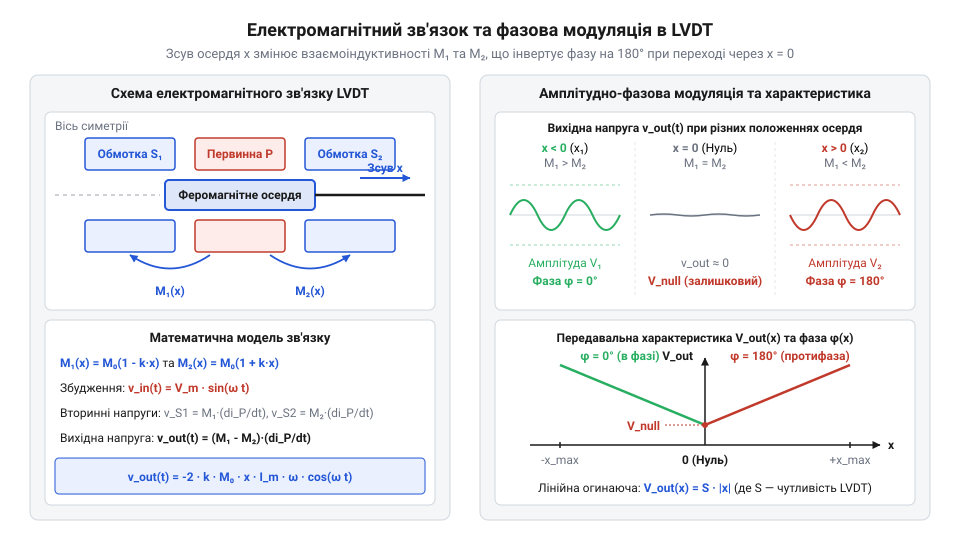
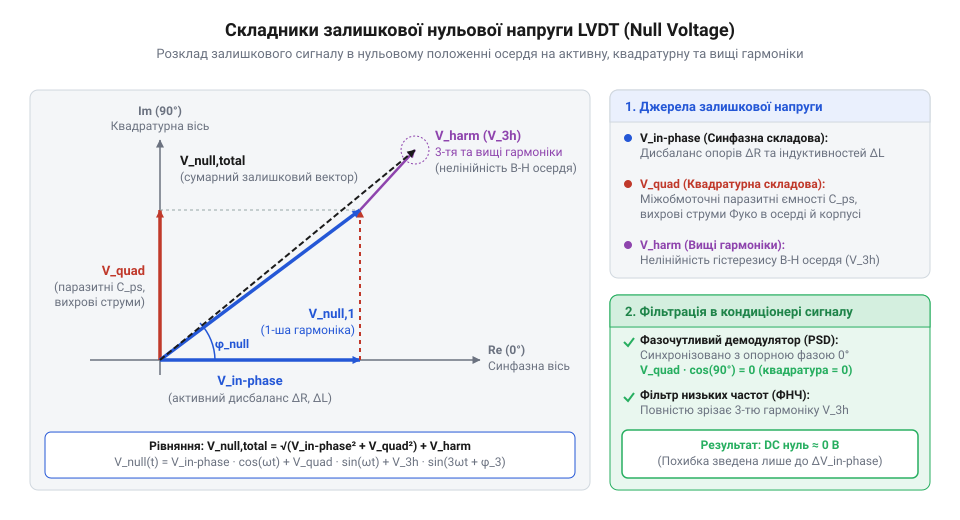

# Математична модель LVDT: взаємоіндуктивність, амплітудно-фазова модуляція та фазові похибки

<preknowlist>
- [Енкодери кутового та лінійного переміщення](root:cat-hw-sensors/optical-and-magnetic-encoders) — принципи дискретизації та вимірювання лінійного переміщення для порівняння з неперервними трансформаторними давачами
- [Сельсини та резольвери: обертові трансформаторні кутоміри](root:cat-hw-sensors/synchro-and-resolver-transducers) — загальні принципи електромагнітної індукції та трансформаторного зв'язку в датчиках положення
</preknowlist>

## Нестабільність вимірювання лінійного переміщення механізмів

У задачах високоточного вимірювання механічного переміщення `x` у промислових агрегатах, авіаційних приводах та гідравлічних циліндрах вимірювальні давачі працюють у жорстких умовах: висока температура, вібрації, наявність мастила та пилу. Застосування стандартних первинних перетворювачів у таких середовищах стикається з фундаментальними фізичними обмеженнями.

Традиційні [контактні потенціометри](root:cat-hw-sensors/servo-feedback-potentiometers-and-magnetic-encoders) (нім. @@de|Potenziometer@@, від лат. @@la|potentia@@ — сила, можливість та грец. @@el|μέτρον@@ — вимірювач) страждають від механічного зношування струмознімального контактного вузла, окиснення доріжок та контактного шуму. Цифрові оптичні [енкодери лінійного переміщення](root:cat-hw-sensors/optical-and-magnetic-encoders) (англ. @@en|encoder@@ — кодувальник) забезпечують високу роздільну здатність, проте оптичні растри легко забруднюються мастилом або конденсатом, що вимагає складного герметичного корпусування. 

Прості однообмоткові індуктивні давачі (лат. @@la|inductio@@ — наведення) безконтактні, але мають високий температурний дрейф (англ. @@en|drift@@ — зсув, відхилення) активного опору мідного дроту `R(T)` та магнітної проникності осердя `μ_r(T)`. Це призводить до нестабільності відліку, виникнення @@en|zero drift@@ (дрейф нуля) та прямої залежності вихідного сигналу від коливань амплітуди джерела живлення `U_m(t)`.

Для усунення механічного тертя та компенсації спільних дестабілізувальних чинників застосовують симетричну трансформаторну структуру з рухомим феромагнітним осердям. Зсув осердя `x` змінює магнітний опір (лат. @@la|reluctantia@@ — опір, протидія) окремих ділянок магнітопроводу, що модулює коефіцієнти взаємоіндуктивності між обмотками.

Такий перетворювач називається LVDT (англ. @@en|linear variable differential transformer@@ — лінійний регульований диференціальний трансформатор). Подібно до того як [обертові трансформатори](root:cat-hw-sensors/synchro-and-resolver-transducers) вимірюють кутове положення через зміну магнітного зв'язку, @@en|LVDT@@ забезпечує неперервне вимірювання лінійного переміщення з теоретично безкінечною роздільною здатністю та відсутністю механічного зношування.

Математична задача полягає в тому, щоб описати зв'язок між механічним зміщенням `x` та коефіцієнтами взаємоіндуктивності `M_1(x)` і `M_2(x)`, вивести аналітичний вираз диференційної вихідної напруги за гармонійного збудження та обґрунтувати компенсацію температурного дрейфу й нестабільності живлення.

## Математична модель взаємоіндуктивності обмоток LVDT

Конструктивно @@en|LVDT@@ складається з однієї центральної первинної обмотки `P` та двох симетрично розташованих вторинних обмоток `S_1` та `S_2`, розміщених на циліндричному каркасі з неферомагнітного матеріалу. Усередині каркаса вздовж осі `x` переміщується циліндричне феромагнітне осердя довжиною `L_c`.

Первинна обмотка живиться гармонійним струмом від джерела напруги `u_p(t) = U_m × sin(ω × t)`, де `U_m` — амплітуда напруги збудження (В), а `ω` — циклічна частота (рад/с). Ця напруга створює в первинній обмотці струм `i_p(t) = I_m × sin(ω × t - φ_p)`, де `I_m` — амплітуда струму, а `φ_p` — фазовий зсув, зумовлений повним імпедансом первинного кола `Z_p = R_p + j × ω × L_p`.

Магнітний потік у системі визначається повним магнітним опором `R_m` (лат. @@la|reluctantia@@) магнітного кола. У нульовому положенні осердя (`x = 0`) воно розташоване рівновіддалено від вторинних обмоток `S_1` та `S_2`. Магнітні опори потоків охоплення першої та другої вторинної обмотки є однаковими, що забезпечує рівність коефіцієнтів взаємоіндуктивності (лат. @@la|inductio@@) `M_1(0) = M_2(0) = M_0`.

При зміщенні осердя на величину `x` від центрального положення:
- Осердя глибше перекриває область обмотки `S_1`, зменшуючи магнітний опір першого кола: `R_m1(x) = R_m0 - k_R × x`. - Осердя виходить із зони обмотки `S_2`, збільшуючи магнітний опір другого кола: `R_m2(x) = R_m0 + k_R × x`. Тут `R_m0` — номінальний магнітний опір при `x = 0`, а `k_R` — коефіцієнт зміни магнітного опору на одиницю переміщення.

Коефіцієнт взаємоіндуктивності `M` між первинною обмоткою з числом витків `N_p` та вторинною обмоткою з числом витків `N_s` обернено пропорційний магнітному опору: `M = (N_p × N_s) ÷ R_m`.

Розкладаючи вираз у ряд Тейлора в околі точки `x = 0` для малих переміщень `|x| << L_c`, отримуємо залежність взаємоіндуктивності першої вторинної обмотки `M_1(x)`:

```
M_1(x)
= (N_p × N_s) ÷ R_m1(x)              [формула взаємоіндуктивності через магнітний опір]
= (N_p × N_s) ÷ (R_m0 - k_R × x)      [підстановка магнітного опору першої половини]
= M_0 × (1 + k_m × x)                 [лінійне наближення розкладу в ряд Тейлора]
```

Аналогічно для другої вторинної обмотки `M_2(x)`:

```
M_2(x)
= (N_p × N_s) ÷ R_m2(x)              [формула взаємоіндуктивності через магнітний опір]
= (N_p × N_s) ÷ (R_m0 + k_R × x)      [підстановка магнітного опору другої половини]
= M_0 × (1 - k_m × x)                 [лінійне наближення розкладу в ряд Тейлора]
```

У цих виразах:
- `N_p` — число витків первинної обмотки `P`. - `N_s` — число витків кожної з однакових вторинних обмоток `S_1` та `S_2`. - `M_0 = (N_p × N_s) ÷ R_m0` — номінальна @@en|mutual inductance@@ (взаємоіндуктивність) при `x = 0` (Гн). - `k_m = k_R ÷ R_m0` — конструктивний коефіцієнт чутливості взаємоіндуктивності до зміщення (мм⁻¹).

За законом електромагнітної індукції Фарадея (англ. @@en|Faraday's law of induction@@), змінний струм первинної обмотки `i_p(t)` індукує електрорушійні сили (ЕРС) `e_s1(t)` та `e_s2(t)` у вторинних обмотках:
`e_s1(t) = - M_1(x) × (d i_p(t) ÷ d t)`
`e_s2(t) = - M_2(x) × (d i_p(t) ÷ d t)`

Похідна первинного струму за часом `d i_p(t) ÷ d t` для гармонійного сигналу `i_p(t) = I_m × sin(ω × t - φ_p)` дорівнює `I_m × ω × cos(ω × t - φ_p)`.

Віднімаючи ЕРС другої обмотки від першої, отримуємо диференційну ЕРС `e_diff(t) = e_s1(t) - e_s2(t)`:

```
e_diff(t)
= e_s1(t) - e_s2(t)                                    [різниця індукованих ЕРС]
= - M_1(x) × (d i_p / d t) + M_2(x) × (d i_p / d t)    [закон електромагнітної індукції Фарадея]
= - (M_1(x) - M_2(x)) × (d i_p / d t)                  [винесення похідної струму за дужки]
= - 2 × M_0 × k_m × x × I_m × ω × cos(ω × t - φ_p)    [підстановка взаємоіндуктивностей та похідної струму]
```

Отримане диференціальне рівняння показує, що амплітуда результуючої ЕРС пропорційна величинам зміщення `x` та частоти `ω`, а знак `x` визначає фазовий орієнтир вихідного сигналу відносно збудження.


*Схема електромагнітного зв'язку обмоток LVDT та залежність взаємоіндуктивності й амплітуди вихідного сигналу від зміщення осердя x.*

## Амплітудно-фазова модуляція та диференційний вихід

Щоб зняти сигнал переміщення з @@en|LVDT@@, вторинні обмотки `S_1` та `S_2` вмикають зустрічно послідовно. Результуюча вихідна напруга `u_out(t) = u_s1(t) - u_s2(t)` являє собою амплітудно-фазово модульований сигнал (лат. @@la|modulatio@@ — розмірність, гармонійність).

У режимі холостого ходу напруги на виводах збігаються з індукованими ЕРС: `u_s1(t) = - e_s1(t)` та `u_s2(t) = - e_s2(t)`. Зраховуючи амплітуду збудження `U_m`, виразимо модуль амплітуди вихідної диференційної напруги `U_out_m(x)`:

```
U_out_m(x)
= 2 × M_0 × k_m × I_m × ω × |x|     [модуль амплітуди диференційної напруги]
= S_v × U_m × |x|                   [вираження через чутливість та амплітуду збудження]
```

Тут `S_v = 2 × M_0 × k_m × ω ÷ |Z_p|` — коефіцієнт напругової чутливості @@en|LVDT@@ (вимірюється в мВ/В/мм).

Поведінка вихідного сигналу залежно від положення осердя:
- При `x > 0`: `M_1(x) > M_2(x)`, тому `U_s1 > U_s2`. Вихідна напруга `u_out(t)` перебуває в фазі з опорним сигналом `cos(ω × t - φ_p)` (зсув фази 0°). - При `x = 0`: В ідеальній математичній моделі `M_1(0) = M_2(0) = M_0`, тому вихідна напруга `u_out(t) = 0`. - При `x < 0`: `M_1(x) < M_2(x)`, тому `U_s2 > U_s1`. Амплітуда сигналу зростає пропорційно `|x|`, але фаза вихідної напруги стрибкоподібно змінюється на 180° (`π` рад).

У реальних фізичних перетворювачах у точці `x = 0` сигнал `u_out(t)` не стає строгим нулем. Фізичні неідеальності формують залишкову нульову напругу (англ. @@en|null voltage@@).

Основними джерелами виникнення залишкової нульової напруги `u_null(t)` є:
1. Геометрична та конструктивна асиметрія намотування обмоток. 2. Паразитні міжобмоткові ємності. 3. Вищі гармоніки в струмі збудження та магнітопроводі. 4. Вихрові струми Фуко (фр. @@fr|Foucault@@, за ім'ям фізика Жана Бернара Леона Фуко; англ. @@en|eddy currents@@), наведені в металевих елементах осердя та корпусу. Вони створюють реактивне магнітне поле, зсунуте за фазою на 90°.

Математично залишкова напруга `u_null(t)` розкладається на дві ортогональні складові:

```
u_null(t)
= u_s1(t)|_(x=0) - u_s2(t)|_(x=0)                            [різниця вторинних напруг при нульовому зсуві]
= U_in_phase × cos(ω × t - φ_p) + U_quadrature × sin(ω × t - φ_p)  [ортогональний розклад за активною та реактивною фазою]
= U_null_m × cos(ω × t - φ_p - φ_null)                       [зведення до амплітудно-фазової форми]
```

Де:
- `U_in_phase` — @@en|in-phase component@@ (синфазна складова), зумовлена незначним геометричним зсувом нуля (може бути мінімізована механічним юстуванням). - `U_quadrature` — @@en|quadrature component@@ (квадратурна складова, лат. @@la|quadratura@@ — надання квадратної форми; англ. @@en|quadrature error@@), зсунута на 90° відносно несучої через вихрові струми та ємнісні витоки (не усувається механічним зсувом осердя).


*Векторна діаграма вихідної напруги LVDT у нульовому положенні осердя.*

Для пригнічення квадратурної завади та збереження інформації про напрямок зсуву `sign(x)` застосовують синхронне детектування (лат. @@la|de-@@ — зняття та @@la|modulatio@@ — розмірність; англ. @@en|phase-sensitive demodulation@@). Множення сигналу `u_out(t)` на опорну несучу `cos(ω × t - φ_p)` з наступною фільтрацією нижніх частот повністю усуває квадратурну складову `U_quadrature × sin(...)`, оскільки інтеграл добутку ортогональних гармонік за період дорівнює нулю (`∫ cos(θ) × sin(θ) dθ = 0`). Докладний аналіз схемотехніки аналогових і цифрових синхронних демодуляторів викладено у статті про [синхронне детектування та фазочутливу демодуляцію давачів положення](root:cat-hw-sensors/lvdt-linear-variable-differential-transformers/math-lvdt-electromagnetics-and-demodulation.md).

Для компенсації температурного дрейфу опору мідних обмоток `R_p(T)` та нестабільності амплітуди живлення `U_m(t)` використовують ратіометричне вимірювання (лат. @@la|ratio@@ — відношення, розрахунок та грец. @@el|μέτρον@@ — вимірювач; англ. @@en|ratiometric measurement@@). Замість обробки лише диференційної напруги `u_out(t)`, аналоговий кондиціонер вимірює амплітуди обох вторинних обмоток `U_s1` та `U_s2` окремо й обчислює безрозмірне відношення `R_ratio(x)`:

```
R_ratio(x)
= (U_s1 - U_s2) ÷ (U_s1 + U_s2)                                    [означення ратіометричного коефіцієнта]
= (K × U_m × (1 + k_m × x) - K × U_m × (1 - k_m × x)) ÷ (K × U_m × (1 + k_m × x) + K × U_m × (1 - k_m × x)) [підстановка амплітуд вторинних напруг]
= (2 × K × U_m × k_m × x) ÷ (2 × K × U_m)                          [спрощення чисельника та знаменника]
= k_m × x                                                          [скорочення спільного множника K × U_m]
```

Тут `K = (N_s ÷ N_p) × (ω × M_0 ÷ |Z_p|)` — спільний електромагнітниій коефіцієнт передачі.

Це математичне доведення показує, що безрозмірний сигнал `R_ratio(x)` інваріантний відносно амплітуди напруги збудження `U_m`, частоти `ω` та температурних змін опору первинної обмотки `Z_p(T)`. Якщо температура змінює параметри обох симетричних вторинних обмоток однаково, ратіометричний алгоритм гарантує високу стабільність нуля та лінійність перетворення у широкому діапазоні температур. Так само, як у високоточних [резольверних системах](root:cat-hw-sensors/synchro-and-resolver-transducers), ратіометричне ділення перетворює трансформаторні амплітуди на інваріантне значення положення.

## Джерела залишкової напруги та квадратурних похибок

Якби перетворювач @@en|LVDT@@ (абревіатура від англ. @@en|Linear Variable Differential Transformer@@ — лінійний змінний диференціальний трансформатор, від латинського *linearis* — лінійний, *variabilis* — змінний, *differentia* — різниця та *transformare* — перетворювати) був ідеальним пристроєм, то при встановленні феромагнітного осердя в геометричний центр (`x = 0`) різниця взаємоіндуктивностей вторинних обмоток дорівнювала б нулю, а вихідна напруга повністю зникала б. Однак вимірювання вихідного сигналу реального давача осцилографом у точці балансу виявляє наявність неперервної змінної напруги. Цей ненульовий сигнал називається залишкова нульова напруга (англ. @@en|null voltage@@, від латинського *nullus* — ніякий та прізвища італійського фізика Алессандро Вольти).

Існує три незалежні фізичні механізми, які формують залишкову напругу:

Перший механізм — ємнісний зв'язок (англ. @@en|parasitic capacitive coupling@@, від грецького *parasitos* — утриманець та латинського *capacitas* — місткість). Первинна й вторинні обмотки розташовані в безпосередній близькості одна до одної, утворюючи паразитивні міжобмоткові ємності `C_p1` та `C_p2`. Змінна напруга первинного збудження `u_p(t) = U_m × sin(ω × t)` має швидкість зміни `du_p / dt = ω × U_m × cos(ω × t)`. Ця похідна створює струм витоку через міжобмоткову ємність `i_c = C_p × (du_p / dt)`. Оскільки струм ємності пропорційний похідній напруги, він зсунутий по фазі відносно первинної напруги рівно на 90°. Навіть найменша геометрична несиметрія ємностей `C_p1` та `C_p2` наводить на вторинних обмотках різницеву напругу, яка знаходиться в точній квадратурі до корисного сигналу.

Другий механізм — вихрові струми Фуко (англ. Foucault eddy currents, від імені французького фізика Léon Foucault). Змінне магнітне поле первинної обмотки пронизує не лише рухоме осердя, а й металевий корпус та елементи кріплення. У цих провідних тілах виникають замкнені струми, які утворюють власний паразитний магнітний потік `Φ_eddy`. Через активний опір корпусу цей потік має фазову затримку відносно основного поля. Неоднорідність матеріалу корпуса або асиметрія його вихрових втрат призводить до того, що наведені ЕРС у двох половинах вторинної обмотки не компенсуються повністю.

Третій механізм — фазовий зсув (англ. @@en|phase shift@@, від грецького *phasis* — поява) первинного струму. Первинна обмотка має не лише індуктивність `L_p`, а й активний мідний опір `R_p`. Струм первинної обмотки `i_p(t)` відстає від напруги збудження на кут `φ_p = arctan(ω × L_p / R_p)`. Наведена вторинна ЕРС `e_s(t) = -M × (di_p / dt)` додає ще 90° зсуву. У результаті фазовий кут `θ` між напругою збудження та вихідною ЕРС становить `θ = 90° - φ_p = arctan(R_p / (ω × L_p))`. Принцип трансформаторного зв'язку та фазового виявлення напрямку в @@en|LVDT@@ має спільні електромагнітні корені з [обертовими трансформаторними кутомірами](root:cat-hw-sensors/synchro-and-resolver-transducers), однак у лінійному трансформаторі зміна мідного опору від температури `R_p(T) = R₀ × (1 + α × ΔT)` викликає постійний фазовий дрейф.

Для математичного опису залишкової напруги `u_null(t)` у нульовій точці `x = 0` її розкладають на три ортогональні складові:

```
u_null(t)
= U_in_phase × sin(ω × t) + U_quadrature × cos(ω × t) + u_harmonics(t)    [ортогональний розклад залишкового сигналу]
```

У цій формулі `u_null(t)` — це миттєва залишкова напруга у часі `t`, `U_in_phase` — амплітуда синфазної складової, `U_quadrature` — амплітуда квадратурної складової, `u_harmonics(t)` — сума вищих непарних гармонік (`3ω`, `5ω`), а `ω` — кругова частота збудження.

Амплітуда `U_in_phase` зветься синфазна складова (англ. @@en|in-phase component@@). Вона збігається за фазою із сигналом збудження `sin(ω × t)` і виникає через невелику активну несиметрію опору та індуктивностей обмоток.

Амплітуда `U_quadrature` зветься квадратурна складова (англ. @@en|quadrature component@@, від латинського *quadratura* — надання квадратної форми, зсув на 90°). Вона зсунута на 90° відносно збудження (`cos(ω × t)`) і породжується паразитивним @@en|ємнісним зв'язком@@ та втратами на @@en|вихрові струми Фуко@@.

Гармоніки `u_harmonics(t)` виникають через нелінійність кривої намагнічування `μ(H)` та гістерезис феромагнітного осердя.


*Розклад залишкового сигналу u_null у нульовому положенні осердя на синфазну U_in_phase та квадратурну U_quadrature векторні складові.*

Щоб компенсувати кут `θ` між напругою збудження та вихідним сигналом в аналогових вимірювальних колах, застосовують фазокомпенсувальний RC-ланцюг (англ. @@en|RC phase compensation network@@). Для повного узгодження фази параметри резистора `R_c` та конденсатора `C_c` розраховують за виведеним співвідношенням:

```
R_c × C_c
= R_p / (ω² × L_p)      [умова фазового узгодження RC-ланцюга з первинною обмоткою]
```

Де `R_p` — активний опір первинної обмотки, `L_p` — її індуктивність, `ω` — кутова частота збудження, `R_c` — опір компенсаційного резистора, а `C_c` — ємність компенсаційного конденсатора.

Такий ланцюг повертає синфазну складову корисного сигналу у фазу з опорною напругою, проте він не здатний усунути квадратурну складову `U_quadrature` та температурний дрейф опору `R_p(T)`. Це створює потребу в обробці сигналу, яка математично нечутлива до фазових та амплітудних дрейфів.

## Ратіометрична обробка та компенсація дрейфів

Для усунення впливу температурного дрейфу та нестабільності напруги живлення застосовують ратіометричний метод (англ. @@en|ratiometric processing@@, від латинського *ratio* — відношення та грецького *metron* — вимірювання). Замість вимірювання чистої різниці напруг обчислюють відношення різниці вихідних амплітуд до їхньої суми.

Запишемо математичні моделі амплітуд вихідних напруг першої `U_s1(x)` та другої `U_s2(x)` вторинних обмоток як функції механічного зсуву осердя `x`:

```
U_s1(x) = K₀ × U_m × (1 + k_m × x)
U_s2(x) = K₀ × U_m × (1 - k_m × x)
```

Тут `U_m` — амплітуда напруги збудження первинної обмотки, `k_m` — конструктивна чутливість давача, `x` — зсув осердя від центру, а `K₀` — базовий коефіцієнт трансформації у нульовій точці. Коефіцієнт `K₀` визначається індуктивним зв'язком і виражається через частоту `ω`, взаємоіндуктивність `M₀` та імпеданс первинного кола: `K₀ = (ω × M₀) / √ (R_p² + ω² × L_p²)`.

Обчислимо різницю амплітуд вторинних напруг `U_diff(x)` та їхню суму `U_sum(x)`:

```
U_diff(x)
= U_s1(x) - U_s2(x)
= K₀ × U_m × (1 + k_m × x) - K₀ × U_m × (1 - k_m × x)    [підстановка виразів вторинних напруг]
= 2 × K₀ × U_m × k_m × x                                 [зведення подібних доданків]
```

```
U_sum(x)
= U_s1(x) + U_s2(x)
= K₀ × U_m × (1 + k_m × x) + K₀ × U_m × (1 - k_m × x)    [підстановка виразів вторинних напруг]
= 2 × K₀ × U_m                                           [зведення подібних доданків]
```

Тепер знайдемо @@en|ратіометричне відношення@@ `R_ratio(x)` як частку від ділення різниці амплітуд на їхню суму:

```
R_ratio(x)
= U_diff(x) / U_sum(x)                                   [визначення ратіометричного співвідношення]
= (2 × K₀ × U_m × k_m × x) / (2 × K₀ × U_m)              [підстановка виразів різниці та суми]
= k_m × x                                                [скорочення спільного множника 2 × K₀ × U_m]
```

З отриманого виразу видно, що множник `2 × K₀ × U_m` у чисельнику та знаменнику скорочується повністю. Це алгебраїчне скорочення дає важливі фізичні висновки:

1. Повна інваріантність до амплітуди збудження `U_m`: будь-які пульсації чи дрейф джерела живлення одночасно змінюють і різницю, і суму напруг, не впливаючи на результат `R_ratio(x)`. 2. Скасування температурного дрейфу `K₀(T)`: зміна активного опору обмоток `R_p(T)` та магнітної проникності `μ(T)` однаково масштабує обидві вторинні напруги, тому їхнє відношення залишається незмінним. 3. Лінійність: підсумковий сигнал `R_ratio(x)` строго лінійно залежить від зсуву `x` із постійним коефіцієнтом чутливості `k_m`.

Завдяки повній компенсації температурного дрейфу й амплітудної нестабільності ратіометричний @@en|LVDT@@ перевершує [потенціометричні та магнітні давачі](root:cat-hw-sensors/servo-feedback-potentiometers-and-magnetic-encoders) в умовах високих температур та агресивного промислового середовища.

У сучасних цифрових кондиціонерах сигналу (англ. @@en|signal conditioner@@, від латинського *condicio* — угода, стан) обробка будується на алгоритмах цифрової фільтрації та синхронного виявлення. У той час як [цифрові магнітні енкодери](root:cat-hw-sensors/as5048-magnetic-encoder) видають готове обчислене значення через цифровий інтерфейс, обробка сигналу @@en|LVDT@@ вимагає аналогової або цифрової синхронної демодуляції на стороні мікроконтролера.

Для виділення синфазної складової та пригнічення квадратурної похибки `U_quadrature` аналогово-цифровий перетворювач мікроконтролера дискретизує сигнальні хвилі `u_s1(t)` та `u_s2(t)`. Потім алгоритм реалізує процедуру, яка називається @@en|синхронна демодуляція@@ (англ. @@en|synchronous demodulation@@, від грецького *synchronos* — одночасний та латинського *de-* — скасування, *modulatio* — розміреність):

```
U_in_phase
= (2 / T_period) × ∫ u_s(t) × sin(ω × t) dt    [обчислення синфазної проєкції сигналу за період T_period]
```

Тут `u_s(t)` — вихідний сигнал вторинної обмотки, `T_period` — період частоти збудження, `ω` — кругова частота, а `sin(ω × t)` — опорна гармонічна хвиля. Операція інтегрування за повний період `T_period` повністю обнуляє квадратурний доданок `cos(ω × t)` та вищі гармоніки `u_harmonics(t)`, залишаючи лише чисту амплітуду корисного сигналу.

Нижче наведено програмний модуль обчислення нормованого зсуву `x` за ратіометричним алгоритмом для вбудованих систем:

:::tabs
:::code math-lvdt-electromagnetics-and-demodulation/c/embedded/calculate-lvdt-position.c

:::code math-lvdt-electromagnetics-and-demodulation/cpp/embedded/lvdtconditioner.cpp
:::

Алгоритм обчислює суму `u_sum`, здійснює перевірку на нуль для запобігання переповненню, розраховує ратіометричний коефіцієнт `r_ratio` та ділить його на чутливість `k_m`, повертаючи точний фізичний зсув осердя `x`. Отримані рівняння та алгоритми повністю замикають математичну модель @@en|LVDT@@ — від фізики змінних магнітних потоків у котушках до вихідного виміряного значення у мікроконтролері.