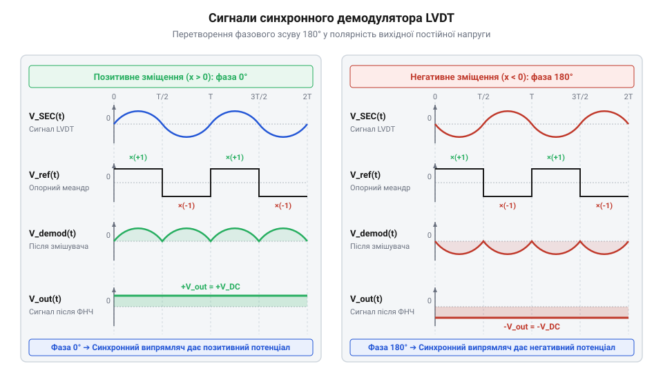
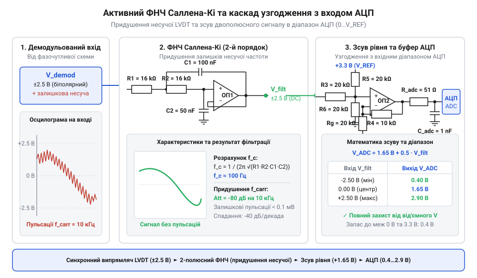

# Розробка прецизійного аналого-цифрового кондиціонера сигналу LVDT із синхронним демодулятором

<preknowlist>
- [Сельсини та резольвери: обертові трансформаторні кутоміри](root:cat-hw-sensors/synchro-and-resolver-transducers) — Принцип трансформаторного зняття сигналу збудженням змінного струму та амплітудно-фазова модуляція вихідної напруги.
</preknowlist>

## Проблема прямого зчитування сигналу LVDT

Лінійний змінний диференціальний трансформатор (LVDT) видає на своїх вторинних обмотках змінну напругу, амплітуда якої пропорційна відхиленню магнітного осердя від центрального положення. Коли осердя знаходиться точно по центру, напруги на обох вторинних обмотках рівні за амплітудою, але протилежні за фазою, тому їхня різниця дорівнює нулю. Зміщення осердя в один або інший бік збільшує напругу в одній обмотці та зменшує в іншій.

Здавалося б, достатньо просто виміряти амплітуду диференціального сигналу, щоб дізнатися відстань зміщення. Проте такий підхід працює лише для визначення абсолютної величини відхилення, але втрачає інформацію про його напрямок. Амплітуда сигналу зростає симетрично незалежно від того, чи зміщується осердя вліво, чи вправо. Єдиним параметром, який містить інформацію про напрямок переміщення, є фаза вихідного сигналу відносно сигналу збудження первинної обмотки: при переході через нульове положення фаза стрибком змінюється на 180 градусів.

Без урахування цієї фазової інформації пряме зчитування амплітуди також страждає від чутливості до шумів та нестабільності напруги збудження. Будь-які коливання температури чи живлення, які впливають на амплітуду первинного сигналу, напряму спотворюють результати вимірювання, оскільки система не може відрізнити зміну положення осердя від зміни амплітуди збудження. Тому для точного визначення позиції необхідно застосовувати синхронну демодуляцію, яка перемножує вихідний сигнал з опорним, дозволяючи виділити як величину, так і знак зміщення, і пригнічуючи при цьому несинхронні завади.

## Генератор стабільного синусоїдального збудження обмотки

Для живлення первинної обмотки LVDT-давача необхідний джерело гармонічного коливання зі стабільною амплітудою та низьким коефіцієнтом нелінійних спотворень. Будь-які спотворення форми сигналу або дрейф амплітуди будуть сприйняті демодулятором як зміна позиції осердя, що призведе до помилок вимірювання.

Одним із класичних і надійних рішень є генератор синусоїдального сигналу на базі моста Віна. Він складається з підсилювача та частотнозалежного RC-ланцюга, який забезпечує фазовий зсув на нуль градусів на робочій частоті. Для стабілізації амплітуди коливань та запобігання насиченню підсилювача в коло зворотного зв'язку зазвичай вводять нелінійний елемент, наприклад, лампу розжарювання, термістор або схему автоматичного регулювання підсилення (АРП) на польовому транзисторі чи діодах.

Сучасніші кондиціонери часто використовують прямий цифровий синтез (DDS), де синусоїда генерується мікроконтролером або спеціалізованою мікросхемою та подається на цифро-аналоговий перетворювач (ЦАП). Це дозволяє досягти високої стабільності частоти, визначеної кварцовим резонатором, та програмно керувати амплітудою.

Незалежно від способу генерації, сигнал потребує посилення для здатності керувати низькоімпедансною первинною обмоткою LVDT. Вихідний буфер струму повинен забезпечувати достатній струм без спотворення синусоїди, оскільки зміна індуктивного опору давача в залежності від положення осердя і температури може впливати на навантаження генератора.

## Схемотехніка аналогового синхронного демодулятора сигналу

Аналоговий синхронний демодулятор виконує фазочутливе випрямлення диференціального сигналу з вторинних обмоток LVDT. Його завдання — перетворити змінну напругу в постійну, амплітуда якої пропорційна відхиленню, а полярність відповідає напрямку зміщення.

Принцип дії полягає в множенні вхідного синусоїдального сигналу на прямокутний опорний сигнал (меандр), який синхронізований за фазою з напругою збудження первинної обмотки. Якщо вихідний сигнал синфазний з опорним, результат множення є додатною пульсуючою напругою. Якщо фази протилежні (сунуті на 180 градусів), результат буде від'ємним.

Схемотехнічно це часто реалізується за допомогою прецизійних операційних підсилювачів та аналогових ключів (наприклад, CD4053 або спеціалізованих мікросхем). Ключі перемикають коефіцієнт підсилення каскаду між +1 та -1 синхронно з опорним меандром.

*На схемі часових діаграм показано синусоїдальний вихідний сигнал LVDT, опорний меандр та результат фазочутливого випрямлення для позитивного й негативного зміщення сердечника.*

Оскільки в реальному давачі завжди існує певний фазовий зсув між первинною напругою збудження та вихідним диференціальним сигналом (через індуктивність та опір обмоток, а також ємність кабелю), перед компаратором, який формує опорний меандр, обов'язково ставлять ланцюг фазової компенсації. Схемотехнічно такий ланцюг найчастіше реалізують у вигляді активного фазообертача (all-pass filter) на базі операційного підсилювача з RC-ланцюгом. Використання підстроювального резистора в цьому контурі дозволяє плавно регулювати фазовий зсув у широких межах, зовсім не змінюючи амплітуду сигналу. Це дозволяє точно узгодити моменти перемикання ключів з переходами через нуль корисного сигналу, максимізуючи вихідну постійну напругу.

Для виділення постійної складової та пригнічення пульсацій подвоєної частоти збудження після демодулятора ставлять активний фільтр нижніх частот.

*Принципова схема двополюсного активного фільтра нижніх частот Саллена-Кі з буфером входу АЦП та ланцюгом зсуву рівня.*

Цей фільтр також може виконувати роль буфера для АЦП та зсувати рівень сигналу так, щоб нульовому переміщенню відповідала напруга, рівна половині опорної напруги АЦП (наприклад, 1.65 В при живленні 3.3 В). Це дозволяє оцифровувати біполярний сигнал за допомогою однополярного АЦП.

Після оцифрування мікроконтролер виконує подальшу математичну обробку.

:::tabs
:::code proj-lvdt-precision-conditioner/c/include/adc_hal.h
:::code proj-lvdt-precision-conditioner/c/include/lvdt.h
:::code proj-lvdt-precision-conditioner/c/src/adc_hal.c
:::code proj-lvdt-precision-conditioner/c/src/lvdt.c
:::code proj-lvdt-precision-conditioner/c/src/main.c
===
:::code proj-lvdt-precision-conditioner/cpp/include/adc_interface.hpp
:::code proj-lvdt-precision-conditioner/cpp/include/lvdt_conditioner.hpp
:::code proj-lvdt-precision-conditioner/cpp/src/lvdt_conditioner.cpp
:::code proj-lvdt-precision-conditioner/cpp/src/main.cpp
:::

## Фільтрація демодульованого сигналу та узгодження АЦП

Після синхронного демодулятора ми отримуємо пульсуючу напругу, що містить як корисну постійну складову (пропорційну переміщенню), так і високочастотні залишки опорного сигналу. Щоб аналого-цифровий перетворювач зміг коректно оцифрувати це значення, високочастотні пульсації необхідно придушити, виділивши чисту постійну напругу. Для цього використовується активний фільтр нижніх частот.

Найчастіше застосовують топологію Саллена-Кі через її стабільність та можливість незалежного налаштування коефіцієнта підсилення і частоти зрізу. Частота зрізу фільтра обирається з урахуванням динаміки переміщення сердечника: вона має бути достатньо високою, щоб пропускати швидкі зміни положення, але достатньо низькою, щоб ефективно відсікати частоту збудження. Наприклад, якщо частота збудження становить 10 кГц, а механічний рух не перевищує 100 Гц, частоту зрізу фільтра доцільно встановити на рівні 500 Гц. Це забезпечить плавний і чистий сигнал на виході.

Демодульований і відфільтрований сигнал може мати діапазон або розмах, який не збігається з вхідним діапазоном мікроконтролерного АЦП. Для узгодження сигналу без втрати розрядності застосовують операційні підсилювачі, які масштабують напругу і зсувають її рівень. Наприклад, якщо сигнал LVDT змінюється від -2.5 В до +2.5 В, а АЦП вимірює від 0 до 3.3 В, буферний каскад має додати зміщення 1.65 В і масштабувати амплітуду.

Завдяки цьому підготовлена напруга безпосередньо подається на вхід мікроконтролера. Програмний драйвер АЦП виконує зчитування та базове цифрове згладжування за допомогою фільтра експоненційного ковзного усереднення (EMA).

:::tabs
:::code proj-lvdt-precision-conditioner/c/src/adc_hal.c 53-84|c
:::code proj-lvdt-precision-conditioner/cpp/src/main.cpp 31-49|cpp
:::

Зчитане значення сирого коду перетворюється на вольти, які потім проходять додаткову цифрову фільтрацію для усунення випадкових шумів, перш ніж стати основою для розрахунку фізичного зміщення.

## Захист аналогового тракту та трасування плати

Слабкий диференціальний сигнал від вторинних обмоток LVDT є надзвичайно чутливим до зовнішніх електромагнітних завад і паразитних ємностей. Тому фізичне проектування друкованої плати та правильне підключення 6-провідної лінії відіграють ключову роль у забезпеченні високої точності вимірювань.

Лінія зв'язку між давачем і кондиціонером має бути екранованою, а екран заземленим лише з одного боку — як правило, на стороні приймача. Це запобігає утворенню земляних петель, які можуть наводити додатковий шум. На самій платі критично важливо фізично розділити аналогову та цифрову землі, з'єднавши їх лише в одній точці, бажано під мікросхемою аналого-цифрового перетворювача. Такий підхід гарантує, що імпульсні струми цифрової частини не створюватимуть падіння напруги на чутливих аналогових колах.

Для побудови вимірювального тракту слід обирати прецизійні операційні підсилювачі з низьким температурним дрейфом напруги зсуву. Навіть мікровольтні зміни, викликані нагріванням компонентів, після підсилення перетворюються на відчутну похибку вимірювання. Трасування сигнальних ліній від роз'єму до підсилювачів має бути максимально коротким і симетричним, щоб мінімізувати диференціальний фазовий зсув між каналами.

## Налагодження та калібрування кондиціонера LVDT

Навіть ідеально спроектований і спаяний кондиціонер потребує фізичного налаштування та калібрування в парі з конкретним LVDT-давачем. Через технологічні розкиди параметрів обмоток, індуктивність і опір кожної котушки трохи відрізняються, що призводить до початкового зсуву нуля та зміни масштабу.

Першим кроком є компенсація фазового зсуву між первинним і вторинним сигналами. За допомогою двоканального осцилографа слід спостерігати сигнал збудження та сигнал з вторинних обмоток, подавши їх на різні канали. Практично це реалізується підбором параметрів фазообертальних RC-ланцюжків: конденсатори фіксованої ємності зазвичай доповнюються прецизійними багатообертовими потенціометрами. Плавно обертаючи гвинт потенціометра та спостерігаючи за екраном осцилографа (наприклад, зводячи моменти перетину нуля обома синусоїдами в режимі часу або використовуючи фігури Ліссажу до отримання вузької діагональної прямої), виконується точне підлаштування. Таким налаштуванням RC-ланцюжків у колі синхронного демодулятора необхідно досягти їх повної синфазності, що максимізує амплітуду вихідної постійної напруги та мінімізує вплив паразитної квадратурної складової.

Після фазової компенсації виконується встановлення електричного нуля. Сердечник давача механічно переміщують у центральне положення, де диференціальна напруга мінімальна. Програмне забезпечення фіксує це значення напруги як опорний нуль. Далі сердечник зміщують на відому еталонну відстань (наприклад, +5.0 мм за допомогою мікрометричного гвинта або еталонної плитки) і знову вимірюють напругу. Розрахований коефіцієнт масштабування (мм/В) дозволяє системі точно перетворювати будь-яку напругу в лінійне переміщення.

Процедуру двопоточкового калібрування та подальшу обробку сигналів зручно інкапсулювати в спеціалізований модуль.

:::tabs
:::code proj-lvdt-precision-conditioner/c/src/lvdt.c 56-95|c
:::code proj-lvdt-precision-conditioner/cpp/src/lvdt_conditioner.cpp 49-77|cpp
:::

Таким чином, мікроконтролер виконує регулярне опитування, розраховує зміщення з урахуванням індивідуальних калібрувальних коефіцієнтів і здійснює валідацію сигналу на обрив або вихід за робочі межі.

:::tabs
:::code proj-lvdt-precision-conditioner/c/src/main.c 64-79|c
:::code proj-lvdt-precision-conditioner/cpp/src/main.cpp 77-98|cpp
:::