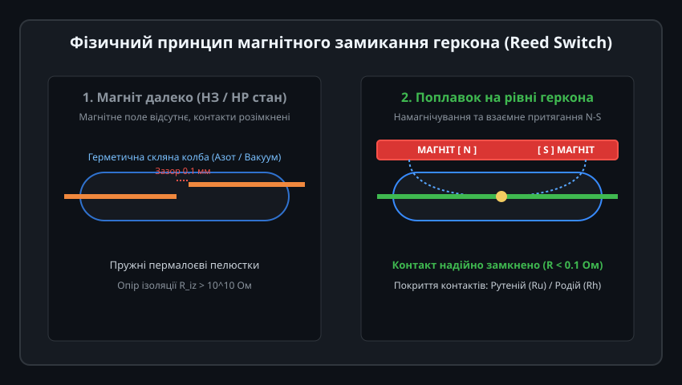
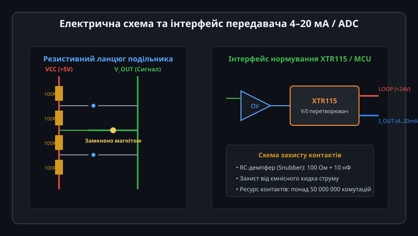
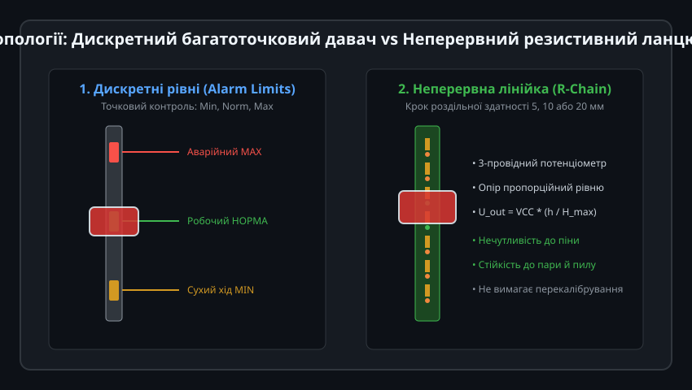
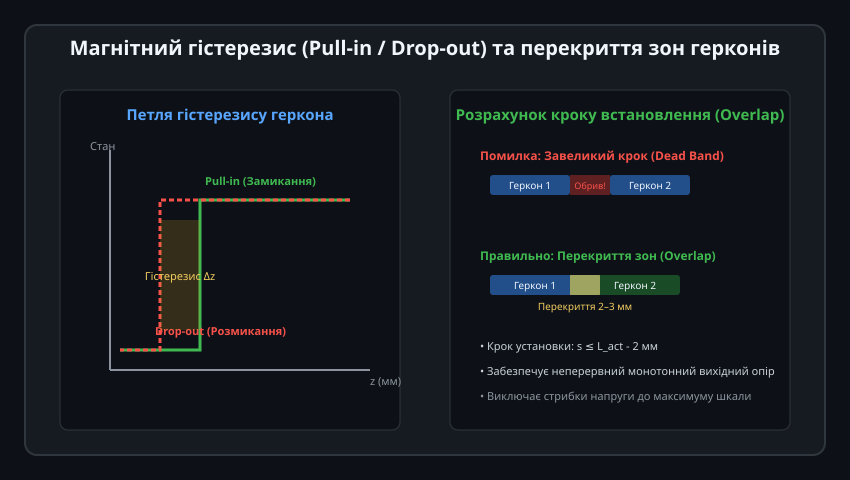
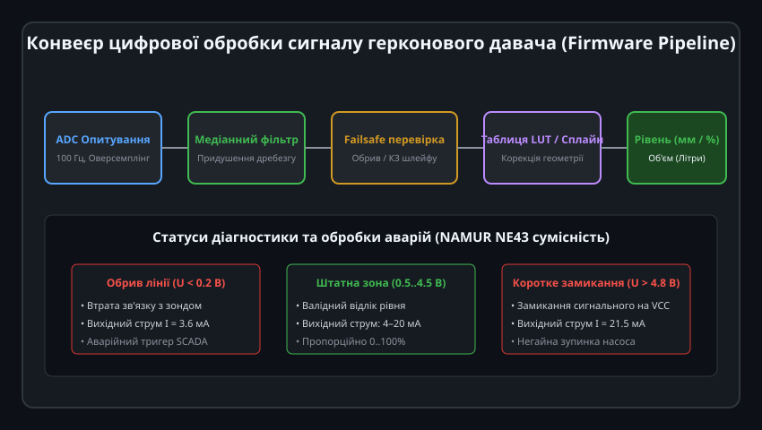

# Поглиблений інженерний аналіз та схемотехніка герконових давачів рівня

Герконові рівнеміри є еталоном схемотехнічної надійності в нафтогазовій, суднобудівній та хімічній галузях. Проте створення прецизійного квазінеперервного датчика вимагає глибокого аналізу електромагнітної взаємодії постійного магніту з пружними пермалоєвими контактами, гідродинамічної плавучості поплавка у середовищах із різною густиною та розробки надійних алгоритмів фільтрації контактного дребезгу.

---

## 1. Електромагнітна теорія замикання та динаміка контактів

Спрацьовування сухого геркона (Dry Reed Switch) підпорядковується законам феромагнетизму та механіки пружних балок з консольним закріпленням:



### Фізико-математична модель контактного вузла:
1. **Магніторушійна сила та ампер-витки (Ampere-Turns, AT):**
   Чутливість герконів нормується в ампер-витках (AT) котушки калібрування. Типові мініатюрні геркони для рівнемірів мають чутливість замикання `AT_pull-in = 10...20 AT`, а чутливість розмикання `AT_drop-out = 5...12 AT`.
2. **Розподіл магнітного поля кільцевого магніту:**
   Кільцевий магніт із радіальним або аксіальним намагнічуванням створює поле з вектором магнітної індукції `B(z, r)`. Уздовж осі переміщення `z`:
   
   B_z(z) = (B_r / 2) * [ (z + L) / sqrt((z + L)^2 + R_out^2) - z / sqrt(z^2 + R_out^2) ]

   де `B_r` — залишкова індукція магніту (1.1–1.3 Тл для NdFeB N35 або 0.38–0.42 Тл для стронцієвого фериту).
3. **Баланс магнітної сили та пружності:**
   - Сила магнітного притягання між кінцями контактів:
     
     F_mag = (B_gap^2 * S_overlap) / (2 * mu_0)
     
     де `S_overlap` — площа перекриття контактних пелюсток, `mu_0 = 4*pi*10^-7 Гн/м`.
   - Пружна сила повернення балки:
     
     F_spring = k_spring * delta_gap = ((3 * E * I_moment) / L_blade^3) * delta_gap
     
     де `E` — модуль Юнга пермалою (близько 150–170 ГПа), `I_moment` — осьовий момент інерції перерізу пелюстки, `delta_gap` — початковий зазор.
   - Замикання відбувається лавиноподібно («snap action»), коли градієнт магнітної сили перевищує жорсткість пружини.

4. **Дребезг контактів (Contact Bounce):**
   При ударі пелюсток виникають затухаючі механічні коливання тривалістю 0.2–1.5 мс. За цей час контакт встигає розімкнутися та знову замкнутися від 3 до 10 разів, що вимагає апаратного або цифрового демпфування.

---

## 2. Схемотехніка потенціометричного R-ланцюга та інтерфейс 4–20 мА

Для неперервного вимірювання формується схема керованого дільника напруги з високою термостабільністю.



### Архітектура дільника та температурний дрейф:
1. Ланцюг складається з `N` прецизійних резисторів з допуском ±0.1% та температурним коефіцієнтом опору (ТКО) не більше ±25 ppm/°C (наприклад, металоплівкові резистори типорозміру 0805 або 1206).
2. Загальний опір лінійки обирають у діапазоні 2 кОм ... 10 кОм. Занадто низький опір веде до надлишкового енергоспоживання, а занадто високий робить схему вразливою до паразитних витоків по платі за високої вологості.
3. **Схема перетворення у струм 4–20 мА (XTR115/116):**
   - Мікросхема живиться безпосередньо від струмової петлі 24 В постійного струму і має вбудований стабілізатор опорної напруги V_REF = 4.096 В.
   - Опорна напруга живить верхнє плече герконового резистивного ланцюга.
   - Знята з активного геркона напруга `V_in` подається на вхід внутрішнього транскондуктивного підсилювача XTR115:
     
     I_LOOP = 4 мА + (V_in / R_span) * 16 мА
     
     За відсутності рівня (0%) струм становить 4.00 мА, за 100% заповнення — 20.00 мА.

---

## 3. Гідродинаміка та розрахунок плавучості поплавка

Поплавок повинен стабільно тримати ватерлінію на середині висоти кільцевого магніту незалежно від типу робочої рідини (бензин, дизельне пальне, вода, моторна олива):



### Рівняння рівноваги поплавка:
F_archimedes = F_gravity + F_friction + F_surface_tension

rho_liquid * V_submerged * g = m_float * g + F_friction + pi * D_guide * sigma * cos(theta_contact)

де:
- `m_float` — сумарна маса поплавка з вбудованим магнітом та захисним компаундом,
- `V_submerged` — об'єм зануреної частини поплавка,
- `rho_liquid` — густина рідини (бензин — 720 кг/м³, олива — 880 кг/м³, вода — 1000 кг/м³, концентровані розсоли — до 1250 кг/м³),
- `sigma` — коефіцієнт поверхневого натягу,
- `theta_contact` — кут змочування матеріалу напрямної трубки.

### Інженерні вимоги:
- **Середня густина поплавка:** Для універсальних паливних та водних давачів конструктивну густину поплавка проектують на рівні `rho_float ≈ 550...650 кг/м³`.
- **Матеріали поплавка:**
  - *NBR (нітрильний каучук):* Спінений еластомер для нафтопродуктів та палива (температура до 110 °C).
  - *AISI 316L (нержавіюча сталь):* Порожнисті тонкостінні зварні поплавки для високого тиску (до 30–50 бар) та агресивних кислот і лугів.
  - *PP / PVDF:* Фторопластові та поліпропіленові поплавки для хімічних реакторів.

---

## 4. Захист контактів від ерозії та оптимізація кроку перекриття (Overlap)

Комутація герконів у довгих лініях зв'язку пов'язана з небезпекою електричного руйнування контактної зони мікродуговими розрядами:



### Механізми зносу контактів:
1. **Ємнісний розряд:** Довгий екранований кабель має розподілену ємність (близько 100–150 пФ/м). При замиканні геркона накопичений у ємності кабелю заряд розряджається через мікроскопічну площу контакту. Імпульсний струм розряду досягає кількох амперів за тривалості в одиниці наносекунд, що викликає мікрозварювання контактів (залипання).
2. **Захисні RC-ланцюги:** Безпосередньо біля виводів датчика обов'язково встановлюють послідовний струмообмежувальний резистор номіналом 47–100 Ом, який обмежує піковий струм розряду до безпечних 50–100 мА.

### Геометрія перекриття (Overlap Optimization):
Щоб запобігти стрибкам сигналу та розриву ланцюга під час переходу поплавка між сусідніми герконами, крок розміщення `s` має задовольняти строгій умові:

s <= L_act_min - delta_margin

де:
- `L_act_min` — мінімальна довжина зони спрацьовування за найменшої напруженості поля магніту (з урахуванням температурного спаду магнітної індукції NdFeB на -0.11%/°C),
- `delta_margin` — гарантований запас перекриття (зазвичай 2.0–3.0 мм).
У зоні перекриття паралельно замкнені два сусідні геркони. Це знижує еквівалентний опір ступеня вдвічі, що програмно згладжується кусочною інтерполяцією.

---

## 5. Промисловий C++ драйвер для обробки сигналів герконового рівнеміра

Для опитування датчика мікроконтролером розроблено надійний клас `ReedLevelTransmitter`, який виконує оверсемплінг АЦП, медіанну фільтрацію викидів, перевірку за стандартом NAMUR NE43 та розрахунок геометричного об'єму резервуара.



```cpp
/**
 * @file ReedLevelTransmitter.hpp
 * @brief Драйвер квазінеперервного герконового рівнеміра з діагностикою NAMUR NE43
 */

#pragma once

#include <stdint.h>
#include <stddef.h>
#include <algorithm>

enum class SensorHealth : uint8_t {
    OK = 0,             ///< Нормальна робота (сигнал у межах 0.5..4.5 В)
    FAULT_OPEN_CIRCUIT, ///< Обрив лінії / шлейфу (U < 0.2 В)
    FAULT_SHORT_CIRCUIT,///< Коротке замикання на живлення (U > 4.8 В)
    UNSTABLE_BOUNCE     ///< Надмірний дребезг або хвилювання поверхні
};

class ReedLevelTransmitter {
public:
    static constexpr size_t MEDIAN_WINDOW = 5;

    ReedLevelTransmitter(float tank_height_mm, float vref = 5.0f)
        : tank_height_mm_(tank_height_mm),
          vref_(vref),
          health_(SensorHealth::OK),
          filtered_voltage_(0.0f),
          buffer_index_(0) {
        for (size_t i = 0; i < MEDIAN_WINDOW; ++i) {
            voltage_samples_[i] = 0.0f;
        }
    }

    /**
     * @brief Додавання нового відліку АЦП (викликається за таймером 50..100 Гц)
     * @param raw_adc_value Сире значення відліку АЦП
     * @param adc_resolution Максимальне значення шкали АЦП (наприклад, 4095 для 12-біт)
     */
    void updateAdcSample(uint16_t raw_adc_value, uint16_t adc_resolution = 4095) {
        float sample_v = (static_cast<float>(raw_adc_value) / adc_resolution) * vref_;
        
        voltage_samples_[buffer_index_] = sample_v;
        buffer_index_ = (buffer_index_ + 1) % MEDIAN_WINDOW;

        // Медіанна фільтрація для усунення контактного дребезгу
        float sorted_samples[MEDIAN_WINDOW];
        for (size_t i = 0; i < MEDIAN_WINDOW; ++i) {
            sorted_samples[i] = voltage_samples_[i];
        }
        std::sort(sorted_samples, sorted_samples + MEDIAN_WINDOW);
        filtered_voltage_ = sorted_samples[MEDIAN_WINDOW / 2];

        // Діагностика цілісності лінії відповідно до концепції NAMUR NE43
        if (filtered_voltage_ < 0.20f) {
            health_ = SensorHealth::FAULT_OPEN_CIRCUIT;
        } else if (filtered_voltage_ > 4.80f) {
            health_ = SensorHealth::FAULT_SHORT_CIRCUIT;
        } else {
            health_ = SensorHealth::OK;
        }
    }

    /**
     * @brief Отримання поточного рівня рідини у відсотках (0..100%)
     */
    float getLevelPercent() const {
        if (health_ != SensorHealth::OK) {
            return 0.0f;
        }

        // Масштабування робочого діапазону 0.5 В (0%) .. 4.5 В (100%)
        float pct = ((filtered_voltage_ - 0.50f) / (4.50f - 0.50f)) * 100.0f;
        if (pct < 0.0f) pct = 0.0f;
        if (pct > 100.0f) pct = 100.0f;
        return pct;
    }

    /**
     * @brief Отримання поточного фізичного рівня рідини в міліметрах
     */
    float getLevelMm() const {
        return (getLevelPercent() / 100.0f) * tank_height_mm_;
    }

    /**
     * @brief Розрахунок об'єму для горизонтального циліндричного резервуара
     * @param tank_radius_mm Радіус резервуара в мм
     * @param tank_length_mm Довжина циліндричної частини в мм
     * @return Об'єм рідини в літрах
     */
    float getVolumeLitersHorizontalCylinder(float tank_radius_mm, float tank_length_mm) const {
        float h = getLevelMm();
        if (h <= 0.0f) return 0.0f;
        if (h >= 2.0f * tank_radius_mm) {
            return (3.14159265f * tank_radius_mm * tank_radius_mm * tank_length_mm) / 1.0e6f;
        }

        float r = tank_radius_mm;
        // Сегмент кола: S = r^2 * arccos((r - h) / r) - (r - h) * sqrt(2*r*h - h^2)
        float cos_val = (r - h) / r;
        if (cos_val > 1.0f) cos_val = 1.0f;
        if (cos_val < -1.0f) cos_val = -1.0f;
        
        float theta = acosf(cos_val);
        float area_segment = (r * r * theta) - (r - h) * sqrtf(2.0f * r * h - h * h);
        float volume_mm3 = area_segment * tank_length_mm;

        return volume_mm3 / 1.0e6f; // Переведення мм3 у кубічні дециметри (літри)
    }

    SensorHealth getHealthStatus() const { return health_; }
    float getFilteredVoltage() const { return filtered_voltage_; }

private:
    float tank_height_mm_;
    float vref_;
    SensorHealth health_;
    float filtered_voltage_;
    float voltage_samples_[MEDIAN_WINDOW];
    size_t buffer_index_;
};
```

Драйвер забезпечує захист промислового контролера від хибних спрацьовувань під час вібрацій та хитання рідкого середовища, транслюючи стабільні показання висоти стовпа та розрахованого об'єму в протокол Modbus RTU або CANopen.
