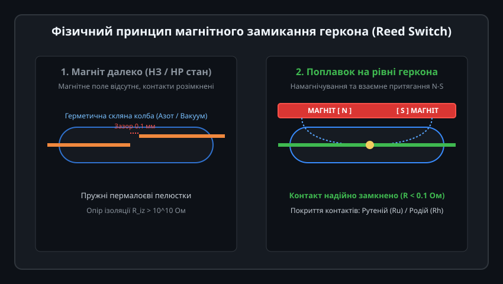
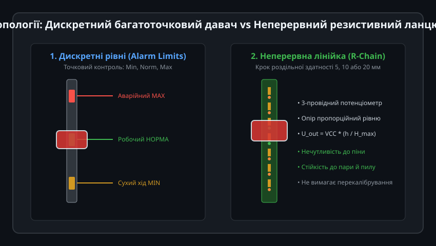
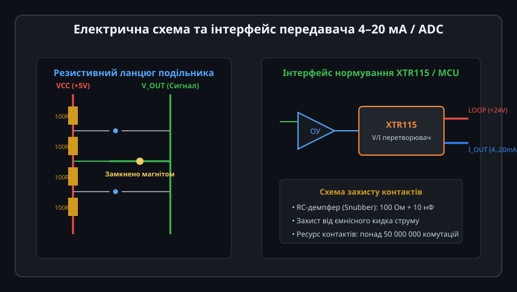
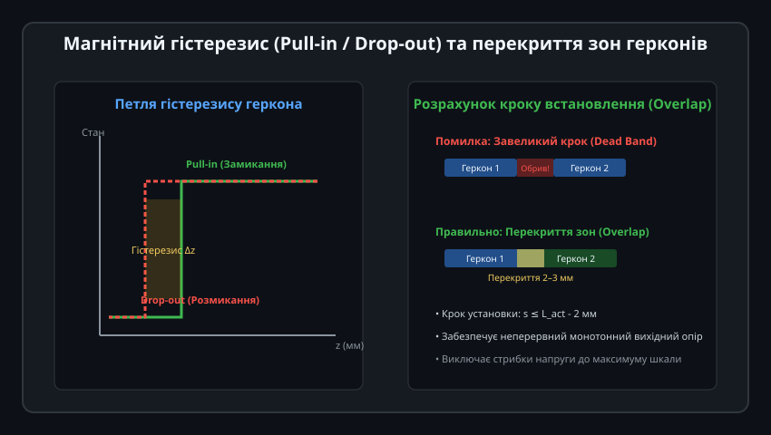
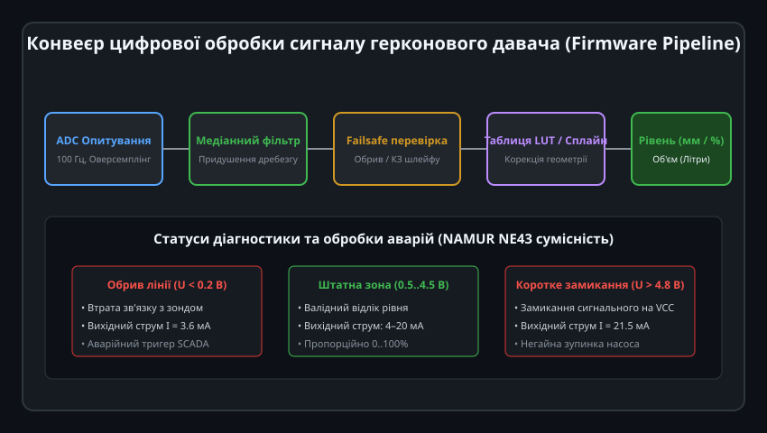

# Герконовий магнітний давач рівня

Герконові (магнітокеровані) давачі рівня рідини поєднують простоту конструкції, високу надійність та повну гальванічну ізоляцію чутливих контактів від вимірюваного середовища. Вони широко використовуються в паливних баках автомобілів та спецтехніки, промислових резервуарах для хімікатів, системах водоочищення, накопичувальних бойлерах та автоматичних станціях дозування.

---

## 1. Фізичний принцип магнітного замикання геркона

Серцем давача є геркон (герметизований контакт, англ. Reed Switch) — електромеханічний перемикач, поміщений у запаяну скляну колбу, заповнену сухим інертним газом (азотом або аргоном) чи глибоким вакуумом:

### Механізм спрацьовування:
1. **Будова контактів:** Усередині колби розташовані дві плоскі пружні пелюстки з феромагнітного прецизійного сплаву (пермалою — залізо-нікель 52/48). Робочі кінці контактів перекриваються з невеликим мікроскопічним зазором (0.05–0.2 мм) і мають зносостійке гальванічне покриття з благородних металів — родію (Rh), рутенію (Ru) або золота (Au).
2. **Дія зовнішнього магнітного поля:**
   - Коли поплавок із вбудованим кільцевим постійним магнітом (неодимовим або барієвим феритом) наближається до колби геркона, магнітний потік замикається крізь пермалоєві пластини.
   - Пластини намагнічуються з протилежною полярністю (N на одній і S на іншій у зоні зазору).
   - Сила магнітного взаємного притягання долає пружний опір металевих пластин, і контакти миттєво змикаються за час 0.5–1.5 мс.
3. **Відновлення:** Коли поплавок віддаляється, магнітний потік зменшується нижче сили пружності, і контакти повертаються у вихідний розімкнений стан.

Оскільки контакти не окислюються і захищені від пилу, агресивних випарів та вологи, ресурс якісних герконів сягає 10–100 мільйонів циклів спрацьовування.

---

## 2. Дискретні сигналізатори граничного рівня

Залежно від завдання моніторингу герконові давачі поділяють на точкові граничні сигналізатори (Alarm Switches) та неперервні рівнеміри:

### Конструкція дискретних давачів:
- **Одинарні мініатюрні давачі:** Монтуються у стінку бака (горизонтальні поворотні) або у кришку (вертикальні штокові). Застосовуються для фіксації критичних точок: «Резервуар порожній / захист від сухого ходу помпи» та «Резервуар переповнений / зупинка наповнення».
- **Багатоточкові зонди:** Усередині однієї вертикальної напрямної трубки з нержавіючої сталі розміщують від 2 до 6 окремих герконів на різній висоті, що відповідають технологічним точкам (MIN, NORM-LOW, NORM-HIGH, MAX). Кожен геркон підключається парою дротів до дискретних входів PLC або контролера.

---

## 3. Квазінеперервні резистивні лінійки (R-ланцюг) та вихід 4–20 мА

Для неперервного контролю поточного об'єму рідини застосовують квазінеперервні рівнеміри на базі резистивного ланцюжка (потенціометричної лінійки):

### Принцип роботи потенціометричного ланцюга:
1. Усередині вертикальної герметичної трубки по всій довжині встановлено друковану плату з послідовним ланцюгом прецизійних резисторів однакового номіналу (наприклад, по 100 Ом) та герконів.
2. Кільцевий магніт циліндричного поплавка, ковзаючи вздовж трубки за рівнем рідини, замикає геркон у поточній точці висоти, відводячи вихідний сигнал на спільну шину зчитування (як повзунок реостата чи змінного резистора).
3. **Крок дискретизації:** Фізична роздільна здатність визначається відстанню між сусідніми герконами:
   - Стандартний крок: 10 мм або 20 мм (для великих резервуарів і паливних цистерн).
   - Прецизійний крок: 5 мм (для точних витратних ємностей та лабораторних установок).
4. **Нормування сигналу:** Вихідна пропорційна напруга перетворюється мікросхемою XTR115/XTR116 у промисловий струмовий сигнал 4–20 мА або оцифровується вбудованим АЦП мікроконтролера.

---

## 4. Магнітний гістерезис та розрахунок перекриття зон

Надійна робота неперервного ланцюжка вимагає точного узгодження ширини магнітного поля поплавка та кроку встановлення герконів:

### Явище гістерезису:
- **Зона спрацьовування (Pull-in):** Відстань наближення магніту, за якої поле досягає напруженості замикання контактів.
- **Зона відпускання (Drop-out):** Відстань віддалення, за якої пружність пелюсток розмикає контакти. Напруженість поля відпускання завжди менша за напруженість замикання (коефіцієнт повернення k_drop ≈ 0.4–0.7).
- **Необхідність перекриття (Overlap):**
  - Якщо крок між герконами перевищує довжину зони замикання, між сусідніми кроками виникає «мертва зона» — коли один геркон уже розімкнувся, а наступний ще не замкнувся. У цей момент ланцюг обривається, а вихідний сигнал стрибає до максимуму шкали живлення.
  - При правильному проектуванні крок установки розраховують із гарантованим перекриттям у 2–3 мм: у проміжній точці одночасно замкнені два сусідні геркони, що забезпечує плавний і монотонний перехід сигналу без обривів.

---

## 5. Цифрове зчитування, програмний фільтр дребезгу та діагностика

Підключення герконового давача до входу мікроконтролера вимагає врахування електромеханічного дребезгу контактів та захисту від наведень у довгих кабельних лініях:

### Програмно-апаратні рішення:
1. **Апаратне придушення дребезгу:** Встановлення паралельного конденсатора (100 нФ) та підтягувального резистора або використання входу із тригером Шмітта для формування чітких фронтів імпульсу тривалістю не менше 10–20 мс.
2. **Програмна цифрова фільтрація:** Для аналогових лінійок застосовують циклічний медіанний фільтр на 5 відліків, який повністю відсікає короткочасні викиди від брязкоту контактів або сплесків на хвилях рідини.
3. **Діагностика цілісності лінії (NAMUR NE43):**
   - Напруга на виході менше 0.2 В — обрив сигнального шлейфу або затоплення клемної коробки.
   - Напруга від 0.5 В до 4.5 В — штатна робоча зона (рівень від 0% до 100%).
   - Напруга вище 4.8 В — коротке замикання сигнального дроту на лінію живлення VCC.
