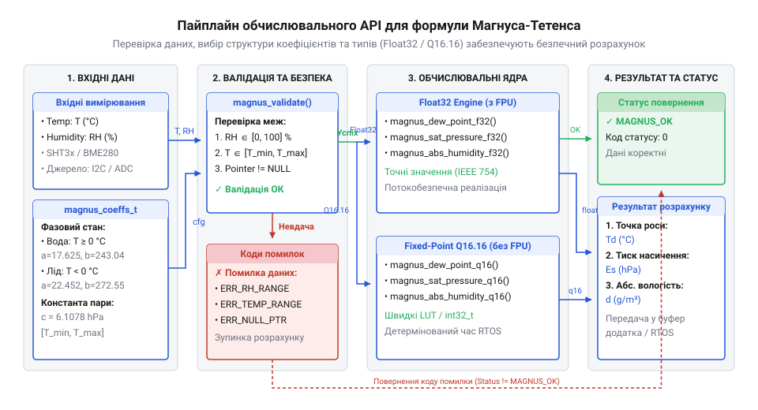
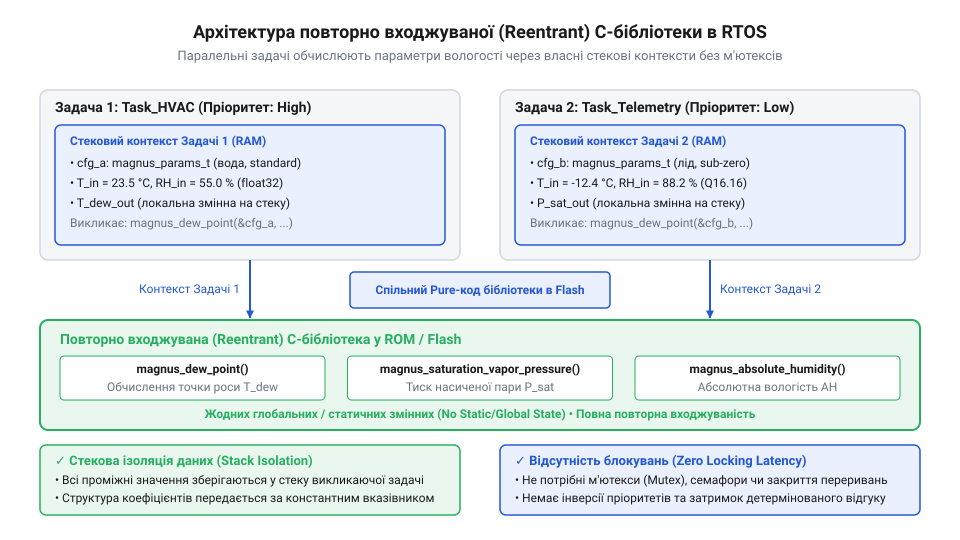

# Програмний інтерфейс C/C++ бібліотеки розрахунку параметрів вологого повітря

<preknowlist>
- [SHT30 — температура й вологість (I2C)](root:cat-hw-sensors/sht30) — Спосіб отримання вхідних виміряних значень температури та відносної вологості через I2C для подальшого математичного оброблення.
- [Цифровий давач температури та вологості AHT20](root:cat-hw-sensors/aht20-sensor) — Формування первинних масивів вимірювань температури й відносної вологості для обчислення похідних параметрів атмосфери.
</preknowlist>

## Помилки непрямих вимірювань вологості повітря

Пряме зчитування показників відносної вологості цифровим [давачем SHT30](root:cat-hw-sensors/sht30) або недорогим [модулів DHT11](root:cat-hw-sensors/dht11) може створити хибне уявлення про безпеку умов всередині герметичного приладового корпусу. Відносна вологість (від лат. *relativus* — відносний, англ. @@en|relative humidity@@) вимірюється у відсотках і показує, яку частку від максимально можливої маси водяної пари за поточної температури містить повітря. Коли внутрішня температура мікроконтролерної системи зростає через нагрів силових транзисторів або знижується під час нічного охолодження, показник відносної вологості стрімко змінюється, навіть якщо абсолютна кількість вологи всередині корпусу залишається незмінною.

Головна небезпека полягає в тому, що при локальному падінні температури конструктивних елементів нижче точки роси (англ. @@en|dew point@@) відносна вологість досягає 100%. Водяна пара в повітрі миттєво фазово перетворюється на рідкий конденсат. Випадання мікрокрапель води на друкованій платі спричиняє струми витоку, корозію контактів та коротке замикання, що виводить з ладу чутливу мікропроцесорну техніку. Тільки виміряного значення відносної вологості недостатньо для керування нагрівачами чи вентиляцією, оскільки воно залежить від температури.

Для об'єктивної оцінки стану довкілля мікроконтролер повинен математично вираховувати абсолютні інваріанти атмосферного стану: точку роси, тиск насиченої пари (від лат. *saturatio* — насичення, англ. @@en|saturation vapor pressure@@) та абсолютну вологість (від лат. *absolutus* — безумовний, англ. @@en|absolute humidity@@). Найбільш збалансованим та точним методом обчислення цих параметрів для вбудованих систем є формула Магнуса-Тетенса.

Організація таких розрахунків вимагає чіткого розмежування архітектурних шарів прошивки. Низькорівневі драйвери для [первинних вимірювань AHT20](root:cat-hw-sensors/aht20-sensor) чи [модулів серії GY-21](root:cat-hw-sensors/gy-21) відповідають за зчитування сирих регістрових даних по апаратних шинах I2C чи SPI та їх первинну фільтрацію. Різні фізичні давачі віддають параметри у власних форматах: у вигляді 20-бітних цілочисельних кодів, дробових часток відліків АЦП чи чисел із фіксованою крапкою. Пряме передавання таких неопрацьованих значень у формулу Магнуса спричинить експоненціальний вибух при піднесенні до степеня та арифметичний збій обчислень. Тому перед передачею даних до обчислювального ядра драйвер виконує нормалізацію (від лат. *normalis* — прямокутний, англ. @@en|normalization@@) одиниць вимірювання: переводить температуру в градуси Цельсія, а відносну вологість — у відсотки або безрозмірні частки від 0 до 1. Завдяки цьому математичне оброблення виноситься в окремий обчислювальний модуль C/C++ бібліотеки, який не має залежностей від фізичного заліза чи системних викликів, приймає стандартизовані фізичні величини та повертає точні параметри повітря.

## Коефіцієнти Магнуса та фазові стани

Фізичні властивості водяної пари суттєво відрізняються залежно від того, перебуває поверхня конденсації у рідкій чи твердій фазі. Класичне рівняння Магнуса-Тетенса визначає тиск насиченої водяної пари `E_s` (у гектопаскалях, hPa) як експоненційну функцію від температури `T` (у градусах Цельсія, °C):

```
E_s = a · exp((b · T) / (c + T))
```

Де `a`, `b` та `c` — емпіричні коефіцієнти (англ. @@en|empirical coefficients@@), визначені шляхом лабораторних вимірювань. Температура точки роси `T_d` виводиться зі співвідношення парціального тиску пари `E = E_s · (RH / 100)` та тиску насичення `E_s(T_d)`:

```
γ(T, RH) = ln(RH / 100) + (b · T) / (c + T)
= ln(RH / 100) + (b · T) / (c + T)        [визначення логарифмічного аргументу]
T_d = (c · γ(T, RH)) / (b - γ(T, RH))      [обернення формули Магнуса]
```

Спроба застосувати єдиний набір констант для всього діапазону температур створює неприпустиму похибку. При позитивних температурах (від 0 °C до +50 °C) над рідкою водою використовуються стандартні коефіцієнти Зоннтага (Sonntag): `a = 6.112`, `b = 17.62`, `c = 243.12`. Якщо температура опускається нижче 0 °C, пара контактує з льодом, тиск насичення над яким нижчий, ніж над переохолодженою водою. Для льоду (від -50 °C до 0 °C) застосовують коефіцієнти: `a = 6.112`, `b = 22.46`, `c = 272.62`. Для високотемпературних умов (від +50 °C до +100 °C) використовуються значення `a = 6.112`, `b = 18.729`, `c = 257.87`.

Використання «водяних» коефіцієнтів при негативних температурах призводить до похибки обчислення точки роси до 1.5–2.0 °C, що є критичним для холодильних установок та метеостанцій. В архітектурі C/C++ бібліотеки всі коефіцієнти об'єднуються у спеціальну структуру конфігурації `magnus_params_t`. Обчислювальний контекст отримує цю структуру через вказівник, що дозволяє динамічно перемикати режими залежно від робочого діапазону.

:::tabs
@tab C (C99)
:::code api-magnus-math-c-library/c/c99/snippet-1.c
@tab C++ (C++17)
:::code api-magnus-math-c-library/cpp/cpp17/magnusparams.cpp
:::

## Обчислювальний API для float32 та Q16

Більшість бюджетних мікроконтролерів (зокрема архітектур ARM Cortex-M0/M0+/M3 або 8-бітних AVR) позбавлені апаратного модуля обчислень з плаваючою крапкою (англ. @@en|FPU@@, floating-point unit). Виконання трансендентних математичних функцій `exp()` та `log()` у форматі `float32` на таких процесорах реалізується програмно через системні бібліотеки емуляції. Це потребує тисяч тактів ядра на кожен розрахунок, що неприпустимо розряджає акумуляторні батареї та затримує виконання критичних за часом задач.

Для забезпечення ефективності на будь-якому залізі бібліотека надає двоваріантний програмний інтерфейс: стандартну версію для `float32` та оптимізовану версію з фіксованою крапкою (англ. @@en|fixed-point@@) `Q16.16`. У форматі `Q16.16` дійсне число кодується 32-бітним цілим числом зі знаком `int32_t`, де 16 старших бітів відведено під цілу частину, а 16 молодших — під дробову. Один дискрет дорівнює `1 / 65536 ≈ 0.000015`. Експонента й логарифм у версії `Q16.16` обчислюються за допомогою швидких поліноміальних наближень Чебишова та таблиць пошуку (англ. @@en|lookup table@@) з лінійною інтерполяцією. Детальніше про двійкове кодування цілочисельних регістрів та швидкодіючу поліноміальну апроксимацію дивіться в статті про [математику з фіксованою крапкою Q16.16 у вбудованих системах](root:sf-devices/integer-scaling-fixed-point).


*Схема потоку даних обчислювального API від первинних значень до розрахунку точних параметрів вологого повітря.*

Загальна структура обчислень для обох типів даних включає три ключові функції: обчислення тиску насиченої пари, точки роси та абсолютної вологості `d_v` (у г/м³). Формула абсолютної вологості використовує отриманий тиск насиченої пари `E_s`, виражений у гектопаскалях (гПа), а її коефіцієнти виводяться безпосередньо з рівняння стану ідеального газу (англ. @@en|ideal gas law@@). Доданок `273.15` здійснює перехід від температури за шкалою Цельсія `T` до абсолютної температури в кельвінах, що необхідно для обчислення термодинамічного стану газу. Чисельний множник `216.7` (з одиницями вимірювання г·К/(гПа·м³)) утворюється діленням молярної маси водяної пари (близько 18.015 г/моль) на універсальну газову константу (близько 8.314 Дж/(моль·К)) з урахуванням масштабування парціального тиску з гектопаскалів у паскалі та відносної вологості `RH` у частки одиниці:

```
d_v = (216.7 · E_s · (RH / 100)) / (273.15 + T)
```

:::tabs
@tab C (C99)
:::code api-magnus-math-c-library/c/c99/snippet-3.c
@tab C++ (C++17)
:::code api-magnus-math-c-library/cpp/cpp17/magnuscalculator.cpp
:::

## Валідація даних та обробка помилок

У реальних умовах експлуатації первинні вимірювання можуть бути спотворені через відмову апаратури. Проблеми з контактами лінії даних на [давачем тиску BMP280](root:cat-hw-sensors/aht20-bmp280), збої живильного напруги на [термісторів серії KY-013](root:cat-hw-sensors/ky-013-thermistor) або вихід з ладу [аналогового сенсора LM35DZ](root:cat-hw-sensors/lm35) можуть призвести до передачі в обчислювальний модуль некоректних даних.

Якщо у функцію розрахунку точки роси потрапляє відносна вологість `RH <= 0%`, виклик `ln(RH / 100)` спричиняє обчислення логарифма нуля або від'ємного числа. У варіанті `float32` це формує значення `-Infinity` або `NaN`, що далі отруює всі наступні арифметичні операції. У варіанті `Q16.16` спроба обчислити логарифм недопустимого значення призводить до переповнення цілочисельного регістра й невизначеної поведінки розрахунку. Так само, якщо температура виходить за межі `-50 °C ... +100 °C`, знаменник формули Магнуса `(c + T)` може наблизитися до нуля, викликаючи ділення на нуль.

Для запобігання фатальним збоям C/C++ бібліотека застосовує сувору валідацію (від лат. *validus* — дійсний, англ. @@en|validation@@) вхідних аргументів і використовує спеціальні коди помилок (англ. @@en|error code@@) типу `magnus_status_t`.

:::tabs
@tab C (C99)
:::code api-magnus-math-c-library/c/c99/magnus-dew-point-safe.c
@tab C++ (C++17)
:::code api-magnus-math-c-library/cpp/cpp17/status.cpp
:::

## Повторна входжуваність та робота в RTOS

У складних вбудованих системах керування під управлінням операційних систем реального часу RTOS (англ. @@en|RTOS@@, real-time operating system), таких як FreeRTOS або Zephyr, обчислення параметрів атмосфери може здійснюватися паралельно з кількох задач. Наприклад, одна задача обробляє дані з зовнішнього метеомодуля, а інша — контролює мікроклімат усередині приладового відсіку.

Виклики функцій з кількох потоків виконання або з обробників переривань (ISR) можуть спричинити пошкодження даних, якщо обчислювальна бібліотека використовує внутрішній статичний стан або глобальні змінні. Щоб гарантувати абсолютну безпеку, C/C++ бібліотека спроектована з дотриманням принципу чистої повторної входжуваності (англ. @@en|reentrancy@@). Обчислювальні функції є чистими функціями (англ. @@en|pure function@@): вони не опираються на глобальні буфери й не зберігають стан між викликами. Усі проміжні значення виділяються виключно в локальному фреймі стеку викликаючої задачі.


*Архітектура паралельного виклику обчислювального API з кількох задач RTOS.*

Відсутність глобального стану усуває потребу в блокуючих м'ютексах та критичних секціях всередині математичного ядра. Це запобігає виникненню інверсії пріоритетів (англ. @@en|priority inversion@@) та виключає накладні витрати на перемикання контексту задач RTOS при розрахунках.

:::tabs
@tab C (FreeRTOS / C99)
:::code api-magnus-math-c-library/c/freertos/vtaskexternalenvironment.c
@tab C++ (CMSIS-RTOS2 / C++17)
:::code api-magnus-math-c-library/cpp/cmsis-rtos2/snippet-8.cpp
:::