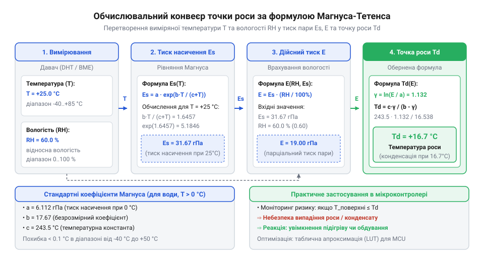
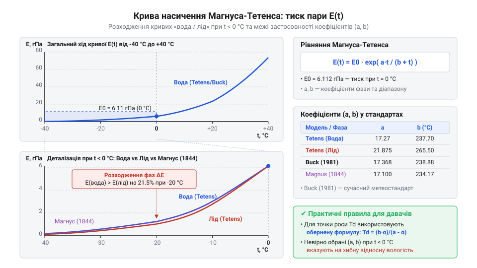

# Історія виникнення та еволюції формули Магнуса-Тетенса

<preknowlist>
- [SHT30 — температура й вологість (I2C)](root:cat-hw-sensors/sht30) — принцип зчитування первинних даних температури й відносної вологості для подальшого алгоритмічного розрахунку точки роси
- [GY-21 (Si7021/HTU21D) — температура/вологість](root:cat-hw-sensors/gy-21) — особливості функціонування ємнісних сенсорів вологості та специфіка вимірювання температури й вологості в одному кристалі
- [DHT11 — температура/вологість](root:cat-hw-sensors/dht11) — межі точності та дискретності вимірювань вологості при використанні нелінійних математичних апроксимацій
</preknowlist>

## Потреба у спрощеному обчисленні пари

Коли фізичний давач вимірює параметри вологого повітря, він не здатний напряму зареєструвати агрегатний стан водяної пари. Як історичний рідинний @@de|психрометр@@ (від грецького @@el|ψυχρός@@ — холодний та @@el|μέτρον@@ — міра), так і сучасний напівпровідниковий чип на кшталт [давача вологості SHT30](root:cat-hw-sensors/sht30) зчитують дві первинні величини для розрахунку параметрів вологості. Однак для прогнозування конденсації, розрахунку систем вентиляції чи керування сушильними камерами потрібні похідні термодинамічні параметри: @@la|тиск насиченої пари@@ (від латинського @@la|pressura@@ — тиск та @@la|vapor@@ — пара), парціальний тиск водяної пари `E` та @@en|точка роси@@ (від англійського @@en|dew point@@) — температура, за якої пара досягає стану насичення й випадає у вигляді рідини.

З погляду класичної термодинаміки залежність тиску насиченої пари від температури визначає фундаментальне [рівняння Клапейрона-Клаузіуса](root:ph-thermodynamics/clapeyron-clausius-equation) (від прізвищ французького фізика @@fr|Benoît Paul Émile Clapeyron@@ та німецького фізика @@de|Rudolf Clausius@@). Це диференціальне співвідношення пов'язує зміну тиску насичення зі зміною температури через питому приховану теплоту фазового переходу `L` та різницю питомих об'ємів пари й рідини.

Щоб дістати практичне значення тиску пари при заданій температурі, диференціальне рівняння необхідно інтегрувати. Оскільки прихована теплота випаровування `L` не є константою й сама залежить від температури, точне інтегрування дає громіздкі вирази з логарифмами та термодинамічними коефіцієнтами вищих порядків. У XIX столітті обчислення за такими формулами вимагало або тривалого ручного розрахунку, або використання друкованих таблиць. Таблиці мали дискретний крок у 1 °C, тому метеорологи були змушені постійно виконувати лінійну інтерполяцію для дробових значень, що сповільнювало обробку спостережень і створювало похибки.

У сучасних вбудованих системах виникає аналогічна обчислювальна перешкода. Коли малопотужний мікроконтролер обробляє signal від [модуля вологості DHT11](root:cat-hw-sensors/dht11) або [цифрового сенсора GY-21](root:cat-hw-sensors/gy-21), він має обмежений обсяг оперативної пам'яті та тактів процесора. Чисельне інтегрування диференціальних рівнянь у реальному часі або збереження масивних інтерполяційних таблиць у пам'яті програм є неефективним для вбудованих пристроїв.

Перед метеорологією та інженерією постала чітка вимога: потрібна замкнена @@en|апроксимація@@ (від латинського @@la|approximo@@ — наближаюсь) — аналітична формула, яка обчислює @@la|тиск насиченої пари@@ безпосередньо з температури за допомогою кількох арифметичних операцій, забезпечує високу точність у межах атмосферного діапазону від -40 °C до +50 °C і легко піддається алгебраїчному розвертанню для знаходження @@en|точки роси@@.


*Блок-схема обчислювального конвеєра показує, як первинні дані температури й відносної вологості від цифрового давача перетворюються через замкнену математичну формулу на тиск пари та точку роси без чисельного інтегрування.*

## Експерименти Генріха Магнуса 1844 року

У 1844 році німецький фізик і хімік @@de|Heinrich Gustav Magnus@@ (1802–1870), працюючи у Берлінському університеті, поставив за мету розробити точну емпіричну модель тиску пари. На той час наявні вимірювальні дані мали значні розбіжності через присутність розчинених газів у воді та недосконалість манометрів. @@de|Heinrich Gustav Magnus@@ сконструював скляний лабораторний прилад, який дозволяв повністю видалити розчинене повітря з рідини й виміряти пружність пари над чистою водою у діапазоні від 0 °C до 100 °C.

Аналізуючи результати експериментів, @@de|Heinrich Gustav Magnus@@ помітив, що десятковий логарифм тиску пари зростає практично лінійно з температурою, але зі специфічним зсувом у знаменнику. На відміну від чистої експоненти, він запропонував дробово-раціональний показник у степені десяточки.

Якщо позначити температуру в градусах Цельсія через `t`, а @@la|тиск насиченої пари@@ в міліметрах ртутного стовпчика через `E_s`, то формулу @@de|Heinrich Gustav Magnus@@ записував у такому вигляді:

```
E_s(t) = c × 10^( (a × t) / (b + t) )      [початкова показкова формула Магнуса 1844 року]
```

де `c = 4.525` мм рт. ст. відповідає тиску пари при 0 °C, а емпіричні коефіцієнти дорівнювали `a = 7.4475` та `b = 234.69` °C.

Головною інженерною перевагою формули стала її повна алгебраїчна оборотність. Щоб знайти @@en|точку роси@@ `t_d` за відомим парціальним тиском пари `E`, формулу можна аналітично виразити щодо температури:

```
lg(E_s / c) = (a × t) / (b + t)              [логарифмування за основою 10]
(b + t) × lg(E_s / c) = a × t               [помноження на знаменник]
b × lg(E_s / c) = t × (a - lg(E_s / c))     [групування членів з температурою]
t_d = (b × lg(E / c)) / (a - lg(E / c))      [аналітичний розрахунок точки роси]
```

Цей результат став проривом для метеорології XIX століття. Оскільки основним робочим приладом був механічний @@de|психрометр@@, за цією формулою стало можливо обчислювати @@en|точку роси@@ та парціальний тиск пари за допомогою логарифмічних лінійок або коротканьких логарифмічних таблиць без використання двовимірної інтерполяції.

Однак початкове співвідношення мав обмежену сферу застосування. Експерименти @@de|Heinrich Gustav Magnus@@ проводилися лише для рідкої води у діапазоні вище 0 °C. При від'ємних температурах довкілля формула давала відхилення, оскільки не враховувала фізичних відмінностей між рідкою переохолодженою водою та льодом.

## Уточнення Отто Тетенса 1930 року

У 1930 році німецький метеоролог та астроном @@de|Otto Tetens@@ (1865–1945) переглянув формулу Магнуса у зв'язку зі стандартизацією метеорологічних одиниць тиску та появою нових термодинамічних даних. @@de|Otto Tetens@@ перевів опорний тиск при 0 °C у гектопаскалі (`E_0 = 6.1078` hPa) і вперше сформулював окремі набори коефіцієнтів для двох фазових станів: рідкої води та льоду.

Фізична причина розділення коефіцієнтів полягає в тому, що при від'ємних температурах сублімація льоду вимагає додаткової енергії на подолання кристалічних ґрат (прихована теплота сублімації є сумою теплоти випаровування та плавлення). Через це крива тиску насиченої пари над льодом спадає швидше, ніж над переохолодженою рідкою водою.

Уточнена апроксимація, яка у світовій літературі отримала назву @@de|Magnus-Tetens@@, описується єдиною функціональною формою:

```
E_s(t) = E_0 × 10^( (a × t) / (b + t) )      [десяткова формула Магнуса-Тетенса]
```

Для рідкої води при `t ≥ 0` °C @@de|Otto Tetens@@ розрахував коефіцієнти `a = 7.5` та `b = 237.3` °C:

```
E_s(t) = 6.1078 × 10^( (7.5 × t) / (237.3 + t) )  [тиск пари над водою]
```

Для крижаної поверхні при `t < 0` °C параметри становили `a = 9.5` та `b = 265.5` °C:

```
E_s(t) = 6.1078 × 10^( (9.5 × t) / (265.5 + t) )  [тиск пари над льодом]
```


*Графік кривих насичення ілюструє розходження тиску пари над рідкою водою та крижаною поверхнею при від'ємних температурах і демонструє точність уточнених коефіцієнтів Тетенса.*

У пізніших роботах XX століття (зокрема у дослідженнях @@en|Arden Buck@@ 1981 року) коефіцієнти формули @@de|Magnus-Tetens@@ були перераховані для натуральної експоненти `e`, що зручно для обчислень у мовах C та C++. Для натуральної основи коефіцієнти для води зазвичай дорівнюють `a = 17.27` та `b = 237.7` °C, що дає математично еквівалентний результат.

Поширеним метеорологічним міфом було уявлення, що формула @@de|Magnus-Tetens@@ є суто підгоночною емпіричною кривою без фізичного підґрунтя. Однак аналіз показав, що знаменник `(b + t)` у виразі слугує лінійним наближенням температурного зсуву абсолютного нуля у [рівнянні Клапейрона-Клаузіуса](root:ph-thermodynamics/clapeyron-clausius-equation), де параметри `a` та `b` безпосередньо пов'язані з температурним коефіцієнтом прихованої теплоти випаровування.

Завдяки поєднанню високої точності (відносна похибка менше 0.1% у діапазоні від -20 °C до +50 °C) та швидкості обчислень, співвідношення @@de|Magnus-Tetens@@ увійшло до стандартів Всесвітньої метеорологічної організації (WMO) та використовується як базовий алгоритм обчислення @@en|точки роси@@ у мікроконтролерах.

## Спірне авторство та емпіричний міф

Спроба запрограмувати розрахунок вологості за формулою Магнуса-Тетенса нерідко супроводжується уявленням, що ця залежність є суто підігнаною емпіричною кривою, побудованою без жодного теоретичного підґрунтя. Такий погляд змушує сприймати її коефіцієнти як випадкові числові константи, позбавлені фізичного змісту, а за авторством бачити виключно результат праці двох німецьких фізиків. Проте ігнорування термодинамічних першопричин цієї формули призводить до хибних розрахунків у критичних температурних зонах та нерозуміння меж її застосовності.

Історичне виникнення назви співвідношення пов'язане з розбудовою вимірювальної фізики у першій половині XIX століття. У 1828 році німецький фізик @@de|Ernst Ferdinand August@@ (з німецької @@de|August@@) запропонував математичну формулу для обчислення вологості повітря за допомогою @@en|психрометра@@ (з грецької @@el|ψυχρός@@ — холодний і @@el|μέτρον@@ — міра). Співвідношення Августа пов'язувало тиск пари з різницею показань сухого й зволоженого термометрів, але вимагало знання точної залежності тиску насичення від температури. У 1844 році @@de|Heinrich Gustav Magnus@@ опублікував результати високоточних вимірювань тиску водяної пари над чистою водою та вивів показникову апроксимаційну залежність. У науковій літературі XIX століття психрометричні формули Августа та вирази тиску пари Магнуса часто об'єднували під спільною назвою «формула Августа-Магнуса». Остаточне закріплення терміна «формула Магнуса-Тетенса» відбулося у 1930 році після того, як німецький метеоролог @@de|Otto Tetens@@ систематизував коефіцієнти для фазових станів води й льоду у метеорологічних розрахунках.

Міф про «чисто емпіричне походження» формули спростовується її прямим зв'язком із фундаментальним рівнянням Клапейрона-Клаузіуса. Це рівняння описує термодинамічну рівновагу фазового переходу між рідкою водою та її парою:

```
d P_s / d T
= L_v / (T × Δv)                 [рівняння Клапейрона-Клаузіуса]
= (L_v × P_s) / (R_v × T²)       [хвильовий припуск: v_vapor >> v_liquid, ідеальний газ]
```

Оскільки питомий об'єм пари `v_vapor` у сотні разів перевищує питомий об'єм рідкої води `v_liquid`, зміна об'єму `Δv` дорівнює об'єму пари. Застосування рівняння стану ідеального газу `v_vapor = R_v × T / P_s`, де `R_v` — питома газова стала водяної пари, дозволяє розділити змінні та перетворити вихідне диференціальне рівняння:

```
d P_s / P_s
= (L_v / (R_v × T²)) dT          [розділення змінних для тиску й температури]
```

Температурна залежність питомої теплоти випаровування `L_v(T)` у вузькому діапазоні добре описується лінійною функцією `L_v(T) = L_0 - α × T`, де `α` враховує різницю ізобарних теплоємностей рідкої води й водяної пари. Інтегрування цього виразу від базисної температури `0` °C (`273.15` K) дає замкнений алгебраїчний вираз:

```
ln(P_s / P_0)
= ∫ ( (L_0 - α × T) / (R_v × T²) ) dT
= (b × T) / (c + T)              [теоретична інтегральна форма з температурним зсувом]
```

Після потенціювання обох частин рівняння отримуємо класичну показачу функцію Магнуса:

```
P_s(T)
= P_0 × exp( (b × T) / (c + T) ) [теоретично обґрунтована формула тиску пари]
```

Знайдений вираз показує, що знаменник `c + T` у градусах Цельсія — це не просто випадкова підгонка під експериментальні криві, а термодинамічний температурний зсув `c ≈ 273.15 - Δ`, пов'язаний із базовою шкалою Кельвіна та коефіцієнтом лінійного зменшення теплоти випаровування. Параметр `b` визначається співвідношенням між початковою теплотою випаровування `L_0` та газовою сталою `R_v`. Отже, експериментальні роботи Магнуса та Тетенса полягали не у вигадуванні математичної структури формули, а в калібруванні коефіцієнтів `P_0`, `b` та `c` для врахування неідеальності справжньої водяної пари.

## Стандартизація Buck для електронних давачів

Перехід від механічних ртутних психрометрів до напівпровідникових сенсорів вологості поставив нові вимоги до точності математичної обробки первинних даних. Застосування класичних коефіцієнтів Тетенса 1930 року створювало похибку розрахунку тиску водяної пари до 1% у діапазоні температур від -40 °C до +50 °C. Для механічних психрометрів така похибка губилася на тлі суб'єктивних помилок зчитування шкали. Однак під час обробки сигналів із цифрових [давачів SHT30](root:cat-hw-sensors/sht30) чи [модулів GY-21](root:cat-hw-sensors/gy-21) така математична похибка ставала головним джерелом спотворення підсумкових результатів.

У 1981 році американський дослідник @@en|Arden Buck@@ провів систематичну переоцінку апроксимаційних формул вологості, опираючись на високоточні спектроскопічні дані. Бак оптимізував набори коефіцієнтів для окремих фізичних діапазонів і ввів фактор підсилення `f(P, T)` для врахування взаємодії молекул водяної пари з іншими газами вологого повітря при атмосферному тиску `P`: Докладніше про врахування взаємодії молекул та вплив атмосферного тиску читайте у матеріалі про [фактор підсилення Бака для вологого повітря](root:ph-thermodynamics/magnus-buck-enhancement-factor).

```
P_s_real(T, P)
= f(P, T) × P_s(T)               [тиск водяної пари з урахуванням фактора підсилення]
```

Для більшості вбудованих застосувань без барометричних сенсорів прийнято використовувати базовий коефіцієнт `f(P, T) ≈ 1`, а основна увага приділяється оптимізації числових констант `a`, `b` та `c`. Бак розділив діапазон вимірювань на піддіапазони над рідкою водою та над поверхнею льоду, що дало змогу знизити максимальну відносну похибку обчислення тиску пари до значення менше ніж 0.05%. Всесвітня метеорологічна організація (@@en|WMO@@, від англ. @@en|World Meteorological Organization@@) рекомендувала коефіцієнти Бака як сучасний міжнародний стандарт. Повний набір уточнених коефіцієнтів та математичні особливості розрахунків подано у статті про [формулу Бака для тиску водяної пари](root:ph-thermodynamics/buck-equation).

У програмному забезпеченні [мікроконтролерів](root:cat-hw-sensors/ky-013-thermistor) (з англійської @@en|microcontroller@@), які опитують вимірювальні канали разом із цифровими давачами чи [аналоговими термісторами KY-013](root:cat-hw-sensors/ky-013-thermistor), формула Бака використовується у зворотному напрямку. Для обчислення @@en|точки роси@@ `T_d` при відомих значеннях температури `T` та відносної вологості `RH` спочатку визначають парціальний тиск водяної пари `e = (RH / 100) × P_s(T)`. Логарифмування обох частин дає проміжний логарифмічний коефіцієнт `γ(T, RH)`:

```
γ(T, RH)
= ln(e / a)                      [визначення логарифмічного аргументу пари]
= ( (b × T) / (c + T) ) + ln(RH / 100) [розкриття через показник формули Магнуса-Бака]
```

Рівнявши тиск насичення при температурі точки роси `P_s(T_d)` до парціального тиску `e`, виконують алгебраїчну інверсію для виділення `T_d`:

```
(b × T_d) / (c + T_d)
= γ(T, RH)                       [рівняння для температури точки роси]
= (c × γ(T, RH)) / (b - γ(T, RH)) [інвертована формула Бака для точки роси T_d]
```

Для позитивних температур над рідкою водою у стандарті Buck використовують коефіцієнти `a = 6.1121` гПа, `b = 17.368` та `c = 238.88` °C. Для зчитування даних із цифрових [давачів DHT11](root:cat-hw-sensors/dht11) або промислових сенсорів у зимових умовах (при температурах нижче 0 °C над льодом) застосовують коефіцієнти `b = 17.966` та `c = 247.15` °C. Програмне перемикання коефіцієнтів залежно від знаку температури забезпечує прецизійний розрахунок точки роси у мікроконтролерних IoT-приладах.