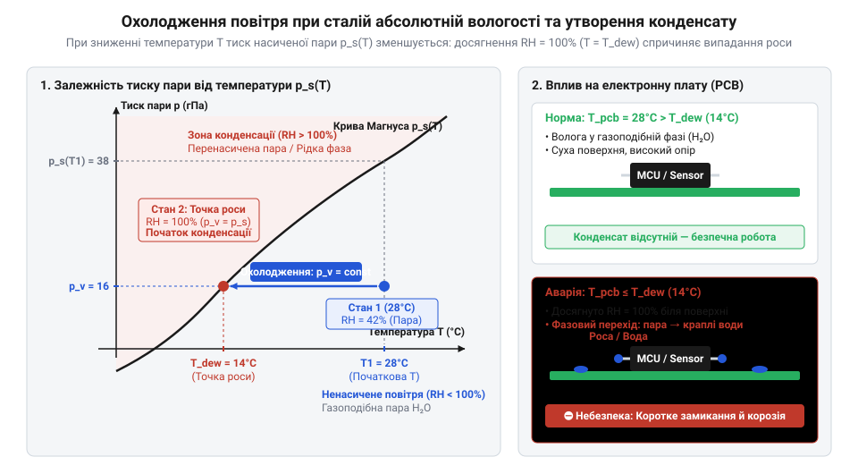
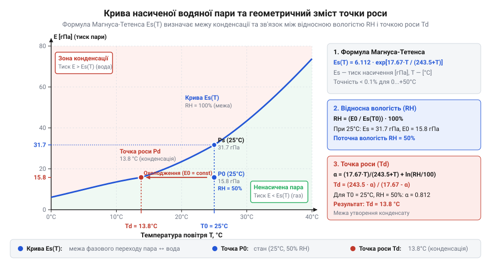
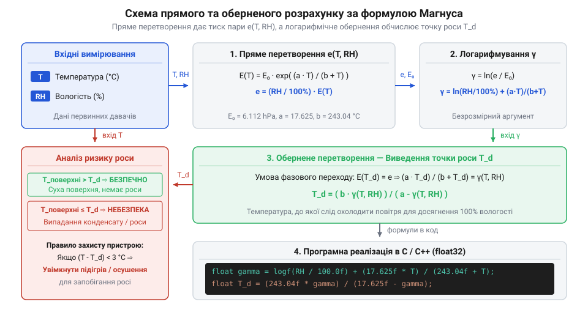
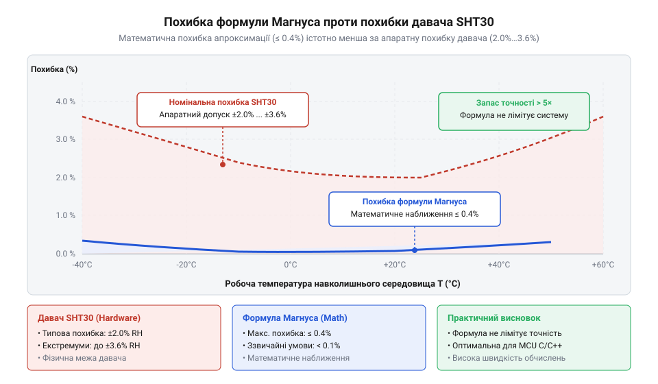
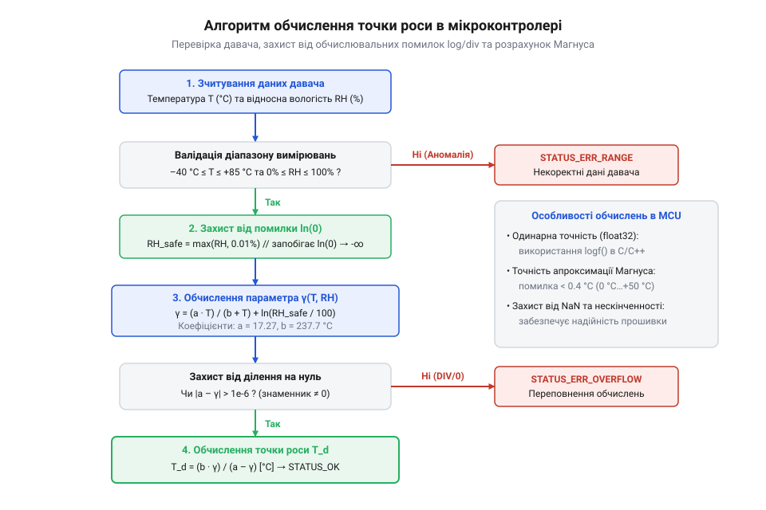

# Формула Магнуса-Тетенса для водяної пари

<preknowlist>
- [SHT30 — температура й вологість (I2C)](root:cat-hw-sensors/sht30) — принципи зчитування цифрових показників температури та відносної вологості за інтерфейсом I2C.
- [DHT11 — температура/вологість](root:cat-hw-sensors/dht11) — особливості вимірювання кліматичних параметрів бюджетними сенсорами та їхні обмеження точності.
- [Цифровий давач температури та вологості AHT20](root:cat-hw-sensors/aht20-sensor) — специфіка отримання каліброваних значень відносної вологості й температури для подальшої математичної обробки.
</preknowlist>

## Ризик конденсації у відкритій електроніці

Уявіть автономну метеорологічну станцію, оптичний вузол систем спостереження або шафу автоматики, встановлену на відкритому повітрі. Первинний цифровий [давач вологості SHT30](root:cat-hw-sensors/sht30) або [бюджетний сенсор DHT11](root:cat-hw-sensors/dht11) стабільно передає виміряні показники microclimate-середовища: температура становить +25 °C, а відносна вологість — 70%. На перший погляд, рівень вологості у 70% є цілком безпечним для роботи електронних компонентів, адже до межі 100% залишається значний запас. Проте з настанням ночі температура навколишнього повітря стрімко знижується до +19 °C. Пристрій продовжує працювати у звичайному режимі, але раптом мікроконтролер виходить із ладу, на друкованій платі (англ. @@en|PCB@@, від @@en|Printed Circuit Board@@ — друкована плата) виникають паразитні струми витоку, а захисне скло оптичного сенсора повністю запітніває.

Причина цієї раптової відмови полягає у фізичній природі величини, яку вимірює первинний кліматичний давач. Він показує відносну вологість (англ. @@en|Relative Humidity@@, від @@en|relative@@ — відносний, та @@en|humidity@@ — вологість), а не абсолютну масу вологи, що міститься у кубічному метрі повітря. Відносна вологість виражає лише відсоток водяної пари від максимально можливої кількості, яку повітря здатне утримати у газоподібному стані за поточної температури.

Термодинамічна здатність повітря утримувати воду в газоподібному стані суттєво залежить від його температури. Гаряче повітря має високу енергетичну місткість і здатне вміщувати значні об'єми невидимої пари. Коли повітря охолоджується, його гранична місткість стрімко скорочується. Якщо об'єм водяної пари залишається незмінним, то при зниженні температури відносна вологість автоматично зростає. В результаті той самий об'єм пари, який за температури +25 °C складав лише 70% від максимуму, при охолодженні до +19.3 °C досягає граничної межі 100% насичення.

При досягненні 100% @@en|Relative Humidity@@ повітря більше не здатне утримувати воду у газоподібній фазі. Настає межа термодинамічної рівноваги, і будь-яке подальше зниження температури змушує надлишок вологи здійснювати фазовий перехід — конденсуватися у рідкі краплі води. Температура, до якої повинно охолонути повітря з даним вмістом вологи, щоб досягти межі повного насичення, називається точкою роси (англ. @@en|Dew Point@@, від @@en|dew@@ — роса, та @@en|point@@ — точка).

Головна небезпека для електронних пристроїв полягає у різниці теплоємності матеріалів. Масивні алюмінієві радіатори, корпуса роз'ємів, скляні лінзи та мідні доріжки на @@en|PCB@@ випромінюють тепло й охолоджуються швидше за навколишнє повітря або, навпаки, утримують холод при раптовому припливі теплого вологого повітря. Коли температура поверхні будь-якого компонента опускається до значення @@en|Dew Point@@ чи нижче нього, волога з повітря починає миттєво конденсуватися безпосередньо на цій поверхні.

Випадання роси на електронних вузлах викликає руйнівні наслідки:
- Утворюються тонкі струмопровідні водні плівки між виводами мікросхем, що спотворює аналогові сигнали з [вимірювальних терморезисторів KY-013](root:cat-hw-sensors/ky-013-thermistor) або цифрових ліній обміну. - При проходженні постійного струму крізь краплі роси виникає електрохімічна корозія та дендритний ріст металу між доріжками, що призводить до незворотного короткого замикання. - На скляних поверхнях оптичних давачів утворюється конденсат, який розсіює світлові промені й спотворює показання вимірювачів.


*Процес охолодження повітря при сталій абсолютній вологості: зниження температури збільшує відносну вологість до межі насичення, що призводить до досягнення точки роси та випадання конденсату на поверхні друкованої плати.*

Просте спостереження за відносною вологістю за допомогою первинного [давача вологості AHT20](root:cat-hw-sensors/aht20-sensor) не дає змоги завчасно виявити загрозу. Наприклад, значення 80% @@en|Relative Humidity@@ за температури +30 °C означає, що @@en|Dew Point@@ становить +26.2 °C, тобто охолодження всього на 3.8 °C призведе до утворення вологи. Водночас 80% вологості за температури +5 °C дають точкою роси +1.9 °C, що забезпечує значно більший температурний запас.

Для створення надійної системи захисту мікроконтролер повинен безперервно розраховувати поточне значення @@en|Dew Point@@ за свідченнями кліматичних давачів. Порівнюючи розраховану точку роси з показаннями температури найхолодніших точок конструкції (виміряних за допомогою [цифрового термометра DS18B20](root:cat-hw-sensors/ds18b20) або [аналогового датчика LM35DZ](root:cat-hw-sensors/lm35)), керуючий процесор може завчасно увімкнути внутрішній нагрівальний елемент (англ. @@en|Heater@@, від @@en|heat@@ — гріти) чи запустити вентиляцію. Це забезпечує ефективне [запобігання конденсації вологи](root:hw-sensing/condensation-prevention-embedded-systems) у вбудованих системах. Практичну архітектуру такого захисного пристрою розкрито у [проєкті детектора точки роси](root:cat-hw-sensors/magnus-formula/proj-dew-point-microcontroller-calc.md).

## Фізика насиченої пари й вологість

Атмосферне повітря є термодинамічною сумішшю різних газів: азоту, кисню, вуглекислого газу та водяної пари. Відповідно до закону Дальтона, загальний барометричний тиск вологого повітря дорівнює сумі парціальних тисків усіх його компонентів. Парціальний тиск водяної пари (англ. @@en|Partial Pressure@@, від @@en|partial@@ — частковий, та @@en|pressure@@ — тиск) позначається як `P_w`. Він виражає точний фізичний тиск, який чинять виключно газоподібні молекули води у даному об'ємі.

Проте маса водяної пари, яка може перебувати у стабільному газоподібному стані за даної температури, обмежена термодинамічною межею. Якщо налити воду у закриту посудину, частина молекул з поверхні рідини вилітає внаслідок теплового руху (випаровування), а частина молекул пари повертається назад у рідину (конденсація). Коли швидкість випаровування зрівнюється зі швидкістю конденсації, між рідкою та газоподібною фазами встановлюється стан динамічної рівноваги.

Тиск водяної пари, що перебуває у рівновазі з плоскою поверхнею чистої води за температури `t`, називається тиском насиченої водяної пари (англ. @@en|Saturation Vapor Pressure@@, від @@en|saturation@@ — насичення) і позначається як `P_s(t)`. Цей тиск залежить виключно від температури середовища і зазвичай виражається у гектопаскалях (названих на честь фізика @@en|Blaise Pascal@@) — @@en|hPa@@ (1 hPa = 100 Па = 1 мбар, @@en|mbar@@).

Для кількісного опису вмісту вологи у повітрі використовують два основних поняття:
- **Абсолютна вологість** (англ. @@en|Absolute Humidity@@, від @@en|absolute@@ — абсолютний) `d_v` — це маса водяної пари, яка фактично міститься в одному кубічному метрі повітря (вимірюється в `г/м³`). Вона визначає фізичну густину водяної пари у просторі. - **Відносна вологість** `RH` — це безрозмірне відношення поточного парціального тиску водяної пари `P_w` до максимально можливого тиску насичення `P_s(t)` за тієї самої температури, виражене у відсотках:

```text
RH = (P_w ÷ P_s(t)) · 100            [визначення відносної вологості, %]
```

Знаючи виміряну давачем відносну вологість `RH` та температуру `t`, можна легко розрахувати фактичний парціальний тиск водяної пари `P_w` у повітрі:

```text
P_w = P_s(t) · (RH ÷ 100)            [розрахунок парціального тиску водяної пари]
```

Чому значення тиску насиченої пари `P_s(t)` так сильно змінюється від температури? При нагріванні молекули рідкої води отримують додаткову кінетичну енергію. Це дозволяє більшій кількості молекул долати міжмолекулярні водневі зв'язки та виходити у газоподібний стан. Фундаментальним зв'язком, що регулює цей фазовий перехід, є рівняння Клапейрона-Клаузіуса (англ. @@en|Clausius-Clapeyron Equation@@, назване на честь німецького фізика @@en|Rudolf Clausius@@ та французького інженера @@en|Émile Clapeyron@@).

Оскільки енергетичний розподіл молекул підпорядковується статистиці Максвелла-Больцмана, кількість молекул з енергією, достатньою для випаровування, зростає експоненційно з підвищенням температури. Тому тиск насиченої водяної пари `P_s(t)` демонструє крутий експоненційний ріст:
- При 0 °C тиск насичення `P_s` становить лише 6.11 hPa (абсолютна вологість насичення близько 4.84 г/м³);
- При +20 °C `P_s` зростає до 23.37 hPa (17.3 г/м³);
- При +30 °C `P_s` досягає 42.43 hPa (30.4 г/м³);
- При +100 °C тиск насиченої пари досягає атмосферного тиску 1013.25 hPa, що викликає процес кипіння води.


*Експоненційна крива залежності тиску насиченої пари від температури: лінія відображає термодинамічну межу між газоподібною парою та рідкою водою, ілюструючи геометричний зміст парціального тиску, відносної вологості й точки роси.*

Розглянемо геометричний зміст точки роси на цій експоненційній фазовій діаграмі. Припустимо, повітря має початкову температуру `t_0` та відносну вологість `RH_0 < 100%`. Цьому стану відповідає парціальний тиск пари `P_w = P_s(t_0) · (RH_0 / 100)`, розташований нижче кривої насичення `P_s(t)`.

Якщо охолоджувати це повітря за постійної абсолютної вологості (тобто при незмінному парціальному тиску `P_w`), робоча точка на графіку рухається горизонтально вліво — в бік зниження температури. Під час охолодження значення кривої насичення `P_s(t)` зменшується. При певній температурі `t_d` крива насичення знизиться до рівня незмінного парціального тиску `P_w`:

```text
P_s(t_d) = P_w                       [умова фазової межі точки роси]
```

Таким чином, температура точки роси `t_d` є розв'язком цього рівняння відносно температури. Математично це означає, що `t_d` є оберненою функцією від тиску насичення:

```text
t_d = P_s⁻¹(P_w)                     [аналітичне визначення точки роси]
```

Пряме інтегрування рівняння Клапейрона-Клаузіуса є складним математичним завданням, оскільки питома теплота випаровування води залежить від температури. На практиці широко застосовується емпірична експоненційна апроксимація, запропонована Генріхом Ґуставом Магнусом у 1844 році та уточнена Отто Тетенсом у 1930 році. Ця залежність відома як формула Магнуса-Тетенса (англ. @@en|Magnus-Tetens Formula@@, названа на честь науковців @@en|Heinrich Gustav Magnus@@ та @@en|Otto Tetens@@):

```text
E(t) = a · exp((b · t) ÷ (c + t))     [формула Магнуса-Тетенса для тиску насичення]
```

Де:
- `E(t)` — тиск насиченої водяної пари `P_s(t)` у гектопаскалях (@@en|hPa@@);
- `t` — температура повітря у градусах Цельсія (`°C`);
- `exp(...)` — математична експоненціальна функція `eⁿ`;
- `a`, `b`, `c` — емпіричні коефіціенти апроксимації.

За стандартом Всесвітньої метеорологічної організації (англ. @@en|WMO@@, від @@en|World Meteorological Organization@@ — Всесвітня метеорологічна організація) для діапазону температур від 0 °C до +50 °C над поверхнею рідкої води використовують наступні коефіцієнти:
- `a = 6.112 hPa` (значення тиску насичення при 0 °C);
- `b = 17.62` (безрозмірний коефіцієнт);
- `c = 243.12 °C` (температурна константа зсуву).

Еволюцію досліджень цієї залежності від перших таблиць 1844 року до сучасних рівнянь Бака (англ. @@en|Buck Equation@@) висвітлено у матеріалі про [історії виникнення формули](root:cat-hw-sensors/magnus-formula/hist-magnus-tetens-origins.md). Математичне виведення експоненційного рівняння, логарифмічне обернення для знаходження `t_d` та оцінку похибок розкрито у [математичному виведенні та точності](root:cat-hw-sensors/magnus-formula/math-magnus-tetens-derivation-and-inversion.md).

Описаний математичний апарат дозволяє будь-якому вбудованому мікроконтролеру, отримуючи первинні дані з давачів типу [GY-21 (Si7021)](root:cat-hw-sensors/gy-21) або комбінованого [модуль AHT20 та BMP280](root:cat-hw-sensors/aht20-bmp280), швидко розраховувати тиск насичення `E(t)`, вираховувати парціальний тиск `P_w` і точне значення точки роси `t_d`. Це становить основу обчислювальної [термодинаміки вологого повітря](root:ph-thermodynamics/psychrometric-thermodynamics-air-moisture), що реалізована у цифрових давачах [родини Sensirion та Bosch](root:cat-hw-sensors/sensor-digital-sht-bme-family).

## Емпірична формула Магнуса та обернення

Просте зчитування температури повітря та відносної вологості (від @@en|relative humidity@@) з кліматичного давача не дає прямої відповіді на запитання, за якої саме температури плати чи корпусу почне випадати конденсат. Щоб визначити критичний поріг охолодження, потрібно знайти точку роси (від @@en|dew point@@) — температуру, при якій поточний парціальний тиск (від @@la|pars@@ — частина) водяної пари стає тиском насиченої пари (від @@en|saturation vapor pressure@@). Прямий розрахунок термодинамічної кривої насичення за допомогою фундаментального рівняння Клапейрона-Клаузіуса (від @@fr|Clapeyron@@ та @@de|Clausius@@) вимагає обчислення складних інтегралів від температурної залежності питомої теплоти випаровування, що створює надмірне обчислювальне навантаження на мікроконтролер. Для уникнення складної обчислювальної математики застосовують емпіричну формулу Магнуса-Тетенса (названу на честь науковців @@en|Heinrich Gustav Magnus@@ та @@en|Otto Tetens@@) — експоненційну апроксимацію (від @@la|approximare@@ — наближати), яка дозволяє обчислити тиск насичення з високою точністю в один математичний крок. Досліджуючи [історію метеорологічних рівнянь](root:cat-hw-sensors/magnus-formula/hist-magnus-tetens-origins.md), фізики оптимізували параметри цієї залежності для практичних потреб кліматичного моніторингу.

Математична структура формули Магнуса-Тетенса описує експоненційне зростання тиску насиченої водяної пари залежно від температури повітря у градусах Цельсія. Позначимо через `t` виміряну температуру повітря в градусах Цельсія (°C), через `E(t)` — тиск насиченої водяної пари в гектопаскалях (від @@el|hekaton@@ — сто та @@el|pascal@@, @@en|hPa@@), через `a` — опорний тиск насичення при температурі 0°C, через `b` — безрозмірний експоненційний коефіцієнт (від @@la|coefficiens@@ — той, що сприяє) температурного масштабування, а через `c` — температурне зміщення у градусах Цельсія (°C). Залежність тиску насичення від температури має такий вигляд:

```
E(t) = a · exp((b · t) / (c + t))      [формула Магнуса-Тетенса для тиску насиченої пари]
```

Значення параметрів цієї математичної моделі підбирають експериментально. Опорний тиск `a = 6.112 hPa` відповідає фізичному тиску насиченої водяної пари за температури замерзання води 0°C. Дріб `(b · t) / (c + t)` у показнику експоненти (від @@la|exponere@@ — показувати) моделює сповільнення відносного зростання тиску насичення при підвищенні температури. Завдяки такій структурі формули помилка апроксимації лишається мінімальною в усьому діапазоні рідкої фази води.

Зв'язок між виміряною відносною вологістю `RH` у відсотках (%), поточним парціальним тиском пари `e` та тиском насичення `E(t)` визначається співвідношенням `e = (RH / 100) · E(t)`. За визначенням @@en|dew point@@, за температури точки роси `T_d` поточний парціальний тиск пари `e` стає рівним тиску насичення для цієї нової температури, тобто `E(T_d) = e`. Оскільки тиск насичення є строго монотонно зростаючою функцією температури, існує єдине обернене перетворення (від @@la|inversio@@ — перевертання), яке дозволяє виразити `T_d` аналітично через відомі значення `t` та `RH`.

Для аналітичного виведення формули точки роси підставимо вираз формули Магнуса-Тетенса у термодинамічну рівність `E(T_d) = (RH / 100) · E(t)`. Розділивши обидві частини рівняння на опорний тиск `a` та прологарифмувавши (від @@el|logos@@ — відношення та @@el|arithmos@@ — число) отриману рівність за допомогою натурального логарифма `ln()`, ми переходимо від експоненційного співвідношення до лінійного рівняння відносно невідомої величини `T_d`. Позначимо для зручності проміжну величину `γ(t, RH)` (гамма, від @@el|gamma@@), яка вбирає в себе весь виміряний стан повітря:

```
E(T_d) = (RH / 100) · E(t)                               [визначення точки роси через тиск]
a · exp((b · T_d) / (c + T_d)) = (RH / 100) · a · exp((b · t) / (c + t))   [підстановка апроксимації Магнуса]
exp((b · T_d) / (c + T_d)) = (RH / 100) · exp((b · t) / (c + t))           [скорочення на опорний тиск a]
(b · T_d) / (c + T_d) = ln(RH / 100) + (b · t) / (c + t)                   [логарифмування обох частин]
γ(t, RH) = (b · t) / (c + t) + ln(RH / 100)                                [введення допоміжної функції γ]
(b · T_d) = γ(t, RH) · (c + T_d)                                           [помноження на (c + T_d)]
b · T_d - T_d · γ(t, RH) = c · γ(t, RH)                                    [перегрупування доданків з T_d]
T_d = (c · γ(t, RH)) / (b - γ(t, RH))                                      [аналітичний вираз для точки роси]
```

Отримана аналітична формула дозволяє обчислити @@en|dew point@@ `T_d` напряму без використання чисельних методів чи ітераційних наближень. Деталі спрощення диференціальних співвідношень описані в [математичному виведенні формули](root:cat-hw-sensors/magnus-formula/math-magnus-tetens-derivation-and-inversion.md), де показується зв'язок емпіричних коефіцієнтів з універсальною газовою сталою та молярною масою води.

Вибір обчислювальних коефіцієнтів `a`, `b`, `c` залежить від температурного діапазону та агрегатного стану фазового переходу. Для позитивних температур (`t ≥ 0°C`), коли пара контактує з рідкою водою, Всесвітня метеорологічна організація (від @@en|World Meteorological Organization@@, @@en|WMO@@) рекомендує використовувати коефіцієнти `a = 6.112 hPa`, `b = 17.625` та `c = 243.04 °C` (або спрощені класичні значення Магнуса: `b = 17.67`, `c = 243.5 °C`). Для від'ємних температур (`t < 0°C`), коли відбувається сублімація пари над поверхнею льоду, міжмолекулярні зв'язки в кристалічній ґратці вимагають більшої енергії фазового переходу. Для льоду коефіцієнти набувають значень `a = 6.112 hPa`, `b = 22.46` та `c = 272.62 °C`. Врахування цієї різниці є критичним при розрахунку точки інею (від @@en|frost point@@) у холодильних та криогенних системах.

Послідовність математичних перетворень від виміряних первинних величин `t` і `RH` до тиску насичення та підсумкової точки роси подано на схемі прямого та оберненого розрахунку.


*Схема прямого перетворення обчислення тиску насичення та його логарифмічного обернення показує послідовність розрахунку точки роси за виміряними параметрами.*

На мікроконтролерах із плаваючою крапкою (від @@en|floating-point unit@@, @@en|FPU@@), таких як @@en|ARM Cortex-M4F@@ або @@en|ESP32@@, обчислення логарифма та експоненти виконується одинарною точністю за допомогою стандартних математичних функцій `logf()` та `expf()`. Код реалізує захист від коректності вхідних даних: якщо значення вологості `RH` виходить за межі діапазону від 0.1% до 100%, функція повертає значення `NAN` (від @@en|Not a Number@@). Нижче наведено ідіоматичну реалізацію алгоритму мовами C та C++.

:::tabs
:::code magnus-formula-d/c/mcu/magnus-calculate-dew-point.c
:::code magnus-formula-d/cpp/mcu/magnuscalculator.cpp
:::

## Діапазони точності та граничні режими

Використання єдиного набору коефіцієнтів формули Магнуса без урахування граничних температурних режимів створює ризик фатальних помилок у роботі систем клімат-контролю та превентивного підігріву. Якщо пристрій працює за умов глибокого заморожування при -25°C, використання коефіцієнтів для рідкої води призводить до похибки обчислення точки роси понад 1.5°C. Наслідком такої систематичної помилки є несвоєчасне ввімкнення підігрівачів оптичного скла або друкованої плати, що спричиняє утворення льодяної кірки. Щоб побудувати надійний вбудований прилад, інженер мусить чітко зіставити власний математичний бюджет похибки (від @@en|error budget@@) формули з фізичною точністю вимірювання давачів вологості.

У помірному температурному діапазоні від 0°C до +50°C емпірична апроксимація Магнуса-Тетенса забезпечує виняткову математичну точність: її відхилення від точних термодинамічних таблиць не перевищує ±0.05°C...±0.1°C. Показники популярного [первинного цифрового сенсора](root:cat-hw-sensors/sht30) Sensirion SHT30 чи первинних вимірювачів типу [GY-21](root:cat-hw-sensors/gy-21) володіють власною апаратною похибкою вимірювання відносної вологості в межах ±2%...±3% @@en|RH@@ та похибкою температури ±0.2°C. Розрахуємо чутливість точки роси до відхилення вологості: за температури 20°C і відносної вологості 50% зміна вологості на 1% @@en|RH@@ викликає зміну розрахованої точки роси приблизно на 0.17°C. Отже, апаратна похибка давача вологості ±2% @@en|RH@@ дає невизначеність точки роси близько ±0.34°C, що в 7 разів перевищує власну математичну похибку формули Магнуса (±0.05°C).

Графічний аналіз співвідношення математичної та апаратної похибок у діапазоні від -40°C до +60°C підтверджує доцільність застосування апроксимації Магнуса для практичних вбудованих систем.


*Графік похибки демонструє, що в робочому діапазоні температур похибка формули Магнуса є на порядок меншою за похибку первинних вимірювальних приладів.*

Основні проблеми точності виникають при від'ємних температурах від 0°C до -40°C через фазовий перехід (від @@en|phase transition@@) та явище існування переохолодженої води (від @@en|sub-cooled water@@). Більшість ємнісних цифрових давачів, коли вимірювальний [модуль вологості та температури](root:cat-hw-sensors/aht20-sensor) передає дані про відносну вологість за від'ємної температури, градуюються відносно рідкої переохолодженої води, а не відносно льоду. Якщо на охолодженій поверхні відбувається утворення інею (сублімація пари безпосередньо в кристал льоду), тиск насичення над льодом є нижчим, ніж над рідкою переохолодженою водою при тій самій температурі. Якщо обчислювальний алгоритм не переключить коефіцієнти `b` та `c` на значення для льоду (`b = 22.46`, `c = 272.62 °C`), розрахована @@en|dew point@@ виявиться завищеною, що викличе хибні спрацьовування алгоритмів захисту.

Для вирішення задач підвищеної точності в авіації, метеорології та вимірювальних лабораторних комплексах застосовують уточнену формулу Бака (від @@en|Buck equation@@). Арден Бак (@@en|Arden Buck@@) у 1981 році запропонував розширене рівняння, що враховує нелінійне викривлення логарифмічної кривої при високих температурах та включає підсилювальний фактор тиску повітря. Оновлена формула Бака для рідкої води має вигляд:

```
E_buck(t) = 6.1121 · exp((18.678 - t / 234.5) · t / (257.14 + t))      [рівняння Бака для тиску насичення]
```

Використання рівняння Бака дозволяє зменшити математичну похибку апроксимації до ±0.005°C у діапазоні від -40°C до +50°C. Проте для побутових та промислових пристроїв мікроклімату, де використовуються сучасні [цифрові комбіновані сенсори](root:cat-hw-sensors/sensor-digital-sht-bme-family), обчислювальна складність рівняння Бака є надлишковою, і стандартних коефіцієнтів @@en|WMO@@ для формули Магнуса цілком достатньо.

Підсумковий бюджет похибки (від @@en|error budget@@) розрахунку точки роси складається з квадратичної суми трьох незалежних компонентів: похибки давача вологості, похибки давача температури та математичної похибки апроксимації. У загальному вигляді сумарне середньоквадратичне відхилення точки роси `ΔT_d` визначається за формулою:

```
ΔT_d = √((ΔT_d_sensor_RH)² + (ΔT_d_sensor_temp)² + (ΔT_d_approx)²)      [бюджет похибки точки роси]
```

Для робочого діапазону від 0°C до +50°C чисельний розрахунок дає `ΔT_d = √((0.34)² + (0.2)² + (0.05)²) ≈ √(0.1156 + 0.04 + 0.0025) ≈ 0.398 °C`. Це означає, що реальна точність визначення межі конденсації становить близько ±0.4°C. Інженери, які розробляють ефективні засоби для [запобігання конденсації вологи](root:hw-sensing/condensation-prevention-embedded-systems) у вбудованих системах, закладають гістерезис (від @@el|hysteresis@@ — запізнення) підігріву не менше 1.0°C...1.5°C вище обчисленого значення `T_d`. Такий температурний запас гарантує надійний захист електронних компонентів від утворення вологи. Зміна барометричного тиску також може впливати на парціальний тиск вологого повітря у комбінованому [кліматичному давачі тиску](root:cat-hw-sensors/aht20-bmp280), що детально аналізується у [термодинаміці вологого повітря](root:ph-thermodynamics/psychrometric-thermodynamics-air-moisture) при змінному тиску.

## Обчислення формули у мікроконтролерних прошивках

Перенесення аналітичних формул обчислення вологого повітря у код прошивки вбудованої системи вимагає врахування апаратних обмежений обчислювача. Практичне завдання мікроконтролера полягає у перетворенні сирих даних вимірювання температури `t` у градусах Цельсія (°C) та відносної вологості `RH` у відсотках (%), які вимірюють комбіновані давачі рівня [Sensirion SHT30](root:cat-hw-sensors/sht30) або [AHT20](root:cat-hw-sensors/aht20-sensor), у фізичні параметри стану середовища. Серед них — тиск насиченої пари `E(t)`, поточний парціальний тиск водяної пари `e`, точка роси `T_d` та абсолютна вологість `AH`. Проте при спробі прямої реалізації обчислень розробники часто стикаються зі зниженням швидкодії або несподіваною втратою точності.

Головне джерело втрати продуктивності на 32-бітних мікроконтролерах із сопроцесором плаваючої крапки (від @@en|floating-point unit@@, @@en|FPU@@), таких як @@en|ARM Cortex-M4F@@ чи @@en|ESP32@@, полягає у некоректному виклику стандартних математичних функцій. Апаратний сопроцесор цих ядер підтримує лише обчислення одиночної точності (від @@en|single-precision@@, 32-бітні числа типу `float`). Виклик стандартних функцій `exp()` або `log()` з бібліотеки `math.h` замість `expf()` та `logf()` призводить до автоматичного приведення типів (від @@la|promotio@@ — просування) аргументу `float` до 64-бітного типу подвійної точності (від @@en|double-precision@@, `double`). Оскільки сопроцесор не підтримує 64-бітну арифметику на апаратному рівні, компілятор змушений підключати програмну емуляцію (від @@la|aemulatio@@ — суперництво). Це збільшує розмір прошивки на кілька кілобайт і сповільнює виконання математичної операції у 5–10 разів.

Крім того, транскурсивні математичні функції природно чутливі до граничних значень вхідних аргументів. При спробі обчислити натуральний логарифм від нульового чи від'ємного значення вологості (`RH ≤ 0`) функція `logf()` повертає мінус нескінченність (`-HUGE_VALF`), що далі призводить до виникнення невизначеності `NaN` (від @@en|Not a Number@@). При обчисленні точки роси `T_d = (c · γ) / (b - γ)` потенційно можливе ділення на нуль, якщо проміжна функція `γ(t, RH)` виявиться рівною коефіцієнту `b`. Це фізично відповідає гіпотетичній вологості `RH`, яка значно перевищує 100%.

Для гарантування стабільності прошивки обчислювальний алгоритм повинен проходити послідовну валідацію входів, вибір коефіцієнтів та перевірку ділення.


*Блок-схема ілюструє послідовну перевірку діапазонів вхідних даних давача, обчислення коефіцієнтів Магнуса, обробку виняткових випадків та захист від переповнення при діленні.*

Формула абсолютної вологості (від @@en|absolute humidity@@, `AH`) у грамах на кубічний метр (`g/m³`) визначає реальну масу водяної пари в одному кубічному метрі повітря. Вона обчислюється через парціальний тиск пари `e` у гектопаскалях (@@en|hPa@@) та абсолютну температуру за шкалою Кельвіна:

```
e = (RH / 100) · E(t)                                    [парціальний тиск водяної пари]
AH = 216.7 · (e / (273.15 + t))                          [абсолютна вологість повітря в g/m³]
```

Чисельний коефіцієнт `216.7` отримують діленням молярної маси води ($18.0152 \text{ г/моль}$) на універсальну газову сталу ($8.3144 \text{ Дж/(моль·К)}$) з урахуванням переведення тиску з гектопаскалів у паскалі.

Нижче наведено повну та захищену реалізацію прямого і оберненого розрахунку параметрів вологого повітря за формулою Магнуса-Тетенса мовами C та C++. Описи структур даних та додаткові допоміжні функції можна переглянути у довідці на [програмний інтерфейс C/C++ бібліотеки](root:cat-hw-sensors/magnus-formula/api-magnus-math-c-library.md).

:::tabs
:::code magnus-formula-d/c/mcu/magnus-calculate-all.c
:::code magnus-formula-d/cpp/mcu/airstate.cpp
:::

Практична інтеграція розглянутих обчислювальних модулів у реальну схему контролера розкривається у [проєкті детектора точки роси](root:cat-hw-sensors/magnus-formula/proj-dew-point-microcontroller-calc.md), де детально показано узгодження вимірювальних циклів із роботою периферійних пристроїв.

## Алгоритми захисту пристроїв від конденсату

Знання точного значення точки роси `T_d` у прошивці мікроконтролера є лише першим кроком до забезпечення надійності електронного обладнання. Фізичне утворення конденсату відбувається тоді, коли температура поверхні пристрою `T_surface` стає нижчою або рівною температурі точки роси оточуючого повітря (`T_surface ≤ T_d`). У герметичних корпусах із захистом @@en|IP67@@, оптичних давачах, вуличних відеокамерах та автомобільних кліматичних системах випадання вологи спричиняє запотівання лінз, корозію контактів друкованих плат і мікрокороткі замикання. Для запобігання фазовому переходу рідини прошивка контролера повинна керувати підігріваючим елементом (від @@en|heater@@).

Для побудови системи превентивного захисту недостатньо орієнтуватися лише на свідчення давача повітря. Поверхня захищуваного об'єкта (наприклад, переднє скло об'єктива чи захисне скло лідара) володіє власною тепловою інерцією (від @@la|inertia@@ — бездіяльність, @@en|thermal inertia@@). При різкому підвищенні температури й вологості навколишнього повітря масивне скло охолоджується значно повільніше і тривалий час лишається холоднішим за довкілля. Тому алгоритм керування вимагає наявності двох температурних каналів: первинного давача мікроклімату середовища, такого як [SHT30](root:cat-hw-sensors/sht30) чи [DHT11](root:cat-hw-sensors/dht11), та контактного давача температури поверхні. Як контактні вимірювачі температури плат чи корпусу застосовують термістори [KY-013](root:cat-hw-sensors/ky-013-thermistor), цифрові давачі [DS18B20](root:cat-hw-sensors/ds18b20), аналогові сенсори [LM35DZ](root:cat-hw-sensors/lm35) або платинові термоопори [PT100](root:cat-hw-sensors/pt100-rtd).

Різниця між температурою поверхні та точкою роси визначає температурний запас безпеки `ΔT = T_surface - T_d`. Якщо параметр `ΔT` зменшується до критичної межі, алгоритм вмикає нагрівач. Пряме пропорційне керування нагрівачем без часового та температурного гістерезису (від @@el|hysteresis@@ — запізнення) призводить до високочастотного перемикання силового ключа на польовому транзисторі (від @@en|metal-oxide-semiconductor field-effect transistor@@, @@en|MOSFET@@) або електромагнітному реле. Це викликає швидкий знос контактів, імпульсні завади у колі живлення та надмірне перевитрачання енергії.

Для усунення коливань застосовують дворежимний гістерезисний алгоритм керування із двома температурними порогами: порогом увімкнення `ΔT_ON` (наприклад, 1.5°C) та порогом вимкнення `ΔT_OFF` (наприклад, 3.5°C). Крім того, у системах із плавним регулюванням потужності застосовують широтно-імпульсну модуляцію (від @@en|pulse-width modulation@@, @@en|PWM@@) нагрівальних елементів, де коефіцієнт заповнення пропорційний швидкості наближення `T_surface` до `T_d`.

У загальному вигляді логіку гістерезисного регулятора підігріву для [запобігання конденсації вологи](root:hw-sensing/condensation-prevention-embedded-systems) можна описати такою системою умов:

```
[Стан: HEATER_OFF]
якщо (T_surface - T_d) ≤ ΔT_ON  ---> перехід у STAN: HEATER_ON

[Стан: HEATER_ON]
якщо (T_surface - T_d) ≥ ΔT_OFF ---> перехід у STAN: HEATER_OFF
якщо час_роботи > MAX_HEATER_TIME ---> перехід у STAN: FAULT_SAFE  [захист від перегріву]
```

Для запобігання аварійним ситуаціям у прошивку обов'язково вбудовують сторожовий таймер максимального часу безперервної роботи підігріву `MAX_HEATER_TIME` та перевірку справності давачів. Якщо контактний сенсор [DS18B20](root:cat-hw-sensors/ds18b20) або кліматичний давач [AHT20](root:cat-hw-sensors/aht20-sensor) втрачають зв'язок по шинах @@en|I2C@@ чи @@en|1-Wire@@, алгоритм переходить у безпечний аварійний режим (від @@en|fail-safe@@) із періодичним імпульсним підігрівом.

Нижче наведено практичну реалізацію алгоритму гістерезисного захисту від конденсату мовами C та C++.

:::tabs
:::code magnus-formula-d/c/mcu/anti-cond-update.c
:::code magnus-formula-d/cpp/mcu/controllerstate.cpp
:::

Оцінити повну схему вимірювальних кіл, керування нагрівальними елементами та алгоритмічний алгоритм захисту мікроклімату можна в описі [проєкту детектора точки роси та захисту від конденсату](root:cat-hw-sensors/magnus-formula/proj-dew-point-microcontroller-calc.md).