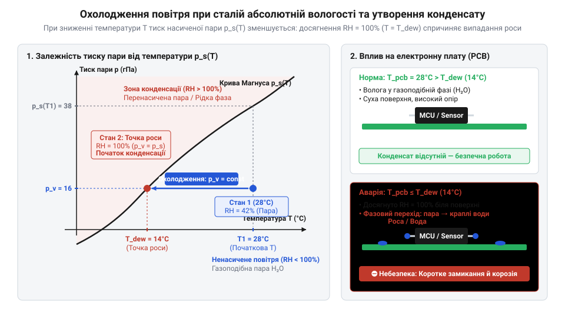
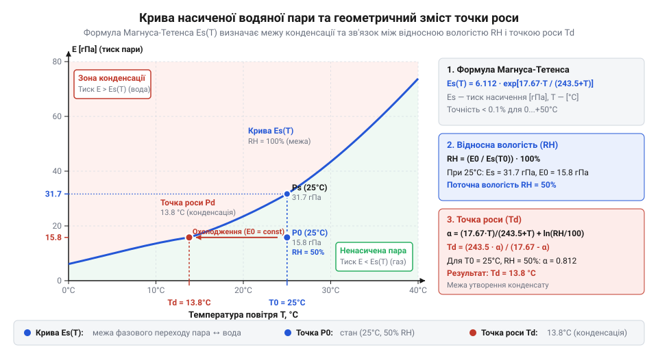
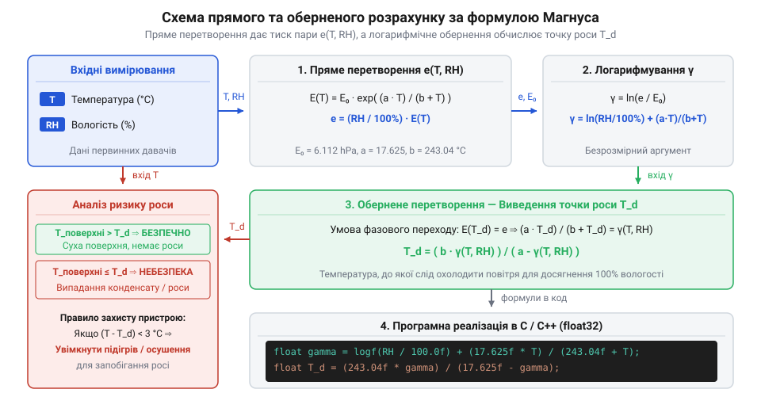

# Формула Магнуса-Тетенса для водяної пари

<preknowlist>
- [SHT30 — температура й вологість (I2C)](root:cat-hw-sensors/sht30) — принципи вимірювання кліматичних параметрів температури й відносної вологості цифровими давачами
- [DHT11 — температура/вологість](root:cat-hw-sensors/dht11) — особливості вимірювання кліматичних параметрів бюджетними сенсорами та їхні обмеження точності
- [Цифровий давач температури та вологості AHT20](root:cat-hw-sensors/aht20-sensor) — отримання каліброваних показників відносної вологості й температури для подальшого перерахунку
</preknowlist>

## Ризик конденсації в електронних пристроях

Герметичні модулі часто виходять з ладу після нічного охолодження через замикання на платах. Показання @@la|відносної вологості@@ з давачів на зразок [SHT30](root:cat-hw-sensors/sht30) описують лише ступінь насичення повітря за даної температури, а не масу води.

При охолодженні повітря його здатність утримувати пару падає, а вологість сягає 100%. Настає @@gr|фазовий перехід@@ (грец. *phasis* — поява) вологи в рідину — на поверхнях виникає @@la|конденсація@@ (лат. *condensatio* — згущення).


*Фізичний процес конденсації вологи: при охолодженні повітря без зміни кількості пари відносна вологість зростає до 100%, викликаючи випадання крапель на поверхні.*

Температуру, за якої пара стає насиченою й випадає краплями, називають @@la|точкою роси@@. Якщо поверхня охолоджується до цього порогу, пара осідає на ній. Для захисту обладнання прошивка має неперервно обчислювати точку роси й зіставляти її з температурою вузлів.

## Термодинаміка пари та формула Магнуса-Тетенса

Для обчислення точки роси розрізняють @@la|парціальний тиск@@ (лат. *partialis* — частковий) водяної пари `P_a` (її внесок у загальний тиск) та @@la|тиск насиченої пари@@ `P_s` — максимальний тиск за температури `T` у стані рівноваги.

Нелінійну залежність `P_s` (у гПа) від температури `T` (°C) описує емпірична @@de|формула Магнуса-Тетенса@@:

P_s(T) = a · exp((b · T) / (c + T))

Емпіричні коефіцієнти для рідкої води (-45…+60 °C): `a = 6.112` гПа, `b = 17.67`, `c = 243.5` °C.


*Крива P_s(T): експоненційне зростання тиску з температурою показує зменшення вологоємності повітря при охолодженні.*

За виміряними `T` та відносною вологістю `RH` (%) з [каліброваного сенсора AHT20](root:cat-hw-sensors/aht20-sensor) обчислюють фактичний парціальний тиск `P_a`:

P_a = P_s(T) · (RH / 100)

## Математичне обернення для точки роси

За визначенням, температура @@la|точки роси@@ `T_d` — це температура, за якої @@la|тиск насичення@@ `P_s(T_d)` дорівнює поточному @@la|парціальному тиску@@ водяної пари `P_a`. Підставивши `P_s(T_d)` у @@de|формулу Магнуса-Тетенса@@, отримуємо рівняння:

a · exp((b · T_d) / (c + T_d)) = P_a
exp((b · T_d) / (c + T_d)) = P_a / a                              [ділення на a]
(b · T_d) / (c + T_d) = ln(P_a / a)                             [логарифмування]

Ввівши функцію `γ(T, RH) = (b · T) / (c + T) + ln(RH / 100)`, виражаємо `T_d`:

(b · T_d) / (c + T_d) = γ(T, RH)
b · T_d = γ(T, RH) · (c + T_d)                                  [помноження на (c + T_d)]
T_d · (b - γ(T, RH)) = c · γ(T, RH)                             [перенесення доданків з T_d]
T_d = (c · γ(T, RH)) / (b - γ(T, RH))                           [вираження T_d]


*Алгоритм обчислення точки роси: від виміряних T і RH через функцію γ(T, RH) до аналітичного визначення T_d.*

Обчислимо точку роси для `T = 25.0` °C та `RH = 70.0` %:

γ(25, 70) = (17.67 × 25.0) ÷ (243.5 + 25.0) + ln(70.0 ÷ 100)
          ≈ 1.64525 - 0.35667                                   [обчислення та логарифмування]
          = 1.28858                                             [значення γ]

T_d = (243.5 × 1.28858) ÷ (17.67 - 1.28858)
    ≈ 19.15 °C                                                  [точка роси T_d]

Аналітичний вираз дає змогу обчислювати точку роси у прошивці за кілька арифметичних операцій без чисельних ітерацій.

:::tabs
:::code magnus-formula/c/esp-idf/calculate-dew-point.c
```cpp|arduino
#include <Arduino.h>
#include <math.h>

float calculateDewPoint(float tempC, float rhPercent) {
    constexpr float b = 17.67f;
    constexpr float c = 243.5f;

    if (rhPercent <= 0.0f) {
        return -999.0f;
    }

    float gamma = (b * tempC) / (c + tempC) + log(rhPercent / 100.0f);
    return (c * gamma) / (b - gamma);
}
```
:::

## Гістерезисний алгоритм захисту від конденсату

Захист чутливих елементів вимагає, щоб температура поверхні `T_surf` (зміряна, наприклад, [термометром DS18B20](root:cat-hw-sensors/ds18b20)) завжди була вищою за точку роси `T_d`.

Вимкнення підігріву одразу при `T_surf > T_d` викликає релейне брязкання від коливань температури довкілля та створює ризик мікроконденсації. Для стабільності застосовують дворежимний @@gr|гістерезис@@ (грец. *hysterēsis* — відставання) з двома порогами:
- Увімкнення: `T_on = T_d + 3.0 °C`
- Вимкнення: `T_off = T_d + 6.0 °C`

Якщо `T_surf <= T_on`, нагрівач вмикається і працює до досягнення `T_off`. У зоні між порогами система зберігає свій стан, що усуває брязкання.

:::tabs
:::code magnus-formula/c/esp-idf/update-anti-condensation-heater.c
:::code magnus-formula/cpp/arduino/updateanticondensationheater.cpp
:::