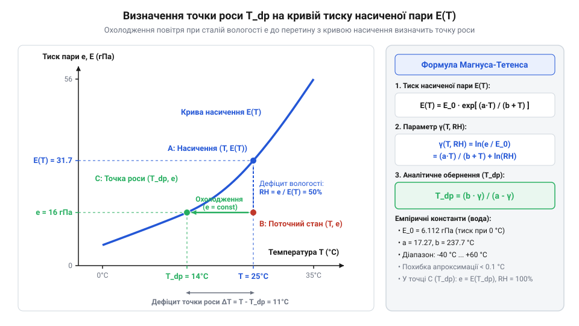
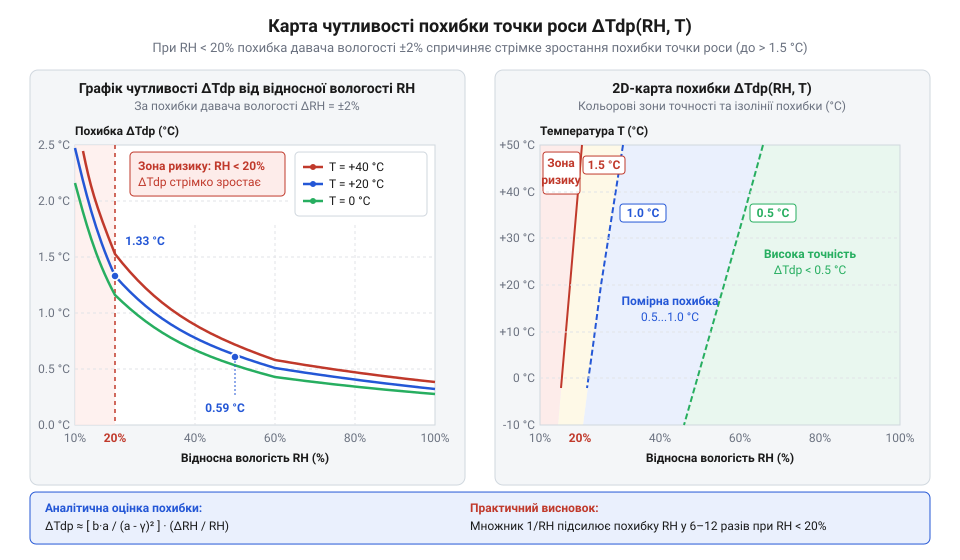

# Математичне виведення, аналітичне обернення та точність формули Магнуса-Тетенса

<preknowlist>
- [SHT30 — температура й вологість (I2C)](root:cat-hw-sensors/sht30) — принципи вимірювання температури й відносної вологості цифровим давачем та межі його точності.
- [Цифровий давач температури та вологості AHT20](root:cat-hw-sensors/aht20-sensor) — способи зчитування первинних фізичних величин T та RH з цифрового сенсора.
</preknowlist>

## Необхідність обчислення температури точки роси

Коли в герметичному шафі з електронікою або на оптичній лінці давача випадає конденсат, це майже завжди стає несподіванкою для розробника. Цифровий мікроконтролер зчитує показання температури середовища `25 °C` та відносної вологості `75 %`, і алгоритм контролю вважає, що середовище залишається безпечним і сухим. Проте варто корпусу пристрою охолонути вночі або під дією зовнішнього обдуву лише на 5 °C, як поверхня друкованої плати вкривається мікроскопічними краплями води. Внаслідок цього виникають витоки струму, корозія доріжок і хибні спрацьовування. Первинні параметри повітря не попереджають про небезпеку напряму, бо вони описують стан газової суміші взагалі, а не межу, за якою волога змінює фазовий стан.

Причина цього явища полягає в тому, що повітря здатне утримувати лише обмежену кількість водяної пари при заданій температурі. Що вища температура, то більшу кінетичну енергію мають молекули води і то вищим є граничний тиск, за якого воно залишається в газоподібному стані. Якщо ж газову суміш охолоджувати при постійному тиску, її здатність утримувати пару нелінійно зменшується. Температуру, до якої необхідно охолодити повітря зі збереженням парціального тиску водяної пари, щоб вона досягла стану повного насичення й почала конденсуватися в рідку фазу, називають росовою температурою або росовою точкою (@@en|dew point@@, від @@la|ros@@ — роса).

Один лише показник відносної вологості (@@en|relative humidity@@) є відносним співвідношенням і не показує енергетичного запасу до фазового переходу. Відносна вологість визначається як відношення поточного парціального тиску (@@en|partial vapor pressure@@) водяної пари `e` до максимального тиску насиченої пари (@@en|saturation vapor pressure@@) `E(T)` при даній температурі:

```
RH = (e / E(T)) · 100%
```

Оскільки тиск насичення (@@en|saturation vapor pressure@@) `E(T)` стрімко зростає з температурою, однакова відносна вологість `RH = 70 %` при температурі `+35 °C` відповідає колосальній масі вологи в кожному кубічному метрі повітря, тоді як при `+5 °C` ця маса у кілька разів менша. Відповідно, при `+35 °C` для початку конденсації (@@la|condensatio@@) достатньо охолодити поверхню лише на `6 °C`, а при низьких температурах запас безпечного охолодження може бути зовсім іншим.

Для надійного захисту обладнання, автоматизованого керування обогревом корпусів, вентиляцією та кліматичними системами мікроконтролер повинен у реальному часі обчислювати росову точку (@@en|dew point@@) `T_dp`. На відміну від простих вимірювачів, де використовуються лише первинні канали температури — як-от [аналоговий термістор KY-013](root:cat-hw-sensors/ky-013-thermistor) або [цифровий давач DS18B20](root:cat-hw-sensors/ds18b20) — сучасні кліматичні вузли отримують комплексну інформацію. Коли первинні вимірювання з [цифрового давача SHT30](root:cat-hw-sensors/sht30) або [комбінованого модуля AHT20](root:cat-hw-sensors/aht20-sensor) надходять у мікроконтролер, алгоритм має негайно перераховувати параметри вологості у росову точку (@@en|dew point@@) `T_dp`.

Різницю між поточною температурою повітря `T` та температурою точки роси `T_dp` називають дефіцитом точки роси (@@en|dew point depression@@):

```
ΔT_dp = T - T_dp
```

Якщо дефіцит точки роси (@@en|dew point depression@@) `ΔT_dp` наближається до нуля (наприклад, стає меншим за `2...3 °C`), мікроконтролер вмикає вбудований нагрівач платформи чи вентиляцію, запобігаючи конденсації (@@la|condensatio@@). Проте пряме обчислення `T_dp` вимагає розв'язання оберненої термодинамічної задачі, оскільки фундаментальний тиск насичення зв'язаний з температурою через складні експоненційні залежності.

## Термодинамічне виведення напівемпіричної формули Магнуса

Щоб побудувати математичний алгоритм розрахунку точки роси (@@en|dew point@@), необхідно спочатку встановити фізичний закон, який пов'язує температуру із тиском насиченої водяної пари (@@en|saturation vapor pressure@@). У фундаментальній термодинаміці фазовий перехід між рідкою водою та парою описується диференціальним рівнянням Клапейрона-Клаузіуса (@@la|Clapeyron-Clausius equation@@, від прізвищ науковців @@fr|Benoît Paul Émile Clapeyron@@ та @@de|Rudolf Clausius@@):

```
dE / dT = L_v / (T · Δv)
```

тут `dE / dT` — зміна тиску насичення при зміні абсолютної температури `T` (у Кельвінах), `L_v` — питома теплота випаровування (@@la|enthalpy of vaporization@@) води, а `Δv = v_vapor - v_liquid` — зміна питомого об'єму при переході з рідкої фази у газоподібну.

Оскільки питомий об'єм пари при атмосферному тиску в тисячі разів перевищує питомий об'єм рідкої води (`v_vapor >> v_liquid`), зміною об'єму рідини можна знехтувати, вважаючи `Δv ≈ v_vapor`. Описуючи водяну пару (@@la|vapor@@) рівнянням стану ідеального газу `v_vapor = (R_v · T) / E`, де `R_v` — питома газова стала водяної пари (`R_v = R / M_v ≈ 461.5 J/(kg·K)`), підставляємо `v_vapor` у рівняння Клапейрона-Клаузіуса:

```
dE / dT = (L_v · E) / (R_v · T²)
```

Це диференціальне рівняння першого порядку описує зростання тиску насичення (@@en|saturation vapor pressure@@) зі збільшенням температури. Для його інтегрування відокремлюємо змінні та робимо припущення, що у відносно вузькому діапазоні температур питома теплота випаровування (@@la|enthalpy of vaporization@@) `L_v` є сталою величиною:

```
dE / E = (L_v / R_v) · (dT / T²)
[відокремлення змінних]

∫ (1 / E) dE = (L_v / R_v) · ∫ (1 / T²) dT
[інтегрування обох частин]

ln(E / E₀) = (L_v / R_v) · (1 / T₀ - 1 / T)
[інтегрування від опорного стану T₀, E₀]

ln(E / E₀) = (L_v / (R_v · T₀)) · (T - T₀) / T
[зведення дробу в дужках до спільного знаменника]
```

Переходячи від абсолютної температури `T` (у Кельвінах) до температури `t` у градусах Цельсія (`t = T - T₀`, де `T₀ = 273.15 K`), підставимо `T = T₀ + t`:

```
ln(E / E₀) = (L_v / (R_v · T₀)) · t / (T₀ + t)
```

Проте в реальних атмосферних умовах питома теплота випаровування `L_v` не є абсолютно сталою: вона лінійно зменшується зі зростанням температури. Для компенсації цієї нелінійності німецький фізик Генріх Густав Магнус (@@de|Heinrich Gustav Magnus@@) у 1844 році та Отто Тетенс (@@de|Otto Tetens@@) у 1930 році запропонували напівемпіричну модифікацію отриманого співвідношення, відому як формула Магнуса (@@de|Magnus formula@@) або Магнуса-Тетенса:

```
E(t) = E₀ · exp((a · t) / (b + t))
```

тут `E₀ = 6.112 hPa` (або мбар) — опорний тиск насиченої пари (@@en|saturation vapor pressure@@) при `0 °C`, `a` — безрозмірний коефіцієнт, який враховує відношення питомої теплоти випаровування до газової сталої, а `b` — коефіцієнт з розмірністю градусів Цельсія, що коригує температурну шкалу та нелінійність випаровування.


*Залежність тиску насиченої пари E(t) від температури: точки роси досягають при охолодженні повітря зі збереженням парціального тиску e до перетину з кривою насичення.*

Фізичний зміст коефіцієнтів у формулі Магнуса (@@de|Magnus formula@@) простежується з зіставлення з теоретичним інтегралом. Безрозмірний параметр `a` безпосередньо зв'язаний із початковою енергією фазового переходу при `0 °C` (`a ≈ L_v / (R_v · T₀)`), а знаменник `b + t` виступає ефективною температурою переносу.

У сучасній метеорології та вимірюваній техніці найчастіше застосовують коефіцієнти, оптимізовані Арденом Баком (@@en|Arden Buck@@) та Всесвітньою метеорологічною організацією для діапазону від `-40 °C` до `+50 °C` над поверхнею рідкої води:

```
E₀ = 6.1121 hPa
a = 17.673 (або 17.625 за стандартом Alduchov & Eskridge)
b = 243.5 °C (або 243.04 °C)
```

Отримана залежність `E(t)` є строго монотонно зростаючою гладкою функцією, що дозволяє виконувати її аналітичне обернення без обчислювальних втрат.

## Аналітичне обернення та точний розрахунок

Маючи вираз для тиску насиченої пари (@@en|saturation vapor pressure@@) `E(t)` та вимірявши відносну вологість (@@en|relative humidity@@) `RH` і температуру `t`, ми можемо обчислити поточний парціальний тиск (@@en|partial vapor pressure@@) водяної пари `e`:

```
e = (RH / 100) · E(t)
```

За визначенням, росова точка (@@en|dew point@@) `t_dp` — це така температура, при якій тиск насиченої пари (@@en|saturation vapor pressure@@) дорівнює поточному парціальному тиску (@@en|partial vapor pressure@@): `E(t_dp) = e`. Оскільки функція Магнуса (@@de|Magnus formula@@) є монотонною, існує єдине точне алгебраїчне розв'язання для `t_dp`, яке не потребує ітераційних чисельних методів (як-от метод Ньютона-Рафсона чи бісекції).

Для виконання аналітичного обернення підставляємо вираз Магнуса в умову рівності тисків:

```
E₀ · exp((a · t_dp) / (b + t_dp)) = (RH / 100) · E₀ · exp((a · t) / (b + t))
[рівність парціального тиску та тиску насичення при t_dp]

exp((a · t_dp) / (b + t_dp)) = (RH / 100) · exp((a · t) / (b + t))
[ділення обох частин на E₀]

(a · t_dp) / (b + t_dp) = ln(RH / 100) + (a · t) / (b + t)
[логарифмування обох частин за натуральною основою ln]
```

Для спрощення запису та подальших обчислень уведемо допоміжний логарифмічний параметр (@@grc|logarithmic parameter@@, від грецького `γ` — ґамма) `γ(t, RH)`:

```
γ(t, RH) = ln(RH / 100) + (a · t) / (b + t)
[визначення допоміжного логарифмічного параметра γ]
```

Тепер рівняння набуває лінійного відносно `t_dp` вигляду у дробово-раціональній формі:

```
(a · t_dp) / (b + t_dp) = γ(t, RH)
[підстановка параметра γ]

a · t_dp = γ(t, RH) · (b + t_dp)
[множення обох частин на (b + t_dp)]

a · t_dp = b · γ(t, RH) + t_dp · γ(t, RH)
[розкриття дужок у правій частині]

t_dp · (a - γ(t, RH)) = b · γ(t, RH)
[перенесення доданків з t_dp в одну частину та винесення за дужки]

t_dp = (b · γ(t, RH)) / (a - γ(t, RH))
[остаточна формула аналітичного обернення]
```

Отримана формула дає точний розрахунок температури точки роси (@@en|dew point@@) за один крок без чисельних ітерацій.

**Обчислення на прикладі**

**Умова**: За допомогою датчика виміряно температуру середовища `t = 25.0 °C` та відносну вологість `RH = 60.0 %`. Застосовуємо коефіцієнти Магнуса `a = 17.625` та `b = 243.04 °C`.

```
γ(25.0, 60.0) = ln(60.0 / 100.0) + (17.625 · 25.0) / (243.04 + 25.0)
= ln(0.60) + 440.625 / 268.04              [обчислення відношення вологості та температури]
= -0.5108256 + 1.6438778                   [обчислення натурального логарифма та дробу]
= 1.1330522                                [сумування складових параметра γ]

t_dp = (243.04 · 1.1330522) / (17.625 - 1.1330522)
= 275.3780 / 16.4919478                    [обчислення чисельника та знаменника]
= 16.698 °C ≈ 16.7 °C                       [остаточне ділення]
```

**Висновок**: При температурі повітря `25.0 °C` та вологості `60.0 %` точка роси становить `16.7 °C`. Дефіцит точки роси (@@en|dew point depression@@) дорівнює `ΔT_dp = 25.0 - 16.7 = 8.3 °C`. Якщо будь-який елемент конструкції охолоне нижче `16.7 °C`, на ньому розпочнеться випадання конденсату (@@la|condensatio@@).

Окрім точки роси (@@en|dew point@@), на основі парціального тиску (@@en|partial vapor pressure@@) `e` можна розрахувати значення абсолютної вологості (@@la|absolute humidity@@, маса пари в грамах на кубічний метр повітря `d_v`):

```
d_v = (216.7 · e) / (t + 273.15)
```

де `e` виражено у гектопаскалях (`hPa`), а `t` — у градусах Цельсія. Для наведеного прикладу `e = (60 / 100) · 6.112 · exp(1.6438778) ≈ 19.06 hPa`, звідки `d_v ≈ (216.7 · 19.06) / 298.15 ≈ 13.85 g/m³`.

Для бюджетних засобів вимірювання на кшталт [модуля вологості DHT11](root:cat-hw-sensors/dht11) чи [точнiшого давача GY-21](root:cat-hw-sensors/gy-21) алгоритм обчислення росової точки (@@en|dew point@@) реалізується у вигляді обчислювальної функції на C або C++. При реалізації важливо додавати перевірку крайових випадків: вологість `RH` повинна бути strictly більшою за `0 %`, щоб уникнути виклику `ln(0)`, що призведе до математичної невизначеності (`-∞`).

:::tabs
@tab C
:::code math-magnus-tetens-derivation-and-inversion/c/embedded/calculate-dew-point-c.c
@tab C++
:::code math-magnus-tetens-derivation-and-inversion/cpp/embedded/environmentalpsychrometrics.cpp
:::

## Фазові коефіцієнти та супутні психометричні величини

Коли температура довкілля опускається нижче точки замерзання води, розрахунок тиску насиченої пари зіштовхується з фізичним розгалуженням. Водяна пара у перехолодженому повітрі може перебувати в рівновазі як із рідкою перехолодженою водою (від англійського *supercooled water*) @@en|supercooled water@@, так і з кристалічним льодом. Питома теплота сублімації (від латинського *sublimare* — підносити вгору) @@la|сублімація@@ `L_sub` є сумою питомої теплоти випаровування (від латинського *evaporatio* — випаровування) випаровування `L_vap` та плавлення `L_fus`. Через вищу енергію зв'язку кристалічних ґраток льоду крутизна кривої Клапейрона-Клаузіуса для фази «лід — пара» вища, ніж для фази «вода — пара». Як наслідок, тиск насиченої пари над льодом за одинакової від'ємної температури завжди нижчий за тиск над рідкою водою.

Напівемпірична формула Магнуса обчислює тиск насиченої водяної пари `E_s(T)` у гектопаскалях (hPa) за такою базовою структурою:

```
E_s(T) = a · exp((b · T) / (c + T))
```

де `T` — температура у градусах Цельсія (°C), а `a`, `b`, `c` — емпіричні фазові коефіцієнти. Залежно від температурного діапазону та фазового стану води застосовують різні набори коефіцієнтів, затверджені метеорологічними стандартами:

* **Стандарт Тетенса (Tetens, 1930) / WMO для води (від 0 °C до +60 °C):**
  `a = 6.112 hPa`, `b = 17.27`, `c = 237.7 °C`. Класичний вибір для побутових та промислових приміщень. * **Стандарт Бакмена (Buck, 1981) для води (від -20 °C до +50 °C):**
  `a = 6.1121 hPa`, `b = 17.368`, `c = 238.88 °C`. Забезпечує підвищену точність узгодження з метеорологічними таблицями в розширеному діапазоні. * **Стандарт Тетенса / WMO для льоду (від -40 °C до 0 °C):**
  `a = 6.112 hPa`, `b = 21.875`, `c = 265.5 °C`. Враховує сублімаційні фазові переходи під час вимірювань на відкритому морозяному повітрі. * **Стандарт Бакмена для льоду (від -50 °C до 0 °C):**
  `a = 6.1115 hPa`, `b = 22.452`, `c = 272.55 °C`. Мінімізує апроксимаційну похибку у високоточних вимірювачах для криогенних чи метеорологічних станцій.

Використання коефіцієнтів рідкої води для від'ємних температур призводить до завищення обчисленого тиску насиченої пари, що спотворює розраховані значення вологості. Для детальнішого ознайомлення з наборами параметрів та межами їх застосування перегляньте матеріал про [емпіричні коефіцієнти Магнуса-Тетенса та фазові стани води й льоду](root:ph-thermodynamics/magnus-coefficients-and-ice-water-phase-states).

Визначивши тиск насиченої пари `E_s(T)` та точку роси `T_dp`, мікроконтролер обчислює два важливі психометричні параметри:

1. **Дефіцит точки роси (dew point depression)** `ΔT_dp` (від латинського *deficit* — бракує) @@la|дефіцит точки роси@@:

```
ΔT_dp = T - T_dp
```

Ця величина показує, накільки градусів має охолодитися поверхня чи повітря до початку випадання конденсату. При відносній вологості 100% дефіцит дорівнює 0 °C. В системах захисту електроніки підігрів вмикають тоді, коли `ΔT_dp` стає меншим за безпечний поріг (наприклад, 2.0 °C).

2. **Абсолютна вологість (absolute humidity)** `A_h` (від латинського *absolutus* — повний, безумовний) @@la|абсолютна вологість@@:

Характеризує масу водяної пари в грамах на один кубічний метр повітря (g/m³). Виведення формули базується на рівнянні стану ідеального газу для водяної пари:

```
A_h = m_v / V
    = P_v / (R_v · T_K)                   [з рівняння стану ідеального газу]
    = (100 · E) / (461.5 · (T + 273.15))   [перехід до паскалів та кілограмів на кубічний метр]
    = (216.7 · E) / (T + 273.15)           [переведення в грами на кубічний метр]
```

де `E` — фактичний парціальний тиск водяної пари в гектопаскалях, який обчислюється через відносну вологість `RH` у відсотках:

```
E = E_s(T) · (RH / 100)
```

Для демонстрації повного розрахункового циклу роздивимося числовий приклад.

**Початкові умови:** Зафіксовано температуру `T = 25.0 °C` та відносну вологість `RH = 60.0%`. Обчислимо супутні психометричні величини за коефіцієнтами Тетенса (`a = 6.112 hPa`, `b = 17.27`, `c = 237.7 °C`).

```
E_s(25) = 6.112 · exp((17.27 · 25) / (237.7 + 25))
        = 6.112 · exp(431.75 / 262.7)
        = 6.112 · exp(1.6435)
        = 31.62 hPa                           [тиск насиченої пари при 25 °C]

E = 31.62 · (60 / 100)
  = 18.97 hPa                                 [фактичний тиск водяної пари]

γ(25, 60) = (17.27 · 25) / (237.7 + 25) + ln(0.60)
          = 1.6435 - 0.5108
          = 1.1327                            [допоміжний логарифмічний параметр]

T_dp = (237.7 · 1.1327) / (17.27 - 1.1327)
     = 269.24 / 16.1373
     = 16.68 °C                               [точка роси]

ΔT_dp = 25.0 - 16.68
      = 8.32 °C                               [дефіцит точки роси]

A_h = (216.7 · 18.97) / (25.0 + 273.15)
    = 4110.799 / 298.15
    = 13.79 g/m³                              [абсолютна вологість]
```

Завдяки єдиній аналітичній основі мікроконтролер обчислює увесь спектр психометричних показників за кілька арифметичних операцій.

## Аналіз чутливості до похибок вимірювання

Первинні вимірювальні пристрої, такі як [цифровий давач SHT30](root:cat-hw-sensors/sht30), [модуль вологості AHT20](root:cat-hw-sensors/aht20-sensor) чи [аналоговий термістор KY-013](root:cat-hw-sensors/ky-013-thermistor), мають власний допуск похибки. Типовий цифровий давач вологості забезпечує точність `±2% RH`...`±4% RH`, тоді як термометр вимірює температуру з похибкою `±0.2 °C`...`±0.5 °C`. Оскільки точка роси `T_dp(T, RH)` є нелінійною функцією двох змінних, похибки первинних вимірювань трансформуються в підсумкову невизначеність нерівномірно.

Для оцінки чутливості обчисленого значення до відхилень первинних параметрів застосовують частинну похідну (від латинського *pars* — частина) @@la|частинна@@ похідна. Розглянемо обернену формулу Магнуса через логарифмічний параметр `γ`:

```
γ(T, RH) = (b · T) / (c + T) + ln(RH / 100)
```

```
T_dp(γ) = (c · γ) / (b - γ)
```

Обчислимо частинну похідну точки роси по температурі `∂T_dp / ∂T`. За правилом диференціювання складеної функції спочатку знаходимо похідну `γ` по `T`:

```
∂γ / ∂T = ∂((b · T) / (c + T)) / ∂T
        = (b · (c + T) - b · T) / (c + T)²
        = (b · c) / (c + T)²                  [похідна параметра γ по температурі]
```

Тепер знаходимо похідну `T_dp` по `γ`:

```
∂T_dp / ∂γ = ∂((c · γ) / (b - γ)) / ∂γ
           = (c · (b - γ) - c · γ · (-1)) / (b - γ)²
           = (b · c) / (b - γ)²                [похідна точки роси по параметру γ]
```

Перемноживши ці частки, отримуємо підсумкову частинну похідну по температурі:

```
∂T_dp / ∂T = (∂T_dp / ∂γ) · (∂γ / ∂T)
           = ((b · c) / (b - γ)²) · ((b · c) / (c + T)²)
           = ((b · c) / ((b - γ) · (c + T)))²  [похідна точки роси по температурі]
```

При відносній вологості 100% параметр `ln(1) = 0`, тому `b - γ = (b · c) / (c + T)`. У результаті `∂T_dp / ∂T = 1.0`. Це означає, що поблизу насичення похибка вимірювання температури передається на точку роси у співвідношенні 1:1. Зі зниженням вологості коефіцієнт передачі незначно зменшується до 0.8...0.9.

Знайдемо частинну похідну точки роси по відносній вологості `∂T_dp / ∂RH`. Диференціюємо параметр `γ` по вологості `RH` (де `RH` виражено у відсотках `RH_%` від 0 до 100):

```
∂γ / ∂RH_% = ∂(ln(RH_% / 100)) / ∂RH_%
           = 1 / RH_%                         [похідна логарифма по відносній вологості]
```

Застосовуючи ланцюгове правило, отримуємо частинну похідну:

```
∂T_dp / ∂RH_% = (∂T_dp / ∂γ) · (∂γ / ∂RH_%)
              = ((b · c) / (b - γ)²) · (1 / RH_%)  [похідна точки роси по відносній вологості]
```

Наявність множника `1 / RH_%` зумовлює високу нелінійність. У насиченому повітрі (`RH = 100%`) значення `∂T_dp / ∂RH_%` становить близько 0.15 °C на 1% вологості. При `RH = 50%` похідна зростає до 0.32 °C на 1% RH. У сухому ж повітрі (`RH = 10%`) похідна сягає 1.8 °C на 1% RH. Таким чином, у сухих середовищах саме похибка давача вологості стає визначальним чинником невизначеності точки роси.

Для розрахунку сукупної похибки `ΔT_dp` за умов незалежних випадкових помилок первинних вимірювачів `ΔT` та `ΔRH_%` застосовують математичний апарат поширення невизначеності (від латинського *propagare* — поширювати) @@la|поширення невизначеності@@:

```
ΔT_dp = √(((∂T_dp / ∂T) · ΔT)² + ((∂T_dp / ∂RH_%) · ΔRH_%)²)
```

Залежність сукупної невизначеності від робочого режиму наочно демонструє карта чутливості.


*Двовимірна карта розподілу похибки обчислення точки роси залежно від температури та відносної вологості при постійній похибці давача вологості ±2%*

З карти видно, що в області низької вологості невизначеність точки роси стрімко зростає. Якщо бюджет проекту вимагає точного контролю точки роси в сухих середовищах, використання бюджетних датчиків на кшталт [простішого давача DHT11](root:cat-hw-sensors/dht11) (з похибкою `±5% RH`) призведе до неприпустимих помилок розрахунку `T_dp` до `±9 °C`. У таких застосуваннях необхідні високоточні модулі рівня [давача GY-21](root:cat-hw-sensors/gy-21) у поєднанні з [платиновим термоопором PT100](root:cat-hw-sensors/pt100-rtd), що працює через [перетворювач MAX31865](root:cat-hw-sensors/max31865-rtd-converter) відповідно до вимог [стандарту IEC 60751](root:cat-hw-sensors/iec-60751-standard-for-rtd). Детальний математичний вивід та методи оцінки невизначеності викладено у статті про [аналіз чутливості та похибок обчислення точки роси](root:ph-thermodynamics/dew-point-error-sensitivity-analysis).