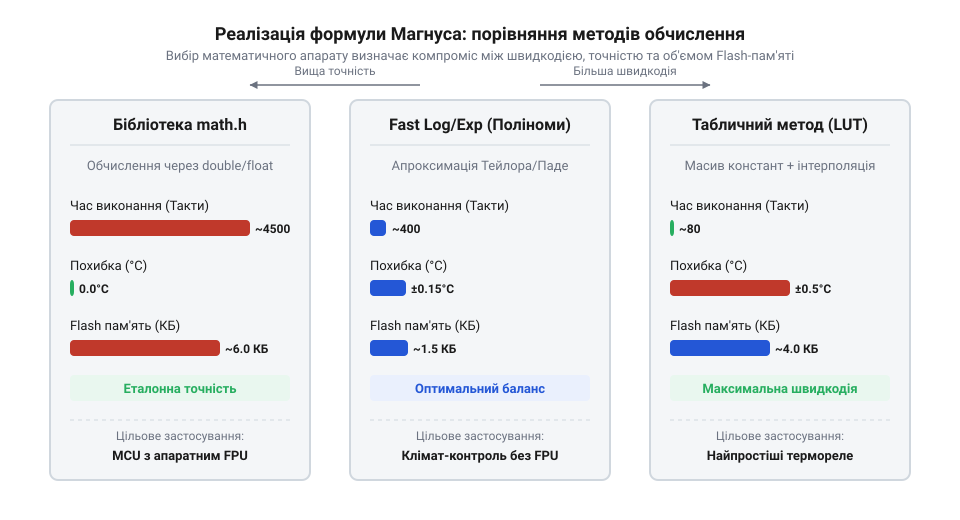
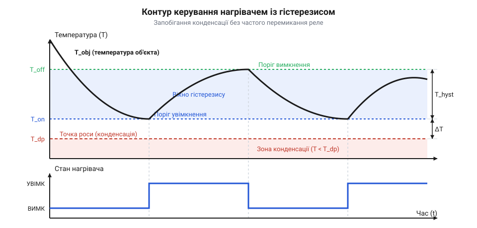

# Проєкт детектора точки роси та захисту від конденсату на мікроконтролері

<preknowlist>
- [SHT30 — температура й вологість (I2C)](root:cat-hw-sensors/sht30) — Принцип зчитування цифрових вимірів температури й відносної вологості через шину I2C та структура отриманих даних.
- [Цифровий давач температури та вологості AHT20](root:cat-hw-sensors/aht20-sensor) — Отримання сирих даних вологості й температури та їх первинний перерахунок у градуси Цельсія і відсотки.
- [DHT11 — температура/вологість](root:cat-hw-sensors/dht11) — Обмеження точності вимірювань вологості та вплив дискретності давача на підсумкову похибку формули.
</preknowlist>

## Ризик конденсації та точка роси

При охолодженні електронних або оптичних вузлів нижче температури навколишнього повітря на поверхнях випадає конденсат, що призводить до коротких замикань та запотівання. Простого вимірювання поточної вологості недостатньо для запобігання аварійним збоям обладнання. Виникає потреба в розрахунку критичної температури фазового переходу (точки роси) на основі поєднання вологості й температури.

## Математична модель та формула Магнуса

Маючи розуміння фізичного феномену конденсації, потрібно перейти до математичного визначення тиску насиченої пари та формули Магнуса-Тетенса (@@en|Magnus-Tetens formula@@). Вона описує нелінійну залежність між поточною температурою `T`, відносною вологістю `RH` та тиском пари через проміжний показник `gamma`:

    gamma
    = ln(RH / 100) + (a * T) / (b + T)       [розрахунок показника насиченості пари]

Ми аналізуємо ці вхідні параметри температури й відносної вологості, а також коефіцієнти формули для робочого діапазону температур, де типовими емпіричними значеннями є `a = 17.625` та `b = 243.04`. Це дозволяє виводити аналітичне рівняння точки роси `T_dp`, виразивши її оберненим математичним перетворенням так, щоб знайти температуру стовідсоткового насичення:

    T_dp
    = (b * gamma) / (a - gamma)              [виведення аналітичного рівняння точки роси]

Розбиття обчислення на два послідовні кроки дає змогу перекласти його на код мікроконтролера та оцінювати теоретичну похибку математичної моделі, яка для наведених коефіцієнтів зазвичай становить менше ніж пів градуса.

## Методи обчислення на вбудованих системах

Обчислення точки роси за формулою @@en|Магнуса-Тетенса (Magnus-Tetens)@@ вимагає знаходження натурального логарифма відносної вологості. На мікроконтролерах із апаратною підтримкою плаваючої крапки (@@en|FPU (Floating-Point Unit)@@) це завдання зводиться до виклику стандартної бібліотеки. Проте на простіших чипах, де операції з рухомою комою емулюються програмно, логарифм стає вузьким місцем: він забирає тисячі тактів процесора і споживає зайву енергію. Тому залежно від апаратних можливостей та вимог до швидкодії обирають один із трьох підходів: класичну математику, швидкі апроксимації або табличні наближення.

*Графік та порівняльна схема точності й швидкодії обчислення формули Магнуса різними методами.*

### Класичний розрахунок через стандартну бібліотеку

Метод прямого обчислення використовує функцію `logf` із бібліотеки `math.h`. Він дає найвищу точність, але потребує обчислювальних ресурсів. Якщо мікроконтролер має FPU, апаратний співпроцесор виконає цю операцію за кілька десятків тактів. Якщо ж FPU немає, компілятор підключить масивні програмні процедури, що збільшить розмір прошивки і суттєво уповільнить виконання.

:::code proj-dew-point-microcontroller-calc/c/dew_point.c 8-13

Цей метод є ідеальним для систем, де датчики опитуються рідко (наприклад, раз на секунду), а процесор більшу частину часу перебуває в режимі сну.

### Швидка апроксимація логарифма (Fast Log)

Коли тактів бракує, а мікроконтролер не має FPU, логарифм можна обчислити наближено, використавши особливості стандарту IEEE 754, який описує зберігання чисел із плаваючою крапкою в пам'яті. Число типу `float` складається зі знаку, експоненти та мантиси. Оскільки експонента вже зберігає двійковий логарифм числа (з певним зсувом), ми можемо прочитати її як ціле число і швидко перетворити на наближений результат.

:::code proj-dew-point-microcontroller-calc/c/dew_point.c 29-45

У цьому коді ми читаємо бітове подання числа `x` як 32-бітне ціле `uint32_t` через @@en|об'єднання (union)@@. Далі множимо його на магічну константу `1.1920928955078125e-7f`, яка дорівнює `1 / 2^23` — це зсуває біти мантиси у дробову частину. Віднявши зміщення експоненти `126.94269504f`, ми отримуємо двійковий логарифм числа. Щоб перетворити його на натуральний, результат множиться на `0.69314718f` (тобто `ln(2)`).

Цей метод виконується в десятки разів швидше за `logf` на чипах без FPU, хоча й дає похибку до 2–3% у розрахунку логарифма. Для завдань моніторингу конденсату, де вологість сама по собі вимірюється з похибкою ±2%, таке наближення цілком прийнятне.

### Табличне наближення (LUT) із лінійною інтерполяцією

Якщо мікроконтролер зовсім слабкий (наприклад, 8-бітні AVR), а обчислення відбуваються безперервно, від операцій із плаваючою крапкою краще відмовитись. Замість цього заздалегідь обчислюють значення логарифма для всього діапазону вологості (від 0% до 100%) і зберігають їх у масиві — @@en|таблиці пошуку (Look-Up Table, LUT)@@. Під час роботи мікроконтролер просто бере готове значення з пам'яті.

Щоб не зберігати тисячі значень, таблицю роблять рідкою (наприклад, із кроком 5%), а значення між вузлами знаходять за допомогою лінійної інтерполяції.

:::code proj-dew-point-microcontroller-calc/c/dew_point.c 15-27

У наведеному фрагменті показано екстремально спрощений варіант цього підходу. Замість повноцінної таблиці використано лінійну апроксимацію `(h - 100.0f) * 0.015f`, яка працює як дуже грубий еквівалент функції у вузькому вікні значень. Справжній LUT складатиметься з масиву констант у флеш-пам'яті мікроконтролера. Цей підхід зводить складну математику до кількох операцій додавання та множення, гарантуючи абсолютно передбачуваний час виконання.

*Схема замкненого циклу керування нагрівачем із вікном гістерезису відносно точки роси.*

Обравши оптимальний метод обчислення, ми безперервно отримуємо актуальне значення точки роси. Оскільки температура навколишнього середовища теж постійно коливається, для керування захисним нагрівачем застосовують не жорсткий поріг, а алгоритм із гістерезисом. Це запобігає нескінченному клацанню реле на межі спрацьовування.

:::code proj-dew-point-microcontroller-calc/cpp/src/DewPointDetector.cpp

## Архітектура збору даних та розрахунку

Щоб захистити оптику чи електроніку від конденсату, недостатньо один раз обчислити температуру випадання вологи. Мікроклімат постійно змінюється, а реальні цифрові давачі, такі як [AHT20](root:cat-hw-sensors/aht20-sensor) чи [SHT30](root:cat-hw-sensors/sht30), завжди дають певну похибку та випадковий шум у вимірах. Якщо передавати сирі показники напряму в математичну формулу Магнуса, обчислене значення точки роси стрибатиме. Це призведе до хаотичних спрацьовувань системи захисту.

Тому збір даних та розрахунок будують як безперервний конвеєр. Спочатку сирі виміри температури та відносної вологості проходять через програмний фільтр, який відтинає випадкові викиди та згладжує імпульсні перешкоди. Найчастіше для цього застосовують експоненційне ковзне середнє (@@en|Exponential Moving Average@@, EMA), оскільки воно потребує мінімум пам'яті — зберігається лише одне попереднє значення. Детальніше про математичну модель та застосування алгоритму для швидкої фільтрації даних читайте в статті про [експоненційне ковзне середнє (EMA)](root:com-signal/ema).

:::code proj-dew-point-microcontroller-calc/cpp/src/SensorFilter.hpp

Лише після стабілізації показників очищені значення передаються до математичного рушія. Тут відбувається вибір оптимального алгоритму обчислення залежно від апаратних можливостей платформи. Наприклад, об'єктно-орієнтована архітектура дозволяє інкапсулювати формулу Магнуса-Тетенса в окремий клас, який працюватиме з уже відфільтрованими даними.

:::code proj-dew-point-microcontroller-calc/cpp/src/MagnusEngine.hpp

У процедурному підході на C цей же вибір зводиться до виклику відповідної функції обчислення (через `math.h` або швидке наближення).

:::code proj-dew-point-microcontroller-calc/c/dew_point.h

:::code proj-dew-point-microcontroller-calc/c/dew_point.c

Отримавши поточну точку роси, система координації зберігає її для подальшого прийняття рішень. Цей конвеєр «зчитав — відфільтрував — обчислив» виконується регулярно, зазвичай раз на кілька секунд, підтримуючи актуальний термодинамічний стан пристрою в пам'яті.

:::code proj-dew-point-microcontroller-calc/cpp/src/DewPointDetector.hpp

:::code proj-dew-point-microcontroller-calc/cpp/src/DewPointDetector.cpp

## Керування антиконденсаційним нагрівачем із гістерезисом

Маючи актуальну точку роси, системі потрібно підтримувати температуру захищуваного вузла вище цього значення. Найпростіший підхід — увімкнути нагрівач, коли температура опускається нижче порогу, і вимкнути, коли піднімається вище. Проте в реальності такий прямий порівняльний алгоритм призводить до постійного швидкого перемикання (брязкоту) керуючого реле або транзистора, коли температура коливається на межі порогу.

Щоб стабілізувати роботу та подовжити ресурс компонентів, застосовують двопозиційне керування з гістерезисом (@@en|hysteresis@@) та запасом безпеки (@@en|safety margin@@). Запас безпеки визначає, на скільки градусів вище точки роси ми починаємо прогрів, щоб не допустити навіть мікрокрапель. Гістерезис розносить пороги увімкнення та вимкнення: нагрівач вмикається при досягненні небезпечної межі, але працює далі, доки температура не перевищить цей поріг на додаткову дельту.

:::code proj-dew-point-microcontroller-calc/c/heater.h

:::code proj-dew-point-microcontroller-calc/c/heater.c

:::code proj-dew-point-microcontroller-calc/c/cpp/HeaterController.hpp

:::code proj-dew-point-microcontroller-calc/c/cpp/HeaterController.cpp

У результаті нагрівач вмикається рідше, але на довший час. Цикл стає передбачуваним: температура повільно падає, система виявляє наближення до точки роси, вмикає підігрів, прогріває вузол із запасом і знову вимикає.

:::tabs
:::code proj-dew-point-microcontroller-calc/c/main.c
:::code proj-dew-point-microcontroller-calc/cpp/examples/main.cpp
:::

Такий алгоритм мінімізує енергоспоживання, що критично для пристроїв з автономним живленням, і надійно розв'язує проблему випадання конденсату навіть при різких змінах вологості.