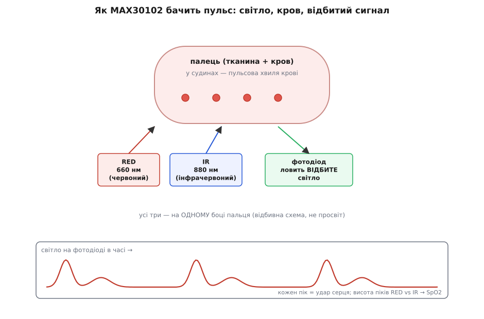
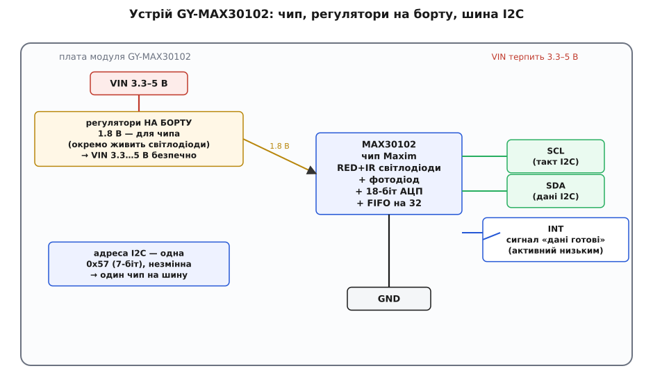
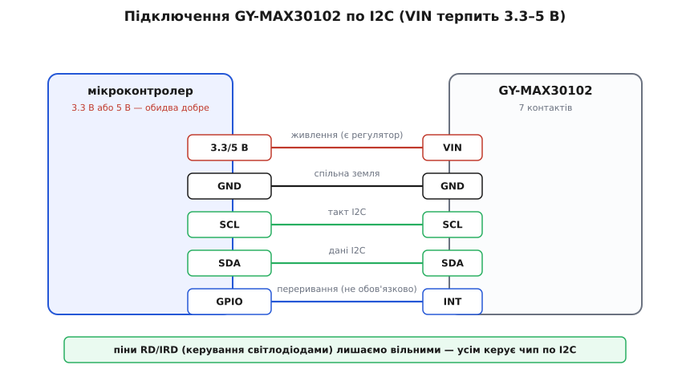

# GY-MAX30102 — давач пульсу/SpO2

<preknowlist>
- [Шина I2C](root:com-devices/i2c-bus) — протокол синхронної передачі даних по лініях SDA та SCL з апаратною адресацією.
- [Світлодіод](root:hw-motion/led) — робота напівпровідникових випромінювачів червоного та інфрачервоного світла.
- [Фізика фотодіода-давача](root:hw-sensing/photodetector-physics) — перетворення відбитого світлового потоку на електричний струм.
</preknowlist>

## Призначення та принцип фотоплетизмографії

Модуль **GY-MAX30102** — це інтегрований оптичний біосенсор, призначений для безперервного неінвазивного моніторингу частоти серцевих скорочень (пульсу, BPM) та ступеня насичення крові киснем (сатурації, SpO2). Завдяки крихітним габаритам і наднизькому енергоспоживанню мікросхеми сімейства MAX30102 від Maxim Integrated (Analog Devices) стали стандартом для переносної електроніки: фітнес-трекерів, смарт-годинників та портативних медичних пульсоксиметрів.

В основі роботи модуля лежить метод **відбивної фотоплетизмографії (PPG)**:

*Принцип вимірювання: пульсація артеріального тиску модулює поглинання світла під час кожного серцевого циклу.*

1. **Пульсова хвиля:** під час систоли (скорочення серця) артерії пальця розширюються й наповнюються порцією свіжої крові, що збільшує поглинання оптичного випромінювання. Під час діастоли судини звужуються, і поглинання спадає.
2. **Рефлективна схема:** випромінювачі та приймач розміщені поруч на одному кристалі під захисним оптичним склом. Світло розсіюється в тканинах пальця та частково відбивається назад на чутливу зону фотодіода.
3. **Двохвильовий метод розрахунку SpO2:** для визначення сатурації використовуються дві довжини хвилі:
   - **Червоне світло (660 нм):** інтенсивно поглинається дезоксигемоглобіном (кров'ю, бідною на кисень).
   - **Інфрачервоне світло (880 нм):** краще поглинається оксигемоглобіном (кров'ю, насиченою киснем).
   Співвідношення амплітуд пульсуючих змінних компонент (AC) до постійного оптичного фону тканин (DC) на двох довжинах хвиль дає точну оцінку відсотка кисню в крові.

## Апаратна структура модуля та інтегроване живлення

Кремнієвий кристал MAX30102 містить не лише оптичні елементи, а й повноцінний цифровий аналоговий тракт:

*Апаратна структура модуля: внутрішній 18-бітний сигма-дельта АЦП, апаратний FIFO-буфер і стабілізатор 1.8 В.*

- **18-бітний АЦП:** забезпечує широкий динамічний діапазон і здатний розрізнити крихітні зміни оптичної щільності судин (частки відсотка) на тлі масивного незмінного поглинання шкіри та кісток.
- **Вбудований FIFO-буфер на 32 вибірки:** накопичує дані всередині чипа, дозволяючи центральному процесору спати або виконувати інші завдання та вичитувати готові пакети блоками по шині I2C.
- **Живлення ядра та світлодіодів:** мікросхема MAX30102 потребує двох шин живлення — 1.8 В для внутрішньої логіки й аналогових підсилювачів та до 3.3–5 В для потужних імпульсів світлодіодів. Плата брейкаута GY-MAX30102 уже містить інтегровані лінійні стабілізатори напруги, тому на контакт `VIN` можна безпечно подавати як 3.3 В, так і 5 В.

## Інтерфейс підключення та адресація I2C

Для зв'язку з мікроконтролером використовується стандартна двопровідна шина I2C:

*Підключення модуля: чотири базові лінії живлення та передачі даних.*

- **VIN:** живлення плати (3.3 В або 5 В). Рекомендується обирати напругу відповідно до логіки підключеного контролера, щоб уникнути конфліктів на лініях підтяжки шини.
- **GND:** загальний спільний провід.
- **SCL / SDA:** лінії синхронізації та даних шини I2C.
- **INT:** вихід апаратного переривання (активний низький рівень). Сигналізує про наповнення FIFO або готовність нового відліку.
- **Фіксована адреса:** мікросхема MAX30102 має єдину апаратну 7-бітну I2C-адресу `0x57` (у 8-бітному форматі запису `0xAE` та читання `0xAF`). Змінити її перемичками неможливо.

## Практичні нюанси експлуатації та алгоритми обробки

1. **Сирий сигнал замість готового пульсу:** модуль видає потік сирих числових відліків відбиття світла. Пульс обчислюється програмним аналізом форми хвилі (пошуком локальних максимумів і розрахунком часу між піками), а SpO2 — розрахунком коефіцієнта поглинання Ratio-of-Ratios.
2. **Чутливість до руху та тиску:** датчик надзвичайно чутливий до зміщення пальця. Надмірний тиск перетискає капіляри й блокує пульсацію, а слабкий контакт пропускає стороннє світло приміщення.
3. **Відмінність від MAX30100:** попередник MAX30100 мав 14-бітний АЦП, довжину хвилі ІЧ 940 нм та інші регістри керування. Бібліотеки й драйвери для MAX30100 несумісні з MAX30102.
