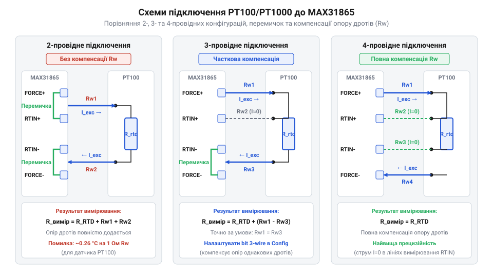
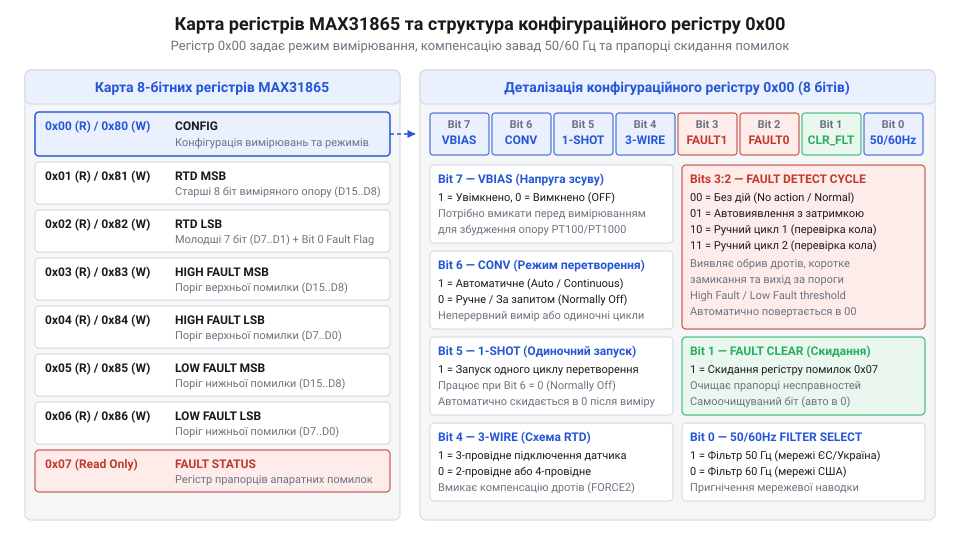

# Апаратний інтерфейс, цокольовка, розводка 2/3/4-провідних RTD та карта регістрів MAX31865

<preknowlist>
- [PT100 — платиновий термоопір](root:cat-hw-sensors/pt100-rtd) — фізичний принцип вимірювання опору платини та температурний коефіцієнт Alpha.
- [Огляд родини резистивних перетворювачів температури RTD](root:cat-hw-sensors/rtd-resistance-temperature-detectors-family-overview) — класифікація RTD-давачів і відмінності між номіналами PT100 та PT1000.
- [Стандарт IEC 60751 для платинових термоопорів](root:cat-hw-sensors/iec-60751-standard-for-rtd) — класи точності платинових давачів і допустимі відхилення опору.
</preknowlist>

## Похибка опору дротів у термометрії

У реальних промислових та побутових системах вимірювання температури первинний сенсор часто віддалений від плати контролера на відстань від кількох метрів до сотень метрів. Приєднані мідні провідники мають власний опір `R_wire`, який додається послідовно до вимірювального елемента. Для резистивних датчиків температури, відомих як @@en|RTD@@ (від англ. *Resistance Temperature Detector* — опірний перетворювач температури), будь-який додатковий паразитний опір ліній сприймається вимірювальною схемою як зміна температури навколишнього середовища.

Найпоширенішими первинними перетворювачами є [платинові термоопори PT100](root:cat-hw-sensors/pt100-rtd), опис яких дає [огляд родини RTD](root:cat-hw-sensors/rtd-resistance-temperature-detectors-family-overview). За градувальною характеристикою згідно з вимогами [стандарту IEC 60751](root:cat-hw-sensors/iec-60751-standard-for-rtd), @@en|PT100@@ має електричний опір `100 Ом` при температурі `0 °C`. Температурний коефіцієнт платини Alpha становить приблизно `0.00385 Ом/Ом/°C`, що відповідає середній чутливості `S_PT100 ≈ 0.385 Ом/°C`.

Якщо підключити датчик @@en|PT100@@ за найпростішою двопровідною схемою, струм вимірювання протікає через два сполучних дроти із загальним опором `R_wire_total = 2 · R_wire`. Повний опір кола, який реєструє аналоговий передній край, обчислюється за формулою:

```
R_measured = R_RTD + 2 · R_wire
```

Розглянемо практичний приклад: мідний кабель перерізом `0.2 мм²` завдовжки `10 метрів` має опір одного провідника `R_wire = 0.5 Ом`. Сумарний опір двох ліній становить `R_wire_total = 1.0 Ом`. Зсув виміряної температури `ΔT` для сенсора @@en|PT100@@ становить:

```
ΔT = R_wire_total / S_PT100
   = 1.0 / 0.385            [ділення паразитного опору ліній на чутливість PT100]
   = 2.597 °C               [температурна похибка вимірювання]
```

Отримане відхилення майже у `2.6 °C` є неприпустимим для прецизійних систем. Для зменшення цієї чутливості застосовують датчики @@en|PT1000@@ (з номіналом `1000 Ом` при `0 °C`), де середня чутливість становить `S_PT1000 ≈ 3.85 Ом/°C`. Обчислимо похибку для того самого кабелю:

```
ΔT = R_wire_total / S_PT1000
   = 1.0 / 3.85             [ділення паразитного опору ліній на чутливість PT1000]
   = 0.2597 °C              [температурна похибка вимірювання]
```

Хоча @@en|PT1000@@ зменшує абсолютний вплив опору ліній у 10 разів, похибка `0.26 °C` все одно виходить за межі прецизійних класів точності. Крім того, опір мідних дротів залежить від температури навколишнього середовища вздовж траси кабелю, що робить статичне програмне віднімання константи недосконалим.

Для повного усунення похибки необхідні аналогові вимірювальні кола з компенсацією падіння напруги на провідниках. Саме для цього розроблено спеціалізований аналогово-цифровий перетворювач @@en|MAX31865@@, який містить прецизійне джерело струму зсуву, диференційні входи та апаратну підтримку компенсації опору ліній.

## Підключення 2, 3 та 4-провідних RTD

Аналоговий інтерфейс мікросхеми @@en|MAX31865@@ розроблено для універсального підключення платинових датчиків за 2-, 3- та 4-провідними топологіями. Для цього мікросхема має п'ять спеціалізованих виводів вимірювального кола та два виводи опорної напруги:
- `@@en|FORCE+@@` — позитивний вихід вимірювального струму зсуву;
- `@@en|FORCE2@@` — додатковий вивід струму зсуву для апаратної компенсації 3-провідних ліній;
- `@@en|RTIN+@@` — позитивний диференційний вхід вимірювача напруги АЦП;
- `@@en|RTIN-@@` — негативний диференційний вхід вимірювача напруги АЦП;
- `@@en|FORCE-@@` — повернення вимірювального струму на опорний резистор;
- `@@en|REFIN+@@` — позитивний вхід опорної напруги АЦП;
- `@@en|REFIN-@@` — негативний вхід опорної напруги АЦП (з'єднується із землею).


*Принципова схема підключення 2-, 3- та 4-провідних датчиків RTD до MAX31865 із розташуванням джамперів і компенсацією опору ліній.*

Двопровідне підключення (@@en|2-Wire RTD@@) використовують на коротких відстанях. Вивід `@@en|FORCE+@@` з'єднують перемичкою з `@@en|RTIN+@@` на платі, а вивід `@@en|RTIN-@@` — з `@@en|FORCE-@@`. Двожильний кабель підключається між цими двома вузлами. У цій схемі струм зсуву та вимірювання напруги проходять через самі й ті самі провідники, тому опір ліній `2 · R_wire` повністю входить у результат перетворення.

Трипровідне підключення (@@en|3-Wire RTD@@) є стандартним для промислових датчиків. Датчик має три провідники: два підключені до одного кінця платинової спіралі, один — до іншого. На платі `@@en|MAX31865@@` вивід `@@en|FORCE+@@` з'єднують із виводом `@@en|FORCE2@@` (або активують внутрішній комутатор), перший дріт іде до `@@en|FORCE+@@`, другий — до `@@en|RTIN+@@`, а третій дріт підключають спільно до `@@en|RTIN-@@` та `@@en|FORCE-@@`. У конфігураційному регістрі мікросхеми вмикають режим `3-Wire RTD`. Завдяки цьому внутрішні джерела струму спрямовують однакові струми через лінії `FORCE+` та `RTIN+`. Падіння напруги на обох провідниках є однаковими за умови рівності їхніх опорів, і диференційний підсилювач на входах `RTIN+` / `RTIN-` віднімає їх одне від одного, повністю компенсуючи вплив ліній.

Чотирипровідне підключення (@@en|4-Wire RTD@@) забезпечує найвищу точність за принципом Кельвіна. Два окремі провідники (лінії `@@en|FORCE+@@` та `@@en|FORCE-@@`) використовують виключно для подачі вимірювального струму від генератора зсуву. Інші два провідники (лінії `@@en|RTIN+@@` та `@@en|RTIN-@@`) підключають безпосередньо до високоомних диференційних входів АЦП. Оскільки вхідний струм АЦП практично дорівнює нулю (`I_in ≈ 0`), падіння напруги на вимірювальних провідниках відсутнє (`ΔV = 0`). Оцінка опору сенсора є повністю незалежною від довжини кабелю та асиметрії ліній.

Для обчислення опору датчика @@en|MAX31865@@ використовує відношувальний (раціометричний) метод вимірювання за допомогою зовнішнього прецизійного опорного резистора `@@en|Rref@@`. Вимірювальний струм послідовно проходить через сенсор @@en|RTD@@ та резистор `Rref`, який підключено між виводами `@@en|FORCE-@@` (або `@@en|REFIN+@@`) та `@@en|REFIN-@@`. Цифровий код АЦП `ADC_code` визначається співвідношенням опорів:

```
ADC_code = (R_RTD / Rref) · 32768
```

Для датчиків @@en|PT100@@ зазвичай вибирають номінал `Rref = 400 Ом` (або `430 Ом` для розширеного діапазону температур до `+850 °C`). Для датчиків @@en|PT1000@@ застосовують `Rref = 4000 Ом` (або `4300 Ом`). Опорний резистор повинен мати допуск опору не гірше `0.1%` та низький температурний коефіцієнт (TCR < `25 ppm/°C`), оскільки будь-яке температурне відхилення номіналу `Rref` безпосередньо викривляє результати вимірювання. Для перетворення отриманого значення опору сенсора у точну температуру використовують [рівняння Каллендара-Ван Дюзена для розрахунку температури RTD](root:hw-sensing/callendar-van-dusen-equation).

## Сигнали живлення, SPI та готовність DRDY

Для забезпечення високої точності аналого-цифрового перетворення мікросхема @@en|MAX31865@@ має розділені кола живлення аналогового переднього краю та цифрового ядра.

Вивід `@@en|AVDD@@` живить аналогові джерела струму зсуву, прецизійні опорні підсилювачі та диференційний АЦП. Вивід `@@en|DVDD@@` живить внутрішню цифрову логіку та шину послідовного інтерфейсу. Обидві лінії розраховані на напругу від `3.0 В` до `3.6 В` (номінально `3.3 В`). Для пригнічення високочастотних перехідних завад та пульсацій безпосередньо біля кожного з виводів `AVDD` та `DVDD` необхідно розміщувати розв'язувальні керамічні конденсатори ємністю `0.1 мкФ` з низьким еквівалентним послідовним опором (ESR) у паралель із танталовим або керамічним конденсатором ємністю `10 мкФ`.

На друкованій платі рекомендується розділяти аналогову землю `AGND` та цифрову землю `DGND` і з'єднувати їх в одній точці («зірочкою») під мікросхемою, або використовувати суцільний шар заземлення з ізоляцією трас високочастотних цифрових сигналів від аналогових входів `RTIN+` та `RTIN-`.

Обмін даними з мікроконтролером здійснюється через чотирипровідну шину @@en|SPI@@ (від англ. *Serial Peripheral Interface* — послідовний периферійний інтерфейс). Інтерфейс містить чотири сигнальні лінії:
- `@@en|CS@@` (від англ. *Chip Select*) — активний низький сигнал вибору мікросхеми на шині;
- `@@en|SCLK@@` (від англ. *Serial Clock*) — тактовий сигнал шини SPI (підтримує частоту до `5 МГц`);
- `@@en|SDI@@` (від англ. *Serial Data In* / MOSI) — вхід послідовних даних для запису в регістри;
- `@@en|SDO@@` (від англ. *Serial Data Out* / MISO) — вихід послідовних даних для зчитування з регістрів.

Мікросхема @@en|MAX31865@@ підтримує режими SPI Mode 1 (`CPOL = 0`, `CPHA = 1`) та SPI Mode 3 (`CPOL = 1`, `CPHA = 1`). Усі логічні рівні сигнальних ліній розраховані на рівень `3.3 В`. При підключенні до мікроконтролерів із 5-вольтною логікою необхідно обов'язково застосовувати двонаправлені перетворювачі логічних рівнів або дільники напруги на лініях `CS`, `SCLK` та `SDI`.

Для сповіщення мікроконтролера про завершення циклу вимірювання призначено вивід готовності даних `@@en|DRDY@@` (від англ. *Data Ready*). Сигнал має активний низький рівень (з відкритим стоком або вихідним буфером). Під час виконання перетворення на виводі `DRDY` утримується високий логічний рівень. Як тільки АЦП завершує оновлення даних у регістрах, сигнал `DRDY` здійснює перехід у низький стан (`0 В`). Це дає змогу налаштувати зовнішнє переривання мікроконтролера за спадом сигналу замість постійного опитування шини SPI. Сигнал `DRDY` автоматично повертається у високий стан під час прочитання регістрів даних RTD (`0x01` або `0x02`).

## Конфігурування режимів через карту регістрів

Усі параметри роботи @@en|MAX31865@@ налаштовуються через внутрішню карту 8-бітних регістрів. Карта містить вісім адресованих комірок із номерами від `0x00` до `0x07`.

Під час обміну по шині @@en|SPI@@ найвищий біт адреси (Bit 7) визначає напрямок операції:
- читання регістру: `Address[7] = 0` (наприклад, читання конфігураційного регістру здійснюється за адресою `0x00`);
- запис у регістр: `Address[7] = 1` (наприклад, запис у конфігураційний регістр здійснюється за адресою `0x80 = 0x00 | 0x80`).


*Адресний простір регістрів MAX31865 та розшифровка бітів регістру Configuration (0x00) для керування VBIAS, вимірюванням і фільтром 50/60 Гц.*

Основним регістром керування є конфігураційний регістр `@@en|Configuration Register@@` (адреса `0x00`, читання/запис). Кожен із його восьми бітів відповідає за окремий параметр аналогово-цифрового тракту:

- `Bit 7` — `@@en|VBIAS@@`: Керування джерелом напруги зсуву. При встановленні `1` вмикається внутрішній аналоговий генератор напруги зсуву, необхідний для подачі струму через RTD та Rref. При `0` генератор вимкнено для економії енергії. Для проведення перетворення VBIAS повинен бути увімкнений. - `Bit 6` — `@@en|Conversion Mode@@`: Вибір режиму вимірювання. Значення `1` вмикає автоматичний (безперервний) режим (Auto Conversion Mode), у якому мікросхема самостійно проводить перетворення із частотою, заданою фільтром. Значення `0` переводить мікросхему в режим за запитом (Normally Off / 1-Shot Mode). - `Bit 5` — `@@en|1-Shot@@`: Запуск поодинокого вимірювання. Працює лише тоді, коли `Conversion Mode = 0`. При записі `1` мікросхема вмикає коло вимірювання, проводить одне перетворення, зберігає результат і повертається в режим зниженого споживання. Біт `1-Shot` автоматично скидається в `0` після завершення циклу. - `Bit 4` — `@@en|3-Wire RTD@@`: Вибір конфігурації датчика. При записі `1` вмикається апаратна компенсація для 3-провідних RTD (підключається додаткове джерело струму). Значення `0` вибирає режим для 2-провідних або 4-провідних датчиків. - `Bits 3:2` — `@@en|Fault Detection Cycle Control@@`: Двобітне поле керування циклом детектування несправностей. Дозволяє запускати апаратну діагностику кіл датчика:
  - `00` — нормальна робота без випробувального циклу;
  - `01` — автоматичний цикл детектування несправностей із самоочищенням;
  - `10` — ручний цикл детектування несправностей (фаза 1);
  - `11` — ручний цикл детектування несправностей (фаза 2). - `Bit 1` — `@@en|Fault Status Clear@@`: Очищення регістру статусу помилок. Запис `1` у цей біт примусово скидає всі прапори в регістрі статусу несправностей `0x07`. Біт автоматично повертається в `0`. - `Bit 0` — `@@en|50/60 Hz Filter Select@@`: Вибір режекторного фільтра цифрового АЦП. Запис `1` вмикає фільтр пригнічення мережевої завади `50 Гц` (час перетворення становить приблизно `62.5 мс`). Значення `0` вмикає фільтр на `60 Гц` (час перетворення становить приблизно `52 мс`).

Завдяки гнучкості регістру `0x00` розробник може легко сформувати потрібну байтову маску. Наприклад, для 3-провідного датчика @@en|PT100@@ у режимі безперервного вимірювання з фільтром 50 Гц байт конфігурації дорівнює `0xD0` (у двійковому вигляді `11010000_2`: `VBIAS=1`, `Auto=1`, `3-Wire=1`, `Filter=50Hz`).

## Детектування несправностей та межі Fault

Отриманий результат аналого-цифрового перетворення зберігається у двох 8-бітних регістрах: `@@en|RTD MSB Register@@` (адреса `0x01`) та `@@en|RTD LSB Register@@` (адреса `0x02`). Разом вони утворюють 16-бітне слово.

Структура 16-бітного слова вимірювання є такою:
- старші 15 бітів (біти `D[14:0]`, що займають весь регістр `0x01` та біти `7..1` регістру `0x02`) містять 15-бітний беззнаковий код АЦП `ADC_code`;
- наймолодший біт (біт `0` регістру `0x02`) є загальним прапором несправності `@@en|Fault Flag@@`.

Якщо біт `Fault Flag` дорівнює `0`, вимірювання пройшло успішно, і код `ADC_code` відповідає дійсному опору RTD. Якщо біт `Fault Flag = 1`, мікросхема виявила апаратне порушення у вимірювальному колі, а детальна причина фіксується у спеціальному регістрі статусу помилок `@@en|Fault Status Register@@` (адреса `0x07`, лише для читання).

Для автоматичного контролю виходу температури за припустимі межі в @@en|MAX31865@@ передбачено дві пари 8-бітних регістрів порогових значень:
- `@@en|High Fault Threshold@@` (регістри `0x03` MSB та `0x04` LSB) — задають верхню межу допустимого коду АЦП;
- `@@en|Low Fault Threshold@@` (регістри `0x05` MSB та `0x06` LSB) — задають нижню межу допустимого коду АЦП.

Якщо виміряний код `ADC_code` перевищує значення `High Fault Threshold` або є меншим за `Low Fault Threshold`, біт `Fault Flag` встановлюється в `1`, а в регістрі `0x07` піднімаються відповідні прапори.

Регістр статусу несправностей `@@en|Fault Status Register@@` (`0x07`) містить деталізовану побітову розшифровку апаратного стану ліній:

- `Bit 7` — `@@en|RTD High Threshold Fault@@`: `1` вказує, що опір RTD перевищив верхній поріг. Зазвичай це свідчить про надмірний перегрів датчика або повний обрив вимірювальної лінії. - `Bit 6` — `@@en|RTD Low Threshold Fault@@`: `1` свідчить про те, що опір RTD впав нижче нижнього порогу. Це фіксує коротке замикання всередині платинового елемента або між його виводами. - `Bit 5` — `@@en|REFIN- > 0.85 × VBIAS@@`: `1` означає, що напруга на виводі REFIN- перевищує 85% від VBIAS. Причиною є обрив лінії `FORCE-` або її замикання на високу напругу. - `Bit 4` — `@@en|REFIN- < 0.85 × VBIAS (FORCE- open)@@`: `1` фіксує, що напруга REFIN- впала нижче 85% від VBIAS при увімкненому VBIAS. Виникає при обриві опорного резистора `Rref` або розмиканні кола `FORCE-`. - `Bit 3` — `@@en|RTIN- < 0.85 × VBIAS (FORCE- open)@@`: `1` свідчить про те, що напруга на виводі RTIN- впала нижче 85% від VBIAS при увімкненому VBIAS, що спричинено обривом вимірювального провідника `RTIN-`. - `Bit 2` — `@@en|Overvoltage / Undervoltage Fault@@`: `1` вказує на вихід синфазної напруги на входах `RTIN+` чи `RTIN-` за межі допустимого діапазону (від `0 В` до `VBIAS`), наприклад при короткому замиканні вимірювальних ліній на шину живлення або заземлення. - `Bits 1:0` — зарезервовані, завжди повертають `0`.

Алгоритм діагностики виглядає так: під час зчитування регістру RTD LSB (`0x02`) програма перевіряє молодший біт `Bit 0`. Якщо він дорівнює `1`, керуючий мікроконтролер виконує читання регістру `0x07` по шині SPI, ідентифікує конкретний вид апаратного збою (обрив кабелю, коротке замикання чи вихід за температурний поріг), після чого записує `1` у біт `Fault Status Clear` конфігураційного регістру `0x00` для скидання прапорця та продовження подальших вимірювань. Практичну реалізацію SPI-зчитування даних та програмування обробки прапорців несправностей описано в статті про [програмний драйвер та зчитування даних MAX31865](root:sf-devices/max31865-software-driver).