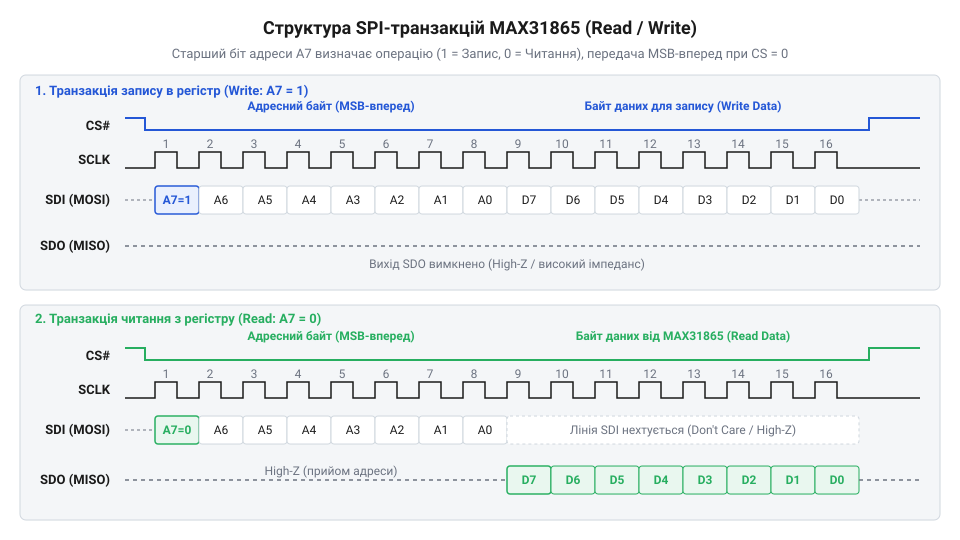
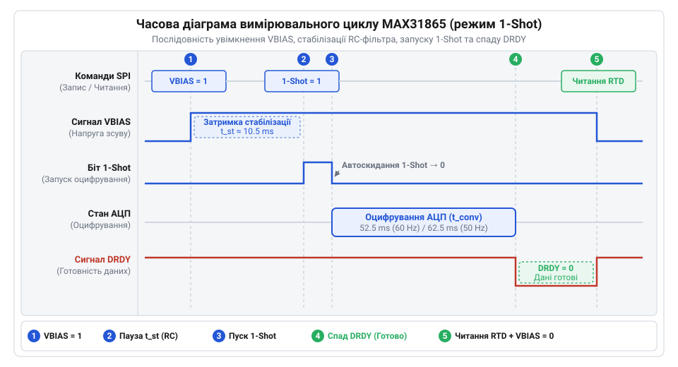

# Програмний драйвер SPI, низькорівневий API та діагностика помилок MAX31865

<preknowlist>
- [PT100 — платиновий термоопір](root:cat-hw-sensors/pt100-rtd) — принцип зміни опору платинового елемента залежно від температури та співвідношення опору сенсора з опорним резистором Rref
- [Огляд родини резистивних перетворювачів температури RTD](root:cat-hw-sensors/rtd-resistance-temperature-detectors-family-overview) — топології 2-, 3- та 4-провідникових схем підключення термоопорів для конфігурації регістрів MAX31865
</preknowlist>

## Синхронізація та кадмування SPI-транзакцій MAX31865

При спробі зчитати дані з аналогово-цифрового перетворювача без урахування фази тактового сигналу або некоректного формування адреси мікроконтролер отримує нульові значення або спотворені прапорці стану. Для надійної взаємодії з перетворювачем платинових термоопорів MAX31865 необхідно суворо дотримуватися часових параметрів та правил кадрування інтерфейсу @@en|SPI@@ (від @@en|Serial Peripheral Interface@@, з англійської «послідовний периферійний інтерфейс»). Основні принципи фізичного підключення та характеристики інтерфейсу детально висвітлено у матеріалі про [базові засади шини SPI](root:com-devices/spi-bus).

Мікросхема MAX31865 підтримує два режими обміну даними шиною @@en|SPI@@: @@en|Mode 1@@ та @@en|Mode 3@@. У обох режимах параметр фази тактування @@en|CPHA@@ (від @@en|Clock Phase@@, фаза тактового сигналу) дорівнює `1`. Це означає, що захоплення бітів на лініях даних відбувається по завершальному фронту імпульсу тактового сигналу @@en|SCLK@@ (від @@en|Serial Clock@@, тактова частота шини), а зміна стану ліній напрямку — по стартовому фронту. Відмінність між режимами полягає лише у вихідній полярності тактового сигналу @@en|CPOL@@ (від @@en|Clock Polarity@@, полярність тактового сигналу): у @@en|Mode 1@@ лінія @@en|SCLK@@ у стані спокою перебуває в логічному нолі (`0 В`), а у @@en|Mode 3@@ — у логічній одиниці (`3.3 В`). Передача здійснюється у форматі @@en|MSB-first@@ (від @@en|Most Significant Bit First@@, «старшим бітом уперед»), тобто першим у лінію завжди висувається найстарший біт `D7`.


*Часова діаграма передачі кадру SPI у перетворювачі MAX31865. Старший біт адреси A7 визначає напрямок транзакції: логічний нуль ініціює читання, а одиниця — запис.*

Кожна операція шиною @@en|SPI@@ починається зі зниження рівня на лінії вибірки мікросхеми @@en|CS@@ (від @@en|Chip Select@@, вибір мікросхеми) з високого стану в логічний нуль (`0 В`). Перший байт, який мікроконтролер надсилає у лінію @@en|SDI@@ (від @@en|Serial Data In@@, вхід послідовних даних або @@en|MOSI@@), є командним адресатом. Його найстарший біт `A7` визначає напрямок передачі:
- Якщо `A7 = 0`, ініціюється операція читання (від @@en|Read@@). Молодші біти `A[6:0]` вказують на конкретний регістр у діапазоні від `0x00` до `0x07`. - Якщо `A7 = 1`, ініціюється операція запису (від @@en|Write@@). Адреса регістру модифікується шляхом логічного додавання маски `0x80` (`Write Address = RegAddress | 0x80`), утворюючи діапазон запису від `0x80` до `0x87`.

Під час попоодинокого зчитування або запису після відправлення адресної команди мікроконтролер передає або приймає рівно один байт даних, після чого повертає лінію @@en|CS@@ у високий стан (`3.3 В`). Проте для гарантування атомарності даних при зчитуванні багатобайтових величин MAX31865 підтримує режим @@en|burst-читання@@ (від @@en|burst read@@, пакетне зчитування). Якщо утримувати лінію @@en|CS@@ у низькому стані й продовжувати тактувати лінію @@en|SCLK@@, внутрішній вказівник адреси мікросхеми автоматично інкрементується після кожного переданого байта (наприклад, від `0x00` до `0x07`). Це дозволяє зчитати увесь масив регістрів за один безперервний сеанс @@en|SPI@@-транзакції без ризику перезапису даних АЦП між окремими байтами.

## Конфігурація режимів вимірювання та живлення

Безперервне проходження вимірювального струму через тонкий платиновий елемент давача, такого як [платиновий термоопір PT100](root:cat-hw-sensors/pt100-rtd), спричиняє ефект @@en|самопрогріву@@ (від @@en|self-heating@@). Це локальне підвищення температури викривляє покази на десяті частки градуса Цельсія. Крім того, постійно увімкнена аналогова схема у приладах із батарейним живленням безпотрібно витрачає енергію. Для запобігання цим явищам MAX31865 надає гнучкі інструменти керування режимами живлення та вимірювання через конфігураційний регістр `0x00` (адреса запису `0x80`).

Конфігураційний регістр `0x00` містить вісім керувальних бітів, які визначають логіку роботи внутрішніх вузлів:

```
+-------+-------+--------+--------+------------+------------+-------------+------------+
| Bit 7 | Bit 6 | Bit 5  | Bit 4  |   Bit 3    |   Bit 2    |    Bit 1    |   Bit 0    |
+-------+-------+--------+--------+------------+------------+-------------+------------+
| VBIAS | Mode  | 1-Shot | 3-Wire | Fault Detection Control | Fault Clear | 50/60Hz    |
+-------+-------+--------+--------+------------+------------+-------------+------------+
```

Розберемо детально призначення кожного біта:
- **Bit 7 (`VBIAS`)**: Керує вмиканням внутрішнього джерела напруги зсуву. При значеннях `1` напруга `VBIAS` подається на вимірювальний міст для заряджання вхідних конденсаторів та стабілізації потенціалів. При `0` напруга знята, що переводить аналоговий фронтенд у режим знеструмлення. - **Bit 6 (`Conversion Mode`)**: Вибирає режим вимірювання. Значення `1` вмикає автоматичний безперервний режим (від @@en|Continuous mode@@), у якому АЦП виконує перетворення постійно один за одним. Значення `0` вмикає режим вимірювання за запитом (від @@en|Normally Off@@ або @@en|1-Shot mode@@). - **Bit 5 (`1-Shot`)**: Запускає попоодиноке вимірювання в режимі @@en|1-Shot@@. Для старту конверсії у цей біт необхідно записати `1`. Після завершення оцифрування внутрішня логіка мікросхеми автоматично скидає біт у `0`. - **Bit 4 (`3-Wire RTD`)**: Визначає конфігурацію підключення давача. Запис `1` активує внутрішній компенсаційний струмовий канал для 3-провідних схем підключення [резистивних перетворювачів RTD](root:cat-hw-sensors/rtd-resistance-temperature-detectors-family-overview). Значення `0` застосовується для 2-провідних або 4-провідних схем. - **Bits 3–2 (`Fault Detection Control`)**: Налаштовують автоматичне або ручне виконання циклу діагностики несправностей кола. - **Bit 1 (`Fault Status Clear`)**: При записі `1` повністю очищає вміст регістру статусу помилок `0x07`. Біт автоматично повертається у `0`. - **Bit 0 (`50/60 Hz Filter`)**: Обирає частоту режекторного фільтра внутрішнього АЦП. Значення `1` вмикає фільтрацію завад мережі 50 Гц (тривалість перетворення ~143–169 мс), а значення `0` — фільтр 60 Гц (тривалість перетворення ~18.5–21 мс).

Для мінімізації споживання струму та усунення @@en|самопрогріву@@ давача найефективнішим є алгоритм керування у режимі @@en|1-Shot@@. Алгоритм передбачає таку послідовність дій:
1. Запис у конфігураційний регістр значення з увімкненим `VBIAS` та закріпленим прапорцем `1-Shot` (наприклад, байт `0x80` для 60 Гц 2/4-провідного давача). 2. Очікування закінчення перетворення АЦП. 3. Зчитування отриманих результатів із регістрів даних. 4. Запис у конфігураційний регістр байта `0x00` для відключення `VBIAS`.

У вимкненому стані (`VBIAS = 0`) струм споживання мікросхеми MAX31865 знижується до міліамперного рівня (~1.5 мА), а струм через [платиновий термоопір PT100](root:cat-hw-sensors/pt100-rtd) повністю припиняється.

## Зчитування 15-бітного коду та DRDY-синхронізація

Якщо мікроконтролер спробує прочитати значення з регістрів даних під час того, як внутрішній дельта-сигма АЦП оновлює їх вміст, старший та молодший байти можуть виявитися взятими з різних вимірювальних циклів. Це призводить до виникнення грубих помилок оцифрування та хибних висновків про температуру. Щоб запобігти зчитуванню незрілих даних, використовують сигнал готовності даних @@en|DRDY@@ (від @@en|Data Ready@@, дані готові).

Вихід @@en|DRDY@@ є фізичним виводом із відкритим стоком (від @@en|open-drain@@), який у пасивному стані підтягнутий зовнішнім резистором до напруги живлення. У момент завершення оцифрування внутрішній АЦП імпульсно або стабільно знижує рівень на виводі @@en|DRDY@@ до логічного ноля (`0 В`), сигналізуючи про появу нових даних у регістрах `0x01` та `0x02`. Під час виконання операції читання по шині @@en|SPI@@ (коли лінія @@en|CS@@ падає у `0 В`) вихід @@en|DRDY@@ примусово піднімається у високий стан до наступного завершення конверсії.


*Послідовність подій під час одноразового вимірювання в MAX31865. Після подачі напруги зсуву VBIAS та запуску 1-Shot внутрішній АЦП виконує перетворення, по завершенні якого сигнал DRDY падає в логічний нуль.*

Тривалість повного циклу оцифрування складається із часу стабілізації напруги `VBIAS` (приблизно 10.5 постійних часу RC-ланцюжка вхідного фільтра плюс 1 мс) та безпосереднього часу роботи АЦП. Залежно від обраного фільтра мережевих завад (біта `Bit 0` конфігураційного регістру) загальний час становить:
- При фільтрі **60 Гц**: сумарна затримка для режиму @@en|1-Shot@@ складає від 52 мс до 55 мс. - При фільтрі **50 Гц**: сумарна затримка для режиму @@en|1-Shot@@ складає від 62.5 мс до 66 мс.

Оцифроване значення опору зберігається у двох 8-бітних регістрах: `0x01` (MSB) та `0x02` (LSB). Разом вони формують 16-бітну структуру:

```
Регістр 0x01 (MSB):  [ D15 | D14 | D13 | D12 | D11 | D10 | D9  | D8  ]  (Біти коду RTD [14:7])
Регістр 0x02 (LSB):  [ D7  | D6  | D5  | D4  | D3  | D2  | D1  | D0  ]  (Біти коду RTD [6:0] + Fault)
```

Наймолодший біт `D0` регістру `0x02` є прапорцем помилки @@en|Fault@@. Біти з `D15` по `D1` утворюють 15-бітний цифровий код АЦП. Виділення значень із зчитаного 16-бітного слова виконується за такими правилами:

```
RAW_16     = (Read_MSB << 8) | Read_LSB
ADC_CODE   = RAW_16 >> 1
FAULT_BIT  = RAW_16 & 0x01
```

Отриманий 15-бітний код `ADC_CODE` пропорційний відношенню опору чутливого елемента R_rtd до опору еталонного резистора R_ref. Фізичний опір розраховується за пропорцією:

```
R_rtd / R_ref = ADC_CODE / 32768
R_rtd = (ADC_CODE × R_ref) / 32768
```

Перетворення отриманого значення опору R_rtd у температуру регулюється стандартом [IEC 60751 для платинових термоопорів](root:cat-hw-sensors/iec-60751-standard-for-rtd) та математично описується у статті про [рівняння Календара-Ван Дюзена](root:hw-sensing/callendar-van-dusen-equation).

Синхронізація зчитування даних мікроконтролером реалізується двома шляхами:
1. **Апаратні переривання (від @@en|Hardware Interrupts@@)**: Вивід @@en|DRDY@@ підключається до виводу GPIO мікроконтролера з підтримкою переривань по спадаючому фронту (від @@en|falling edge@@). Це найбільш ефективний підхід для операційних систем реального часу (RTOS), оскільки процесор не витрачає цикли на очікування. 2. **Програмне опитування (від @@en|Software Polling@@)**: Мікроконтролер після запуску перетворення періодично опитує стан виводу @@en|DRDY@@ у циклі або витримує гарантовану часову затримку (наприклад, `25 мс` для фільтра 60 Гц), після чого зчитує байти `0x01` та `0x02`.

## Пороговий моніторинг та розшифровка Fault Status

У промислових системах вимірювання лінії підключення давача піддаються механічним навантаженням та впливу високих температур. Це може призвести до обриву кабелю, короткого замикання або пошкодження опорного резистора R_ref. Якщо мікроконтролер не виявить апаратну аварію, обчислення температури дасть хибні результати, що призведе до аварійних дій автоматики. MAX31865 містить вбудовану систему апаратного порогового моніторингу та детекції несправностей.

Для автоматичного контролю меж використовуються чотири регістри порогових значень:
- `0x03` (High Fault Threshold MSB) та `0x04` (High Fault Threshold LSB) — утворюють 15-бітний верхній поріг опору. - `0x05` (Low Fault Threshold MSB) та `0x06` (Low Fault Threshold LSB) — утворюють 15-бітний нижній поріг опору.

Якщо оцифрований код `ADC_CODE` виходить за межі встановлених порогів або в аналоговому фронтенді відбувається електричний збій, мікросхема виставляє прапорець @@en|Fault@@ (біт `D0` регістру `0x02`) в `1` і деталізує причину в 8-бітному регістрі статусу помилок `Fault Status` (адреса `0x07`).

Розшифровка бітів регістру `Fault Status` (`0x07`):

```
+---------+---------+-------------+-------------+-------------+----------+----------+----------+
|  Bit 7  |  Bit 6  |    Bit 5    |    Bit 4    |    Bit 3    |  Bit 2   |  Bit 1   |  Bit 0   |
+---------+---------+-------------+-------------+-------------+----------+----------+----------+
| High Th | Low Th  | REFIN- >    | REFIN- <    | RTDIN- <    | Over/Under| Reserved | Reserved |
| Fault   | Fault   | 0.85*VBIAS  | 0.85*VBIAS  | 0.85*VBIAS  | Voltage  |          |          |
+---------+---------+-------------+-------------+-------------+----------+----------+----------+
```

Детальний аналіз діагностичних прапорців:
- **Bit 7 (`High Threshold Fault`)**: Перевищення верхньої межі. Вказує на те, що опір давача перевищив поріг у регістрах `0x03/0x04`. Найчастіше сигналізує про перегрів або повний обрив лінії давача. - **Bit 6 (`Low Threshold Fault`)**: Перевищення нижньої межі. Опір давача нижчий за поріг у регістрах `0x05/0x06`. Зазвичай вказує на коротке замикання платинового елемента. - **Bit 5 (`REFIN- > 0.85 × VBIAS`)**: Напруга на виводі `REFIN-` перевищує `0.85 × VBIAS` при відкритому ключі. Свідчить про обрив опорного резистора R_ref або обрив з'єднувального проводу `FORCE-`. - **Bit 4 (`REFIN- < 0.85 × VBIAS`)**: Напруга на виводі `REFIN-` менша за `0.85 × VBIAS` при відкритому FORCE-ключі. Сигналізує про дефект у колі опорного резистора або замикання лінії `FORCE-` на землю. - **Bit 3 (`RTDIN- < 0.85 × VBIAS`)**: Напруга на аналоговому вході `RTDIN-` впала нижче за `0.85 × VBIAS` при відкритому FORCE-ключі. Свідчить про обрив вимірювального провідника давача. - **Bit 2 (`Over/Under Voltage Fault`)**: Перенапруга або знижена напруга на вхідних виводах. Спрацьовує, якщо напруга на входах `RTDIN+` або `RTDIN-` виходить за допустимий діапазон від `0 В` до `VBIAS` (наприклад, при наведенні зовнішньої перенапруги). - **Bits 1–0**: Зарезервовані системні біти, завжди зчитуються як `0`.

Для очищення зафіксованих помилок після усунення несправності необхідно подати команду запису в конфігураційний регістр `0x00` з встановленим у `1` бітом `Bit 1` (`Fault Status Clear`).

Нижче наведено практичну реалізацію низькорівневого драйвера MAX31865 для зчитування даних та діагностики помилок:

:::tabs
@tab c|esp-idf
:::code api-max31865-spi-firmware-driver/c/esp-idf/max31865-write-reg.c
@tab cpp|arduino
:::code api-max31865-spi-firmware-driver/cpp/arduino/max31865driver.cpp
:::