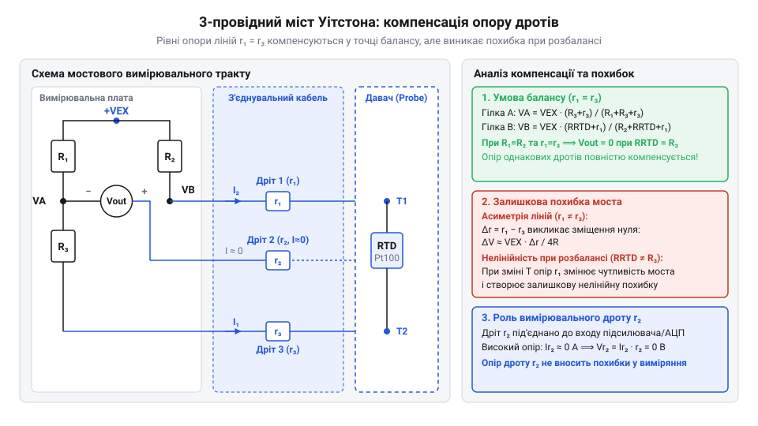
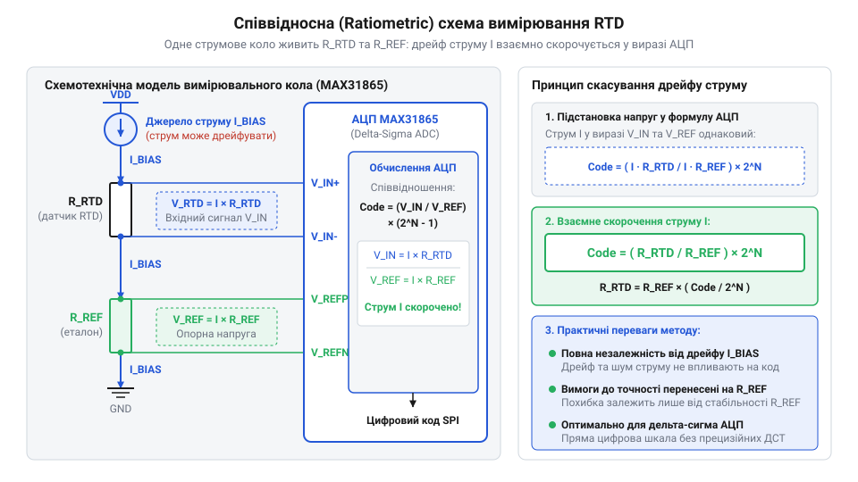

# Еволюція вимірювання платинових термоопорів: від моста Уітстона до ratiometric АЦП MAX31865

<preknowlist>
- [PT100 — платиновий термоопір](root:cat-hw-sensors/pt100-rtd) — фізичний принцип залежності опору платини від температури та базову конструкцію сенсорів PT100
- [Огляд родини резистивних перетворювачів температури RTD](root:cat-hw-sensors/rtd-resistance-temperature-detectors-family-overview) — загальне поняття про резистивні датчики температури, їхню класифікацію та номінальні опори
- [Стандарт IEC 60751 для платинових термоопорів](root:cat-hw-sensors/iec-60751-standard-for-rtd) — класи точності платинових термоопорів та допуски відхилення опору
</preknowlist>

## Виклик платини: від Сіменса до Каллендара

У XIX столітті швидкий розвиток металургії, парових машин та хімічного виробництва поставив перед інженерами критичну проблему: відсутність точних засобів вимірювання високих температур. Рідинні скляні термометри на ртуті виявилися непридатними для екстремальних умов — ртуть закипає при 357 °C, а саме скло розм'якшується та деформується. Виробництву потрібен був термометричний елемент, здатний витримувати високу температуру й стабільно змінювати свої фізичні властивості.

У 1871 році інженер Вільям Сіменс (англ. *@@en|Sir William Siemens@@*) запропонував рішення, презентувавши перед Лондонським королівським товариством перший термометр опору. В його основі лежав тонкий дріт із платини, намотаний на керамічний каркас із вогнетривкої глини та вміщений у захисну залізну трубку. Платину було обрано завдяки її високій температурі плавлення (1768 °C), хімічній інертності та стійкості до окислення. Фізична ідея полягала в тому, що електричний опір металу зростає зі збільшенням амплітуди теплових коливань кристалічної ґратки. Такий пристрій одержав назву резистивний давач температури (англ. *@@en|Resistance Temperature Detector@@*, від лат. *@@la|resistere@@* — чинити опір, далі — @@en|RTD@@).

Проте перші термометри Сіменса зіткнулися з серйозною фізичною перешкодою: неконтрольованим температурним дрейфом. За високих температур силіцій (SiO₂) з керамічного каркаса вступав у хімічну реакцію з платиновим дротом у відновлювальному газовому середовищі. Це призводило до забруднення платини домішками силіцію, зміни її кристалічної структури та постійного спотворення опору. У 1874 році Британська наукова асоціація навіть визнала такі термометри нестабільними для точних вимірювань.

Вирішальний прорив у 1887 році здійснив британський фізик Х'ю Лонгборн Каллендар (англ. *@@en|Hugh Longbourne Callendar@@*). Він змінив конструкцію сенсора, вільно підвісивши платиновий дріт на хрестоподібному каркасі зі слюди всередині скляної колби, що повністю виключило хімічне забруднення. Головним внеском Каллендара став математичний аналіз нелінійності платини. Він довів, що опір платини зростає не суворо лінійно, а підпорядковується квадратичній залежності від температури. У 1925 році Мільтон Ван Дюзен (англ. *@@en|Milton S. Van Dusen@@*) доповнив цю модель для від'ємних температур, додавши кубічний член.

Отримане математичне співвідношення називається [рівнянням Каллендара — Ван Дюзена](root:cat-hw-sensors/max31865-rtd-converter/math-callendar-van-dusen-equations.md) (англ. *@@en|Callendar–Van Dusen equation@@*):

```
R(T) = R_0 × (1 + A × T + B × T²)              [для T ≥ 0 °C]
```

```
R(T) = R_0 × (1 + A × T + B × T² + C × (T - 100) × T³)    [для T < 0 °C]
```

Де символи позначають такі величини:
- `R(T)` — електричний опір платинового @@en|RTD@@ за температури `T` у градусах Цельсія (°C);
- `R_0` — номінальний опір сенсора при 0 °C, де найпоширенішим стандартом є [платиновий термоопір PT100](root:cat-hw-sensors/pt100-rtd) з опором 100 Ом;
- `T` — вимірювана температура у °C;
- `A`, `B`, `C` — коефіцієнти математичної моделі, визначені чистотою платинової нитки.

Детальні вимоги до допусків та калібрувальних коефіцієнтів описуються [стандартом IEC 60751](root:cat-hw-sensors/iec-60751-standard-for-rtd), а з класифікацією різновидів сенсорів можна ознайомитися в [огляді родини RTD](root:cat-hw-sensors/rtd-resistance-temperature-detectors-family-overview).

Рівняння Каллендара — Ван Дюзена перетворило платиновий дріт із нестабільного елемента на еталонний вимірювальний прилад. Проте поява математичної моделі оголила нову схемотехнічну проблему: опір платини змінюється надзвичайно мало, тому для його зчитування потрібні були принципово нові методи вимірювання електричного опору.

## Міст Уітстона та 3-провідна схема

Маючи математичну модель платинового сенсора, інженери зіткнулися з практичним викликом: як точно виміряти його опір. Для стандартного елемента [PT100](root:cat-hw-sensors/pt100-rtd) опір при 0 °C становить рівно 100 Ом, а при зміні температури на 1 °C опір змінюється лише на 0.385 Ом. Ця величина називається температурним коефіцієнтом опору (англ. *@@en|Temperature Coefficient of Resistance@@*, далі — @@en|TCR@@). Виміряти настільки малий приріст опору `ΔR` за допомогою звичайного омметра XIX століття було неможливо через низьку чутливість стрілочних приладів.

Щоб перетворити малі зміни опору на доступний для вимірювання сигнал, застосували вимірювальний міст (англ. *@@en|Wheatstone bridge@@*, від прізвища вченого Чарльза Уітстона, далі — міст Уітстона). За класичного 2-провідного підключення @@en|RTD@@ під'єднується до одного з плечей моста двома мідними провідниками. Опір цих з'єднувальних дротів `r_1` та `r_2` додається безпосередньо до опору сенсора `R_rtd`. Стандартний мідний кабель перерізом 0.2 мм² має опір близько 0.09 Ом/м. Якщо датчик віддалений від вимірювача на 10 метрів, сумарний опір дротів становитиме 1.8 Ом, що створить постійну похибку вимірювання понад +4.6 °C. Більше того, при коливаннях температури довкілля опір самих мідних дротів змінюється, викликаючи непередбачуваний температурний дрейф.

Для вирішення цієї проблеми Вільям Сіменс запропонував 3-провідну схему підключення моста, в якій до датчика підводять три дроти `r_1`, `r_2` та `r_3`.


*Міст Уітстона з 3-провідним підключенням RTD, де опори ліній r1 та r2 розділені між вимірювальним та опорним плечима моста.*

У цій схемі дріт `r_1` підключено послідовно з @@en|RTD@@ у вимірювальне плече, дріт `r_2` увімкнено послідовно з опорним резистором `R_3` у суміжне плече, а дріт `r_3` під'єднано до вимірювальної діагоналі моста, де протікає практично нульовий струм індикатора балансу.

У багатьох підручниках існує поширений міф про те, що 3-провідний [міст Уітстона](root:hw-sensing/wheatstone-bridge) «автоматично та повністю» компенсує опір з'єднувальних ліній. Схемотехнічний розрахунок спростовує це твердження. Рівняння рівноваги моста має вигляд:

```
(R_rtd + r_1) ÷ R_1 = (R_3 + r_2) ÷ R_2        [умова балансу 3-провідного моста]
```

Якщо резистори плечей рівні між собою (`R_1 = R_2`), вираз спрощується до співвідношення:

```
R_rtd + r_1 = R_3 + r_2                        [рівність верхніх плечей]
R_rtd = R_3 + (r_2 - r_1)                     [визначення опору датчика]
```

Лише за умови строгої ідентичності опорів дротів (`r_1 = r_2`) різниця `r_2 - r_1` дорівнює нулю, і опір ліній повністю компенсується. Якщо ж дроти мають різну довжину, різний ступінь окиснення контактів або якщо плечі моста `R_1` та `R_2` мають технологічний розкид, компенсація ламається. Небаланс опорів дротів усього в 0.1 Ом дає некомпенсовану похибку вимірювання 0.26 °C.

Окрім чутливості до асиметрії ліній, [міст Уітстона](root:hw-sensing/wheatstone-bridge) мав інші вагомі обмеження. Ручне балансування моста за допомогою гальванометра вимагало участі людини і було непридатним для автоматизованих систем. А при переході до автоматичного вимірювання незбалансованої напруги вихідний сигнал моста ставав нелінійним щодо зміни `R_rtd` і пропорційним до стабільності напруги живлення моста.

## 4-провідний вимір і дискретна аналогова ера

З початком ери автоматизації промислових процесів у середині XX століття нелінійність мостових схем і похибки від асиметрії кабелів стали неприпустимими. Потрібен був метод вимірювання, який повністю відокремлює струм збудження від вимірюваної напруги. У фізиці вимірювань малих опорів таким стандартом стала [4-провідна схема підключення Кельвіна](root:hw-sensing/kelvin-connection) (англ. *@@en|4-wire Kelvin sensing@@*, від імені Вільяма Томсона, лорда Кельвіна).

Фізичний принцип 4-провідного вимірювання полягає в розділенні кіл на струмові та потенційні. Два струмові дроти подають від зовнішнього джерела контрольований струм збудження `I_ext` через платиновий елемент. Два потенційні дроти підключаються безпосередньо до виводів @@en|RTD@@ і ведуть до вимірювача напруги з високим вхідним опором. Оскільки вхідний опір сучасних підсилювачів сягає мільйонів або мільярдів Ом, струм у потенційних дротах прямує до нуля (`I_sense ≈ 0`). Відповідно до закону Ома, спад напруги на опорі потенційних дротів дорівнює нулю (`V = I_sense × r_sense = 0`). Вимірювальний прилад фіксує чистий спад напруги безпосередньо на платиновій спіралі:

```
V_rtd = I_ext × R_rtd                          [падіння напруги на датчику]
```

У 1960–1980-х роках на основі 4-провідного методу будувалися дискретні аналогові тракти обробки сигналів. Джерело струму на операційному підсилювачі та опорному стабілітроні формувало фіксований струм збудження `I_ext` (зазвичай 1 мА для PT100). Диференціальну напругу `V_rtd` знімав аналоговий вимірювальний підсилювач (англ. *@@en|instrumentation amplifier@@*, далі — @@en|instrumentation amplifier@@), після чого сигнал масштабувався для аналогово-цифрового перетворювача або аналогових контролерів 4–20 мА.

Однак дискретна аналогова схемотехніка зіткнулася з трьома фундаментальними фізичними обмеженнями:

1. **Паразитна термо-ЕРС**: У точках з'єднання мідних дротів із платиновими виводами датчика або на паяних контактах плати виникають термоелементи. Внаслідок [ефекту Зеєбека](root:hw-sensing/efekt-zeiebeka) (нім. *@@de|Seebeck-Effekt@@*, від прізвища фізика Томаса Зеєбека, далі — @@en|Seebeck effect@@*) за наявності градієнта температур між контактами генерується паразитна постійна напруга `ΔV_thermo`. Оскільки вихідний сигнал [PT100](root:cat-hw-sensors/pt100-rtd) при струмі 1 мА становить лише 385 мкВ/°C, паразитні термоелектрорушійні сили величиною в десятки мікровольт створювали суттєвий зсув нульової точки та похибку вимірювання.

2. **Температурний дрейф аналогових джерел**: З виразу `V_rtd = I_ext × R_rtd` видно, що будь-яка нестабільність струму `I_ext` прямо пропорційно спотворює результат. Щоб забезпечити точність вимірювання 0.1 °C, джерело струму повинно мати температурну стабільність вище 0.01%. Це вимагало застосування прецизійних резисторів із низьким значенням @@en|TCR@@ (< 5 ppm/°C) та термостабілізованих джерел опорної напруги, що робило дискретні плати дорогими й громіздкими.

3. **Ефект самонагрівання**: Для підвищення амплітуди вихідного сигналу та покращення відношення сигнал/шум вигідно збільшувати струм `I_ext`. Проте електрична потужність, яка виділяється на сенсорі (`P = I_ext² × R_rtd`), призводить до розігріву платинової нитки вище температури середовища. Цей виклик називається ефектом самонагрівання (англ. *@@en|self-heating effect@@*).

Необхідність подолання температурного дрейфу аналогових джерел струму, зменшення самонагрівання та усунення паразитної термо-ЕРС підштовхнула схемотехніку до цифрової ratiometric-революції, в якій абсолютна величина струму більше не має значення.

## Математика та схемотехніка ratiometric-підходу

Аналогові вимірювальні тракти десятиліттями потерпали від температурного дрейфу прецизійних джерел струму та підсилювачів. Спроби компенсувати нестабільність живлення зводилися до побудови складних термостатованих опорних елементів та добору прецизійних операційних підсилювачів, що суттєво здорожувало прилади. Справжнім схемотехнічним проривом стало впровадження співвідносного вимірювання — @@en|ratiometric@@ (від лат. @@la|ratio@@ — відношення, співвідношення та грец. @@el|metron@@ — вимірювання). Суть цього підходу полягає у відмові від вимірювання абсолютної величини напруги на датчику на користь вимірювання співвідношення двох опорів.

Для реалізації ratiometric-схеми платиновий датчик температури, як-от [платиновий термоопір PT100](root:cat-hw-sensors/pt100-rtd), вмикають послідовно з прецизійним еталонним резистором @@en|Rref@@ (від англ. @@en|reference resistor@@ — опорний резистор) у єдине струмове коло.


*Принципова схема співвідносного вимірювання, де струм живлення протікає крізь терморезистор та еталонний резистор Rref.*

Через обидва елементи протікає один і той самий струм зсуву `I_bias`. Падіння напруги на датчику `V_RTD` подається на диференціальний вхід аналого-цифрового перетворювача, а падіння напруги на еталонному резисторі `V_ref` використовується як зовнішня опорна напруга того ж самого АЦП.

Математичне виведення вихідного цифрового коду АЦП базується на визначенні співвідношення вхідної та опорної напруг. Позначимо через `R_RTD` поточний опір терморезистора, `R_ref` — опір еталонного резистора, а через `N` — максимальну числову місткість шкали АЦП. Для 15-бітного перетворювача значення `N` дорівнює `2¹⁵ = 32768`. Обчислення цифрового коду `ADC_code` відбувається за наступним ланцюжком:

```
ADC_code = (V_RTD ÷ V_ref) × N
= ((I_bias × R_RTD) ÷ (I_bias × R_ref)) × 32768      [підстановка виразів падіння напруги за законами Ома]
= (R_RTD ÷ R_ref) × 32768                           [скорочення спільного струму I_bias]
```

З отриманої підсумкової формули видно, що величина струму `I_bias` повністю скорочується. Якщо струм живлення змінюється через дрейф джерела чи коливання напруги живлення на кілька відсотків, напруги `V_RTD` та `V_ref` змінюються пропорційно, залишаючи їхнє співвідношення незмінним.

Номінал еталонного резистора `R_ref` обирають виходячи з максимального опору датчика у вимірювальному діапазоні. Оскільки відношення `V_RTD ÷ V_ref` не повинно перевищувати одиницю для запобігання переповненню шкали АЦП, опір `R_ref` має бути більшим за максимальний опір RTD. Наприклад, для датчика PT100 при температурі +850 °C опір сягає приблизно 390 Ом, тому стандартним значенням `R_ref` є 400 Ом або 430 Ом. Будь-яке відхилення номіналу `R_ref` безпосередньо формує похибку вимірювання, тому цей резистор мусить мати точність 0.1% та низький температурний коефіцієнт.

Отриманий результат розвінчує поширену технічну оману про необхідність застосування прецизійно стабілізованих джерел струму для вимірювання RTD. У ratiometric-системах джерело струму може мати значний температурний дрейф або пульсації. Єдиною вимогою до компонента є висока часова та температурна стабільність єдиного пасивного елемента — еталонного резистора `R_ref`. Такий підхід усунув головні джерела аналогових похибок, що дозволило порівняти точність із тими вимірюваннями, які пропонує [огляд резистивних датчиків](root:cat-hw-sensors/rtd-resistance-temperature-detectors-family-overview).

## Архітектура MAX31865: дельта-сигма АЦП в деталях

Логічним завершенням еволюції від дискретних аналогових схем стало створення інтегрованих спеціалізованих мікросхем фронтенду. Компанія @@en|Maxim Integrated@@ втілила ratiometric-принцип у мікросхемі @@en|MAX31865@@, об'єднавши на одному силіцієвому кристалі аналоговий фронтенд, систему захисту та цифровий контролер інтерфейсу.

Основою перетворювача є 15-бітний дельта-сигма АЦП — @@en|delta-sigma ADC@@ (від грец. @@el|delta@@ — різниця та @@el|sigma@@ — сума). Архітектура дельта-сигма перетворення ідеально підходить для термометрії завдяки високій здатності до надлишкової дискретизації та цифрової фільтрації. Перетворювач здійснює цифрове придушення мережевих завад частотою 50 Гц та 60 Гц із глибиною знешкодження понад 80 дБ. Інженер обирає режим фільтрації шляхом запису відповідного біта в конфігураційний регістр пристрою. Для придушення завади 50 Гц час одного перетворення становить 21 мс, що гарантує потрапляння періоду мережевої напруги в нуль-інтеграл цифрового фільтра.

Схемотехніка @@en|MAX31865@@ містить гнучкий комутатор та генератор напруги зсуву @@en|VBIAS@@ (від англ. @@en|bias voltage@@ — напруга зсуву), який подається лише під час вимірювання для зменшення ефекту самонагрівання датчика. Мікросхема підтримує апаратне підключення 2-, 3- і 4-провідних сенсорів через виводи FORCE+, FORCE-, RTDIN+ та RTDIN-. У 3-провідному режимі мікросхема активує додатковий внутрішній струмовий канал та проводить диференціальне віднімання падіння напруги на з'єднувальних провідниках, усуваючи їхній паразитний опір без використання складного моста Уітстона.

Вимірювальний тракт доповнено комплексною системою автоматичного виявлення несправностей — @@en|fault detection@@. Мікросхема постійно порівнює вхідні напруги з програмованими верхніми та нижніми порогами несправностей й здатна за один цикл конверсії виявити:
1. Обрив будь-якого зі з'єднувальних дротів датчика;
2. Коротке замикання терморезистора на землю або лінію живлення;
3. Вихід опору датчика за межі заданих температурних меж;
4. Перенапругу на аналогових входах.

Усі налаштування та зчитування результатів вимірювання здійснюються через послідовний шинний інтерфейс @@en|SPI@@ (від англ. @@en|Serial Peripheral Interface@@ — послідовний периферійний інтерфейс). На відміну від простих рішень, як-от [аналоговий давач LM35DZ](root:cat-hw-sensors/lm35) або [цифровий давач DS18B20](root:cat-hw-sensors/ds18b20), поєднання платинового RTD та мікросхеми @@en|MAX31865@@ забезпечує високу точність вимірювання у широкому діапазоні від -200 °C до +850 °C, як регламентує [стандарт IEC 60751](root:cat-hw-sensors/iec-60751-standard-for-rtd). Інтегрований підхід спростив проєктування високоточних систем термометрії, позбавивши розробників потреби вручну калібрувати аналогові підсилювачі.