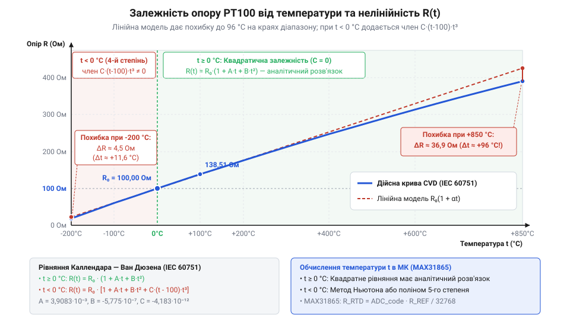
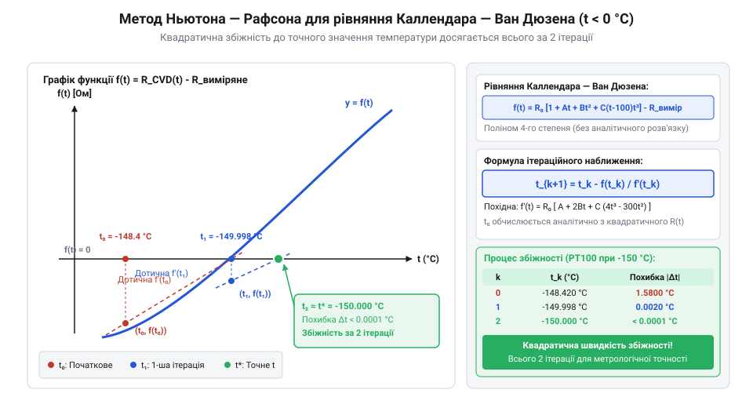

# Математичні рівняння Каллендара — Ван Дюзена для платинових датчиків опору PT100/PT1000

<preknowlist>
- [PT100 — платиновий термоопір](root:cat-hw-sensors/pt100-rtd) — будова платинового резистора та принцип зміни опору від температури
- [Стандарт IEC 60751 для платинових термоопорів](root:cat-hw-sensors/iec-60751-standard-for-rtd) — класи точності та нормовані значення опору за температури 0 °C
- [Огляд родини резистивних перетворювачів температури RTD](root:cat-hw-sensors/rtd-resistance-temperature-detectors-family-overview) — загальний принцип вимірювання опору RTD та схема підключення
</preknowlist>

## Нелінійність платини та похибки лінійного розрахунку

Для вимірювання температури у промислових та наукових системах найчастіше застосовують [платиновий термоопір PT100](root:cat-hw-sensors/pt100-rtd). Вибір платини зумовлений її високою хімічною стійкістю, точним відтворенням електричного опору та стійкістю до старіння. На відміну від напівпровідникових датчиків, як-от [цифровий давач DS18B20](root:cat-hw-sensors/ds18b20), опір платинових дротів або плівок змінюється монотонно й без різких стрибків.

Початківці в розробці вимірювальних приладів часто припускають, що опір платинового резистора залежить від температури строго лінійно. Виходячи з того, що номінальний опір датчика @@en|PT100@@ (від позначення платини *platinum* — назви шляхетного металу від іспанського *platina*, та номінального опору 100 Ом за 0 °C) за 0 °C становить рівно 100 Ом, а температурний коефіцієнт опору або @@en|TCR@@ (англ. *Temperature Coefficient of Resistance*, від латинського *coefficiens* — той, що сприяє, та *resistere* — чинити опір) становить приблизно 0.003851 °C⁻¹, спрощена формула розрахунку опору `R(t)` від температури `t` виглядає так:

```
R(t) = R₀ × (1 + α × t)
```

У цій формулі `R₀` позначає номінальний опір за нульової температури в омах, `α` — температурний коефіцієнт опору в °C⁻¹, а `t` — вимірювану температуру в градусах Цельсія. Якщо спробувати обернути цей вираз для обчислення температури `t` за виміряним опором `R`, отримуємо лінійне співвідношення:

```
t = (R - R₀) / (R₀ × α)
```

Такий спрощений розрахунок створює ілюзію достатньої точності у вузькому діапазоні довкола 0 °C. Згідно з вимогами [нормованого стандарту IEC 60751](root:cat-hw-sensors/iec-60751-standard-for-rtd) значення опору @@en|PT100@@ за температури 100 °C становить 138.51 Ом. Підставивши цей опір у лінійну формулу, отримаємо `t = (138.51 - 100) / (100 × 0.003851) = 100.00 °C`. Проте за межами цього вузького інтервалу лінійна модель зазнає критичного збою.

Фізична причина нелінійності полягає у зміні механізмів розсіювання електронів провідності на фононах (коливальних квантах кристалічної ґратки платини) під час нагрівання та охолодження. При зростанні температури амплітуда коливань атомів ґратки збільшується, але приріст опору на кожен градус Цельсія поступово зменшується. Тобто чутливість первинного перетворювача `dR/dt` згасає із підвищенням температури. На відміну від термісторів, таких як [аналоговий термістор KY-013](root:cat-hw-sensors/ky-013-thermistor), де опір падає за експоненційним законом, нелінійність платини є плавною, проте суттєвою для високоточних вимірювань.

Для порівняння обчислимо опір датчика за точними фізичними таблицями стандарту та похибку, яку дає лінійне наближення або @@en|linear approximation@@ (від латинського *approximare* — наближатися):

- За температури 200 °C реальний опір @@en|PT100@@ становить 175.86 Ом. Лінійна формула дає оцінку 197.00 °C, що створює похибку в -3.00 °C. - За температури 500 °C реальний опір становить 280.98 Ом. Лінійний розрахунок дає лише 470.00 °C — похибка сягає -30.00 °C. - За максимальної робочої температури 850 °C реальний опір становить 390.48 Ом. Обчислення за лінійною формулою показує 754.29 °C, з катастрофічною похибкою понад -95 °C. - У кріогенній зоні за -200 °C реальний опір становить 18.52 Ом, тоді як лінійна формула видає -211.58 °C, даючи похибку -11.58 °C.


*Графік залежності опору платинового датчика PT100 від температури в діапазоні від -200 °C до +850 °C та відхилення реальної кривої від лінійної апроксимації.*

Таке значне відхилення унеможливлює використання лінійного розрахунку в промисловості, де вимагається точність вимірювання до часток градуса. Загальні принципи будови різних типів термоопорів описані в [огляді родини RTD](root:cat-hw-sensors/rtd-resistance-temperature-detectors-family-overview), однак для забезпечення високої точності обробки вимірювальних сигналів платинового датчика необхідна нелінійна математична модель.

## Рівняння Каллендара — Ван Дюзена

Математичний опис реальної залежності опору платини від температури був розроблений британським фізиком Г'ю Каллендаром у 1887 році та доповнений американським дослідником Мілтоном Ван Дюзеном у 1925 році. Сформована ними модель, відома як рівняння Каллендара — Ван Дюзена або @@en|Callendar — Van Dusen equations@@, стала основою міжнародних метрологічних стандартів, зокрема @@en|IEC 60751@@ та температурної шкали @@en|ITS-90@@ (англ. *International Temperature Scale of 1990*).

Рівняння Каллендара — Ван Дюзена описує пряму залежність опору платинового терморезистора `R(t)` від температури `t`. Математична модель розділена на два температурні діапазони через принципову зміну поведінки кристалічної ґратки платини за від'ємних температур.

Для додатних температур у діапазоні від 0 °C до +850 °C залежність описується поліномом другого степеня (квадратичною функцією):

```
R(t) = R₀ × (1 + A × t + B × t²)
```

У цій формулі `R(t)` позначає опір датчика за температури `t` в омах, `R₀` — номінальний опір за 0 °C (наприклад, 100 Ом для @@en|PT100@@ або 1000 Ом для @@en|PT1000@@), а `A` та `B` — нормовані коефіцієнти Каллендара — Ван Дюзена. Докладніше про особливості вимірювань, відмінності від PT100 та переваги застосування високоомних датчиків читайте у статті про [платиновий терморезистор PT1000](root:cat-hw-sensors/pt1000-rtd-sensor).

Для від'ємних температур у діапазоні від -200 °C до 0 °C квадратичної залежності стає недостатньо. При наближенні до кріогенних температур квантово-механічні ефекти в металі змінюють характер електронного розсіювання, що вимагає додавання кубічного члена з додатковим коефіцієнтом `C`:

```
R(t) = R₀ × (1 + A × t + B × t² + C × (t - 100) × t³)
```

Якщо розкрити дужки у від'ємному поліномі, вираз перетворюється на поліном четвертого степеня відносно `t`:

```
R(t) = R₀ × (1 + A × t + B × t² - 100 × C × t³ + C × t⁴)
```

Згідно зі стандартом @@en|IEC 60751@@ для платини високого ступеня чистоти із коефіцієнтом `α = 0.003851 °C⁻¹` встановлено такі точні значення коефіцієнтів:

- `A = 3.9083 × 10⁻³ °C⁻¹`
- `B = -5.7750 × 10⁻⁷ °C⁻²`
- `C = -4.1830 × 10⁻¹² °C⁻⁴` (для `t < 0 °C`, а для `t ≥ 0 °C` коефіцієнт `C = 0`).

Аналіз фізичного змісту коефіцієнтів розкриває роль кожного члена рівняння:

1. Коефіцієнт `A` визначає базовий лінійний нахил кривої опору поблизу 0 °C і забезпечує основний внесок у чутливість датчика. 2. Коефіцієнт `B` є від'ємним (`B < 0`), що спричиняє поступове падіння чутливості `dR/dt` із зростанням температури. Завдяки від'ємному квадратичному члену `B × t²` графік залежності опору відхиляється донизу від прямої лінії, що точно відтворює фізичну нелінійність платини у додатному діапазоні. 3. Коефіцієнт `C` також є від'ємним і діє лише при `t < 0 °C`. Зауважимо, що при `t = 0 °C` та `t = 100 °C` множник `(t - 100) × t³` дорівнює нулю. При `t < 0 °C` значення `t - 100` є від'ємним, а `t³` — також від'ємним. Їхній добуток дає додатне число, яке при множенні на від'ємний коефіцієнт `C` створює необхідну від'ємну поправку опору при низьких температурах.

Пряме обчислення опору `R` за відомою температурою `t` за цими формулами є простою обчислювальною задачею. Проте перед розробником програмного забезпечення мікроконтролера стоїть обернена задача: давач вимірює опір `R`, і з нього необхідно вирахувати температуру `t`.

З математичного погляду обернення рівняння для додатного діапазону зводиться до розв'язання квадратного рівняння, для якого існує точне аналітичне рішення. Натомість для від'ємного діапазону вимагається обернення полінома четвертого степеня, яке не має простого аналітичного виразу для обчислення в реальному часі на мікроконтролерах і потребує застосування чисельних методів.

## Аналітичний розрахунок для додатних температур

Для додатного діапазону температур від 0 °C до +850 °C залежність опору від температури є квадратичною. Це дозволяє вивести точну аналітичну формулу для прямого розрахунку температури `t` за виміряним опором `R`.

Записуємо вихідне рівняння Каллендара — Ван Дюзена для `t ≥ 0 °C`:

```
R(t) = R₀ × (1 + A × t + B × t²)
```

Поділимо обидві частини рівняння на номінальний опір `R₀`:

```
R(t) / R₀ = 1 + A × t + B × t²
```

Перенесемо відношення опорів у правий бік та згрупуємо члени для отримання канонічного квадратного рівняння вигляду `a × t² + b × t + c = 0`:

```
B × t² + A × t + (1 - R(t) / R₀) = 0
```

У цьому рівнянні коефіцієнти дорівнюють `a = B`, `b = A`, а вільний член `c = 1 - R(t) / R₀`. Корні квадратного рівняння знаходять за загальною формулою:

```
t = (-A ± √(A² - 4 × B × (1 - R(t) / R₀))) / (2 × B)
```

Оскільки коефіцієнт `B` є від'ємним (`B = -5.775 × 10⁻⁷`), знаменник `2 × B` також є від'ємним. Для вибору фізично коректного кореня розглянемо випадок, коли `R(t) > R₀` (тобто `t > 0 °C`). Оскільки `A > 0`, доданок `-A` є від'ємним. Щоб чисельник був від'ємним (і при діленні на від'ємний знаменник давав додатну температуру `t`), необхідно перед квадратним коренем обрати знак плюс. Таким чином, єдиний фізично обґрунтований корінь має вигляд:

```
t = (-A + √(A² - 4 × B × (1 - R(t) / R₀))) / (2 × B)
```

Для зручності обчислень та уникнення ділення на від'ємне число помножимо чисельник і знаменник на `-1`:

```
t = (A - √(A² - 4 × |B| × (R(t) / R₀ - 1))) / (2 × |B|)
```

Продемонструємо покроковий розрахунок температури за цією формулою на конкретному прикладі.

**Приклад обчислення температури за виміряним опором:**
Нехай вимірювальне коло з платиновим датчиком @@en|PT100@@ (`R₀ = 100.00 Ом`) зафіксувало опір `R = 175.86 Ом`.

```
R / R₀ = 175.86 / 100.00 = 1.7586                                           [обчислення нормованого опору]
R / R₀ - 1 = 0.7586                                                         [обчислення відхилення]
4 × |B| × (R / R₀ - 1) = 4 × 5.775 × 10⁻⁷ × 0.7586 = 1.752369 × 10⁻⁶       [підготовка підкореневого члена]
A² = (3.9083 × 10⁻³)² = 1.52748089 × 10⁻⁵                                  [квадрат коефіцієнта A]
Дискримінант = 1.52748089 × 10⁻⁵ + 1.752369 × 10⁻⁶ = 1.70271779 × 10⁻⁵      [сума під коренем]
√Дискримінант = √1.70271779 × 10⁻⁵ = 4.12640011 × 10⁻³                      [добування квадратного кореня]
Чисельник = 3.9083 × 10⁻³ - 4.12640011 × 10⁻³ = -0.00021810011              [різниця A - √D]
Знаменник = 2 × 5.775 × 10⁻⁷ = 1.155 × 10⁻⁶                                 [подвійний коефіцієнт B]
t = -0.00021810011 / (-0.000001155) = 200.00 °C                             [точна температура]
```

Розрахунок дає точне значення температури `200.00 °C`, повністю усуваючи похибку лінійного наближення.

При реалізації цієї математичної формули на мікроконтролерах слід ураховувати обчислювальні ресурси процесора та особливості арифметики з плаваючою крапкою або @@en|FPU@@ (англ. *Floating-Point Unit*, від латинського *fluere* — текти, *punctum* — крапка, та *unitas* — єдність). 

На 32-розрядних мікроконтролерах із найменуванням архітектури ARM Cortex-M4F або ESP32, що мають апаратний математичний співпроцесор, обчислення квадратного кореня операцією `sqrtf()` виконується за кілька тактів процесора. Проте на 8-розрядних мікроконтролерах без апаратного @@en|FPU@@ обчислення квадратного кореня виконується програмно, що вимагає сотень тактів процесора.

Окрім швидкодії, існує ризик втрати точності через віднімання близьких чисел (катастрофічне скасування точності). Оскільки значення `A²` (`~1.527 × 10⁻⁵`) та підкореневий дискримінант мають близький порядок, використання стандартних 32-бітних чисел із плаваючою крапкою (`float` стандарту IEEE 754) поблизу 0 °C може призводити до похибок у молодших розрядах. Для досягнення максимальної точності рекомендується використовувати 64-бітну арифметику подвійної точності (`double`).

Нижче наведено ідіоматичні приклади програмного обчислення температури за аналітичною формулою для додатного діапазону.

:::tabs
:::code math-callendar-van-dusen-equations/c/esp-idf/rtd-pt100-calc-positive-temp.c
:::code math-callendar-van-dusen-equations/cpp/arduino/pt100positivecalculator.cpp
:::

## Чисельні методи для від'ємного діапазону

У додатному діапазоні температур залежність опору платини від температури описується квадратичною функцією, яка легко піддається аналітичному оберненню за допомогою звичайної формули квадратного рівняння. Проте для від'ємних температур у межах від `-200 °C` до `0 °C` вимоги [стандарту IEC 60751](root:cat-hw-sensors/iec-60751-standard-for-rtd) визначають розширене математичне рівняння з додатковим членом четвертого степеня. Введення цього додатка створює @@en|quartic equation@@ (поліном четвертого степеня):

R(t) = R₀ · [1 + A · t + B · t² + C · (t - 100) · t³]

Розкриття дужок у дужковій виразовій частині рівняння утворює повний поліном четвертого степеня відносно температури `t`:

```
R(t)
= R₀ · (1 + A · t + B · t² + C · t⁴ - 100 · C · t³)      [розкриття дужок у члені рівняння]
= R₀ · (1 + A · t + B · t² - 100 · C · t³ + C · t⁴)      [впорядкування членів за степенями]
```

Аналітичне обернення цього полінома для знаходження `t` за відомим опором `R` вимагає застосування канонічного розв'язку Феррарі. На практиці цей метод є абсолютно непридатним для вбудованих систем. Формула Феррарі потребує обчислення кубічних та квадратних коренів від комплексних проміжних величин, що призводить до обчислювальної нестабільності та такої проблеми, як @@en|catastrophic cancellation@@ (катастрофічна втрата точності через віднімання близьких за величиною чисел у процесорах із плаваючою крапкою).

Замість складного аналітичного розв'язання для обчислення від'ємних температур використовують чисельне обернення за допомогою @@en|Newton-Raphson method@@ (від англ. *Newton-Raphson method*, на честь Ісаака Ньютона та Джозефа Рафсона). Метод полягає у знаходженні нуля цільової функції `f(t)`, яка виражає різницю між теоретичним опором при температурі `t` та реально виміряним опором `R_meas`:

```
f(t)
= R(t) - R_meas                                                         [різниця між теоретичним та виміряним опором]
= R₀ · (1 + A · t + B · t² - 100 · C · t³ + C · t⁴) - R_meas            [підстановка полінома Каллендара — Ван Дюзена]
```

Геометрія метода Ньютона — Рафсона полягає у заміні кривої `f(t)` дотичною прямою у точці поточного наближення `tₙ` та знаходженні перетину цієї дотичної з віссю температур. Перша похідна функції `f'(t)` за температурою визначає нахил цієї дотичної:

```
f'(t)
= d/dt [R₀ · (1 + A · t + B · t² - 100 · C · t³ + C · t⁴) - R_meas]   [диференціювання цільової функції]
= R₀ · (A + 2 · B · t - 300 · C · t² + 4 · C · t³)                      [в взяття похідної для кожного члена]
```

Звідси будується ітеративна формула обчислення наступного значення температури `tₙ₊₁`:

```
tₙ₊₁
= tₙ - f(tₙ) / f'(tₙ)                                                   [ітераційний крок Ньютона — Рафсона]
```


*Процес ітераційного наближення за методом Ньютона — Рафсона: початкова дотична перетинає вісь у точці першого наближення, досягаючи точного розв'язку за два-три кроки.*

Швидкість збіжності алгоритму вирішальним чином залежить від обраного початкового наближення `t₀`. Оскільки крива опору [платинових терморезисторів PT100](root:cat-hw-sensors/pt100-rtd) у від'ємній зоні відхиляється від квадратичної моделі лише на частки відсотка, як початкове значення `t₀` доцільно використати розв'язок спрощеного квадратного рівняння (без врахування коефіцієнта `C`):

```
t₀
= (-A + √(A² - 4 · B · (1 - R_meas / R₀))) / (2 · B)                    [початкове наближення з квадратичного аналізу]
```

Розглянемо числовий приклад обчислення. Нехай для датчика PT100 (`R₀ = 100.0 Ом`) виміряний опір становить `R_meas = 60.2558 Ом`, що відповідає еталонній температурі `-100.0 °C`. Значення коефіцієнтів стандарту: `A = 3.9083 × 10⁻³ °C⁻¹`, `B = -5.775 × 10⁻⁷ °C⁻²`, `C = -4.183 × 10⁻¹² °C⁻⁴`.

**Обчислення кроків ітерації:**

```
t₀
= (-3.9083 × 10⁻³ + √((3.9083 × 10⁻³)² - 4 · (-5.775 × 10⁻⁷) · (1 - 60.2558 / 100))) / (2 · (-5.775 × 10⁻⁷))
= -100.1993 °C                                                          [розрахунок початкового значення t₀]
```

Помилка початкового наближення становить усього `0.1993 °C`. Підставимо `t₀` у формулу першого ітераційного кроку:

```
f(t₀)
= 100 · (1 + 3.9083×10⁻³·(-100.1993) - 5.775×10⁻⁷·(-100.1993)² - 100·(-4.183×10⁻¹²)·(-100.1993)³ + (-4.183×10⁻¹²)·(-100.1993)⁴) - 60.2558
= 0.000832 Ом                                                           [недолік опору на першому кроці]
```

```
f'(t₀)
= 100 · (3.9083×10⁻³ + 2·(-5.775×10⁻⁷)·(-100.1993) - 300·(-4.183×10⁻¹²)·(-100.1993)² + 4·(-4.183×10⁻¹²)·(-100.1993)³)
= 0.40183 Ом/°C                                                         [крутизна кривої опору при t₀]
```

```
t₁
= -100.1993 - (0.000832 / 0.40183)
= -100.0014 °C                                                          [значення після першої ітерації]
```

Усього за один крок абсолютна похибка зменшилася до `0.0014 °C`. На другій ітерації значення `t₂` повністю збігається з точним розв'язком `-100.0000 °C` у межах точності 32-бітного числа з плаваючою крапкою.

:::tabs
@tab C
:::code math-callendar-van-dusen-equations/c/esp-idf/rtd-subzero-newton-calc.c
@tab C++
:::code math-callendar-van-dusen-equations/cpp/arduino/rtdconverter.cpp
:::

## Поліноміальні апроксимації та оптимізація обчислень

Виконання обчислень методом Ньютона — Рафсона або обчислення квадратних коренів вимагає роботи з числами типу `float` або `double`. Проте багато недорогих мікроконтролерів (наприклад, 8-бітні сімейства AVR або 32-бітні ядра Cortex-M0/M0+) позбавлені апаратного модуля @@en|floating-point unit@@ (FPU). Виклик програмних бібліотек емуляції плаваючої крапки уповільнює виконання перетворення на сотні тактів і суттєво роздуває розмір виконання у флеш-пам'яті.

Щоб оптимізувати обчислення без втрати точності, розробники використовують два основні підходи: поліноміальну апроксимацію прямої функції `t(R)` та таблиці пошуку.

Перший метод полягає у заміні оберненої ітераційної процедури прямою **поліноміальною апроксимацією** (від грец. *полі* — багато, лат. *nomen* — ім'я та лат. *approximo* — наближатися). Замість розв'язання рівняння відносно `t`, температура виражається прямо як поліном 4-го або 5-го степеня від нормованого опору `r = R_meas / R₀`:

R(r) = p₀ + p₁ · r + p₂ · r² + p₃ · r³ + p₄ · r⁴ + p₅ · r⁵

Щоб мінімізувати кількість операцій множення під час обчислення такого полінома на мікроконтролері, застосовують @@en|Horner's scheme@@:

```
t(r)
= p₀ + r · (p₁ + r · (p₂ + r · (p₃ + r · (p₄ + r · p₅))))              [згортання полінома за схемою Горнера]
```

Завдяки схемі Горнера поліном 5-го степеня обчислюється всього за 5 операцій множення та 5 операцій додавання замість обчислення окремих степенів. Для діапазону від `-200 °C` до `0 °C` коефіцієнти прямого полінома добираються методом найменших квадратів, забезпечуючи похибку апроксимації менше `0.005 °C`.

Другим високоефективним методом є використання **таблиць пошуку** @@en|lookup table@@ із застосуванням **інтерполяції** (від лат. *interpolatio* — відновлення, переробка). У флеш-пам'яті мікроконтролера розміщують заздалегідь обчислені опорні значення опору `R[i]` із кроком по температурі, наприклад `Δt = 10 °C`.

Алгоритм обробки виміряного опору `R_meas` складається з двох кроків:
1. За допомогою @@en|binary search@@ (двійкового пошуку) або прямої адресації знаходять інтервал `[R[i], R[i+1]]`, якому належить значення `R_meas`. 2. Застосовують **шматочно-лінійну інтерполяцію** @@en|piecewise linear interpolation@@ для обчислення точного значення температури всередині інтервалу:

```
t
= t[i] + Δt · (R_meas - R[i]) / (R[i+1] - R[i])                        [шматочно-лінійна інтерполяція]
```

На відміну від [родини резистивних датчиків](root:cat-hw-sensors/rtd-resistance-temperature-detectors-family-overview) з прямою обробкою чи цифрових [датчиків типу DS18B20](root:cat-hw-sensors/ds18b20) та інтегральних [модулів SHT30](root:cat-hw-sensors/sht30), які видають готові числові значення через цифровий протокол, точна математична обробка аналогового опору RTD вимагає свідомого вибору алгоритму під обчислювальні ресурси процесора.

Для реалізацій на ядрах без FPU лінійну інтерполяцію та таблиці пошуку легко перевести на @@en|fixed-point math@@ (цілочисельну арифметику з фіксованою крапкою, наприклад Q16.16), що дозволяє виконувати розрахунки взагалі без операцій з плаваючою крапкою за одиниці мікросекунд.

| Алгоритм обчислення | Математичний апарат | Операції на крок | Похибка (°C) | Вимоги до Flash / RAM | Оптимальна платформа |
| :--- | :--- | :--- | :--- | :--- | :--- |
| **Ньютон — Рафсон (точний)** | Float32 / Float64 | `sqrt`, ділення, ~30-40 float ops | `< 0.001` | Мінімальний Flash / RAM | STM32F4/F7/H7, ESP32 (є апаратний FPU) |
| **Поліном Горнера (5 ст.)** | Float32 / Fixed-point | 5 множень, 5 додавань | `< 0.005` | Дуже малий Flash | Cortex-M0/M0+, AVR ATmega (без FPU) |
| **Таблиця + лінійна інтерполяція** | Fixed-point Q16.16 | 1 ділення, 1 множення, пошук | `< 0.01` (крок 10 °C) | Пам'ять під таблицю (~200 байт) | 8-бітні та 16-бітні МК (AVR, PIC, MSP430) |

:::tabs
@tab C
:::code math-callendar-van-dusen-equations/c/esp-idf/rtd-lut-linear-interpolate.c
@tab C++
:::code math-callendar-van-dusen-equations/cpp/arduino/fastrtdconverter.cpp
:::