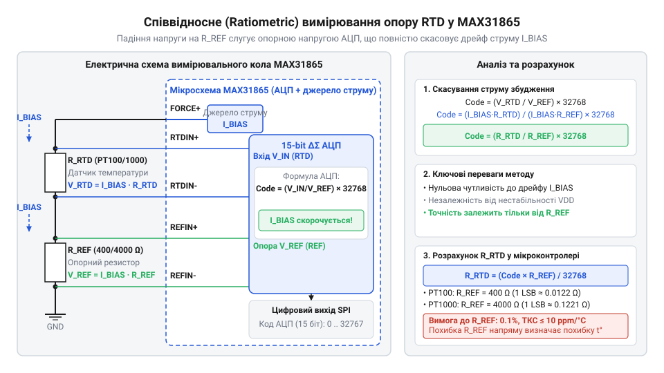

# Математика співвідносного АЦП-перетворення та вибору опорного резистора MAX31865

<preknowlist>
- [PT100 — платиновий термоопір](root:cat-hw-sensors/pt100-rtd) — фізичний принцип залежності опору платини від температури та значення номінального опору при 0 °C
- [Огляд родини резистивних перетворювачів температури RTD](root:cat-hw-sensors/rtd-resistance-temperature-detectors-family-overview) — класифікацію та характеристики давачів типом PT100 і PT1000
- [Стандарт IEC 60751 для платинових термоопорів](root:cat-hw-sensors/iec-60751-standard-for-rtd) — таблиці та вирази залежності R(T) для розрахунку діапазону опорів RTD
</preknowlist>

## Проблема дрейфу струму в абсолютних вимірюваннях

Вимірювання температури за допомогою платинових резистивних давачів, таких як [платинові термоопори PT100](root:cat-hw-sensors/pt100-rtd), ґрунтується на вимірюванні їхнього електричного опору. Оскільки мікроконтролери та аналого-цифрові перетворювачі вимірюють напругу, а не опір безпосередньо, у вимірювальне коло необхідно подати струм збудження. Пропускаючи струм через резистивний давач температури (англ. *Resistance Temperature Detector*, від лат. *resistere* — чинити опір) `@@en|RTD@@`, ми отримуємо спад напруги, який пропорційний опору терморезистора.

Прямий розрахунок опору здається простим і базується на законі Ома:

V_RTD = I_BIAS × R_RTD
= R_RTD = V_RTD ÷ I_BIAS      [ізоляція шуканого опору RTD]

У цій абсолютній схемі вимірювання аналого-цифровий перетворювач (від грец. *analogos* — пропорційний, відповідний та лат. *digitus* — палець, лічба) `@@en|АЦП@@` (англ. *Analog-to-Digital Converter*, `@@en|ADC@@`) перетворює отриману напругу `V_RTD` у цифровий код, порівнюючи її з власною внутрішньою опорною напругою `V_REF_ADC`. 

Основна проблема такого підходу полягає у фізичній нестабільності реальних електронних компонентів. Струм збудження `I_BIAS`, який генерує джерело струму чи джерело живлення через обмежувальний резистор, неминуче змінюється під впливом температури навколишнього середовища, старіння компонентів та пульсацій живлення. Зміна температури на декілька градусів спричиняє температурний дрейф струму збудження. Крім того, сама опорна напруга `V_REF_ADC` всередині `@@en|АЦП@@` (англ. *Analog-to-Digital Converter*, `@@en|ADC@@`) також має власний температурний коефіцієнт.

Щоб оцінити підсумковий вплив цих факторів, виразимо обчислюваний опір терморезистора `R_RTD` через цифровий код `Code_ADC` та максимальний розмах шкали АЦП `N_MAX`:

Code_ADC = (I_BIAS × R_RTD ÷ V_REF_ADC) × N_MAX
= (R_RTD × I_BIAS × N_MAX) ÷ V_REF_ADC      [перегрупування множників у виразі напруги]

Виразивши з цього співвідношення опір `R_RTD`, отримуємо залежність від двох незалежних аналогових величин:

R_RTD = (Code_ADC ÷ N_MAX) × (V_REF_ADC ÷ I_BIAS)

Взявши повний диференціал або прологарифмувавши вираз за незалежними змінними `V_REF_ADC` та `I_BIAS`, виведемо відносну похибку обчислення опору `ΔR_RTD ÷ R_RTD`:

ΔR_RTD ÷ R_RTD = (ΔV_REF_ADC ÷ V_REF_ADC) - (ΔI_BIAS ÷ I_BIAS)
⇒ |ΔR_RTD ÷ R_RTD|_max = |ΔV_REF_ADC ÷ V_REF_ADC| + |ΔI_BIAS ÷ I_BIAS|      [оцінка найгіршого випадку для суми незалежних дрейфів]

Це математичне виведення показує, що відносний дрейф опорної напруги `ΔV_REF_ADC ÷ V_REF_ADC` та відносний дрейф струму збудження `ΔI_BIAS ÷ I_BIAS` додаються за модулем у найгіршому випадку. Навіть якщо ідеально стабілізувати струм збудження `I_BIAS`, будь-яка нестабільність опорної напруги АЦП безпосередньо створює еквівалентну відносну похибку вимірювання опору `R_RTD`.

Для давача `@@en|PT100@@` зміна опору становить приблизно `0.385 Ω` на кожен градус Цельсія. Якщо струм збудження `I_BIAS` або опорна напруга `V_REF_ADC` здрейфують бодай на `0.1%`, це призведе до похибки обчислення опору `0.1 Ω`. Для платинового термоопору така відносна зміна еквівалентна хибному зсуву виміряної температури майже на `0.26 °C`. У реальних промислових умовах при зміні температури плати від `-40 °C` до `+85 °C` дрейф недорогих джерел струму може сягати `1%`–`2%`, що викликає невиправну похибку вимірювання у кілька градусів Цельсія.

Отже, абсолютне вимірювання напруги вимагає надскладних, дорогих та термостабілізованих джерел струму й опорних напруг. Щоб усунути цей недолік, потрібна схемна топологія, у якій результат перетворення взагалі не залежить від абсолютного значення струму збудження та його дрейфу.

## Математичний принцип співвідносного перетворення АЦП

Щоб повністю усунути вплив дрейфу струму збудження, використовують співвідносне (англ. *ratiometric*, від лат. *ratio* — відношення та грец. *metron* — вимірювання) перетворення `@@en|ratiometric@@`. Спеціалізована мікросхема `@@en|MAX31865@@` реалізує цей принцип завдяки послідовному увімкненню терморезистора `@@en|RTD@@` та високоточного прецизійного опорного резистора `R_REF`.

Завдяки послідовному з'єднанню через обидва елементи протікає один і той самий струм збудження `I_BIAS`. Падіння напруги на терморезисторі `V_RTD` подається на диференційний вхід аналого-цифрового перетворювача. Водночас падіння напруги на опорному резисторі `V_REF = I_BIAS × R_REF` подається безпосередньо на входи опорної напруги `REFIN+` та `REFIN-` того самого `@@en|АЦП@@`.

*Принципова схемотехніка співвідносного вимірювального кола MAX31865: струм збудження послідовно проходить через RTD та R_REF, скасовуючи власний дрейф у виразі АЦП.*

Всередині `@@en|MAX31865@@` інтегровано 15-бітний (англ. *delta-sigma*, від грецьких літер `Δ` та `Σ`) `@@en|дельта-сигма@@` `@@en|АЦП@@`. Цифровий код на виході АЦП визначається як відношення вхідної напруги `V_RTD` до опорної напруги `V_REF`, помножене на повну шкалу 15-бітного розрядного сімейства `2¹⁵ = 32768`:

Code_ADC = (V_RTD ÷ V_REF) × 32768
         = ((I_BIAS × R_RTD) ÷ (I_BIAS × R_REF)) × 32768      [підстановка виразів падіння напруги]
         = (R_RTD ÷ R_REF) × 32768                            [математичне скорочення I_BIAS]

У виведеній формулі струм збудження `I_BIAS` повністю скорочується. Незалежно від того, чи дорівнює струм `1.0 mA`, чи він здрейфував до `0.9 mA` або `1.1 mA`, співвідношення напруг `V_RTD ÷ V_REF` залишається строго тотожним співвідношенню опорів `R_RTD ÷ R_REF`.

Виразивши опір терморезистора `R_RTD` через отриманий 15-бітний цифровий код `Code_ADC`, отримуємо підсумкову розрахункову формулу для мікроконтролера:

R_RTD = (Code_ADC × R_REF) ÷ 32768

У результаті вимірювання опору `R_RTD` зводиться до множення відомого фіксованого номіналу `R_REF` на цифровий коефіцієнт. Співвідносне перетворення переносить вимоги щодо високої точності з джерела струму та внутрішньої опорної напруги АЦП на один-єдиний пасивний компонент — опорний резистор `R_REF`.

## Алгоритм вибору опорного резистора R_REF

Вибір номіналу опорного резистора `R_REF` визначає верхню межу вимірюваного опору `R_RTD` та ефективність використання динамічного діапазону (англ. *dynamic range*, від грец. *dynamis* — сила) `@@en|АЦП@@`. Зі співвідносної формули видно, що коли опір `R_RTD` дорівнює номіналу `R_REF`, відношення напруг досягає одиниці `V_RTD / V_REF = 1`, а цифровий код `Code_ADC` досягає максимального 15-бітного значення `32767` (значення повної шкали `@@en|full-scale@@`).

Якщо опір `R_RTD` перевищить номінал `R_REF`, падіння напруги на давачі перевищить опорну напругу `V_REF`, що призведе до насичення АЦП та переповнення вимірювального тракту. Тому головне правило вибору `R_REF` полягає у дотриманні умови, за якої номінал `R_REF` строго більший за максимальний опір давача `R_RTD_max` у всьому заданому робочому температурному діапазоні:

R_REF ≥ R_RTD_max(T_max)

Розглянемо алгоритм розрахунку `R_REF` на прикладі давачів `@@en|PT100@@` та `@@en|PT1000@@` згідно зі [стандартом IEC 60751](root:cat-hw-sensors/iec-60751-standard-for-rtd):

1. **Визначення максимальної температури вимірювання `T_max`.** Стандартний діапазон для платинових термоопорів становить від `-200 °C` до `+850 °C`. 2. **Розрахунок максимального опору `R_RTD_max`.** При температурі `+850 °C` опір платинового давача `@@en|PT100@@` сягає приблизно `390.48 Ω`, а для давача `@@en|PT1000@@` — `3904.8 Ω`. 3. **Вибір стандартного номіналу `R_REF`.** Щоб охопити увесь температурний діапазон без насичення АЦП і мати невеликий технологічний запас, обирають найближчий більший стандартний прецизійний номінал:
   - Для `@@en|PT100@@`: `R_REF = 400 Ω` (або `430 Ω` для розширеного запасу). - Для `@@en|PT1000@@`: `R_REF = 4000 Ω` (або `4300 Ω`).

Вибір занадто великого номіналу `R_REF` погіршує використання динамічного діапазону. Наприклад, якщо для `@@en|PT100@@` помилково встановити `R_REF = 1000 Ω`, то при температурі `0 °C` (`100 Ω`) АЦП використовуватиме лише `100 ÷ 1000 = 10%` своєї шкали (`3277` відліків із `32768`). Це призведе до втрати `90%` роздільної здатності АЦП. За номіналу `R_REF = 400 Ω` при `0 °C` використовується `25%` шкали (`8192` відліки), а при `+850 °C` — `97.6%` шкали (`31991` відліків), що забезпечує оптимальне поєднання діапазону й роздільної здатності.

## Роздільна здатність та похибка опорного резистора

Дискретність 15-бітного аналого-цифрового перетворювача визначає фізичну ціну молодшого розряду (англ. *Least Significant Bit*) `@@en|LSB@@`. Ціна одного розряду `LSB_Ω` у вираженні опору визначається за формулою:

LSB_Ω = R_REF ÷ 32768

Для конфігурації з `@@en|PT100@@` та `R_REF = 400 Ω`:

LSB_Ω = 400 ÷ 32768 ≈ 0.012207 Ω/LSB

Враховуючи чутливість платини поблизу `0 °C` (приблизно `0.385 Ω/°C`), температурна роздільна здатність `LSB_T` вимірювального тракту становить:

LSB_T = 0.012207 Ω ÷ 0.385 Ω/°C ≈ 0.0317 °C/LSB

Для конфігурації з `@@en|PT1000@@` та `R_REF = 4000 Ω` ціна розряду в омах становить `LSB_Ω = 4000 ÷ 32768 ≈ 0.12207 Ω/LSB`. Проте чутливість `@@en|PT1000@@` поблизу `0 °C` також у 10 разів вища (`3.85 Ω/°C`), тому температурна роздільна здатність залишається тотожною: `LSB_T = 0.12207 ÷ 3.85 ≈ 0.0317 °C/LSB`.

Хоча співвідносне перетворення повністю усуває дрейф струму збудження, воно переносить системну похибку на опорний резистор `R_REF`. Похибка номіналу `R_REF` пропорційно масштабує результат обчислення опору `R_RTD`:

ΔR_RTD ÷ R_RTD = ΔR_REF ÷ R_REF

Системна похибка опорного резистора складається з двох основних чинників:

1. **Початковий допуск номіналу (англ. *tolerance*).** Використання резистора з допуском `0.1%` дає невизначеність опору `±0.1 Ω` при `100 Ω`, що еквівалентно початковій температурній похибці близько `±0.26 °C`. 2. **Температурний коефіцієнт опору (англ. *Temperature Coefficient of Resistance*) `@@en|TCR@@`.** Параметр `@@en|TCR@@` вимірюється в частинках на мільйон на градус Цельсія (англ. *Parts Per Million*) `@@en|PPM@@` (`ppm/°C`). Якщо резистор `R_REF` має `TCR = 25 ppm/°C`, зміна температури плати на `ΔT_amb = 40 °C` спричинить додатковий дрейф номіналу:

δ_drift = 25 × 10⁻⁶ × 40 = 0.001 = 0.1%

Це додає ще `±0.26 °C` похибки вимірювання температури. Для прецизійних вимірювальних систем рекомендується використовувати резистори `R_REF` з допуском не гірше `0.1%` (ідеально `0.02%`–`0.05%`) та температурним коефіцієнтом `TCR ≤ 10 ppm/°C`.

Під час первинного опрацювання сигналів мікроконтролер має зчитувати сирий 15-бітний код із `@@en|MAX31865@@`, обчислювати фактичний опір `R_RTD` з урахуванням каліброваного значення `R_REF`, а для розрахунку температури у широкому діапазоні застосовувати [рівняння Каллендара-Ван Дюзена](root:hw-sensing/callendar-van-dusen-equation).

Нижче наведено приклади реалізації обчислення опору `R_RTD` та оцінки роздільної здатності для мікроконтролерів:

:::tabs
@tab C (ESP-IDF)
:::code math-max31865-ratiometric-adc-math/c/esp-idf/max31865-code-to-rtd-resistance.c
@tab C++ (Arduino)
:::code math-max31865-ratiometric-adc-math/cpp/arduino/max31865reader.cpp
:::