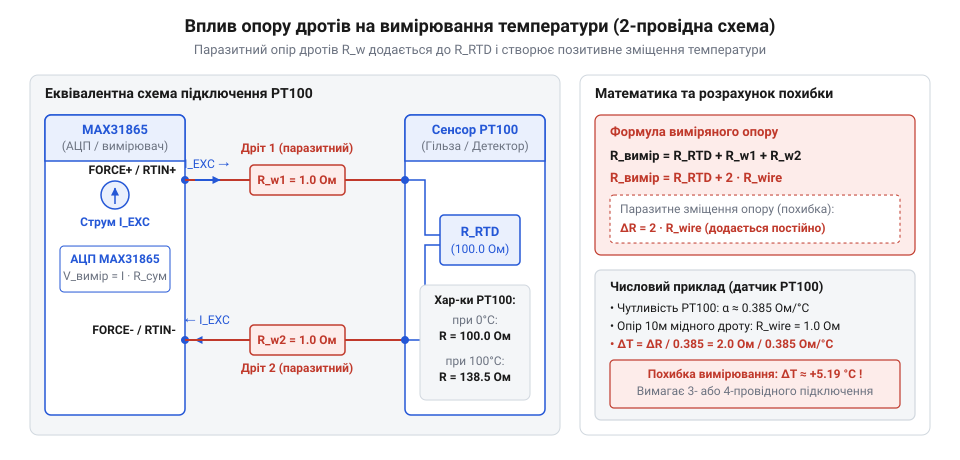
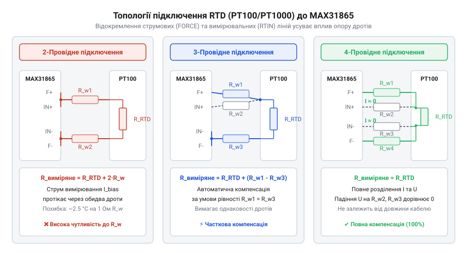
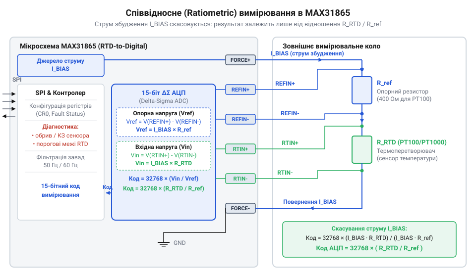
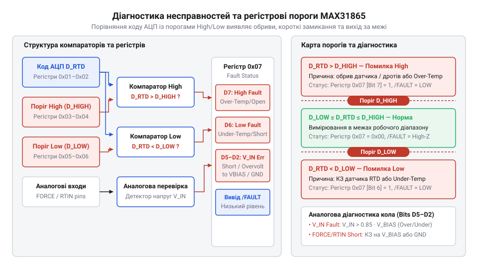
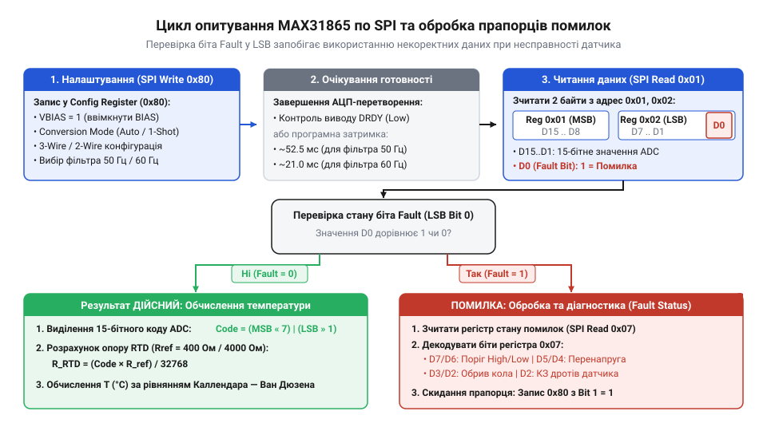

# MAX31865 — перетворювач опору платинових датчиків PT100/PT1000

<preknowlist>
- [PT100 — платиновий термоопір](root:cat-hw-sensors/pt100-rtd) — залежність опору платини від температури ($R_0 = 100\ \Omega$ при $0^\circ\text{C}$), високу лінійність і стабільність характеристик
- [Огляд родини резистивних перетворювачів температури RTD](root:cat-hw-sensors/rtd-resistance-temperature-detectors-family-overview) — класифікацію термоопорів, відмінності між PT100 та PT1000, номінальний опір та температурний коефіцієнт $\alpha$
- [Стандарт IEC 60751 для платинових термоопорів](root:cat-hw-sensors/iec-60751-standard-for-rtd) — класи точності платинових датчиків (Class A, Class B, 1/3 DIN) та нормативну шкалу опору відносно температури
</preknowlist>

## Паразитний опір дротів та температурна похибка

У промислових системах автоматизації вимірювальні давачі температури та контролери обробки даних майже завжди рознесені в просторі. Коли платиновий перетворювач температури розташовують усередині технологічного реактора, сушильної камери або магістрального трубопроводу, відстань від сенсора до вимірювального модуля може становити десятки або навіть сотні метрів. Електричне з'єднання між ними виконується мідними кабелями, які в теоретичних розрахунках вважають ідеальними провідниками з нульовим опором. На практиці мідний дріт має власний електричний опір, який послідовно вмикається у вимірювальне коло і спотворює реальні значення.

Фізична природа електричного опору металевих провідників зумовлена розсіюванням носіїв заряду (електронів провідності) на теплових коливаннях кристалічної ґратки. Під час вимірювання опору платинового сенсора вимірювальний прилад пропускає через коло електричний струм і фіксує падіння напруги. Якщо вимірювальне коло побудоване за найпростішою двопровідною схемою, той самий струм протікає як через чутливий платиновий елемент, так і через обидві жили з'єднувального кабелю. В результаті аналоговий модуль фіксує сумарний опір усієї замкненої лінії, не маючи змоги апаратно відокремити опір датчика від опору дротів.

Математична модель такого вимірювального кола визначається через додавання опору платинового елемента `R_rtd` та паразитного опору двох дротів `R_line1` і `R_line2`. За умови використання стандартного симетричного кабелю, в якому обидві жили мають однаковий переріз і довжину (`R_line1 = R_line2 = R_line`), загальний виміряний опір `R_total` описується виразом:

```
R_total = R_rtd + R_line1 + R_line2
        = R_rtd + 2 · R_line                 [за умови симетрії провідників R_line1 = R_line2 = R_line]
```

де:
- `R_total` — загальний електричний опір, який фіксує вимірювальний прилад, Ом;
- `R_rtd` — фактичний електричний опір платинового терморезистора при поточній температурі середовища, Ом;
- `R_line1`, `R_line2` — електричний опір першої та другої жил з'єднувального кабелю, Ом;
- `R_line` — паразитний опір одного з'єднувального провідника, Ом.

Щоб оцінити масштаб похибки, яку створює опір дротів, розглянемо фізичні характеристики найпоширеніших платинових датчиків. Поведінка платинових термоперетворювачів опору @@en|RTD@@ (від англ. @@en|Resistance Temperature Detector@@ — резистивний детектор температури) стандартизована вимогами [стандарту IEC 60751](root:cat-hw-sensors/iec-60751-standard-for-rtd). Для елемента @@en|PT100@@ номінальний опір `R_0` при температурі `0` °C становить `100` Ом, а середній температурний коефіцієнт `α` дорівнює `0.003851` Ом/(Ом·°C). Абсолютний приріст опору датчика @@en|PT100@@ на кожен градус Цельсія обчислюється за формулою:

```
ΔR / ΔT = R_0 · α
        = 100 · 0.003851                     [множення номінального опору на температурний коефіцієнт]
        = 0.3851                             [Ом/°C]
```

де:
- `R_0` — номінальний опір датчика при `0` °C, Ом;
- `α` — температурний коефіцієнт опору платини за стандартом @@en|IEC 60751@@, `1/°C`;
- `ΔR / ΔT` — чутливість платинового елемента, Ом/°C.

Типовий промисловий мідний кабель перерізом `0.2` мм² (стандарт @@en|AWG24@@) має питомий опір приблизно `0.084` Ом на один метр довжини. При довжині лінії у `10` метрів загальна довжина мідного провідника в обох напрямках (туди й назад) становить `20` метрів, що дає сумарний паразитний опір `2 · R_line = 1.68` Ом.

Обчислимо еквівалентну температурну похибку `ΔT_error`, яку створює цей паразитний опір при використанні платинового елемента @@en|PT100@@:

**Розрахунок похибки вимірювання для PT100 при довжині кабелю 10 метрів**
```
ΔT_error = (2 · R_line) / (ΔR / ΔT)
         = 1.68 / 0.3851                     [ділення сумарного опору дротів на чутливість PT100]
         ≈ 4.36                              [°C]
```

де:
- `ΔT_error` — еквівалентна температурна похибка вимірювання, °C;
- `2 · R_line` — сумарний паразитний опір двох жил кабелю, Ом;
- `ΔR / ΔT` — абсолютна чутливість датчика, Ом/°C.

Систематична похибка в `4.36` °C є критичною для технологічних процесів у фармацевтичній, хімічній та харчовій промисловості, де вимагається точність підтримання температури в межах `0.1` °C. Ситуацію частково покращує застосування датчиків @@en|PT1000@@, які мають номінальний опір `1000` Ом при `0` °C. Поведінка таких елементів висвітлена в огляді [платинових датчиків опору](root:hw-sensing/rtd-sensor). Чутливість @@en|PT1000@@ становить `3.851` Ом/°C, що вдесятеро вище за @@en|PT100@@. За тих самих `10` метрів кабелю похибка вимірювання для @@en|PT1000@@ складе:

**Розрахунок похибки вимірювання для PT1000 при довжині кабелю 10 метрів**
```
ΔT_error = 1.68 / 3.851                      [ділення сумарного опору дротів на чутливість PT1000]
         ≈ 0.436                             [°C]
```

Використання @@en|PT1000@@ зменшує вплив паразитного опору ліній у десять разів, проте повністю не усуває проблему. Якщо кабель має довжину `50` метрів, похибка навіть для @@en|PT1000@@ перевищить `2.18` °C.


*Еквівалентна вимірювальна схема показує, як опір з'єднувальних дротів додається до опору сенсора, утворюючи нероздільну суму на вхідних клемах вимірювача.*

Набагато складнішою проблемою є температурний дрейф опору самого з'єднувального кабелю. Мідь володіє високим температурним коефіцієнтом опору `α_Cu ≈ 0.00393` 1/°C, що майже збігається з температурним коефіцієнтом платини. Якщо траса кабелю проходить через приміщення з добовими коливаннями температури від `10` °C до `30` °C (зміна `ΔT_cable = 20` °C), опір мідного провідника буде динамічно змінюватися.

Зміна опору мідного кабелю `ΔR_line(T)` обчислюється як:

```
ΔR_line(T) = 2 · R_line0 · α_Cu · ΔT_cable
           = 1.68 · 0.00393 · 20             [підстановка початкового опору, коефіцієнта міді та перепаду температур]
           ≈ 0.132                           [Ом]
```

де:
- `ΔR_line(T)` — температурна зміна опору двох жил кабелю, Ом;
- `R_line0` — початковий опір однієї жили при базі вимірювання, Ом;
- `α_Cu` — температурний коефіцієнт опору міді, `1/°C`;
- `ΔT_cable` — зміна температури навколишнього середовища вздовж траси кабелю, °C.

Для датчика @@en|PT100@@ ця добова зміна опору кабелю в `0.132` Ом викликає хибне зміщення показів температури на `0.132 / 0.3851 ≈ 0.34` °C. Цю похибку неможливо компенсувати одноразовим калібруванням у програмі контролера, оскільки вона залежить від погодних умов і температури вздовж траси прокладання кабелю.

Додатковим деструктивним фактором у найпростіших аналогових вимірювачах є самонагрів чутливого елемента струмом вимірювання (ефект Джоуля — Ленца). Якщо через датчик @@en|PT100@@ пропускати занадто великий струм `I_bias = 5` мА, на ньому виділятиметься потужність `P = I_bias² · R_rtd = (0.005)² · 100 = 2.5` мВт. За низького коефіцієнта тепловіддачі середовища це спричиняє локальне перегрівання сенсора на декілька десятих градуса Цельсія відносно вимірюваного середовища. Тому сучасні конвертери обмежують вимірювальний струм на рівні `0.1`–`1` мА.

У довгих промислових кабелях поблизу потужного обладнання (частотних перетворювачів, електродвигунів та силових трансформаторів) на з'єднувальні жили додатково наводяться електромагнітні завади. Вони спотворюють вимірювальний сигнал і вимагають екранування кабелю з заземленням екрана в одній точці.

Спроби використовувати стандартний потенціометричний дільник напруги з підключенням до аналого-цифрового перетворювача без компенсації зустрічають ще одну перешкоду: нестабільність напруги живлення. Якщо напруга живлення дільника `V_CC` плаває, вихідна напруга змінюється пропорційно, що АЦП хибно інтерпретує як зміну опору датчика.

Історично першим ефективним рішенням для точного вимірювання малих змін опору став міст Вітстона (англ. @@en|Wheatstone bridge@@), винайдений у XIX столітті. Докладно про цей етап вимірювальної техніки розповідається у матеріалі про [еволюцію вимірювання термоопорів](root:cat-hw-sensors/max31865-rtd-converter/hist-rtd-and-ratiometric-measurement.md). Мостова схема дозволила усунути залежність від нестабільності живлення за допомогою балансування плечей. Проте мости Вітстона вимагали використання прецизійних резисторів із низьким температурним дрейфом, складного ручного або автоматичного балансування та застосування диференційних підсилювачів. Крім того, опір з'єднувальних дротів, включений у плече моста, все одно зміщував точку балансу.

Для досягнення високої точності вимірювань виникла фізична необхідність відокремити струмові лінії, які забезпечують проходження вимірювального струму, від потенційних ліній, призначених виключно для зняття падіння напруги з платинового решітка. Саме цей принцип покладено в основу багатопровідних схем підключення.

## Багатопровідні схеми підключення платинових датчиків

Фундаментальний спосіб усунення похибки від паразитного опору провідників полягає у використанні закону Ома та розділенні функцій з'єднувальних ліній. Для визначення опору резистивного елемента необхідно пропустити через нього вимірювальний струм відомої величини і виміряти падіння напруги безпосередньо на його виводах. Якщо напругу знімають за допомогою окремих провідників, підключених до вимірювального приладу з високим вхідним опором, струм через ці потенційні провідники прямує до нуля. Згідно із законом Ома, за відсутності струму падіння напруги на паразитних опорах вимірювальних дротів дорівнює нулю, що робить результат вимірювання незалежним від довжини кабелю.

У практичній схемотехніці вимірювальних систем застосовують три основні топології комутації платинових сенсорів: двопровідну, трипровідну та чотирипровідну. Детальний аналіз цих конфігурацій надано у матеріалі про [методи компенсації опору](root:cat-hw-sensors/rtd-resistance-temperature-detectors-family-overview/math-rtd-self-heating-and-wire-resistance-error.md). Кожна топологія являє собою схемотехнічний компроміс між вартістю кабельної лінії, складністю комутації та досяжною точністю.


*Порівняння трьох топологій показує перехід від некомпенсованого 2-провідного кола до частково компенсаційного 3-провідного та безальтернативно точного 4-провідного підключення Кельвіна.*

Двопровідна схема (англ. @@en|2-wire topology@@) є найпростішою та найдешевшою в реалізації: платиновий сенсор з'єднується з вимірювальним модулем за допомогою двожильного кабелю. Через ці самі дві жили протікає вимірювальний струм і з них же зчитується падіння напруги. Падіння напруги `U_measured`, яке фіксує вимірювальний прилад при проходженні струму `I_bias`, описується виразом:

```
U_measured = I_bias · (R_rtd + R_line1 + R_line2)
           = I_bias · R_rtd + I_bias · (R_line1 + R_line2)    [розкриття дужок для виділення паразитного додатка]
```

де:
- `U_measured` — падіння напруги на вхідних клемах вимірювача, В;
- `I_bias` — вимірювальний струм, А;
- `R_rtd` — опір платинового чутливого елемента, Ом;
- `R_line1`, `R_line2` — електричний опір жил кабелю, Ом.

Паразитний додаток `I_bias · (R_line1 + R_line2)` спотворює результат вимірювання. Двопровідну схему застосовують лише тоді, коли довжина кабелю не перевищує `0.5` метра, або при використанні датчиків @@en|PT1000@@ у системах, де технологічний допуск на вимірювання температури становить `1` °C і більше.

Трипровідна схема (англ. @@en|3-wire topology@@) є промисловим стандартом для систем середньої протяжності ліній. Вона дозволяє математично або апаратно компенсувати паразитний опір кабелю за використання лише трьох провідників. У цій схемі до одного з кінців платинового решітка підключають дві жили кабелю (наприклад, `FORCE+` та `RTIN+`), а до протилежного кінця — одну жилу (`FORCE-` / `RTIN-`).

Принцип компенсації у трипровідній конфігурації ґрунтується на симетрії дротів та диференційній обробці напруг. У класичній реалізації з двома однаковими джерелами струму `I_1 = I_2 = I_bias` перший струм `I_1` подається через жилу 1 (`FORCE+`) до верхнього контакту датчика і повертається через жилу 3 (`FORCE-`). Другий струм `I_2` подається через жилу 2 (`RTIN+`) до того самого верхнього контакту датчика і також повертається через жилу 3 (`FORCE-`).

Обчислимо потенціали у вузлах схеми відносно загальної шини живлення. Струм `I_1` створює падіння напруги на першій жилі `I_1 · R_line1` та на датчику `I_1 · R_rtd`. Через третю жилу протікає сумарний струм `I_1 + I_2 = 2 · I_bias`, створюючи падіння напруги `2 · I_bias · R_line3`.

Різниця потенціалів `U_13` між першою та третьою жилами дорівнює:

```
U_13 = I_bias · R_line1 + I_bias · R_rtd + 2 · I_bias · R_line3   [падіння напруги у першому вимірювальному контурі]
```

Різниця потенціалів `U_23` між другою та третьою жилами дорівнює:

```
U_23 = I_bias · R_line2 + 2 · I_bias · R_line3                   [падіння напруги у другому компенсаційному контурі]
```

Якщо від відносного падіння напруги `U_13` відняти напругу `U_23`, то за умови суворої симетрії кабелю (`R_line1 = R_line2 = R_line3 = R_line`) отримуємо:

```
U_diff = U_13 - U_23
       = (I_bias · R_line + I_bias · R_rtd + 2 · I_bias · R_line) - (I_bias · R_line + 2 · I_bias · R_line)   [підстановка виразів рівних опорів]
       = I_bias · R_rtd                                                                                     [скорочення однакових доданків]
```

Результат вираження `U_diff` містить виключно корисну напругу на платиновому елементі `I_bias · R_rtd`. Паразитний опір дротів `R_line` повністю взаємно знищується.

Критичним обмеженням трипровідної схеми є вимогливість до ідеальної симетрії кабелю. Якщо жили мають навіть незначну різницю опорів `ΔR_line = R_line1 - R_line2` (через розкид товщини міді, неякісний обтиск гільз або різний стан гвинтових клемників), некомпенсована різниця опорів `ΔR_line` напряму додається до опору датчика. При асиметрії всього в `0.1` Ом похибка для датчика @@en|PT100@@ становитиме `0.26` °C.

З плином часу на гвинтових клемних з'єднаннях виникає окиснення міді, що збільшує перехідний опір контактів `R_contact`. У трипровідній системі нерівномірне окиснення трьох контактів порушує симетрію ліній і призводить до прогресуючого часового дрейфу показів.

Найбільш досконалою є чотирипровідна схема, відома як підключення Кельвіна (англ. @@en|Kelvin connection@@ або @@en|4-wire topology@@). У цій топології пара провідників `FORCE+` та `FORCE-` утворює виключно струмовий контур живлення, а друга пара `RTIN+` та `RTIN-` підключається безпосередньо до виводів платинового резистора для зняття електричного потенціалу.

Вхідний опір `Z_in` сучасних аналогово-цифрових перетворювачів, таких як мікросхема @@en|MAX31865@@, становить понад `100` мегаом (`Z_in > 10⁸` Ом). Завдяки цьому струм `I_sense`, який відгалужується у потенційні провідники `RTIN+` та `RTIN-`, не перевищує кількох наноампер:

```
I_sense = U_rtd / Z_in
        = 0.1 / 10⁸                          [підстановка типової напруги 100 мВ та вхідного опору АЦП]
        = 10⁻⁹                               [А] або 1 нА
```

Струм у `1` нА, протікаючи через паразитний опір потенційного провідника `R_line2 = 10` Ом, створює падіння напруги `U_line2 = 10⁻⁹ · 10 = 10⁻⁸` В (`10` нВ). Така мікроскопічна величина перебуває глибоко поза межами чутливості навіть прецизійного 15-бітного АЦП мікросхеми @@en|MAX31865@@.

Математичний розрахунок різниці потенціалів `U_measured` між вхідними клемами АЦП демонструє повну незалежність від опору кабелю:

**Виведення рівняння вимірювання напруги для 4-провідної схеми Кельвіна**
```
U_measured = V_RTIN+ - V_RTIN-
           = (V_top - I_sense · R_line2) - (V_bottom + I_sense · R_line3)
           = V_top - V_bottom                 [оскільки I_sense · R_line2 ≈ 0 та I_sense · R_line3 ≈ 0]
           = I_bias · R_rtd                   [за законом Ома на чутливому елементі RTD]
```

де:
- `V_RTIN+`, `V_RTIN-` — потенціали на вхідних виводах вимірювального конвертера, В;
- `V_top`, `V_bottom` — потенціали безпосередньо на контактних площадка платинового елемента, В;
- `I_sense` — струм вимірювальних входів АЦП, А;
- `R_line2`, `R_line3` — опір потенційних жил з'єднувального кабелю, Ом.

Чотирипровідне підключення Кельвіна повністю ліквідує вплив паразитного опору провідників, незалежно від довжини кабелю, перерізу жил або асиметрії контактного опору в клемах. Це єдиний метод, який забезпечує еталонну точність вимірювання температури у відповідальних промислових та наукових застосуваннях.

Для роботи з різними типами датчиків мікросхема @@en|MAX31865@@ має гнучкий апаратний інтерфейс. Деталі підключення виводів `FORCE+`, `FORCE-`, `RTIN+` та `RTIN-` регулюються вимогами [апаратного інтерфейсу MAX31865](root:cat-hw-sensors/max31865-rtd-converter/api-max31865-hardware-interface.md). Шляхом встановлення зовнішніх перемичок на платі один і той самий конвертер можна сконфігурувати для роботи з 2-, 3- або 4-провідними датчиками.

Для досягнення граничної точності 4-провідне підключення поєднують із вибором термостабільного опорного резистора `Rref`, про що докладно йдеться у розділі про [прецизійні опорні резистори](root:hw-components/precision-reference-resistors-selection). Така комбінація формує основу співвідносного (ратиометричного) вимірювання, що усуває як опір дротів, так і похибку від дрейфу джерела живлення.

## Архітектура та співвідносне вимірювання MAX31865

Вимірювання температури за допомогою платинових датчиків @@en|PT100@@ та @@en|PT1000@@ висуває виключно високі вимоги до точності аналогового тракту. Для датчика @@en|PT100@@ номінальний опір при `0 °C` становить `100.0 Ω`, а при зміні температури на `0.1 °C` опір змінюється лише на `0.0385 Ω`. У класичній вимірювальній схемі аналого-цифровий перетворювач оцифровує падіння напруги `V_RTD = I_ex × R_RTD`, утворене струмом збудження `I_ex`, порівнюючи його з внутрішньою або зовнішньою опорною напругою `V_ref`. Якщо струм збудження або опорна напруга дрейфують хоча б на `0.1%` через зміну температури довкілля чи нестабільність джерела живлення, вихідний код АЦП змінюється на ті ж `0.1%`. Для датчика @@en|PT100@@ при `0 °C` це відповідає хибному зсуву опору на `0.1 Ω`, що еквівалентно похибці вимірювання температури майже у `0.26 °C`. Промислова термометрія не може спиратися на абсолютні джерела напруги чи струму такої стабільності.

Розв'язання цієї проблеми полягає в переході від абсолютних вимірювань до @@en|ratiometric measurement@@ (від латинського @@en|ratio@@ — відношення, пропорція та @@en|metricus@@ — вимірювальний). У спеціалізованій мікросхемі @@en|MAX31865@@ принципово відсутня потреба у високостабільному джерелі напруги чи струму. Замість цього платиновий @@en|RTD@@ (від англійського @@en|Resistance Temperature Detector@@ — резистивний детектор температури) та зовнішній прецизійний @@en|reference resistor@@ (від англійського @@en|reference@@ — еталон, орієнтир та латинського @@en|resisto@@ — чинити опір) `R_ref` вмикаються послідовно в єдиний струмовий ланцюг, який живиться від внутрішнього генератора зміщення @@en|bias generator@@.

Оскільки через обидва резистори протікає абсолютно однаковий струм збудження `I_bias`, падіння напруги на платиновому сенсорі дорівнює `V_RTD = I_bias × R_RTD`, а падіння напруги на опорному резисторі дорівнює `V_ref = I_bias × R_ref`. Вимірювальне відношення двох напруг має вигляд:

```
V_RTD / V_ref
= (I_bias × R_RTD) / (I_bias × R_ref)      [скорочення спільного струму I_bias]
= R_RTD / R_ref                            [співвідношення опорів]
```

З отриманого рівняння видно, що струм `I_bias` повністю скорочується. Будь-які пульсації, шум або температурний дрейф струму збудження чи напруги живлення в однаковій пропорції змінюють як чисельник `V_RTD`, так і знаменник `V_ref`. У результаті відношення напруг залишається абсолютно незмінним. Дослідити еволюцію цього підходу від перших мостових схем XIX століття допомагає [історичний огляд термометрії](root:cat-hw-sensors/max31865-rtd-converter/hist-rtd-and-ratiometric-measurement.md), де висвітлено шлях від класичного моста Уітстона до сучасних цифрових АЦП.

Оцифрування отриманого співвідношення в мікросхемі @@en|MAX31865@@ здійснює 15-розрядний @@en|delta-sigma ADC@@ (від грецьких літер @@en|delta@@ — різниця та @@en|sigma@@ — сума) з диференційними аналоговими входами.


*Блок-схема MAX31865 демонструє послідовне проходження струму збудження через опорний резистор та термоперетворювач із передачею падінь напруги на дельта-сигма АЦП.*

Згідно з блок-схемою, внутрішній генератор `VBIAS` подає струм збудження через вивід `FORCE+` у зовнішнє струмове коло. Струм послідовно проходить через опорний резистор `R_ref`, підключений між виводами `REFIN+` та `REFIN-`, після чого прямує до платинового сенсора `R_RTD` і повертається на землю через вивід `FORCE-`. Аналоговий тракт АЦП використовує падіння напруги на опорному резисторі `V_ref` безпосередньо як опорну напругу масштабування модулятора.

Диференційний дельта-сигма модулятор вимірює напругу `V_RTD` з входів `RTIN+` та `RTIN-` відносно напруги `V_ref` на входах `REFIN+` та `REFIN-`. Вихідний 15-бітний цифровий код `ADC_code` обчислюється за формулою:

```
ADC_code
= (V_RTD / V_ref) × 2¹⁵                     [диференційне співвідносне перетворення]
= (R_RTD / R_ref) × 32768                  [підстановка співвідношення опорів]
```

Звідси значення опору платинового датчика `R_RTD` розраховується з отриманого коду даних за прямою формулою:

```
R_RTD
= (ADC_code × R_ref) / 32768               [розрахунок опору RTD]
```

Отримана формула показує, що точність вимірювання опору сенсора визначається виключно точністю номіналу `R_ref` та роздільною здатністю АЦП. Роздільна здатність одного молодшого розряду @@en|LSB@@ (від англійського @@en|Least Significant Bit@@) у фізичних одиницях опору становить `LSB = R_ref / 32768`. Для опорного резистора номіналом `R_ref = 400.0 Ω` квант вимірювання опору дорівнює `400.0 / 32768 ≈ 0.012207 Ω`. Враховуючи чутливість платини `0.385 Ω/°C`, це забезпечує теоретичну роздільну здатність за температурою близько `0.0317 °C` на один розряд АЦП. Подрібниці обчислення шуму квантування та розширення динамічного діапазону висвітлює [математична модель АЦП](root:cat-hw-sensors/max31865-rtd-converter/math-max31865-ratiometric-adc-math.md).

Критично важливим етапом проєктування є коректний вибір номіналу опорного резистора `R_ref`. Оскільки максимальне значення 15-бітного коду дорівнює `32767` (що відповідає `R_RTD / R_ref ≈ 1.0`), опір датчика в усьому робочому діапазоні температур не повинен перевищувати значення `R_ref`.

Для платинового датчика @@en|PT100@@ опір при `0 °C` становить `100.0 Ω`, а при максимальній робочій температурі `+850 °C` згідно зі [стандартом IEC 60751](root:cat-hw-sensors/iec-60751-standard-for-rtd) досягає `390.48 Ω`. З огляду на це для @@en|PT100@@ стандартним є вибір опорного резистора `R_ref = 400.0 Ω` (або `430.0 Ω` для забезпечення запасів по верхньому краю діапазону). Для датчика @@en|PT1000@@ опір при `0 °C` дорівнює `1000.0 Ω`, а при `+850 °C` зростає до `3904.8 Ω`, що вимагає вибору `R_ref = 4000.0 Ω` (або `4300.0 Ω`).

Вимоги до температурної стабільності `R_ref` є надзвичайно суворими. Оскільки опір `R_RTD` обчислюється як прямий добуток `ADC_code × R_ref`, будь-яка відносна зміна опору `R_ref` на `0.01%` спричиняє таку ж похибку вимірювання опору датчика `R_RTD`. Тому в схемотехніці @@en|MAX31865@@ застосовують металоплівкові прецизійні резистори з температурним коефіцієнтом опору @@en|TCR@@ (від англійського @@en|Temperature Coefficient of Resistance@@) не гіршим за `±5 ppm/°C` або `±10 ppm/°C`. Правила добору таких компонентів деталізує [аналіз прецизійних опорних елементів](root:hw-components/precision-reference-resistors-selection).

Підключення термоперетворювача до виводів `FORCE+`, `FORCE-`, `RTIN+` та `RTIN-` визначається топологією кабельної лінії. У 4-провідному підключенні типу @@en|Kelvin connection@@ струм збудження подається через окрему пару силових дротів `FORCE+` / `FORCE-`, а напруга знімається високомними входами `RTIN+` / `RTIN-`. Оскільки вхідний опір вимірювальних каналів перевищує `10 MΩ`, струм через вимірювальні провідники практично дорівнює нулю, що повністю усуває похибку від паразитного опору з'єднувальних дротів. При 3-провідній топології використовується внутрішній компенсаційний вимикач `FORCE2`, який автоматично віднімає падіння напруги на третьому провіднику. Конкретні схеми комутації перемичок на друкованій платі описує [специфікація апаратного інтерфейсу](root:cat-hw-sensors/max31865-rtd-converter/api-max31865-hardware-interface.md).

Після обчислення опору `R_RTD` здійснюється розрахунок температури `T` у градусах Цельсія. Взаємозв'язок між опором платини та температурою описується рівняннями Каллендара — Ван Дюзена. Для діапазону позитивних температур (`T ≥ 0 °C`) залежність є квадратичною:

```
R_RTD(T) = R_0 × (1 + A × T + B × T²)
```

Де `R_0 = 100.0 Ω` (для @@en|PT100@@), а стандартні коефіцієнти становлять `A = 3.9083 × 10⁻³ °C⁻¹` та `B = -5.775 × 10⁻⁷ °C⁻²`. Для визначення температури `T` за виміряним опором `R_RTD` застосовують пряме розв'язання квадратного рівняння:

```
T = (-A + √(A² - 4 × B × (1 - R_RTD / R_0))) / (2 × B)
```

Для від'ємних температур (`-200 °C ≤ T < 0 °C`) у рівняння додається кубічний член `C × (T - 100) × T³` із коефіцієнтом `C = -4.183 × 10⁻¹² °C⁻⁴`, розв'язок якого вимагає ітераційних чисельних методів, що детально розкрито в [описі рівнянь Каллендара — Ван Дюзена](root:cat-hw-sensors/max31865-rtd-converter/math-callendar-van-dusen-equations.md).

Розглянемо числовий приклад розрахунку температури за результатами зчитування даних.

**Умова:** Модуль @@en|MAX31865@@ із прецизійним опорним резистором `R_ref = 400.0 Ω` та датчиком @@en|PT100@@ повернув з регістрів даних 15-бітний код `ADC_code = 9830`. Необхідно розрахувати опір датчика `R_RTD` та температуру `T`.

```
R_RTD
= (9830 × 400.0) / 32768                   [формула співвідносного розрахунку]
= 3932000.0 / 32768                        [множення коду на R_ref]
= 119.995117 Ω                             [обчислений опір RTD]

ΔR = R_RTD - R_0
= 119.995117 - 100.0                       [різниця відносно опору при 0 °C]
= 19.995117 Ω                              [приріст опору]

T_linear
= ΔR / (R_0 × A)                           [лінійна оцінка першого порядку]
= 19.995117 / (100.0 × 0.0039083)          [підстановка коефіцієнта A]
= 19.995117 / 0.39083                      [обчислення знаменника]
= 51.160 °C                                [наближена температура]

T_exact
= (-A + √(A² - 4 × B × (1 - R_RTD / R_0))) / (2 × B)  [квадратне рівняння]
= (-0.0039083 + √(0.0039083² - 4 × (-5.775×10⁻⁷) × (1 - 1.19995117))) / (2 × (-5.775×10⁻⁷))
= 51.467 °C                                [точна температура за Каллендаром — Ван Дюзеном]
```

Результат розрахунку показує, що врахування квадратичного коефіцієнта `B` дає поправку на `0.307 °C` навіть при відносно помірній температурі близько `+51.5 °C`. При вищих температурах (наприклад, `+400 °C`) лінійна оцінка дає похибку вже понад `10 °C`, що робить квадратичний розрахунок обов'язковим для промислових контролерів, коли застосовується [співвідносне вимірювання опору](root:hw-sensing/ratiometric-measurement) у прецизійних каналах.

## Фільтрація завад та діагностика несправностей

У промислових середовищах з'єднувальні лінії термоперетворювачів опору прокладаються в кабельних каналах поруч із силовими мережами живлення, частотними перетворювачами та потужними комутаційними контакторами. Промислова мережа змінного струму створює інтенсивні електромагнітні завади з частотою `50 Hz` (в Україні та країнах Європи) або `60 Hz` (у Північній Америці). Оскільки корисний сигнал напруги на сенсорі @@en|PT100@@ при вимірювальному струмі `I_bias = 1 mA` вимірюється десятками мілівольт, мережева наводка амплітудою навіть у `1 mV` здатна спотворити вимірювання на кілька десятих градуса Цельсія.

Для пригнічення цих завад у дельта-сигма АЦП мікросхеми @@en|MAX31865@@ інтегровано цифровий гребінчастий фільтр @@en|notch filter@@ (від англійського @@en|notch@@ — виріз, зазублина), що забезпечує глибоке ослаблення частот мережі. Цифровий фільтр інтегрує аналоговий сигнал протягом часу, кратного періоду мережевої напруги (20 ms для `50 Hz` або 16.67 ms для `60 Hz`), завдяки чому змінна складова завади взаємно компенсується та усереднюється до нуля.

Налаштування режиму фільтрації виконується через конфігураційний регістр `Configuration Register` (адреса `0x00` для читання, `0x80` для запису) за допомогою біта D0 (`50/60Hz Rejection`):
- При встановленні біта D0 в `1` вмикається режим пригнічення завади `50 Hz`. Цифровий фільтр забезпечує пригнічення сигналів частотою `50 Hz` та її вищих гармонік на рівні понад `82 dB`. Час одного АЦП-перетворення у цьому режимі становить `62.5 ms`, що відповідає максимальній частоті оновлення даних `16` вимірювань на секунду. - При скиданні біта D0 в `0` фільтр перемикається на пригнічення частоти `60 Hz` та її гармонік із часом перетворення `52 ms` (`19` вимірювань на секунду). - Для додаткового прискорення мікросхема підтримує режим одночасного пригнічення `50/60 Hz` із часом перетворення `21 ms`, який застосовується у динамічних системах за умови збереження прийнятного рівня ослаблення завад.

Глибоке цифрове пригнічення дозволяє відмовитися від громіздких зовнішніх апаратних `RC`-фільтрів на аналогових входах, що запобігає виникненню фазових затримок та зберігає високий вхідний опір вимірювальних каналів.

Окрім фільтрації завад, критичною вимогою до промислових термометричних систем є неперервна діагностика цілісності датчика та кабельної лінії @@en|fault detection@@. Механічні вібрації, термічна втома та корозія контактів можуть призводити до обриву платинового спірального елемента, короткого замикання дротів між собою або замикання на заземлений металевий корпус захисної ґільзи.


*Схема діагностики порівнює вхідні напруги з регістровими порогами для швидкого виявлення апаратних аварій сенсорної лінії.*

Як зображено на структурі компараторів діагностики, аналоговий тракт @@en|MAX31865@@ містить групу прецизійних компараторів @@en|comparator@@ (від латинського @@en|comparo@@ — порівнювати), які контролюють потенціали на виводах `RTIN+`, `RTIN-` та `REFIN-` відносно внутрішніх опорних рівнів та значень спеціальних регістрів порогів.

Для автоматичного відстеження виходу температури чи опору за припустимі межі в мікросхемі передбачено два 16-бітних регістри:
- `High Fault Threshold Register` (адреси `0x03` та `0x04`): задає верхню межу 15-бітного коду опору. Якщо виміряний `ADC_code` перевищує заданий поріг, у регістрі статусу помилок `Fault Status Register` (адреса `0x07`) встановлюється прапорець `RTD High Threshold` (біт D7). Це свідчить про вихід температури за аварійну межу або появу підвищеного контактного опору в лінії. - `Low Fault Threshold Register` (адреси `0x05` та `0x06`): задає нижню межу коду. При падінні `ADC_code` нижче цього рівня виставляється прапорець `RTD Low Threshold` (біт D6), що відповідає короткому замиканню елемента @@en|PT100@@.

Окрім перевірки регістрових меж, апаратний блок компараторів відстежує чотири граничні физичні аварії сенсорної лінії:
1. `REFIN- > 0.85 × VBIAS` (біт D5 в `Fault Status Register`): фіксує обрив опорного резистора `R_ref` або коротке замикання вивода `REFIN-` на шину живлення `VDD`. 2. `REFIN- < 0.85 × VBIAS (FORCE- open)` (біт D4): сигналізує про обрив силового провідника `FORCE-` при відкритому компенсаційному ключі. 3. `RTIN- < 0.85 × VBIAS (FORCE- open)` (біт D3): сигналізує про обрив провідника `FORCE-` при закритому компенсаційному ключі. 4. `Overvoltage / Undervoltage Fault` (біт D2): виникає при виході напруги на будь-якому з аналогових входів за межі безпечного діапазону від `GND - 0.3 V` до `VDD + 0.3 V` (наприклад, при наведенні високовольтного потенціалу або випадковому торканні лінії `24 V`).

Мікросхема @@en|MAX31865@@ дає змогу керувати вимірювальним трактом у двох режимних концепціях: безперервному @@en|continuous mode@@ та одиночному @@en|one-shot mode@@.

У безперервному режимі (біт D6 `Conversion Mode` у регістрі `0x00` встановлено в `1`) джерело `VBIAS` (біт D7) працює постійно. АЦП виконує циклічні перетворення, оновлюючи регістри даних `0x01` та `0x02`. Однак постійне проходження струму `I_bias = 1 mA` через датчик @@en|PT100@@ викликає виділення електричної потужності `P = I_bias² × R_RTD = (1 mA)² × 100 Ω = 100 μW`. У малогабаритних або занурювальних термопарах із високим тепловим опором це спричиняє ефект самонагріву чутливого елемента, що додає систематичну похибку вимірювання до `0.05 °C ... 0.1 °C`.

Для ліквідації самонагріву застосовують одиночний режим (біт D6 встановлено в `0`). За командою мікроконтролера у конфігураційному регістрі короткочасно активується біт D5 (`One-Shot`). Мікросхема автоматично вмикає `VBIAS`, виконує одне оцифрування протягом `62.5 ms`, записує результат у регістри даних, виставляє активний низький рівень на виводі готовності даних @@en|DRDY@@ (від англійського @@en|Data Ready@@) та відразу вимикає `VBIAS`. Одиночний режим повністю усуває самонагрів сенсора між замірами та зменшує середнє енергоспоживання вузла у сотні разів.

Управління мікросхемою та зчитування діагностичної інформації виконується через послідовний інтерфейс @@en|SPI@@ (підтримуються режими Mode 1 та Mode 3 з передачею старшого біта @@en|MSB@@ насамперед). При виникненні будь-якої аварійної ситуації @@en|MAX31865@@ негайно притягує лінію @@en|DRDY@@ до землі та виставляє біт D0 в `Fault Status Register`. Програмний драйвер контролера зчитує регістр статусу `0x07`, переводить технологічний процес у безпечний стан та виконує скидання аварійного тригера шляхом запису `1` у біт D5 (`Fault Status Clear`) конфігураційного регістра `0x80`.

Повну структуру картографії регістрів та програмну реалізацію низькорівневих викликів містить [специфікація SPI-драйвера](root:cat-hw-sensors/max31865-rtd-converter/api-max31865-spi-firmware-driver.md). Практичне застосування розгалуженої діагностики у промислових приладах продемонстровано в проєктах [промислового термометра STM32](root:cat-hw-sensors/max31865-rtd-converter/proj-max31865-stm32-rtd-meter.md) та [багатоканального логера ESP32](root:cat-hw-sensors/max31865-rtd-converter/proj-max31865-esp32-multichannel-logger.md).

## Керування регістрами та розрахунок температури

Фізичний аналоговий тракт перетворювача не зможе провести вимірювання, доки цифрова частина чипа не отримає чітких інструкцій щодо режиму подачі струму зміщення, конфігурації з'єднувальних дротів, вибору частоти фільтрації завад та способу обробки прапорців помилок. Спроба зчитувати сирі двійкові значення без конфігурування внутрішньої картографії регістрів призводить до отримання хибних даних або блокування перетворення при виникненні апаратної несправності. Взаємодія з внутрішніми блоками мікросхеми відбувається через послідовний периферійний інтерфейс (англ. @@en|Serial Peripheral Interface@@, @@en|SPI@@) шляхом запису та читання восьми 8-бітних регістрів.

Карта пам'яті спеціалізованого перетворювача містить регістри з адресами від `00h` до `07h`. Протокол обміну вимагає чіткого розрізнення операцій читання та запису: при записі конфігураційних даних до адреси регістру додається маска `0x80` (тобто старший біт адреси встановлюється в `1`), тоді як для зчитування використовується безпосередня адреса зі старшим бітом `0`. Головним вузлом керування є конфігураційний регістр `00h` (англ. @@en|Configuration Register@@). Його бітова структура визначає фундаментальну поведінку всього вимірювального тракту:

- **Біт 7 (`Vbias`)**: керує подачею напруги зміщення (англ. @@en|bias voltage@@) на схему RTD. Значення `1` вмикає внутрішній генератор напруги, що необхідно для заряду вхідних конденсаторів перед початком АЦП-перетворення, а `0` переводить аналогову частину в режим енергозбереження. - **Біт 6 (`Conversion Mode`)**: визначає режим роботи. Логічна `1` вмикає автоматичний безперервний режим (англ. @@en|continuous mode@@) із частотою оновлення даних від 50 до 60 Гц, а `0` залишає пристрій у ручному режимі. - **Біт 5 (`1-Shot`)**: ініціює одиночне вимірювання (англ. @@en|one-shot mode@@). При записі `1` мікросхема виконує один цикл перетворення, після чого біт автоматично скидається в `0`. - **Біт 4 (`3-Wire RTD`)**: задає схемотехніку підключення датчика. Встановлення `1` вмикає внутрішній джерельний компенсаційний струм для 3-провідної лінії, а `0` конфігурує пристрій для роботи з 2- або 4-провідними давачами, деталі яких містить [апаратний інтерфейс MAX31865](root:cat-hw-sensors/max31865-rtd-converter/api-max31865-hardware-interface.md). - **Біти 3–2 (`Fault Detection Cycle`)**: керують апаратним циклом тестування лінії на обриви та короткі замикання. - **Біт 1 (`Fault Status Clear`)**: при записі `1` примусово очищає прапорці помилок у регістрі статусу `07h`. - **Біт 0 (`50/60 Hz Filter`)**: вибирає частоту режекторного нотч-фільтра. Логічна `1` налаштовує цифровий фільтр на пригнічення мережевої завади 50 Гц, а `0` — на 60 Гц.

Після завершення АЦП-перетворення результат фіксується у двох регістрах даних: `01h` (старший байт, @@en|MSB@@) та `02h` (молодший байт, @@en|LSB@@). Разом вони формують 16-бітну сукупність, у якій 15 старших бітів містять виміряний цифровий код, а наймолодший біт D0 регістру `02h` виконує роль індикатора апаратної помилки. Зчитування результату вимагає поєднання обох байтів у єдину змінну з наступним правобічним зсувом:

```
D_ADC = ((Data_MSB × 256) + Data_LSB) ÷ 2      [об'єднання байтів та видалення біта помилки D0]
```

Якщо наймолодший біт D0 у зчитаному слові дорівнює `1`, поточний виміряний код є недійсним. У цьому разі мікроконтролер має зчитати регістр статусу `07h` (англ. @@en|Fault Status Register@@), біти якого вказують на вихід опору за встановлені пороги `High Fault Threshold` (регістри `03h`–`04h`) чи `Low Fault Threshold` (регістри `05h`–`06h`), або на фізичний обрив дротів чи замикання на лініях `FORCE` та `RTIN`. Здійснювати діагностику та програмне керування дозволяє [програмний драйвер SPI](root:cat-hw-sensors/max31865-rtd-converter/api-max31865-spi-firmware-driver.md).


*Часова діаграма опитування регістрів по SPI демонструє послідовність зчитування байтів даних RTD та алгоритм перевірки біта помилки з наступним зчитуванням регістра статусу.*

Оскільки вбудований дельта-сигма АЦП реалізує співвідносний принцип вимірювання відносно зовнішнього опорного резистора `R_ref`, виміряне значення 15-бітного коду `D_ADC` пропорційне відношенню опору платинового давача `R_RTD` до `R_ref`. Повний діапазон 15-бітного АЦП становить 2¹⁵ = 32768 відліків. Перерахунок цифрового коду у фізичний опір датчика в Омах виконується за формулою:

```
R_RTD = (D_ADC × R_ref) ÷ 32768               [розрахунок опору RTD з 15-бітного коду]
```

Правильно підібрані значення опорного елемента, які описують вимоги до [прецизійних опорних резисторів](root:hw-components/precision-reference-resistors-selection), є критично важливими, оскільки будь-яка похибка `R_ref` безпосередньо масштабує обчислений опір. Детальніше математичну модель співвідносного перетворення розгортає [співвідносне АЦП-перетворення](root:cat-hw-sensors/max31865-rtd-converter/math-max31865-ratiometric-adc-math.md).

Отримане значення опору `R_RTD` необхідно перевести в градуси Цельсія. Промислові [платинові термоопори PT100](root:cat-hw-sensors/pt100-rtd) та PT1000 виготовляються відповідно до стандарту, який описує [стандарт IEC 60751](root:cat-hw-sensors/iec-60751-standard-for-rtd), а загальні характеристики термоопорів висвітлює [родина резистивних датчиків](root:cat-hw-sensors/rtd-resistance-temperature-detectors-family-overview). Для додатних температур (від 0 °C до +850 °C) залежність опору від температури `T` описується квадратичним рівнянням Каллендара — Ван Дюзена:

```
R(T) = R_0 × (1 + A × T + B × T²)              [рівняння Каллендара — Ван Дюзена для T >= 0 °C]
```

Тут `R_0` — номінальний опір при 0 °C (100 Ом для PT100 або 1000 Ом для PT1000), а стандартизовані коефіцієнти становлять `A = 3.9083 × 10⁻³ °C⁻¹` та `B = -5.775 × 10⁻⁷ °C⁻²`. Для визначення температури `T` за виміряним опором `R_RTD` квадратичне рівняння зводиться до стандартного вигляду:

```
B × T² + A × T + (1 - R_RTD ÷ R_0) = 0        [квадратична форма рівняння]
T = (-A + √(A² - 4 × B × (1 - R_RTD ÷ R_0))) ÷ (2 × B)   [точний аналітичний розв'язок для T >= 0 °C]
```

Для від'ємних температур (від -200 °C до 0 °C) у рівняння входить додатковий кубічний член `C × (T - 100) × T³` з коефіцієнтом `C = -4.183 × 10⁻¹² °C⁻⁴`. Через це точний аналітичний розв'язок ускладнюється, і на практиці застосовують поліноміальну апроксимацію 5-го степеня або метод ітерацій Ньютона — Рафсона. Повний математичний апарат та поліноми розгортають [математичні рівняння Каллендара — Ван Дюзена](root:cat-hw-sensors/max31865-rtd-converter/math-callendar-van-dusen-equations.md), а історичні передумови виникнення мостових та співвідносних схем описує [історичний розвиток термометрії](root:cat-hw-sensors/max31865-rtd-converter/hist-rtd-and-ratiometric-measurement.md).

Практична реалізація ініціалізації перетворювача, обробки прапорців помилок та розрахунку температури вимагає чіткої послідовності кроків у програмному коді. Наведені нижче приклади демонструють повний цикл опитування MAX31865 мовами C та C++.

:::tabs
@tab C
:::code max31865-rtd-converter-d/c/esp-idf/max31865-init.c
@tab C++
:::code max31865-rtd-converter-d/cpp/arduino/max31865driver.cpp
:::

Для побудови масштабованих вимірювальних комплексів на базі розглянутого алгоритму розроблено [прецизійний вимірювач температури](root:cat-hw-sensors/max31865-rtd-converter/proj-max31865-stm32-rtd-meter.md) на мікроконтролері STM32 та [багатоканальний логер](root:cat-hw-sensors/max31865-rtd-converter/proj-max31865-esp32-multichannel-logger.md) для віддаленого моніторингу на ESP32.