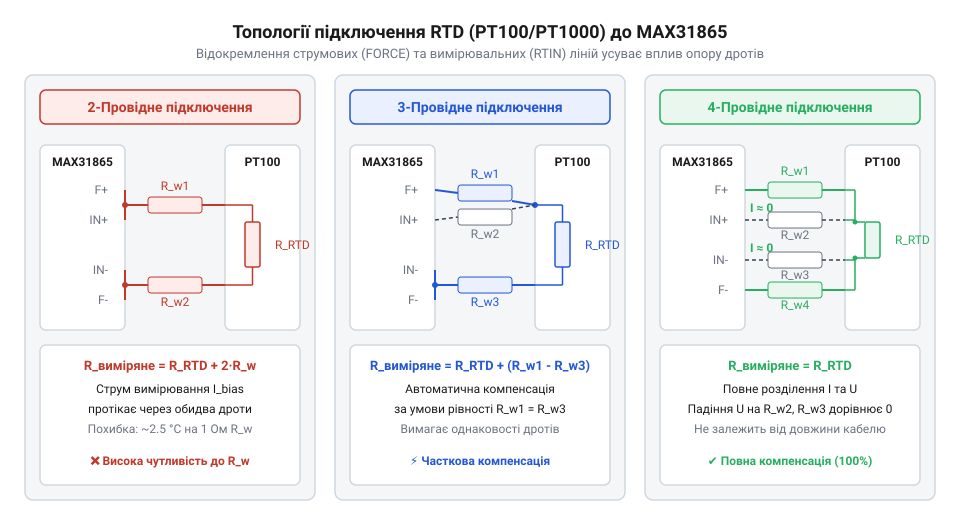
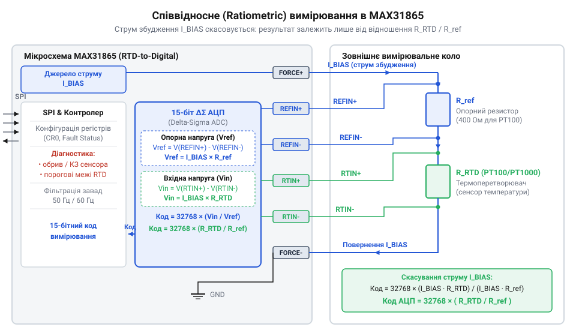
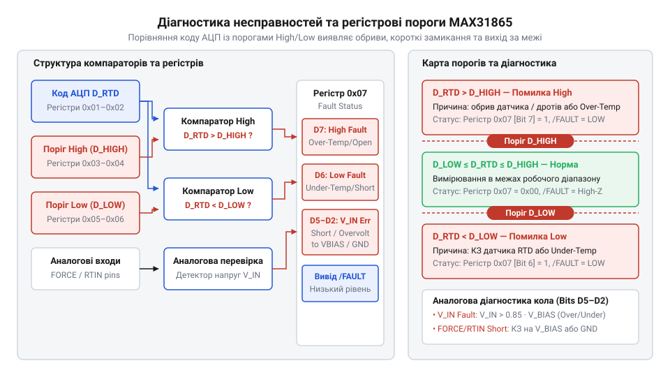
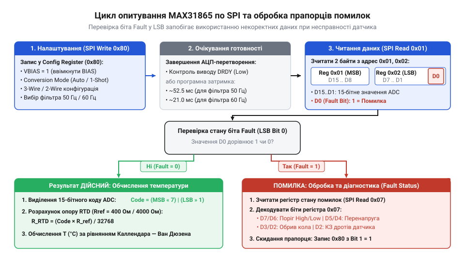

# MAX31865 — перетворювач опору платинових датчиків PT100/PT1000

<preknowlist>
- [PT100 — платиновий термоопір](root:cat-hw-sensors/pt100-rtd) — залежність опору платини від температури ($R_0 = 100\ \Omega$ при $0^\circ\text{C}$), високу лінійність і стабільність характеристик
- [Огляд родини резистивних перетворювачів температури RTD](root:cat-hw-sensors/rtd-resistance-temperature-detectors-family-overview) — класифікацію термоопорів, відмінності між PT100 та PT1000, номінальний опір та температурний коефіцієнт $\alpha$
- [Стандарт IEC 60751 для платинових термоопорів](root:cat-hw-sensors/iec-60751-standard-for-rtd) — класи точності платинових датчиків (Class A, Class B) та рівняння Каллендара — Ван Дюзена для зв'язку опору з температурою
</preknowlist>

## Паразитний опір дротів та компенсація

Вимірювання температури за допомогою [платинового термоопору PT100](root:cat-hw-sensors/pt100-rtd) ґрунтується на зміні його електричного опору. При `0 °C` опір платинового термоопору PT100 становить `100 Ом`, а температурний коефіцієнт — `0.00385 °C⁻¹`. Звичайний мідний кабель перерізом `0.2 мм²` має опір `0.0875 Ом/м`. Двопровідна лінія завдовжки 10 метрів додає `2 Ом` @@en|паразитного опору@@, що призводить до систематичної похибки вимірювання понад `5.2 °C` та температурного дрейфу.


*Топології підключення RTD: чотирипровідне з'єднання повністю розділяє струмовий шлях та лінії зняття напруги, усуваючи падіння напруги на провідниках.*

Найточнішим розв'язком у [родині резистивних перетворювачів](root:cat-hw-sensors/rtd-resistance-temperature-detectors-family-overview) є @@en|чотирипровідна топологія@@ @@en|Кельвіна@@. У ній струм джерела протікає по окремій струмовій парі дротів (`FORCE+` та `FORCE-`), а напруга знімається вимірювальною парою (`SENSE+` та `SENSE-`). Оскільки вхідний опір аналогово-цифрового перетворювача прямує до нескінченності, струм через вимірювальні дроти дорівнює нулю, що усуває спад напруги на лініях `SENSE` та дозволяє виміряти напругу безпосередньо на платиновому кристалі.

Компромісною альтернативою є трипровідна схема, де один дріт слугує спільним для струму та напруги. Вимірювач віднімає падіння напруги на третьому провіднику за умови суворої симетрії їхнього опору. На відміну від [цифрових сенсорів DS18B20](root:cat-hw-sensors/ds18b20), де дані передаються в цифровому коді, аналоговий термоопір вимагає однакового опору всіх провідників лінії.

## Співвідносне вимірювання в MAX31865

Коливання живлення та дрейф струму викривляють покази аналогових вимірювачів. MAX31865 усуває цю залежність через @@en|співвідносне вимірювання@@ (@@en|ратиометричне вимірювання@@, від лат. *ratio* — відношення).


*Співвідносне вимірювання: послідовний струм через RTD та R_REF скасовує коливання живлення.*

Струм `I_bias` протікає послідовно через сенсор `R_RTD` та @@en|опорний резистор@@ `R_REF`. Напруга `V_RTD` подається на вхід 15-бітного АЦП, а `V_REF` слугує опорною напругою:

```
ADC_code
= (V_RTD / V_REF) × 32768                [визначення коду 15-бітного АЦП]
= (I_bias × R_RTD / (I_bias × R_REF)) × 32768 [закон Ома для послідовного кола]
= (R_RTD / R_REF) × 32768                [скорочення вимірювального струму]
```

Струм `I_bias` у чисельнику й знаменнику скорочується, тому цифровий код залежить лише від відношення опорів `R_RTD / R_REF`, а дрейф живлення скасовується.

Номінал `R_REF` обирають за [стандартом IEC 60751](root:cat-hw-sensors/iec-60751-standard-for-rtd): `400 Ом` (або `430 Ом`) для PT100 та `4000 Ом` (або `4300 Ом`) для PT1000. Це покриває весь динамічний діапазон АЦП до `+850 °C`.

## Фільтрація завад та апаратна діагностика

Кабелі термоопорів збирають електромагнітні завади мережі 50/60 Гц, а тривалий вимірювальний струм викликає @@en|ефект самонагріву@@ датчика.

Вбудований @@en|дельта-сигма АЦП@@ містить @@en|цифровий нотч-фільтр@@ (від англ. *notch* — виріз), який формує нулі АЧХ на частотах 50 або 60 Гц і пригнічує наводки понад 80 дБ. Для боротьби із самонагрівом в одиночному режимі струм `I_bias` подається лише на час перетворення (близько 52 мс при 60 Гц) і вимикається після оцифрування. Докладніше про принципи усереднення, передискретизації та формування шуму в дельта-сигма архітектурах читайте у статті про [основні принципи дельта-сигма АЦП](root:hw-analog/sigma-delta-adc).


*Діагностика несправностей: вбудовані компаратори фіксують вихід напруги за межі порогових регістрів.*

Цілісність лінії контролюють аналогові компаратори, зіставляючи напругу з регістрами `High Fault Threshold` та `Low Fault Threshold`. При обриві кабелю чи короткому замиканні напруга виходить за встановлені межі, і мікросхема виставляє прапор помилки `FAULT`.

## Конфігурування регістрів та обчислення температури

Управління MAX31865 здійснюється через @@en|інтерфейс SPI@@. Для старту вимірювання мікроконтролер записує байт у конфігураційний регістр `00h`: біт `VBIAS` вмикає напругу збудження, `Conversion Mode` вибирає режим опитування, а `3-wire` визначає топологію підключення.


*Зчитування 15-бітного коду АЦП та біта помилки FAULT по SPI з регістрів 01h та 02h.*

Після перетворення мікроконтролер зчитує байти з регістрів `01h` та `02h`. Старші 15 біт містять код `ADC_code`, а молодший біт `02h` — прапорець помилки `FAULT`.

Перерахунок коду у фізичний опір здійснюється за формулою:

```
R_RTD
= (ADC_code × R_REF) / 32768             [перерахунок цифрового коду в опір]
```

Для обчислення температури застосовують @@en|рівняння Каллендара — Ван Дюзена@@. У діапазоні `T ≥ 0 °C` залежність опору від температури є квадратичною:

```
R_RTD
= R₀ × (1 + A × T + B × T²)              [рівняння Каллендара — Ван Дюзена для T ≥ 0 °C]
```

де `R₀` дорівнює `100 Ом` для PT100 (`1000 Ом` для PT1000), `A = 3.9083 × 10⁻³ °C⁻¹`, `B = -5.775 × 10⁻⁷ °C⁻²`.

Розв'язок цього рівняння відносно температури `T` дає точний вираз:

```
T
= (-A + √(A² - 4 × B × (1 - R_RTD / R₀))) / (2 × B) [температура в градусах Цельсія]
```