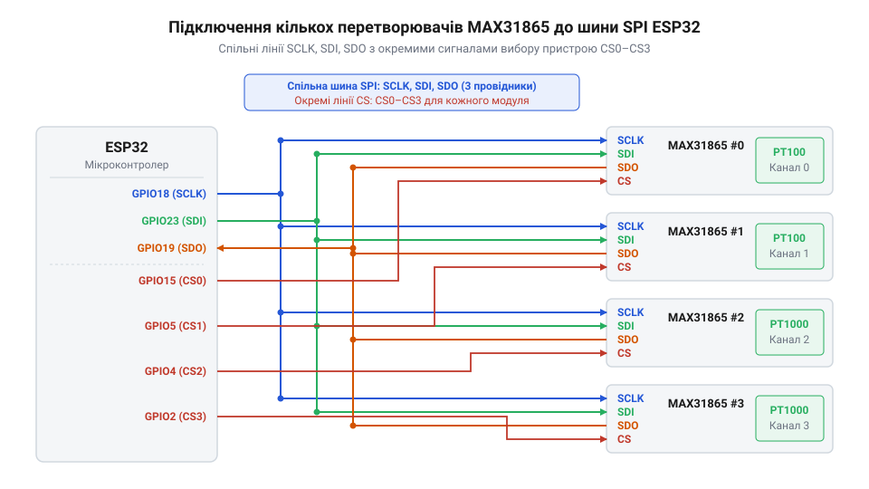
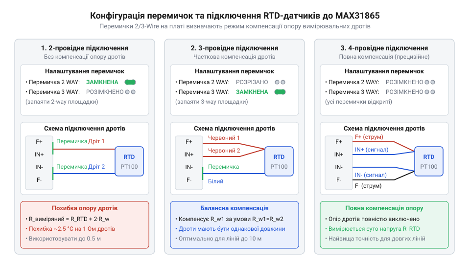

# Багатоканальний термометричний логер на ESP32 та модулях MAX31865 з підтримкою 2/3/4-провідних датчиків

<preknowlist>
- [PT100 — платиновий термоопір](root:cat-hw-sensors/pt100-rtd) — принцип зміни опору платини від температури та компенсація опору з'єднувальних дротів
- [Огляд родини резистивних перетворювачів температури RTD](root:cat-hw-sensors/rtd-resistance-temperature-detectors-family-overview) — відмінності між RTD PT100/PT1000 та схемами підключення 2/3/4 дротів
- [Стандарт IEC 60751 для платинових термоопорів](root:cat-hw-sensors/iec-60751-standard-for-rtd) — рівняння Каллендара-Ван Дюзена та класи точності платинових сенсорів
</preknowlist>

## Проблема багатоточкового вимірювання температури у промисловості

Точне вимірювання температури на віддалених об'єктах у промислових умовах ускладнюється великою довжиною ліній зв'язку та наявністю потужних електромагнітних завад. Звичайні аналогові давачі температури, такі як [LM35](root:cat-hw-sensors/lm35), втрачають точність через падіння напруги на опорі довгих провідників. Кожен метр мідного дроту додає власний опір до кола вимірювання. Коли йдеться про використання прецизійних [платинових термоопорів PT100](root:cat-hw-sensors/pt100-rtd), зміна опору яких становить менше 0.4 Ом на градус Цельсія, навіть частка ома додаткового опору дроту призводить до значної похибки в обчисленні температури.

Крім того, промислове середовище пронизане мережевими завадами з частотою 50 Гц від силового обладнання. Ці наведення додаються до слабкого корисного сигналу аналогового давача. Просте оцифрування такого сигналу звичайним АЦП мікроконтролера дає шумні та нестабільні значення. Виникає потреба в підсиленні сигналу та його фільтрації безпосередньо біля точки вимірювання. 

Розв'язанням цієї проблеми є використання спеціалізованих мікросхем-перетворювачів, які поєднують прецизійний АЦП, блок компенсації опору провідників та вбудовані цифрові фільтри. Перенесення оцифрування безпосередньо до датчика та використання індивідуальних цифрових інтерфейсів дозволяє передавати вже готові дані без спотворень незалежно від довжини комунікаційних ліній. Цифровий сигнал передається лінією у вигляді станів логічного нуля та одиниці з широкими межами допусків. Будь-яка аналогова завада або падіння напруги на довгому дроті прямо спотворюють безперервну величину. Цифровий приймач натомість безпомилково зчитує біт, якщо шум і втрати не виштовхують напругу за пороги перемикання. Завдяки цьому опір довгої лінії зв'язку та промислові наведення не погіршують точності переданого результату. Це відкриває шлях до побудови розподілених систем, де кожен вузол самостійно обробляє слабкий сигнал і віддає мікроконтролеру готове значення температури.

## Апаратна шинна архітектура логера MAX31865

Щоб зібрати дані з кількох просторово рознесених [платинових термоопорів PT100](root:cat-hw-sensors/pt100-rtd), потрібно об'єднати відповідні мікросхеми-перетворювачі в єдину мережу. Мікросхема MAX31865 має цифровий інтерфейс SPI, що дозволяє підключити багато таких перетворювачів до однієї спільної шини мікроконтролера, наприклад ESP32. У цій архітектурі лінії тактування SCK, передачі даних від мікроконтролера MOSI та прийому даних MISO є спільними для всіх пристроїв на шині.

*Схема підключення кількох MAX31865 до шини SPI. Спільні лінії даних та тактування поєднують усі модулі, тоді як окремі лінії CS забезпечують індивідуальну адресацію.*

Щоб мікроконтролер міг спілкуватися з конкретним перетворювачем, не заважаючи іншим, кожен модуль MAX31865 має вивід вибору кристала CS (Chip Select). ESP32 використовує окремі цифрові виходи для керування лінією CS кожного модуля. Коли мікроконтролер подає низький логічний рівень на лінію CS певного модуля, цей модуль активує свій інтерфейс і починає слухати спільну шину, тоді як інші модулі з високим рівнем на CS ігнорують сигнали й переводять свої виходи MISO у високоімпедансний стан, щоб не заважати передачі даних.

Точність перетворення в MAX31865 залежить від зовнішнього еталонного резистора Rref, відносно якого мікросхема вимірює опір датчика за допомогою ратіометричного методу. Суть методу полягає в тому, що генератор струму мікросхеми пропускає один і той самий вимірювальний струм послідовно через еталонний резистор та термоопір. Оскільки струм у послідовному колі однаковий, його абсолютне значення та можливі коливання взаємно скорочуються при діленні, а вбудований АЦП порівнює лише відношення падінь напруги на датчику й на еталоні. Завдяки цьому результат перетворення не залежить від дрейфу внутрішнього джерела струму чи шумів напруги живлення, проте повністю визначається точністю самого Rref. Для PT100 опір Rref зазвичай становить 430 Ом (або 400 Ом), що забезпечує оптимальний діапазон АЦП. Цей резистор має бути прецизійним, з допуском 0.1% і низьким температурним коефіцієнтом, оскільки його зміна від нагріву прямо спотворить обчислену температуру. Через це кожен модуль у системі обов'язково обладнується власним еталонним резистором.

## Комутація та налаштування різнопровідних RTD

Термоопори можуть підключатися за 2-, 3- або 4-провідною схемою. Двопровідна схема є найпростішою, але опір з'єднувальних дротів додається до опору сенсора, створюючи хибне підвищення температури. Трьохпровідна схема дозволяє частково компенсувати цей опір, пропускаючи струм через два дроти і вимірюючи напругу на третьому, за умови рівного опору всіх дротів. Чотирипровідна схема повністю усуває вплив дротів, оскільки вимірювальний струм тече через одну пару дротів, а напруга зчитується з іншої пари без струму.

*Апаратне конфігурування модуля MAX31865 під різну кількість провідників RTD. Зміна стану контактних майданчиків на платі забезпечує маршрутизацію вимірювального струму та сигналів напруги.*

Готові модулі з MAX31865 зазвичай мають контактні майданчики або перемички для конфігурування потрібної схеми. Для 4-провідної схеми всі перемички залишаються розімкнутими. Вимірювальний струм виходить з виводу FORCE+ і повертається у FORCE-, тоді як напруга знімається з виводів RTDIN+ та RTDIN-. Для 3-провідної схеми потрібно замкнути відповідні перемички на платі, що з'єднують FORCE+ і RTDIN+ всередині, та залишити один контакт для компенсаційного проводу. У 2-провідному режимі замикаються перемички, що з'єднують FORCE+ з RTDIN+ та FORCE- з RTDIN-, перетворюючи входи вимірювання напруги на ті самі точки, куди подається струм.

Окрім апаратної комутації, мікросхема потребує програмного налаштування. Під час ініціалізації мікроконтролер записує байти конфігурації у відповідний регістр MAX31865 через SPI. Залежно від підключення, біт 3 конфігураційного регістра визначає, чи використовується 3-провідна схема (значення 1) або 2/4-провідна (значення 0). Крім того, налаштовується частота відхилення мережевих завад (50 Гц або 60 Гц), що активує відповідний цифровий фільтр, та режим Vbias для увімкнення вимірювального струму.

## Цифрова фільтрація та діагностика несправностей

Навіть якщо вимірювальна лінія ідеально узгоджена і підключена за чотирипровідною схемою, на довгих провідниках все одно наводиться електромагнітна завада від промислової електромережі частотою 50 або 60 Гц. Якщо не пригнічувати цей шум, значення опору постійно коливатимуться, і точність вимірювання температури суттєво впаде. MAX31865 містить вбудований цифровий фільтр, який вирішує цю проблему на апаратному рівні. Він аналізує вхідний сигнал і «вирізає» з нього наведення на обраній частоті.

Щоб фільтр спрацював, необхідно записати конфігурацію в головний регістр мікросхеми. За замовчуванням MAX31865 налаштований на фільтрацію 60 Гц (стандарт Північної Америки), проте в більшості інших регіонів, включно з Україною, промислова мережа працює на частоті 50 Гц. Для перемикання фільтра потрібно змінити нульовий біт у конфігураційному регістрі. Після цього мікросхема автоматично відкидатиме періодичні завади мережі на цій частоті.

Проте завади — не єдина проблема при роботі в промисловому середовищі. Провідник може обірватися від механічного пошкодження, ізоляція може оплавитися, що спричинить коротке замикання лінії на землю, або ж опір платинового сенсора вийде за межі, які мікросхема здатна обробити. Щоб миттєво реагувати на ці аварійні ситуації, MAX31865 має регістр статусу помилок — @@en|Fault Status Register@@.

У нормальному стані мікросхема безперервно відстежує напругу на входах і порівнює їх із заданими порогами. Якщо виникає аварійна ситуація, вона виставляє відповідний біт у регістрі статусу помилок. Щоб перевірити стан каналу, достатньо прочитати цей регістр. Зокрема, у ньому відображаються такі біти: перевищення верхнього порогу (перегрів або обрив), падіння нижче нижнього порогу (переохолодження або замикання), а також наявність напруги поза робочим діапазоном на лініях вимірювання.

Для забезпечення безперервності роботи потрібно постійно перевіряти регістр помилок. Алгоритм простий: перед зчитуванням значення АЦП зчитуємо байт статусу. Якщо він дорівнює нулю — все гаразд, зчитуємо температуру. Якщо байт не дорівнює нулю — аналізуємо біти помилок і фіксуємо несправність, замість того, щоб зберігати хибне значення температури. Якщо помилка зникає (наприклад, контакт відновився), регістр потрібно очистити записом відповідної команди в конфігураційний регістр, інакше мікросхема «пам'ятатиме» про аварію. Детальну структуру та процедуру очищення описує стаття про [регістр статусу помилок](root:sf-devices/fault-status-register).

## Опитування каналів та передача в MQTT

Коли система має кілька каналів, їхнє почергове опитування в блокувальному режимі гальмує роботу мікроконтролера. Якщо чекати, поки кожен MAX31865 здійснить вимірювання і повідомить результат, процесор не зможе виконувати інші завдання. Щоб цього уникнути, на ESP32 слід побудувати асинхронний цикл опитування на базі неблокувальних таймерів.

Ідея полягає в тому, щоб надіслати команду вимірювання всім каналам одночасно або по черзі з мінімальною затримкою, не чекаючи відповіді. Далі мікроконтролер переходить до виконання інших завдань (наприклад, підтримки з'єднання Wi-Fi або обробки таймерів). Коли спливає час, потрібний MAX31865 для завершення конвертації (близько 65 мілісекунд при частоті 50 Гц), цикл повертається до мікросхем і по черзі забирає готові дані з їхніх регістрів. Це економить процесорний час і забезпечує швидке оновлення значень.

Зчитані з MAX31865 дані — це сире значення АЦП, яке пропорційне співвідношенню опору сенсора і еталонного резистора. Щоб отримати температуру, це значення треба перерахувати в опір (за формулою подільника напруги), а потім опір — у температуру за допомогою рівняння Каллендара-Ван Дюзена. Оскільки це рівняння є нелінійним і досить складним для частих обчислень, у мікроконтролерах зазвичай використовують його наближення або готові бібліотеки, які самі виконують цю математику. Математичну модель та методи її обчислення розкриває стаття про [рівняння Каллендара-Ван Дюзена](root:cat-hw-sensors/max31865-rtd-converter/math-callendar-van-dusen-equations.md).

Після отримання значень температури (або повідомлень про помилки) з усіх каналів їх потрібно надіслати на сервер. Для цього найчастіше використовується протокол MQTT, який ідеально підходить для пристроїв Інтернету речей. Щоб дані було легко розібрати на приймальному кінці, їх пакують у компактний JSON-об'єкт. Кожен датчик стає полем у цьому об'єкті, наприклад: `{"ch1": 24.5, "ch2": "fault", "ch3": 85.1}`.

Такий JSON-пакет ESP32 публікує у визначений топік MQTT-брокера. Завдяки цьому інші системи (наприклад, сервери розумного будинку або промислові SCADA) можуть підписатися на цей топік і одразу отримувати свіжі дані з термометричного логера. Асинхронний підхід до опитування і відправки дозволяє ESP32 одночасно підтримувати стабільне з'єднання та миттєво реагувати на будь-які несправності в вимірювальних лініях.