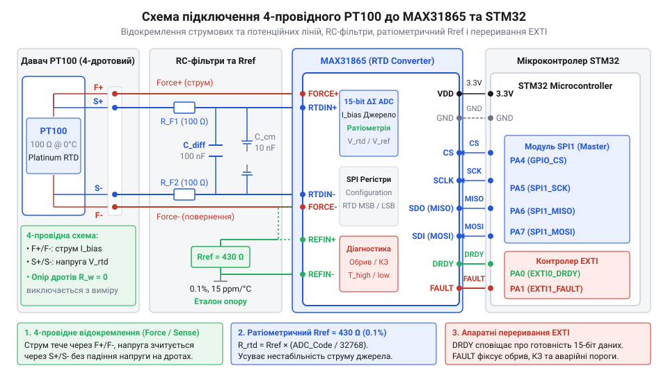
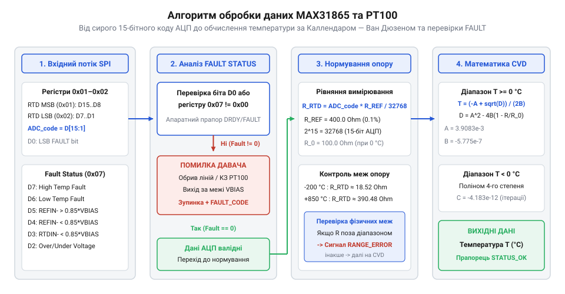

# Прецизійний промисловий вимірювач температури на STM32 та MAX31865 з 4-провідним PT100

<preknowlist>
- [PT100 — платиновий термоопір](root:cat-hw-sensors/pt100-rtd) — Фізичний принцип залежності опору платини від температури, базовий номінал 100 Ом та конструкція 4-провідного підключення
- [Огляд родини резистивних перетворювачів температури RTD](root:cat-hw-sensors/rtd-resistance-temperature-detectors-family-overview) — Класифікація резистивних давачів, порівняльні характеристики RTD та загальні принципи побудови вимірювальних кіл
- [Стандарт IEC 60751 для платинових термоопорів](root:cat-hw-sensors/iec-60751-standard-for-rtd) — Математичні коефіцієнти рівняння Каллендара — Ван Дюзена та класи точності платинових сенсорів
</preknowlist>

## 1. Похибки вимірювання температури довгими лініями

У промисловій автоматиці точне вимірювання температури є критично важливим завданням. Одним із найпоширеніших і найнадійніших давачів для цього є платиновий термоопір PT100. Його принцип дії базується на лінійній залежності електричного опору платини від температури, де базовий номінал становить рівно 100 Ом при 0 °C. Однак на практиці виникає серйозна проблема: у промислових умовах давач часто знаходиться на значній відстані від вимірювального приладу, і підключення здійснюється за допомогою довгих з'єднувальних дротів.

Якщо використовувати класичну 2-провідну схему підключення, опір самих дротів додається до опору термодавача. Наприклад, якщо опір мідного дроту становить 1 Ом, то загальний опір лінії складе 2 Ом. Для PT100 зміна опору на 1 Ом відповідає зміні температури приблизно на 2.6 °C. Таким чином, додатковий опір дротів у 2 Ом призведе до похибки вимірювання у понад 5 °C, що є абсолютно неприпустимим для прецизійних систем. Крім того, опір дротів сам по собі залежить від температури навколишнього середовища, що вносить додатковий температурний дрейф, який неможливо просто скомпенсувати програмно константою.

Класичне місткове вимірювання (міст Уітстона) частково вирішує проблему, але вимагає ретельного балансування і все одно страждає від температурного дрейфу аналогового тракту мікроконтролера, зокрема операційних підсилювачів та АЦП. Тому для досягнення високої точності необхідно відокремити струмові лінії (якими подається струм збудження) від потенційних (якими вимірюється падіння напруги). Саме такий підхід реалізовано у 4-провідному підключенні.

У 4-провідній схемі два дроти використовуються для протікання стабільного струму через давач, а два інших — для вимірювання напруги безпосередньо на виводах сенсора. Оскільки вхідний опір вимірювального тракту дуже високий, струм у потенційних лініях практично відсутній, отже падіння напруги на них дорівнює нулю. Це дозволяє повністю виключити вплив опору довгих з'єднувальних ліній на результат вимірювання.

Для реалізації такого підходу ідеально підходить спеціалізований перетворювач MAX31865. Ця мікросхема являє собою прецизійний АЦП, оптимізований спеціально для роботи з платиновими термоопорами (RTD). Вона бере на себе всі завдання зі збудження давача, вимірювання напруги за 4-провідною схемою та перетворення результату в цифровий код, мінімізуючи вплив зовнішніх факторів на точність.

## 2. Апаратне узгодження MAX31865 та STM32

Принципи побудови вхідного вимірювального кола MAX31865 базуються на використанні ратіометричного методу вимірювання. Замість того, щоб вимірювати абсолютне значення напруги на сенсорі, мікросхема порівнює напругу на термоопорі з напругою на прецизійному опорному резисторі Rref, через який протікає той самий струм збудження. Такий підхід робить вимірювання незалежним від точного значення струму та його флуктуацій.

Вибір номіналу Rref є критично важливим. Для давача PT100 зазвичай використовують прецизійний резистор опором 400 Ом або 430 Ом (допуск 0.1% або краще, з низьким температурним коефіцієнтом). Якщо використовується PT1000, Rref має становити 4000 Ом або 4300 Ом. Висока стабільність цього компонента безпосередньо визначає загальну точність системи.

Підключення 4-провідного PT100 до MAX31865 виконується таким чином: дві струмові лінії підключаються до виводів FORCE+ та FORCE-, а дві потенційні — до RTDIN+ та RTDIN-. Така конфігурація дозволяє мікросхемі точно вимірювати напругу безпосередньо на чутливому елементі.



Для зв'язку з мікроконтролером STM32 використовується стандартна шина SPI. Необхідно підключити чотири лінії: SCLK (тактування), MISO (дані від MAX31865 до STM32), MOSI (дані від STM32 до MAX31865) та CS (вибір кристала). Крім того, MAX31865 має два важливих цифрових виходи: DRDY (Data Ready), який сигналізує про завершення перетворення АЦП, та FAULT, який вказує на виявлення апаратної помилки (наприклад, обрив давача або коротке замикання напруги живлення).

У промислових умовах вхідні кола пристрою повинні бути захищені від електромагнітних завад та імпульсних перенапруг. Для цього на лініях підключення сенсора встановлюють RC-фільтри низьких частот для придушення високочастотних завад, а також TVS-діоди для захисту від статичної електрики (ESD) та наведених перенапруг. Також рекомендується розділяти аналогову та цифрову землі для зменшення цифрового шуму у вимірювальному тракті.

## 3. Конфігурування SPI та обробка переривань

Після завершення апаратної розробки переходимо до програмної частини — налаштування зв'язку між STM32 та MAX31865. Мікросхема має набір конфігураційних та інформаційних регістрів, основними з яких є регістр конфігурації (CONFIG), регістри даних АЦП (RTD MSB та LSB), а також регістри статусу помилок (FAULT STATUS).

SPI-периферія мікроконтролера STM32 повинна бути налаштована відповідно до вимог MAX31865. Мікросхема підтримує режим SPI 1 або 3, що означає налаштування полярності тактового сигналу (CPOL = 0) та фази (CPHA = 1). Дані передаються старшим бітом вперед (MSB First), а максимальна частота тактування може досягати 5 МГц, проте для більшої надійності зазвичай використовують 1-2 МГц.

MAX31865 може працювати у двох основних режимах перетворення: поодинокому (1-Shot) та безперервному (Auto-Conversion). У безперервному режимі мікросхема постійно виконує перетворення, оновлюючи регістри даних. Це зручно, але струм збудження постійно протікає через давач, що може призвести до його самонагріву і, відповідно, спотворення показників. У поодинокому режимі STM32 подає команду на вимірювання, мікросхема вмикає струм збудження, виконує перетворення, оновлює дані та вимикає струм. Це мінімізує самонагрів сенсора, що є критичним для прецизійних вимірювань.



Для оптимізації роботи мікроконтролера доцільно використовувати переривання. Сигнал DRDY підключається до виводу STM32, налаштованого як вхід зовнішнього переривання (EXTI). Коли MAX31865 завершує конверсію, він встановлює низький рівень на лінії DRDY. Мікроконтролер, отримавши переривання, може відразу зчитати готові дані через SPI, не витрачаючи час на постійне опитування регістра статусу (полінг).

Аналогічно, лінія FAULT підключається до іншого входу EXTI. При виникненні апаратної помилки (наприклад, обрив дроту, вихід опору за встановлені межі або замикання), MAX31865 активує цей сигнал. Обробник переривання STM32 може негайно зреагувати на збій, зчитати регістр FAULT STATUS для визначення причини помилки та перевести систему у безпечний режим, інформуючи оператора.

Завдяки правильному конфігуруванню SPI та ефективному використанню апаратних переривань досягається стабільне та швидке зчитування сирих 15-бітових даних, яке ляже в основу подальшого розрахунку температури.

Нижче наведено інтеграцію відповідного програмного коду на мові C та C++, який ілюструє ініціалізацію, зчитування та обробку даних драйвера:

:::code proj-max31865-stm32-rtd-meter/c/include/max31865.h
:::code proj-max31865-stm32-rtd-meter/c/include/sensor_app.h
:::code proj-max31865-stm32-rtd-meter/c/src/main.c
:::code proj-max31865-stm32-rtd-meter/c/src/max31865.c
:::code proj-max31865-stm32-rtd-meter/c/src/sensor_app.c

:::code proj-max31865-stm32-rtd-meter/cpp/include/max31865_sensor.hpp
:::code proj-max31865-stm32-rtd-meter/cpp/include/rtd_math.hpp
:::code proj-max31865-stm32-rtd-meter/cpp/src/main.cpp
:::code proj-max31865-stm32-rtd-meter/cpp/src/max31865_sensor.cpp

## 4. Математичний розрахунок температури та діагностика

Отримання цифрового коду від аналого-цифрового перетворювача MAX31865 — це лише перший крок на шляху до створення прецизійного вимірювального пристрою. Сирі дані 15-бітного АЦП необхідно правильно інтерпретувати, перетворивши їх спочатку на фізичне значення опору, а потім — на градуси Цельсія. Крім того, жорсткі промислові умови експлуатації вимагають постійного автоматичного контролю цілісності ліній зв'язку з датчиком.

Ратіометричний метод вимірювання, що використовується в архітектурі MAX31865, дозволяє розрахувати опір платинового термометра (RTD) як чітку пропорцію від прецизійного еталонного опору R_REF. Для 15-бітного АЦП базова математична формула має такий вигляд:
```
R_RTD = (ADC / 32768) * R_REF
```
де ADC — зчитане мікроконтролером 15-бітне значення. Такий підхід робить результати вимірювання абсолютно незалежними від нестабільності напруги живлення (VBIAS), оскільки і датчик, і еталонний резистор живляться від одного джерела, а вимірюється лише їхнє відношення.

Отримавши точне значення опору платини, наступним етапом є його конвертація безпосередньо в температуру. Фізична залежність опору платинового датчика від температури докладно описується рівнянням Каллендара — Ван Дюзена, коефіцієнти якого регламентовані міжнародним стандартом IEC 60751 (ITS-90). Ця залежність є нелінійною, і математичний розрахунок природно поділяється на два температурні діапазони:
1. **Для додатних температур (T >= 0 °C)** рівняння має вигляд `R_t = R0 * (1 + A * T + B * T^2)`. Знайти температуру T у цьому випадку можна через розв'язання звичайного квадратного рівняння:
```
T = (-A + sqrt(A^2 - 4 * B * (1 - R_t / R0))) / (2 * B)
```
   де константи A = 3.9083e-3, B = -5.775e-7, а R0 — це номінальний опір датчика при 0 °C (наприклад, рівно 100 Ом для PT100).

2. **Для від'ємних температур (T < 0 °C)** рівняння стає значно складнішим і включає додаткові члени вищих порядків `R_t = R0 * [1 + A * T + B * T^2 + C * (T - 100) * T^3]`, що ускладнює пряме аналітичне розв'язання на мікроконтролері. Найбільш ефективним способом розрахунку в embedded-системах є використання поліноміального наближення (наприклад, полінома 5-го степеня), яке забезпечує високу точність обчислень без надмірного навантаження на обчислювальне ядро процесора.

У наведеному коді функція `max31865_calculate_temperature` елегантно реалізує цей математичний апарат. Спочатку обчислюється відношення виміряного опору до номінального R0. Якщо це відношення більше або дорівнює одиниці (що відповідає T >= 0 °C), застосовується формула з дискримінантом квадратного рівняння. У випадку меншого відношення (T < 0 °C) температура прецизійно розраховується за поліноміальною моделлю.

Проте будь-які обчислення температури мають практичний сенс лише за умови повної справності датчика та його з'єднувальних ліній. Мікросхема MAX31865 оснащена надзвичайно потужною системою апаратної діагностики, яка безперервно контролює струм у вимірювальному колі та напругу на всіх диференційних входах. Результати цієї постійної діагностики зберігаються в спеціальному регістрі `FAULT_STATUS`. Серед основних помилок, які здатний апаратно зафіксувати перетворювач:
- `MAX31865_FAULT_HIGH_THRESH` та `LOW_THRESH` — вихід виміряного опору за встановлені користувачем межі. - `MAX31865_FAULT_REFIN_HIGH` та `REFIN_LOW` — помилки підключення еталонного резистора (обрив або неякісний контакт). - `MAX31865_FAULT_RTDIN_LOW` — обрив лінії самого термометра опору. - `MAX31865_FAULT_OV_UV` — вихід напруги живлення мікросхеми за допустимі безпечні межі.

Функція `max31865_read_raw` працює дуже ефективно: вона одразу перевіряє молодший біт D0 в регістрі даних (LSB), який слугує швидким індикатором наявності будь-якої помилки. Якщо цей прапорець встановлений, драйвер викликає окрему функцію зчитування регістра `FAULT_STATUS` для точного визначення конкретної причини збою. Це дозволяє системі керування миттєво реагувати на аварійні ситуації, гарантуючи безпеку всього технологічного процесу.

## 5. Інтеграція пристрою телеметрії та передача даних

Маючи надійний низькорівневий драйвер для зчитування сирих даних, потужний математичний модуль для розрахунку температури та систему автоматичної обробки апаратних помилок, наступним логічним кроком є об'єднання всіх цих розрізнених компонентів у цілісний пристрій телеметрії. Головна мета такого телеметричного вузла — регулярно, стабільно і з високою точністю вимірювати температуру та передавати її значення, а також розширену діагностичну інформацію на верхній рівень промислової мережі автоматизації (наприклад, через інтерфейси UART, RS-485 або CAN).

Архітектура програмного забезпечення вимірювального вузла базується на сучасному подійно-орієнтованому підході. Замість ресурсоємного та неефективного безперервного опитування (полінгу) мікросхеми MAX31865 через шину SPI, використовується лінія зовнішнього апаратного переривання `DRDY` (Data Ready). Коли аналого-цифровий перетворювач мікросхеми успішно завершує перетворення і нові валідовані дані готові до зчитування, логічний рівень на цій лінії падає до нуля. Мікроконтролер STM32 миттєво фіксує цей спад через апаратний модуль EXTI (External Interrupt/Event Controller) та викликає відповідне переривання.

У запропонованому файлі `sensor_app.c` детально реалізована логіка роботи телеметричного застосунку. Обробник переривання `sensor_app_on_drdy_interrupt` просто і безпечно встановлює програмний прапорець `drdy_flag`. В головному суперциклі системи (функція `sensor_app_process`) програма перевіряє цей прапорець. Якщо дані справді готові, ініціюється транзакція зчитування по SPI та наступний розрахунок температури за допомогою функції `max31865_read_temperature`. Такий асинхронний підхід кардинально вивільняє ресурси центрального процесора для виконання інших важливих задач і гарантує, що шина SPI ніколи не буде перевантажена марними опитуваннями.

Передача телеметричних даних реалізована за допомогою вбудованої периферії UART. Якщо вимірювальний цикл пройшов успішно і без помилок, функція `sensor_app_transmit_telemetry` формує зрозуміле текстове повідомлення, яке обов'язково містить унікальний номер ітерації вимірювання, поточну температуру в градусах Цельсія та точний розрахований опір датчика. Сформований інформаційний пакет негайно відправляється через послідовний порт. В реальних промислових SCADA-системах замість такого простого читабельного тексту зазвичай використовують жорстко стандартизовані протоколи, такі як Modbus RTU.

Особлива увага приділена реакції системи на різноманітні нештатні ситуації. Якщо під час зчитування драйвер виявляє встановлений біт апаратної помилки, система негайно призупиняє обчислення хибної температури і викликає спеціалізовану функцію `sensor_app_transmit_error`. Ця функція коректно розшифровує код із регістра статусу та відправляє розгорнуте діагностичне повідомлення про конкретний характер несправності на диспетчерський пульт. Після успішної фіксації та передачі інформації про помилку обов'язково викликається `max31865_clear_fault`, яка записує потрібний біт у конфігураційний регістр мікросхеми для скидання апаратних прапорців.

Запропонована комплексна архітектура гарантує найвищу надійність роботи в суворих промислових умовах експлуатації. Розроблений C/C++ драйвер та високорівневий застосунок є максимально гнучкими та легко масштабуються під конкретні інженерні потреби: за необхідності використання 4-провідної схеми компенсації або іншого типу платинового датчика достатньо лише змінити одну конфігураційну структуру під час стартової ініціалізації пристрою.