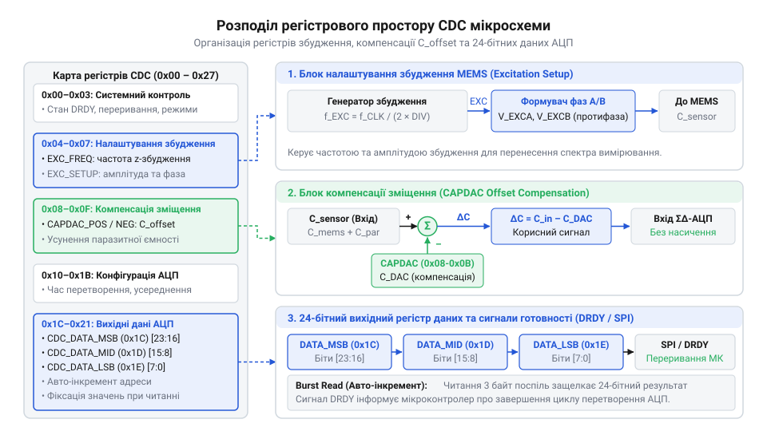
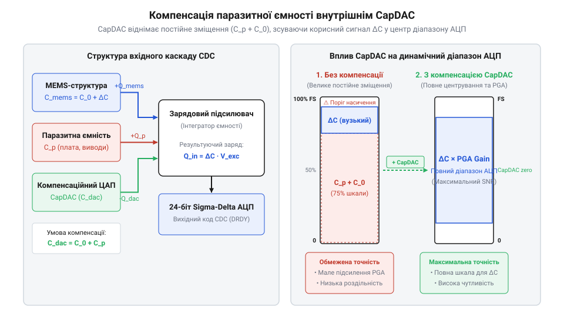

# Програмний інтерфейс та карта регістрів перетворювача ємності в цифру

<preknowlist>
- [ADXL345 — 3-осьовий цифровий акселерометр](root:cat-hw-sensors/adxl345) — принципи організації регістрової карти та протоколи послідовного зв'язку I2C/SPI в цифрових MEMS-давачах.
- [Підсистема Industrial I/O (IIO) в ядрі Linux](root:cat-hw-sensors/iio-subsystem-linux-kernel) — концепція високорівневої абстракції драйверів та обробка буферизованих ємнісних каналів у системі.
</preknowlist>

## Проблема вимірювання фемтофарадних змін ємності

У мікроелектромеханічних системах (MEMS) чутливий елемент реалізують у вигляді рухомого мікроскопічного електрода, що утворює з нерухомою обкладкою змінний конденсатор. Коли пристрій зазнає прискорення або нахилу, інерційна маса зміщується, змінюючи зазор між обкладками. Ці зазори вимірюються нанометрами, а відповідні зміни ємності становлять фракції фемтофарада (від дан. @@da|femten@@ — п'ятнадцять та прізвища фізика @@en|Faraday@@; 1 фФ = 10⁻¹⁵ Ф). Наприклад, цифровий [акселерометр ADXL345](root:cat-hw-sensors/adxl345) фіксує зміщення обкладок, що викликають зміну ємності порядка одиниць або часто часток фемтофарада.

Головна перешкода прямого вимірювання таких малих величин полягає в тому, що звичайні друковані плати та вхідні виводи мікроконтролерів володіють власною фізичною ємністю. Паразитна ємність (@@en|parasitic capacitance@@, від грец. @@el|parasitos@@ — нахлібник) контактних майданчиків, трас провідників та вхідних польових транзисторів становить від 2 до 15 пікофарад (1 пФ = 10⁻¹² Ф). Це в тисячі разів перевищує корисний динамічний діапазон MEMS-структури. Спроба підключити таку систему безпосередньо до входу звичайного аналого-цифрового перетворювача (АЦП) послідовного наближення призводить до того, що паразитна ємність повністю шунтує вхідний сигнал, а фонові наводки та шуми живлення викликають миттєве насичення (@@en|saturation@@) аналогового тракту.

Для виділення фемтофарадних змін на тлі величезного постійного фону потрібна спеціалізована мікросхема — перетворювач ємності в цифру (CDC, від @@en|Capacitance-to-Digital Converter@@, від лат. @@la|capacitas@@ — місткість та англ. @@en|digital@@ — цифровий). Пряме абсолютне вимірювання (від лат. @@la|absolutus@@ — безумовний) оцінює повну ємність `C = C₀ + ΔC + C_параз`, де корисний приріст `ΔC` маскується гігантським фоном, а будь-який температурний дрейф фонового значення викликає зміщення нуля або насичення АЦП. Натомість диференційне вимірювання (від лат. @@la|differentia@@ — різниця) у мостовій схемі (@@en|bridge circuit@@, від дав.-англ. @@ang|brycg@@ — міст) спирається на два симетричні елементи `C₁ = C₀ + ΔC` та `C₂ = C₀ - ΔC`. Під час подачі протифазних збуджувальних сигналів синфазна паразитна ємність та фонова складова `C₀` взаємно нейтралізуються у вимірювальному вузлі, залишаючи для оцифрування лише чисте диференційне відхилення `ΔC`. CDC використовує апаратні схеми на перемикальних конденсаторах (@@en|switched-capacitor circuit@@) для інтегрування цього різницевого заряду. Щоб керувати високовольтним збудженням, програмувати піддіапазони чутливості та апаратно компенсувати залишкове зміщення до його потрапляння на АЦП, розробники інтегрують у CDC гнучку карту регістрів. Взаємодія з цією картою через послідовні інтерфейси зв'язку становить основу програмування ємнісних давачів. Детальніше про принцип зарядового підсилення та побудову комутованих ємнісних мостів читайте у матеріалі про [аналоговий фронтенд на перемикальних конденсаторах для MEMS-давачів](root:cat-hw-sensors/mems-capacitive-sensing-principles/math-switched-capacitor-readout.md).

## Архітектура карти регістрів перетворювача ємності

Пам'ять CDC-перетворювача організована у вигляді таблиці 8-бітних регістрів, доступних за фіксованими адресами через шини I2C або SPI. Функціонально карта регістрів розділена на чотири ключові зони: керування конфігурацією, налаштування генераторів збудження, апаратна компенсація зміщення та буфери вихідних даних АЦП.


*Розподіл пам'яті CDC-перетворювача на функціональні блоки конфігурації, компенсації та даних.*

Адресний простір починається з конфігураційних регістрів (@@en|control registers@@), які визначають режим роботи мікросхеми, частоту дискретизації та коефіцієнт підсилення. За ними йдуть регістри генератора збуджувального сигналу (@@en|excitation signal@@, від лат. @@la|excitare@@ — пробуджувати), де задається амплітуда та частота імпульсів перемикання. Окремий блок займають регістри компенсаційного ЦАП (CAPDAC, від @@en|Capacitance DAC@@), який підключає внутрішні калібрувальні ємності паралельно до вимірювальних каналів. Нарешті, область вихідних даних складається з кількох послідовних 8-бітних комірок (наприклад, `DATA_MSB`, `DATA_MID`, `DATA_LSB`), що утворюють підсумкове 24-бітне значення виміряної ємності.

Оскільки результати вимірювання АЦП охоплюють 24 біти, зчитування окремих байтів у різний час може призвести до розриву цілісності даних, якщо АЦП оновить регістри всередині циклу читання. Тому CDC підтримує мультибайтові або пакетизовані (@@en|burst read@@) операції. При груповому читанні мікросхема фіксує (@@en|latch@@) поточний стан усіх трьох байтів даних у внутрішній теневий буфер у момент адресації першого байта `DATA_MSB`.

## Налаштування збудження та піддіапазонів ємності

Вимірювання ємності у змінострумових мостах CDC базується на циклічному перезаряджанні MEMS-конденсатора під дією прямокутного збуджувального сигналу. Генератор збудження CDC подає на електрод сенсора протифазні імпульси з програмованою амплітудою `V_exc` та частотою `f_exc`. Середній струм заряджання `I_avg`, який протікає через чутливий елемент і надходить на вхід інтегратора, прямо пропорційний вимірюваній ємності `C_m`:

```
I_avg = C_m · V_exc · f_exc
= (1.5 × 10⁻¹⁵ F) · 3.3 V · (32 × 10³ Hz)    [підстановка параметрів]
= 1.584 × 10⁻¹⁰ A                           [обчислення струму]
```

Частота тактування `f_exc` є критичним параметром конфігурації. Її обирають так, щоб вона була суттєво вищою за механічну смугу пропускання MEMS-елемента, але нижчою за його власні механічні резонанси. Якщо частота збудження збігається з резонансною частотою підвісу маси, виникає механічний резонанс (@@en|resonance@@) та паразитна акустична наводка. Крім того, невідповідність частоти дискретизації викликає накладання спектрів (аліасинг, @@en|aliasing@@, від лат. @@la|alias@@ — інше ім'я), при якому високочастотні шуми середовища трансформуються в низькочастотні коливання відліків АЦП.

Регістри піддіапазонів ємності (@@en|full-scale range@@, FSR) визначають максимальний динамічний діапазон АЦП (наприклад, ±0.5 пФ, ±1.0 пФ або ±4.0 пФ). Вибір вужчого діапазону підвищує роздільну здатність на один молодший значущий розряд (@@en|LSB@@, від @@en|Least Significant Bit@@), проте створює ризик швидкого заходження АЦП у насичення при температурному дрейфі або сильних механічних ударах.

## Калібрування зміщення та компенсація паразитної ємності

У реальних пристроях фонова @@en|parasitic capacitance@@ монтажу досягає значень, які в десятки разів перевищують робочий діапазон FSR самого АЦП. Якщо діапазон вимірювання становить ±1 пФ, а паразитне зміщення плати становить 8.5 пФ, аналоговий інтегратор миттєво перезавантажиться, і АЦП видасть максимальний код @@en|saturation@@.


*Апаратна нейтралізація паразитної ємності за допомогою компенсаційного ЦАП для збереження динамічного діапазону АЦП.*

Для нейтралізації цього ефекту CDC містить вбудований компенсаційний ЦАП ємності (CAPDAC). CAPDAC складається з масиву високоточних внутрішніх конденсаторів, які за командою з регістрів зміщення підключаються у протифазі до вимірювального входу. Це дозволяє «відняти» постійний струм паразитної ємності ще до його підсилення й оцифровки, повертаючи корисний змінний сигнал у середину шкали АЦП. Така методика апаратної компенсації в підсистемі [Industrial I/O в ядрі Linux](root:cat-hw-sensors/iio-subsystem-linux-kernel) реалізується через процедуру первинного калібрування зсуву (@@en|offset calibration@@).

Алгоритм програмного калібрування зміщення виконується під час ініціалізації пристрою:
1. Записати 0 у регістри CAPDAC і встановити максимальний динамічний діапазон FSR. 2. Прочитати сирий код АЦП та обчислити значення фонової ємності `C_parasitic`. 3. Розрахувати необхідне значення кроків CAPDAC: `N_capdac = floor(C_parasitic / C_step)`, де `C_step` — дискрета ємності CAPDAC (наприклад, 0.32 пФ). 4. Записати отриманий код у регістри компенсації зміщення (`CAPDAC_OFFSET`). 5. Зменшити FSR до оптимального значення, досягаючи максимальної чутливості до фемтофарадних відхилень.

## Зчитування даних та обробка переривань готовності

Періодичне опитування (@@en|polling@@) регістрів даних через послідовну шину завантажує процесор та створює невизначеність у часових інтервалах дискретизації. Для синхронізації зчитування CDC формує апаратний сигнал готовності даних на окремому виводі `DRDY` (від @@en|Data Ready pin@@). Коли сигма-дельта АЦП завершує новий цикл інтегрування, вивід `DRDY` переходить у низький логічний рівень, генеруючи переривання в мікроконтролері.

Усередині обробника переривань (ISR) або пов'язаного з ним фонового потоку виконується мультибайтове читання регістрів. Зчитане 24-бітне беззнакове ціле число `N_raw` перетворюється на фізичне значення ємності `C_val` за формулою відносного масштабування:

```
C_val = ((N_raw - N_zero) ÷ (2²⁴ - 1)) × Range_FSR
= ((12582912 - 8388608) ÷ 16777215) × 4.0 pF    [підстановка кодів АЦП]
= (4194304 ÷ 16777215) × 4.0 pF                [різниця відносно нуля]
= 0.25 × 4.0 pF                                [відносний коефіцієнт]
= 1.0 pF                                       [підсумкова виміряна ємність]
```

де `N_zero = 8388608` (2²³) відповідає нульовому зміщенню в середній точці шкали для двополярного вимірювання.

Нижче наведено приклад реалізації модуля зчитування даних та обробки переривань `DRDY` для мікроконтролерних систем на мовах C та C++.

:::tabs
@tab C (ESP-IDF)
:::code api-mems-capacitive-cdc-register-interface/c/esp-idf/cdc-drdy-isr-handler.c
@tab C++ (Arduino)
:::code api-mems-capacitive-cdc-register-interface/cpp/arduino/cdcconverter.cpp
:::

## Керування живленням та обробка граничних станів

Неперервна генерація збуджувального сигналу та робота високорозрядного АЦП супроводжуються постійним споживанням струму до 1.5–3 мА, що неприпустимо для автономних пристроїв із батарейним живленням. CDC підтримує кілька режимів енергозбереження: сну (@@en|power-down mode@@), очікування (@@en|standby mode@@) та циклічного вимірювання (@@en|duty-cycled mode@@). У режимі циклічного вимірювання мікросхема самостійно прокидається за внутрішнім таймером, активує аналоговий фронтенд, виконує один цикл оцифровки, подає імпульс на вивід `DRDY` та миттєво повертається в режим сну зі споживанням менше 1 мкА.

Надійність розробленого драйвера залежить від обробки виняткових і граничних станів (@@en|fault detection@@). Під час експлуатації давача можуть виникати такі збої:
- **Переповнення АЦП (@@en|overflow@@):** Якщо вимірювана ємність виходить за межі обраного FSR, біт `EXC_OVERRUN` або `ADC_SATURATION` у регістрі статусу встановлюється в 1. Драйвер повинен виявити цей прапорець, розширити FSR або збільшити від'ємне зміщення в CAPDAC. - **Обрив електродів:** При механічному пошкодженні плати або руйнуванні MEMS-структури виміряна ємність падає до нуля або виходить за допустимі технологічні межі. Зчитування крайніх кодів (`0x000000`) використовується як індикатор апаратної несправності. - **Збої послідовного інтерфейсу:** Проведення вимірювань у сильних електромагнітних полях може призвести до зависання шини I2C. Драйвер повинен періодично перевіряти регістр ідентифікації чипа (`CHIP_ID`), а при відсутності відповіді виконувати програмний скид через біт `SOFT_RESET` або циклічне перемикання лінії CS шини SPI.

Реалізація повного циклу — від апаратного скиду та компенсації паразитної ємності плати до неблокуючого зчитування за перериваннями та обробки збоїв — забезпечує створення стабільного виробничого API для керування будь-якими MEMS-перетворювачами ємності в цифру.