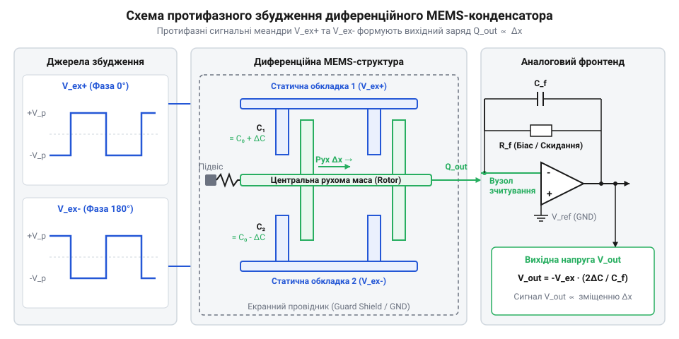
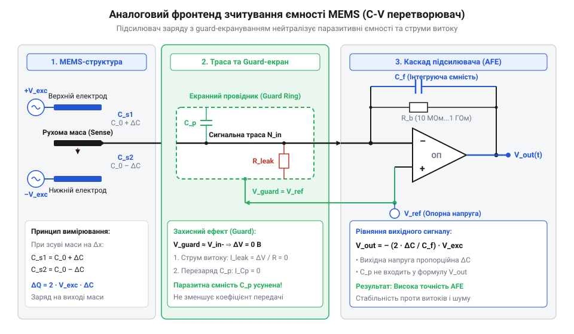

# Залізний інтерфейс та схема підключення ємнісної MEMS-структури

<preknowlist>
- [GY-61 ADXL335](root:cat-hw-sensors/adxl335) — будова аналогових виходів та принцип отримання вихідної напруги, пропорційної прискоренню.
- [ADXL345](root:cat-hw-sensors/adxl345) — розуміння інтеграції ємнісної MEMS-структури з внутрішнім ASIC та АЦП.
</preknowlist>

## Паразитивні ємності нищать мікровольтний сигнал

Коли інженер намагається зняти сигнал безпосередньо з виводів первинної ємнісної @@en|MEMS@@ (від @@en|microelectromechanical systems@@ — мікроелектромеханічні системи) структури за допомогою звичайного вимірювального підсилювача чи АЦП, корисний сигнал повністю зникає. Усі розрахункові мікровольти вихідної напруги розчиняються у шумах, а відгук на механічне зміщення стає практично невідчутним. Чому так відбувається, якщо математична модель змінення ємності виглядає абсолютно прозорою?

Причина полягає у співвідношенні між базовою ємністю сенсора та паразитивними параметрами друкованої плати @@en|PCB@@ (від @@en|printed circuit board@@ — друкована плата). Внутрішня ємність MEMS-конденсатора `C₀` вимірюється у пікофарадах або навіть фемтофарадах (зазвичай від `0.5 pF` до `2 pF`), а зміна ємності `ΔC` під дією прискорення становить лише від `0.1 fF` до `10 fF` (`10⁻¹⁶`–`10⁻¹⁴ F`). Для поглибленого вивчення механічних підвісів роторної маси та первинного рівняння ємності дивіться матеріал про [фізику ємнісного MEMS-перетворювача](root:hw-sensing/mems-capacitive-transducer-physics).

Якщо підключити таку структуру до високоімпедансного входу підсилювача, вхідний каскад разом із трасами плати утворює паразитивну ємність `C_p` відносно землі. Ця ємність складається з ємності контактних майданчиків, трасувальних ліній та вхідних виводів мікросхеми. Зазвичай `C_p` становить від `2 pF` до `10 pF`, що перевищує власну ємність сенсора `C₀` у кілька разів.

Оцінимо амплітуду вихідного сигналу при прямому підключенні через дільник напруги з джерелом постійного біасу `V_bias`. Припустимо, потенціал збудження становить `V_bias`, початкова ємність `C₀`, паразитивна ємність `C_p`, а зміна ємності від зміщення маси `ΔC`. Зміна напруги на вихідній трасі `ΔV` обчислюється через перерозподіл електричного заряду:

`ΔV`
`= V_bias · (ΔC / (C₀ + C_p))`      [формула ємнісного дільника]

Оскільки паразитивна ємність `C_p` суттєво більша за `C₀`, знаменник дробу зростає у `5`–`10` разів. Сигнал `ΔV`, який і без того становить мікровольти, зменшується на порядки.

Додатковим руйнівним чинником є струми витоку `I_leak` через діелектрик друкованої плати. Опір ізоляції `R_ins` між сусідніми трасами плати FR-4 за умов підвищеної вологості може падати до `10⁹ Ω`–`10¹⁰ Ω`. Навіть при напрузі живлення `3.3 V` струм витоку досягає наноамперів, що на кілька порядків перевищує струми перезаряду фемтофарадних ємностей MEMS-структури.

На відміну від готових рішень, таких як [аналоговий акселерометр ADXL335](root:cat-hw-sensors/adxl335) чи повністю інтегрований [цифровий модуль ADXL345](root:cat-hw-sensors/adxl345), де первинний перетворювач розміщено безпосередньо на одному кристалі з @@en|ASIC@@ (від @@en|application-specific integrated circuit@@ — спеціалізована інтегральна схема), дискретне підключення MEMS-структури вимагає суворого розділення шляхів збудження та зчитування. Потрібно побудувати низькоімпедансний тракт для джерел збудження та ізольований високоімпедансний аналоговий фронтенд @@en|AFE@@ (від @@en|analog front-end@@ — аналоговий фронтенд), який унеможливить перерозподіл заряду на паразитивну ємність `C_p`.

## Схемотехніка диференційної структури та збудження

Щоб усунути вплив нестабільності постійної напруги біасу та мінімізувати синфазні завади, ємнісну MEMS-структуру виконують у вигляді диференціального конденсатора з трьома виводами. Структура складається з двох нерухомих обкладок — статорів @@en|stator@@ — та центральної рухомої маси — ротора @@en|rotor@@.

Схемотехнічно диференційна ємнісна структура утворює ємнісний напівміст. Дві статичні обкладки `CS1` та `CS2` підключаються до протифазних джерел високочастотного змінного сигналу збудження, а центральна рухома маса `CM` є вихідним вузлом зчитування.

*Принципова схема підключення протифазних джерел збудження до двох статичних обкладок диференційної MEMS-структури та зняття сигналу з роторної маси.*

Джерела збудження генерують протифазні прямокутні або синусоїдальні сигнали одинакової амплітуди `V_exc` на несучій частоті `ω_c` (зазвичай від `100 kHz` до `1 MHz`). Напруга першого джерела становить `V_exc1(t) = +V_exc · sin(ω_c · t)`, а другого — `V_exc2(t) = -V_exc · sin(ω_c · t)`.

Визначимо вихідний струм `I_cm`, що витікає з центральної рухомої маси у вхідний вузол зчитування. Позначимо ємність між першим статором і ротором як `C1`, а між другим статором і ротором як `C2`. За відсутності зовнішнього прискорення маса розташована рівновіддалено від обкладок, тому `C1 = C2 = C₀`. За наявності зміщення `Δx` ємності змінюються диференційно: `C1 = C₀ + ΔC`, а `C2 = C₀ - ΔC`.

Знайдемо сумарний струм `I_cm`, який подається на вхід зчитувального фронтенду:

`I_cm(t)`
`= d(Q1 + Q2) / dt`                                      [закон збереження заряду]
`= d(C1 · V_exc1 + C2 · V_exc2) / dt`                     [вираження заряду через ємність та напругу]
`= d((C₀ + ΔC) · V_exc · sin(ω_c · t) - (C₀ - ΔC) · V_exc · sin(ω_c · t)) / dt`  [підстановка протифазних сигналів]
`= d(2 · ΔC · V_exc · sin(ω_c · t)) / dt`                 [скорочення синфазного доданку C₀]
`= 2 · ΔC · V_exc · ω_c · cos(ω_c · t)`                  [диференціювання за часом]

З отриманого виразу видно дві критичні властивості диференційного збудження:
1. Базова ємність `C₀` повністю взаємно знищується завдяки протифазності сигналів збудження. Струм на несучій частоті виникає лише тоді, коли є корисне зміщення `ΔC ≠ 0`. 2. Амплітуда вихідного струму прямо пропорційна несучій частоті `ω_c`. Використання високочастотної несучої (наприклад, `500 kHz`) переносить низькочастотний механічний сигнал у область вищих частот, де флікер-шум (шум `1/f`) аналогових транзисторів є мінімальним.

Для запобігання паразитивному ємнісному зв'язку між високоамплітудними трасами збудження `CS1`/`CS2` та чутливим виводом `CM` у структурі передбачають додаткові виводи для екранування. Ці виводи підключають до екранних провідників на платі. Отриманий високоімпедансний струмовий сигнал з центральної маси `CM` далі подається на первинний підсилювач.

## Аналоговий фронтенд зчитування та біасування

Оскільки роторна маса `CM` є високоімпедансним джерелом струму, для її узгодження застосовують підсилювач заряду @@en|charge amplifier@@ (також відомий як перетворювач ємності в напругу @@en|C-V converter@@, від @@en|capacitance-to-voltage converter@@). Головна задача цього каскаду — усунути вплив паразитивної ємності монтажу `C_p` шляхом створення віртуальної землі @@en|virtual ground@@ на вхідній трасі.

*Структура аналогового фронтенду на базі підсилювача заряду, де еталонна ємність зворотного зв'язку фіксує віртуальну землю на вхідній трасі.*

Аналоговий фронтенд будується на базі операційного підсилювача @@en|op-amp@@ (від @@en|operational amplifier@@ — операційний підсилювач) із польовими транзисторами на вході (@@en|JFET@@ або @@en|CMOS@@), які забезпечують наднизькі вхідні струми біасування (на рівні фемтоамперів). Інвертувальний вхід підсилювача підключається до центральної маси MEMS, а неінвертувальний вхід фіксується на опорній напрузі `V_ref` (чи на землі `0 V`). Докладніше про критерії вибору мікросхем, вхідні струми біасування та рівні шуму ОП читайте у матеріалі про [вибір операційного підсилювача для підсилювачів заряду](root:hw-analog/charge-amplifier-opamp-selection).

У кола зворотного зв'язку між виходом підсилювача та інвертувальним входом паралельно вмикаються еталонна ємність `C_f` та високоомний резистор біасу `R_f`. Завдяки глибокому негативному зворотному зв'язку операційний підсилювач підтримує потенціал інвертувального входу рівним `V_ref`. Потенціал траси рухомої маси залишається нерухомим, тому паразитивна ємність `C_p` між цією трасою та землею не перезаряджається (`ΔV_Cp = 0`) і не відбирає струм корисного сигналу!

Обчислимо вихідну напругу `V_out(t)` аналогового фронтенду. Вся зміна заряду `ΔQ = 2 · ΔC · V_exc · sin(ω_c · t)` з центральної маси тече не в паразитивну ємність чи у вхід підсилювача, а виключно у конденсатор зворотного зв'язку `C_f`:

`V_out(t)`
`= V_ref - (1 / C_f) · ∫ I_cm(t) dt`                   [інтегрування струму заряду на ємності]
`= V_ref - (1 / C_f) · (2 · ΔC · V_exc · sin(ω_c · t))` [підстановка виразу струму збудження]
`= V_ref - 2 · V_exc · (ΔC / C_f) · sin(ω_c · t)`        [остаточна напруга на виході C-V перетворювача]

З вираженого рівняння слідують важливі схемотехнічні висновки:
1. Коефіцієнт підсилення задається співвідношенням `ΔC / C_f` і не залежить від паразитивної ємності монтажу `C_p`. 2. Величина еталонної ємності `C_f` вибирається у межах від `1 pF` до `10 pF`. Зменшення `C_f` збільшує чутливість схеми, проте надто мале значення `C_f` робить коефіцієнт передачі чутливим до розкиду прохідної ємності @@en|feedthrough capacitance@@ самого підсилювача.

Резистор зворотного зв'язку `R_f` є критичним елементом для забезпечення постійної складової біасу вхідного каскаду. Без нього вхідний струм біасування операційного підсилювача повільно зарядить ємність `C_f`, що призведе до насичення виходу (@@en|saturation@@).

Опір `R_f` обирають надвисоким — від `10 MΩ` до `1 GΩ`. Разом із ємністю `C_f` він утворює фільтр високих частот у колі зворотного зв'язку з зрізом на частоті:

`f_hp`
`= 1 / (2 · π · R_f · C_f)`                             [частота зрізу ФВЧ біасування]

Щоб фільтр не послаблював корисну модульовану несучу `ω_c`, частота зрізу `f_hp` повинна бути у сотні разів нижчою за несучу `f_c = ω_c / (2 · π)`. Наприклад, при `C_f = 2 pF` та `R_f = 100 MΩ` частота зрізу становить `f_hp ≈ 795 Hz`, що гарантує збереження амплітуди модульованого сигналу на частотах збудження `100 kHz`–`500 kHz`.

## Топологія плати та охоронні кільця

Навіть при ідеальній схемотехніці аналогового фронтенду реальні характеристики вимірювального вузла залежать від топології друкованої плати. Фізична поверхня текстоліту FR-4 схильна до адсорбції вологи та забруднень, через що виникають поверхневі струми витоку. Крім того, близьке розташування високоамплітудних трас збудження до вхідної траси створює паразитивний ємнісний зв'язок через повітря та діелектрик.

Основним методом придушення поверхневих струмів витоку є застосування охоронних кілець @@en|Guard Ring@@. Охоронне кільце — це мідний провідник на платі, який повністю оточує високоімпедансну сигнальну трасу центральної маси `CM` та вхідний вивід операційного підсилювача.

Принцип дії охоронного кільця полягає у підтримці на ньому потенціалу, строго рівного потенціалу сигнальної траси. Оскільки інвертувальний вхід C-V перетворювача знаходиться під потенціалом віртуальної землі `V_ref`, на охоронне кільце подають ту саму напругу `V_ref` від низькоімпедансного джерела (наприклад, з неінвертувального входу підсилювача).

Обчислимо поверхневий струм витоку `I_leak` між сигнальною трасою з потенціалом `V_sig` та охоронним кільцем з потенціалом `V_guard` через опір поверхневого діелектрика `R_surf`:

`I_leak`
`= (V_sig - V_guard) / R_surf`                           [закон Ома для поверхневого витоку]
`= (V_ref - V_ref) / R_surf`                            [рівність потенціалів сигнальної траси та кільця]
`= 0`                                                   [повне усунення витоку]

Оскільки різниця потенціалів між сигнальною трасою та охоронним кільцем дорівнює нулю (`ΔV = 0`), струм витоку через опір ізоляції `R_surf` не виникає незалежно від вологості чи забруднення плати. Усі зовнішні струми витоку з боку шин живлення або ліній збудження перехоплюються низькоімпедансним охоронним кільцем і скидаються у джерело `V_ref`.

При трасуванні друкованої плати для ємнісного MEMS-інтерфейсу необхідно дотримуватися таких топологічних правил:
1. Симетричність трасування ліній збудження: траси `CS1` та `CS2` повинні мати однакову довжину, ширину та однаковий зазор до вхідної траси `CM`. Це забезпечує рівність паразитивних прохідних ємностей `C_p1 = C_p2`, збереження якої критичне для коефіцієнта пригнічення синфазного сигналу @@en|CMRR@@ (від @@en|common-mode rejection ratio@@ — коефіцієнт пригнічення синфазного сигналу). 2. Вирізання внутрішніх шарів землі (@@en|ground plane relief@@): під високоімпедансним вхідним майданчиком `CM` та трасою зворотного зв'язку видаляють суцільні шари заземлення у внутрішніх шарах плати. Це мінімізує паразитивну ємність відносно землі `C_g`. 3. Захисна маска та очищення: з ділянки охоронного кільця та сигнальної траси вилучають паяльну маску (@@en|solder mask@@), оскільки покриття маски може накопичувати об'ємний заряд. Після монтажу плата підлягає ультразвуковому відмиванню від залишків флюсу та покриттю конформним лаком.

## Захист від електростатики та паразити

Тонкі кремнієві підвіси та мікроскопічні зазори (близько `1`–`2 μm`) у ємнісній MEMS-структурі роблять її вкрай чутливою до електростатичного розряду @@en|ESD@@ (від @@en|electrostatic discharge@@ — електростатичний розряд). Напруга понад `30`–`50 V` між обкладками може спричинити електростатичний прибій (@@en|stiction@@) або пробій повітряного мікропроміжку. Однак традиційне підключення стандартних захисних діодів чи супресорів @@en|TVS@@ (від @@en|transient voltage suppressor@@ — супресор обмежувача напруги) неприпустиме через їхню високу бар'єрну ємність `C_j` (від `5 pF` до `30 pF`).

Впровадження захисту вимагає багатобар'єрної схеми з мінімізацією паразитивної ємності:

1. Використання наднизькоємнісних ESD-супресорів: для захисту ліній застосовують спеціалізовані полімерні або напівпровідникові супресори з паразитивною ємністю `C_j < 0.1 pF` (наприклад, серій @@en|NXP IP425x@@ або @@en|Semtech RClamp@@). Вони підключаються між лініями збудження `CS1`/`CS2` та землею. 2. Послідовні струмообмежувальні резистори `R_lim`: у коло сигнальної траси `CM` між виводом сенсора та входом операційного підсилювача вмикають резистор опором `100 Ω`–`1 kΩ`. Разом із власною ємністю вхідних діодів підсилювача він розсіює енергію високочастотного імпульсу ESD.

Обчислимо граничну частоту зрізу low-pass фільтра `f_cut`, утвореного обмежувальним резистором `R_lim` та залишковою ємністю захисного елемента `C_esd`:

`f_cut`
`= 1 / (2 · π · R_lim · C_esd)`                        [частота зрізу захисного ФНЧ]

При `R_lim = 470 Ω` та `C_esd = 0.1 pF` частота зрізу становить:

`f_cut`
`= 1 / (2 · 3.14159 · 470 · 0.1 · 10⁻¹²)`                [підстановка числових значень]
`≈ 3.388 × 10⁹ Hz`                                      [обчислення результату у герцах]
`≈ 3.39 GHz`                                            [значення у гігагерцах]

Отримане значення `f_cut ≈ 3.39 GHz` перебуває на кілька порядків вище за робочу несучу частоту збудження `ω_c` (`100 kHz`–`1 MHz`). Це означає, що такий схемотехнічний захист ефективно гасить високовольтні ESD-імпульси з наносекундними фронтами, не спотворюючи амплітудно-частотну характеристику корисного вимірювального тракту.

Завдяки поєднанню протифазного збудження, C-V перетворювача, охоронних кілець на платі та наднизькоємнісного ESD-захисту формується закінчений залізний інтерфейс ємнісної MEMS-структури, здатний стабільно вимірювати зміни ємності рівня фемтофарад у реальних завадових умовах.