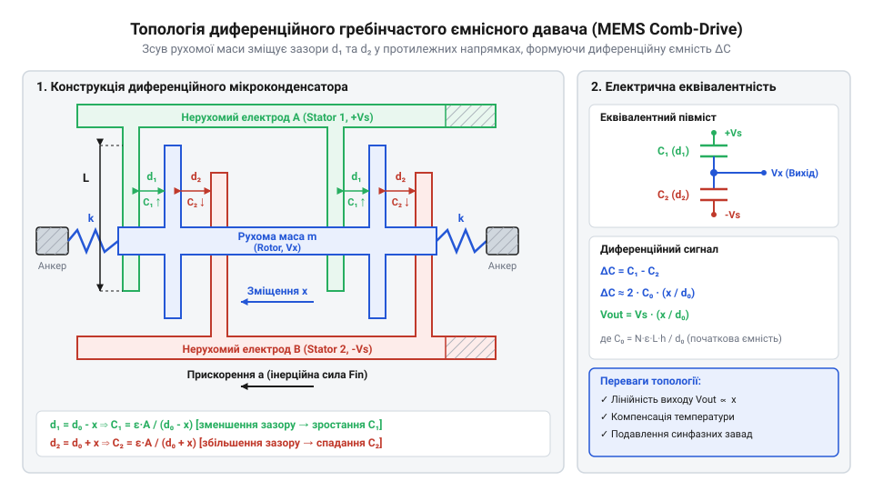
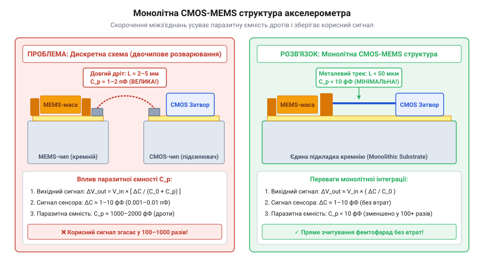

# Еволюція ємнісних MEMS-структур: від лабораторних досліджень до масової мікроелектроніки

<preknowlist>
- [GY-61 ADXL335 — 3-осьовий акселерометр](root:cat-hw-sensors/adxl335) — базова будова та призначення триосьового аналогового ємнісного акселерометра
- [ADXL345 — 3-осьовий цифровий акселерометр](root:cat-hw-sensors/adxl345) — розуміння концепції інтегрованого аналогово-цифрового перетворення в сучасних MEMS-чипах
</preknowlist>

## Криза автомобільної автоматики та обмеження п'єзорезистивності

У середині 1970-х років автомобільна промисловість зіткнулася з жорсткими екологічними та безпековими стандартами. Масове впровадження систем пасивної безпеки — насамперед надувних подушок безпеки (@@en|airbag@@) — вимагало принципово нових давачів прискорення. Автомобільний @@en|sensor@@ мав безпомилково визначати момент аварійного гальмування чи удару (прискорення від `10 g` до `50 g`) упродовж кількох мілісекунд, зберігати працездатність понад десять років у жорстких умовах підкапотного простору та коштувати кілька доларів замість сотень.

До того часу в промисловості панували дискретні механічні перемикачі (кулька в трубці з магнітом) та п'єзорезистивні акселерометри (від лат. @@la|акцелератіо@@ — прискорення та грец. @@el|метрон@@ — міра). П'єзорезистивний ефект (від грец. @@el|пієзо@@ — тиснути та лат. @@la|резисто@@ — чинити опір) полягав у зміні питомого електричного опору півпровідника під дією механічної деформації. Кремнієві тензорезистори формування мостової схеми Вітстона (@@en|Wheatstone bridge@@) витравлювали на поверхні пружної кремнієвої мембрани. Коли інерційна маса зсувалася під дією прискорення, мембрана згиналася, опір плечей моста змінювався, а вихідна напруга `V_out` пропорційно зростала.

Проте п'єзорезистивні давачі виявилися непридатними для масового автомобілебудування через три критичні обмеження:

1. **Температурний дрейф (@@en|thermal drift@@)**: П'єзорезистивний коефіцієнт кремнію катастрофічно залежить від температури. У діапазоні від `-40 °C` до `+125 °C` опір півпровідникових тензодатчиків та їхня чутливість плавали на десятки відсотків. 2. **Висока собівартість та калібрування**: Кожен такий @@en|sensor@@ вимагав індивідуального лазерного підганяння (@@en|laser trimming@@) підрядних резисторів та складної термокомпенсаційної схеми, що робило прилад надто дорогим для серійного авто. 3. **Енергоспоживання та шум**: Постійний струм, що протікав крізь резистивний міст, спричиняв саморозігрів чипа, викликаючи додатковий дрейф нуля та низькочастотний шум.

Виходом із цієї технологічної кризи став перехід від зміни опору до вимірювання відносного геометричного зсуву за допомогою ємнісного зчитування. Мікроконденсатор вимірює не внутрішні напруження матеріалу, а зміну відстані `d` між електродами. Оскільки діелектрична проникність повітря чи вакууму практично не залежить від температури, ємнісний підхід обіцяв високу термостабільність, нульове споживання струму за постійного зміщення та відсутність саморозігріву. Окрім того, як показав подальший розвиток [триосьових аналогових акселерометрів](root:cat-hw-sensors/adxl335), ємнісна структура природно інтегрується в кремнієві технології.

## Перші мікроконденсатори та парадокс злипання

Здавалося, що створення мікроконденсатора на кремнії є простою задачею геометрії: достатньо витравити в пластині кремнію тонку підвішену мембрану або консольну балку (@@en|cantilever beam@@), яка слугуватиме однією обкладкою конденсатора, а на протилежній нерухомій підкладці сформувати другу обкладку. Наприкінці 1970-х та на початку 1980-х років інженери активно застосовували об'ємну мікрообробку кремнію (від англ. @@en|bulk micromachining@@) — глибоке анізотропне травлення монокристалічної підкладки в розчинах гідроксиду калію (`KOH`).

Однак спроби створити надійний ємнісний @@en|sensor@@ цим шляхом натовкнулися на два фундаментальні фізичні бар'єри.

**Перший бар'єр — паразитні ємності та розварювання**. Об'ємна мікрообробка створювала механічний елемент на одному кремнієвому чипі, тоді як зчитувальна аналогова електроніка розміщувалася на окремому кристалі підсилювача. Вони з'єднувалися металевими розварювальними дротами (@@en|wire bonding@@). Ємність плоского мікроконденсатора розраховується за формулою:

```
C = ε₀ · εᵣ · A / d
= (8.854 × 10⁻¹² F/m) · A / d      [підстановка електричної сталої]
```

Для мікроструктури площею `A = 200 µm × 200 µm` із міжелектродним зазором `d = 2 µm` початкова ємність `C` становить лише близько `0.18 pF` (`180 fF`). При прискоренні в `1 g` зсув балки викликає зміну ємності `ΔC` порядку кількох фемтофарад (`1 fF = 10⁻¹⁵ F`). Водночас паразитна ємність `C_p` самого контактного майданчика та розварювального дроту становить від `1 pF` до `10 pF` — тобто в тисячі разів більше за корисний сигнал `ΔC`! Корисний сигнал повністю тонув у шумах та температурних дрейфах паразитної ємності дротів.

**Другий бар'єр — парадокс злипання (stiction)**. Спроба збільшити початкову ємність `C` шляхом зменшення зазору `d` або пом'якшення підвісу призвела до катастрофічного фізичного явища — злипання (@@en|stiction@@, утвореного від @@en|static@@ — статичний та @@en|friction@@ — тертя). При масштабуванні макроскопічних пристроїв до мікрометрових розмірів лінійний розмір `L` зменшується, а отже, об'єм і маса `m` падають пропорційно `L³`. Інерційні сили `F_m = m · a` стають мізерними. Натомість площа поверхні падає пропорційно `L²`, через що поверхневі явища починають домінувати над масовими.

Під час останньої стадії рідинного хімічного травлення, коли вивільнену балку промивають у воді чи спирті та сушать, під балкою утворюється мікроскопічний меніск рідини. Капілярні сили (від лат. @@la|капілляріс@@ — капілярний, @@en|capillary forces@@) втягують гнучку балку до підкладки:

```
F_cap = (2 · γ · A · cos θ) / d
```
де `γ` — поверхневий натяг рідини, `θ` — кут змочування, `A` — площа, `d` — зазор.

Як тільки відстань `d` зменшується до часток нанометра, між атомами полікремнію та підкладки виникають вандерваальсові сили (названі на честь Йоганнеса ван дер Ваальса, @@en|van der Waals forces@@) та водневі зв'язки. Відновлювальні механічні сили пружності балки `F_spring = k · x` не здатні подолати ці поверхневі сили притягання, і мікроструктура безповоротно прилипає до підкладки, роблячи прилад неробочим. Детальний математичний аналіз капілярних сил та поверхневого натягу наведено у статті про [фізико-хімічні механізми злипання в MEMS](root:hw-sensing/mems-stiction-physics).

Провал перших мікроконденсаторів довів: мікроелектромеханічні системи (@@en|Micro-Electro-Mechanical Systems@@, @@en|MEMS@@) не є просто зменшеною копією макроскопічних машин. Успіх вимагав докорінної зміни топології та технології виготовлення.

## Поверхнева мікрообробка та гребінчасті електроди

Вихід із глухого кута знайшли в середині 1980-х років дослідники з Каліфорнійського університету в Берклі (зокрема Роджер Хау та Річард Мюллер). Замість витравлювання глибоких каверн у тілі кристала вони запропонували технологію поверхневої мікрообробки (@@en|surface micromachining@@).

Суть технології полягає в послідовному нанесенні тонких плівок на поверхню кремнієвої підкладки. Спочатку осаджують жертовний шар (@@en|sacrificial layer@@) діоксиду кремнію (`SiO₂`), на якому формують вікна для анкерів. Потім зверху наносять конструкційний шар полікремнію (полікристалічний кремній, від грец. @@el|полі@@ — багато та лат. @@la|сіліціум@@ — кремній, @@en|polysilicon@@), з якого методом фотолітографії травлять рухому структуру. Наприкінці чип занурюють у розчин плавикової кислоти (`HF`), яка вибірково розчиняє жертовний оксид `SiO₂`, не чіпаючи полікремній. Після рідинного травлення застосовують надкритичне сушіння діоксидом вуглецю (`CO₂`), що переходить із рідкої фази в газоподібну оминаючи меніск, усуваючи капілярне злипання.

Проте справжнім топологічним проривом став винахід у 1989 році Вільямом Таном та його колегами диференційних гребінчастих електродів (диференційні @@en|comb drives@@). Замість суцільної плоскої пластини інерційну масу виконано у вигляді рамки з висунутими вбоки пальцями, що заходять між нерухомими пальцями статора.


*Топологія диференційного гребінчастого перетворювача, де зсув сейсмічної маси протилежно змінює ємності двох плечей C₁ та C₂.*

Гребінчаста структура вирішила одразу дві фундаментальні проблеми:

1. **Множення площі та диференційне зчитування**: Десятки паралельних пальців формують дві диференційні ємності `C₁` та `C₂`. Коли сейсмічна маса зсувається на відстань `x`, зазори в одному плечі зменшуються, а в іншому — зростають:

```
ΔC = C₁ - C₂
   = N · ε₀ · A / (d - x) - N · ε₀ · A / (d + x)      [різниця ємностей N пар пальців]
   = (2 · N · ε₀ · A · x) / (d² - x²)                 [зведення до спільного знаменника]
   ≈ (2 · N · ε₀ · A / d²) · x                        [лінійна апроксимація при x << d]
```
де `N` — кількість пар пальців. Це помножило корисний сигнал у десятки разів та забезпечило високу лінійність.

2. **Стійкість до злипання**: Пальці гребінки рухаються уздовж поздовжньої осі (@@en|in-plane motion@@), де жорсткість підвісу висока, а поперечне зміщення обмежене спеціальними стопорами (@@en|anti-stiction bumps@@).

Отож остаточну перемогу ємнісних @@en|MEMS@@ забезпечила монолітна інтеграція (від грец. @@el|монос@@ — один, @@el|літос@@ — камінь та лат. @@la|інтегратіо@@ — об'єднання). У 1991 році компанія @@en|Analog Devices@@ випустила легендарний акселерометр @@en|ADXL50@@ — перший у світі промисловий акселерометр, у якому поверхнево мікрооброблена полікремнієва механіка та зчитувальна CMOS-електроніка (від @@en|Complementary Metal-Oxide-Semiconductor@@) виготовлялися на єдиному кремнієвому чипі.


*Крос-секція монолітного чипа, яка ілюструє безпосереднє поєднання мікромеханічного полікремнієвого підвісу та CMOS-підсилювача на єдиному кристалі кремнію.*

Розміщення високочастотного зчитувального підсилювача на відстані менше `100 µm` від гребінчастих електродів повністю знівелювало паразитні ємності розварювальних дротів. Чип @@en|ADXL50@@ здатний був надійно фіксувати зміни ємності нижче `0.1 fF` (`10⁻¹⁶ F`), працюючи в діапазоні `±50 g` з вбудованим самотестуванням (@@en|self-test@@).

Успіх @@en|ADXL50@@ відкрив еру масових @@en|MEMS@@-компонентів, на якій сьогодні базуються як аналогові давачі, так і сучасні [цифрові ємнісні акселерометри](root:cat-hw-sensors/adxl345) та багатоосьові [інерційні модулі](root:cat-hw-sensors/mpu6050). Втім, цей успіх вимагав постійного компромісу: підвищення чутливості за рахунок тонших підвісів завжди межує з ризиком механічного злипання під час перевантажень чи демпфування повітряним прошарком (@@en|squeeze-film damping@@), що задає фізичні межі проектування сучасних мікросистем.

## Монолітна CMOS-інтеграція та чип ADXL50

Наприкінці 1980-х років розробники мікросенсорів зіштовхнулися з технічним тупиком гібридного компонування. У гібридних системах мікромеханічний кремнієвий кристал із підвішеною масою та окремий чип зчитувальної підсилювальної схеми розміщували поруч у спільному керамічному корпусі. Під дією прискорення відносний зсув полікремнієвих гребінок створював зміну ємності `ΔC` порядку від `0.1 fF` до `1 fF` (фемтофарад, від данського @@da|femten@@ — п'ятнадцять, що означає `10⁻¹⁵ F`). Однак зовнішні розварювальні дроти між кристалами разом із контактними майданчиками вносили паразитну ємність від `1 pF` до `2 pF` (`10⁻¹² F`). Вхідний корисний сигнал послаблювався у тисячу разів ще до того, як потрапляв на вхід підсилювача, і повністю губився у температурному дрейфі та шумах. Окрім цього, складна збірка двох кристалів робила датчики занадто дорогими для масового автомобільного ринку подушок безпеки, який вимагав надійного пристрою вартістю менше ніж п'ять доларів.

Проривом стало створення у 1991 році компанією @@en|Analog Devices@@ першого комерційного монолітного акселерометра @@en|ADXL50@@. Його суть полягала у виготовленні полікремнієвих мікромеханічних структур безпосередньо на одному кремнієвому кристалі разом із транзисторними схемами @@en|CMOS@@ (від англійського @@en|Complementary Metal-Oxide-Semiconductor@@, де прикметник походить від латинського @@la|complementum@@ — те, що доповнює) та @@en|BiCMOS@@. Головна технологічна складність полягала у сумісності процесів: високотемпературний відпал полікремнієвих підвісів за температури біля 1000 °C руйнував стандартну алюмінієву металізацію інтегральних схем. Інженери розробили сумісний процес, у якому спочатку формувалися силіцієві дифузійні області транзисторів, потім вирощувався та травлявся жертовний шар фосфорносилікатного скла (@@en|PSG@@) з полікремнієм, а з'єднання виконувалися з тугоплавкого вольфраму.

Завдяки розміщенню вхідного підсилювача на відстані кількох мікрометрів від рухомих гребінок паразитні ємності зварювальних дротів зникли, а паразитна ємність зчитувального вузла зменшилася до фемтофарадного рівня. Для вимірювання мікроскопічного зміщення застосували диференційну схему та високочастотну несучу.

Обчислимо різницю ємностей `ΔC` диференційного гребінчастого електрода залежно від відносного зсуву рухомої маси `x`, початкового зазору `d₀` та початкової ємності спокою `C₀`, де `ε` є діелектричною проникністю середовища, а `A` — площею перекриття обкладок.

```
ΔC = C₁ - C₂
   = (ε · A / (d₀ - x)) - (ε · A / (d₀ + x))    [підстановка формули плоского конденсатора]
   = (ε · A · 2 · x) / (d₀² - x²)              [зведення до спільного знаменника]
   ≈ 2 · C₀ · (x / d₀)                         [для малих зсувів x « d₀]
```

Наведений вираз показує, що за умови незначного відхилення `x` відносно мікрокремнієвого зазору `d₀` зміна ємності `ΔC` є лінійно пропорційною механічному зміщенню.

Внутрішній генератор чипа @@en|ADXL50@@ подавав на нерухомі пальці диференційного гребінчастого електрода (@@en|comb drive@@) протифазні прямокутні напруги частотою 1 MHz. Зміщення рухомої маси змінювало амплітуду й фазу напруги, індукованої на центральному вузлі. Синхронний демодулятор на чипі перемножував цей сигнал із несучою частотою, переносячи інформацію про прискорення у постійний струм і повністю пригнічуючи низькочастотні шуми та зсув нуля. Лазерне підганяння тонкоплівкових резисторів безпосередньо на кремнієвій пластині забезпечувало точне калібрування чутливості до пакування чипа. Монолітна концепція чипа @@en|ADXL50@@ відкрила шлях до [сучасних цифрових акселерометрів](root:cat-hw-sensors/adxl345), які інтегрують багатшарові АЦП безпосередньо на мікрокремнієвому чипі.

## Межі мікромеханіки та розвінчання міфів

Поширеною інженерною ілюзією щодо @@en|MEMS@@ є уявлення про них як про просту масштабовану копію макроскопічних механічних приладів — нібито це звичайний годинниковий механізм чи маятник, зменшений до мікронних розмірів. Проте така інтуїція ламається через фізичні закони масштабування геометричних розмірів `L`. У макросвіті домінують об'ємні сили — інерція та гравітація, які зменшуються пропорційно кубу розміру `L³`. У мікросвіті при зменшенні розмірів до мікрометрів (`L ≈ 10⁻⁶ m`) маса зменшується у `10¹²` разів, тоді як площа поверхні — лише у `10⁸` разів. Поверхневі явища починають повністю домінувати над масою та інерцією.

Головною пасткою переходу до мікромасштабу стало явище злипання — @@en|stiction@@ (утвореного від злиття англійських слів @@en|static@@ та @@en|friction@@ — статичне тертя). Якщо під дією капілярних сил залишкової вологи або електростатичного притягання мікроскопічні полікремнієві пальці торкаються один одного, вандерваальсові сили адгезії виявляються набагато сильнішими за пружну силу повернення кремнієвої пружини. Структура назавжди злипається та втрачає рухомість. Для подолання цього ефекту розробники впровадили нанесення гідрофобних самозбірних моношарів, формування локальних мікровиступів на поверхнях контактів та сушку у надкритичному `CO₂` під час травлення жертовного шару. Технологічні деталі пасивації поверхонь та надкритичного сушіння розкрито у матеріалі про [фізико-хімічні методи запобігання злипанню у MEMS](root:hw-sensing/capacitive-mems-anti-stiction).

Другим хибним міфом є уявлення про можливість безмежної мікромініатюризації сейсмічної маси задля здешевлення чипа. Фізичну межу тут ставить броунівський рух (названий на честь шотландського ботаніка @@en|Robert Brown@@) молекул залишкового газу та теплові коливання самої кремнієвої ґратки.

Визначимо спектральну щільність теплового шуму прискорення `a_n` через коефіцієнт демпфування `b`, абсолютну температуру `T`, сталу Больцмана `k_B` та сейсмічну масу `m`.

```
a_n² = (4 · k_B · T · b) / m²
a_n = √((4 · k_B · T · b) / m²)                  [добування квадратного кореня]
    = (1 / m) · √(4 · k_B · T · b)                [винесення маси за знак кореня]
```

З цієї залежності випливає, що зменшення маси `m` у 10 разів призводить до десятиразового зростання спектральної щільності шуму прискорення, якщо не зменшити коефіцієнт демпфування `b` шляхом вакуумування корпусу.

Отже, проектування будь-якого ємнісного @@en|MEMS@@ є пошуком компромісу між фізичними величинами. Зменшення жорсткості підвісу підвищує чутливість, але знижує резонансну частоту та робить структуру вразливою до ударів і злипання. Зменшення зазору збільшує вихідну ємність, але підвищує ризик електростатичного захоплення. Розуміння цих компромісів пояснює будову сучасних [шестиосьових інерційних модулів](root:cat-hw-sensors/mpu6050), а також застосування диференційних підвісів у [компактних платах Pololu](root:cat-hw-sensors/pololu-imu) для систем автоматичної стабілізації.