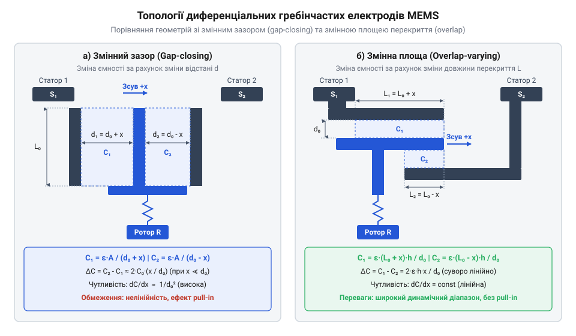
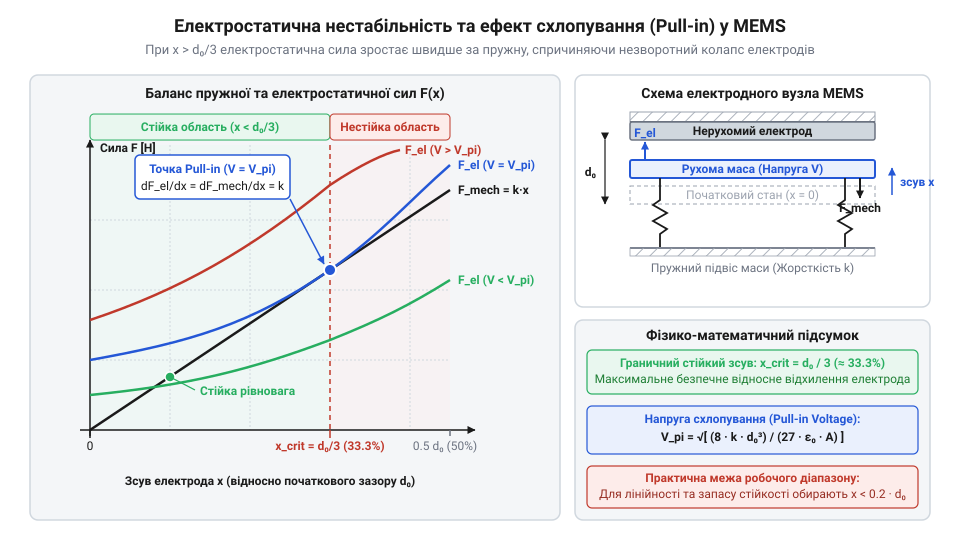
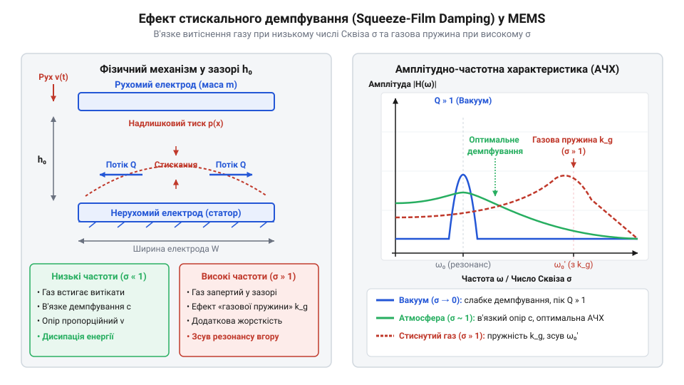
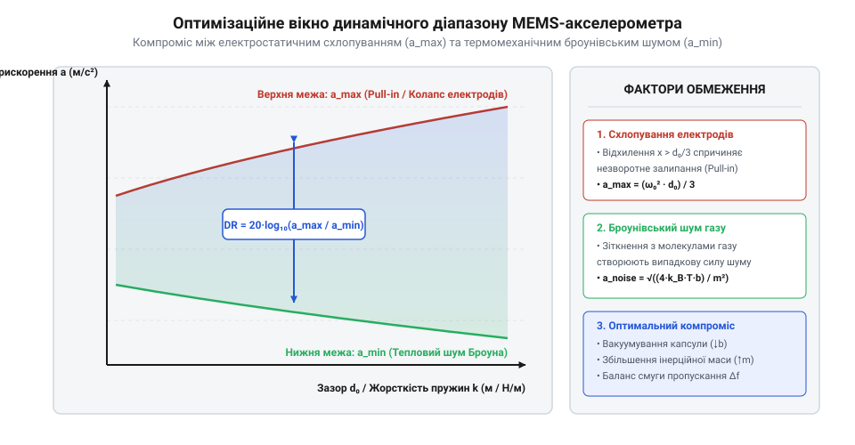

# Електромеханіка й розрахунок ємності MEMS-структур

<preknowlist>
- [GY-61 ADXL335 — 3-осьовий акселерометр](root:cat-hw-sensors/adxl335) — Розуміння загального принципу роботи аналогового MEMS-акселерометра та використання ємнісного перетворення для вимірювання прискорення.
- [ADXL345 — 3-осьовий цифровий акселерометр](root:cat-hw-sensors/adxl345) — Знання будови цифрових інерційних модулів та вимог до динамічного діапазону й лінійності первинних ємнісних перетворювачів.
</preknowlist>

## Нелінійність зсуву та вимірювання мікропереміщень

У @@en|MEMS@@ (від англ. *Micro-Electro-Mechanical Systems*) вимірювання прискорення зводиться до вимірювання зсуву рухомої підвішеної структури. Інерційна маса, або @@en|proof mass@@ (від англ. *proof mass*), відхиляється під дією сили інерції на відстань від пікометрів до часток мікрометра. Виміряти таке мікропереміщення оптично чи механічно всередині кристала неможливо, тому його перетворюють у зміну електричної ємності між рухомою масою та нерухомими електродами.

У найпростішій моделі одиничного плоского конденсатора з зазором спокою `d₀`, площею електродів `S` та діелектриком між ними ємність при зсуві `x` описується виразом:

        C(x) = (ε₀ · εᵣ · S) ÷ (d₀ - x)

де `ε₀` — електрична стала, `εᵣ` — відносна діелектрична проникність.

Розкладемо вираз ємності в ряд Тейлора, або @@en|Taylor series@@ (від англ. *Taylor series*), у околі точки `x = 0`:

        C(x)
        = C₀ ÷ (1 - (x ÷ d₀))      [виділення початкової ємності C₀ = ε₀ · εᵣ · S ÷ d₀]
        = C₀ · [1 + (x ÷ d₀) + (x ÷ d₀)² + (x ÷ d₀)³ + ...]      [розклад геометричної прогресії]

Отриманий вираз показує проблему: члени вищих порядків `(x ÷ d₀)²` та `(x ÷ d₀)³` утворюють сильні нелінійні спотворення. Щоб зберегти точність, зсув довелося б обмежити умовою `x ≪ d₀`, що різко звужує динамічний діапазон. Через це одиничний конденсатор непридатний для точних давачів на кшталт [аналогових інерційних модулів](root:cat-hw-sensors/adxl335).

Для подолання нелінійності застосовують диференціальний конденсатор, або @@en|differential capacitor@@ (від лат. *differentia* — різниця). Інерційна маса між двома нерухомими електродами утворює дві ємності `C₁` та `C₂`, зазори яких змінюються як `d₀ - x` та `d₀ + x`:

        C₁(x) = C₀ ÷ (1 - (x ÷ d₀))
        C₂(x) = C₀ ÷ (1 + (x ÷ d₀))

Обчислимо абсолютну різницю ємностей `ΔC = C₁ - C₂`:

        ΔC
        = [C₀ ÷ (1 - (x ÷ d₀))] - [C₀ ÷ (1 + (x ÷ d₀))]      [підстановка виразів для C₁ та C₂]
        = C₀ · [(1 + (x ÷ d₀)) - (1 - (x ÷ d₀))] ÷ [1 - (x ÷ d₀)²]      [зведення до спільного знаменника]
        = 2 · C₀ · (x ÷ d₀) ÷ [1 - (x ÷ d₀)²]      [спрощення чисельника]

Різниця `ΔC` містить нелінійний знаменник `1 - (x ÷ d₀)²`. Проте вимірювальні схеми в [цифрових триосьових акселерометрах](root:cat-hw-sensors/adxl345) обчислюють мостове відношення `(C₁ - C₂) ÷ (C₁ + C₂)`.

Спочатку знайдемо суму ємностей `C₁ + C₂`:

        C₁ + C₂
        = [C₀ ÷ (1 - (x ÷ d₀))] + [C₀ ÷ (1 + (x ÷ d₀))]      [підстановка виразів для C₁ та C₂]
        = C₀ · [(1 + (x ÷ d₀)) + (1 - (x ÷ d₀))] ÷ [1 - (x ÷ d₀)²]      [зведення до спільного знаменника]
        = 2 · C₀ ÷ [1 - (x ÷ d₀)²]      [спрощення чисельника]

Тепер обчислимо нормоване відношення різниці до суми:

        (C₁ - C₂) ÷ (C₁ + C₂)
        = [2 · C₀ · (x ÷ d₀) ÷ (1 - (x ÷ d₀)²)] ÷ [2 · C₀ ÷ (1 - (x ÷ d₀)²)]      [ділення різниці на суму]
        = x ÷ d₀      [скорочення спільних множників C₀ та знаменника]

Нелінійний знаменник `1 - (x ÷ d₀)²` скорочується, і відношення стає строго лінійно залежним від зсуву `x ÷ d₀`. Диференціальна схема усуває нелінійність вищих порядків, забезпечуючи точне вимірювання мікропереміщень.

## Геометрія та розрахунок диференційної ємності

Для диференціального вимірювання створюють гребінчасті електроди, або @@en|comb drive@@ (від англ. *comb* — гребінець), із паралельних кремнієвих пальців. У @@en|MEMS@@-структурах вживають два геометричні типи: зі змінною площею перекриття та зі змінним зазором.


*Конфігурації гребінчастих електродів MEMS: поперечний зсув маси змінює міжелектродний зазор, тоді як поздовжній зсув змінює площу перекриття пальців.*

Поздовжній гребінчастий привід, або @@en|lateral comb drive@@ (від англ. *lateral* — бічний), зміщує пальці вздовж їхньої довжини `L₀` паралельно нерухомим. Нехай `N` — кількість пар пальців, `h` — товщина шару, `d₀` — зазор.

Початкова ємність одного плеча становить:

        C₀ = N · ε₀ · εᵣ · h · L₀ ÷ d₀

Зсув `x` змінює довжину перекриття пліч до `L₀ + x` та `L₀ - x`. Ємності пліч:

        C₁(x) = N · ε₀ · εᵣ · h · (L₀ + x) ÷ d₀
        C₂(x) = N · ε₀ · εᵣ · h · (L₀ - x) ÷ d₀

Знайдемо диференційну зміну ємності `ΔC`:

        ΔC
        = C₁(x) - C₂(x)      [визначення диференційної зміни]
        = [N · ε₀ · εᵣ · h · (L₀ + x) ÷ d₀] - [N · ε₀ · εᵣ · h · (L₀ - x) ÷ d₀]      [підстановка ємностей]
        = 2 · N · ε₀ · εᵣ · h · x ÷ d₀      [розкриття дужок та зведення подібних]

Параметрична чутливість, або @@en|parametric sensitivity@@ (від грец. *параметр* та англ. *sensitivity*), є похідною ємності за зсувом `dC₁ ÷ dx`:

        dC₁ ÷ dx
        = d/dx [N · ε₀ · εᵣ · h · (L₀ + x) ÷ d₀]      [обчислення похідної першого плеча]
        = N · ε₀ · εᵣ · h ÷ d₀      [константа за зсувом]

Чутливість `dC₁ ÷ dx` тут є постійною й не залежить від `x`. Структура ідеально лінійна на всьому ході (поки `x < L₀`), але її чутливість пропорційна `1 ÷ d₀`, що вимагає значної кількості пальців `N` для відчутного сигналу.

Поперечний гребінчастий привід, або @@en|transverse comb drive@@ (від англ. *transverse* — поперечний), зміщує пальці перпендикулярно до довжини. Площа `S = h · L₀` залишається незмінною, а зазори пліч стають `d₁ = d₀ - x` та `d₂ = d₀ + x`.

Ємності двох пліч для поперечної структури:

        C₁(x) = N · ε₀ · εᵣ · h · L₀ ÷ (d₀ - x)
        C₂(x) = N · ε₀ · εᵣ · h · L₀ ÷ (d₀ + x)

Обчислимо диференційну зміну ємності `ΔC`:

        ΔC
        = C₁(x) - C₂(x)      [визначення диференційної зміни]
        = [N · ε₀ · εᵣ · h · L₀ ÷ (d₀ - x)] - [N · ε₀ · εᵣ · h · L₀ ÷ (d₀ + x)]      [підстановка виразів]
        = 2 · C₀ · (x ÷ d₀) ÷ [1 - (x ÷ d₀)²]      [зведення до початкової ємності C₀]

Знайдемо параметрична чутливість `dC₁ ÷ dx` в околі рівноваги `x = 0`:

        dC₁ ÷ dx
        = d/dx [N · ε₀ · εᵣ · h · L₀ ÷ (d₀ - x)]      [обчислення похідної дробу]
        = N · ε₀ · εᵣ · h · L₀ ÷ (d₀ - x)²      [похідна складеної функції]
        = C₀ ÷ d₀      [значення при x = 0]

Диференційна чутливість усієї системи при `x = 0` становить:

        d(ΔC) ÷ dx = 2 · C₀ ÷ d₀ = 2 · N · ε₀ · εᵣ · h · L₀ ÷ d₀²

Поперечна структура забезпечує чутливість, пропорційну `1 ÷ d₀²`, що при типових зазорах `d₀ ≈ 1...2` мкм дає в десятки разів більший сигнал на одиницю площі, ніж поздовжня. Завдяки малосигнальній лінеаризації при `x ≪ d₀`, саме структура зі змінним зазором є базовою для акселерометрів у [шестиосьових вимірювальних модулях](root:cat-hw-sensors/mpu6050).

## Електростатичне притягання та колапс електродів

Хоча зчитування ємності дозволяє виміряти зміщення, воно створює побічний физичний ефект. Для вимірювання ємності на електроди необхідно подати вимірювальну напругу `V`. Електричне поле між обкладками накопичує енергію `E = 0.5 · C · V²`. При зміщенні електродів ця енергія змінюється, що породжує притягальну електростатичну силу, або @@en|electrostatic attraction@@ (від грец. *електрон* та лат. *attractio* — притягання).

Обчислимо електростатичну силу `Fₑₗ`, яка діє на рухомий палець у напрямку зменшення зазору:

        Fₑₗ(x)
        = ∂E ÷ ∂x      [визначення сили як градієнта потенціальної енергії]
        = ∂ ÷ ∂x [0.5 · C₁(x) · V²]      [підстановка енергії поля]
        = 0.5 · V² · d ÷ dx [ε₀ · εᵣ · S ÷ (d₀ - x)]      [підстановка виразу ємності]
        = 0.5 · ε₀ · εᵣ · S · V² ÷ (d₀ - x)²      [обчислення похідної]

На рухому масу одночасно діє пружна відновлювальна сила кремнієвих мікропружин `Fₘₑ = k · x`, де `k` — механічна жорсткість підвісу. Результуюча сила `Fₙₑₜ` дорівнює різниці пружної та електростатичної сил:

        Fₙₑₜ(x) = k · x - 0.5 · ε₀ · εᵣ · S · V² ÷ (d₀ - x)²

Знайдемо ефективну жорсткість підвісу `kₑff` шляхом диференціювання результуючої сили за зсувом:

        kₑff
        = dFₙₑₜ ÷ dx      [похідна результуючої сили]
        = d ÷ dx [k · x - 0.5 · ε₀ · εᵣ · S · V² ÷ (d₀ - x)²]      [підстановка сил]
        = k - ε₀ · εᵣ · S · V² ÷ (d₀ - x)³      [обчислення похідної електростатичного доданка]

У точці спокою `x = 0` ефективна жорсткість зменшується: `kₑff = k - ε₀ · εᵣ · S · V² ÷ d₀³`. Виникає явище, відоме як електростатичне пом'якшення, або @@en|electrostatic softening@@ (від англ. *softening* — розм'якшення). Прикладена напруга діє як «негативна пружина», зменшуючи власну резонансну частоту механічної системи `ω₀ = √(kₑff ÷ m)`.

Якщо вимірювальна напруга `V` зростає, градієнт електростатичної сили починає зростати швидше, ніж пружна сила пружин. Виникає електростатичний колапс, або @@en|pull-in effect@@ (від англ. *pull-in* — втягування). Знайдемо критичне зміщення `x꜀ᵣᵢₜ`, при якому система втрачає механічну стійкість.

Умова стійкої рівноваги вимагає рівності сил `Fₘₑ = Fₑₗ`, а межа стійкості настає тоді, коли жорсткості стають рівними `dFₘₑ/dx = dFₑₗ/dx`, тобто `kₑff = 0`. Запишемо ці дві умови:

        k · x = 0.5 · ε₀ · εᵣ · S · V² ÷ (d₀ - x)²      [умова рівноваги сил]
        k = ε₀ · εᵣ · S · V² ÷ (d₀ - x)³      [умова межі стійкості]

Поділимо перше рівняння на друге для знаходження критичного зсуву `x꜀ᵣᵢₜ`:

        (k · x) ÷ k
        = [0.5 · ε₀ · εᵣ · S · V² ÷ (d₀ - x)²] ÷ [ε₀ · εᵣ · S · V² ÷ (d₀ - x)³]      [ділення рівнянь]
        x = 0.5 · (d₀ - x)      [скорочення k, V² та однакових множників]
        x = 0.5 · d₀ - 0.5 · x      [розкриття дужок]
        1.5 · x = 0.5 · d₀      [перенесення доданків зі змінною x]
        x꜀ᵣᵢₜ = d₀ ÷ 3      [ділення обидвох частин на 1.5]

Фізичний зміст виведеного правила: максимальний стабільний зсув електродів зі змінним зазором під дією напруги становить рівно одну третину початкового зазору `d₀ ÷ 3`. Перевищення цієї межі призводить до втрати балансу — електростатична сила незворотно долає пружини, і пальці миттєво злипаються.

Тепер обчислимо критичну напругу колапсу, або @@en|pull-in voltage@@ `Vₚᵢ`. Підставимо `x꜀ᵣᵢₜ = d₀ ÷ 3` у рівняння рівноваги сил:

        k · (d₀ ÷ 3)
        = 0.5 · ε₀ · εᵣ · S · Vₚᵢ² ÷ (d₀ - (d₀ ÷ 3))²      [підстановка критичного зсуву]
        = 0.5 · ε₀ · εᵣ · S · Vₚᵢ² ÷ (2 · d₀ ÷ 3)²      [обчислення різниці у знаменнику]
        = 0.5 · ε₀ · εᵣ · S · Vₚᵢ² ÷ (4 · d₀² ÷ 9)      [піднесення до квадрата]
        = (9 ÷ 8) · ε₀ · εᵣ · S · Vₚᵢ² ÷ d₀²      [спрощення коефіцієнтів]

Розв'яжемо отримане рівняння відносно напруги `Vₚᵢ`:

        Vₚᵢ²
        = (k · d₀ ÷ 3) ÷ [(9 ÷ 8) · ε₀ · εᵣ · S ÷ d₀²]      [виділення квадрата напруги]
        = (8 ÷ 27) · k · d₀³ ÷ (ε₀ · εᵣ · S)      [перемноження дробив]
        Vₚᵢ = √[ (8 · k · d₀³) ÷ (27 · ε₀ · εᵣ · S) ]      [добування квадратного кореня]


*Криві електростатичної сили при прикладанні напруг V та лінійна відновлювальна сила пружини k·x. Перетин стійкої та нестійкої точок рівноваги зникає при напрузі колапсу Vₚᵢ.*

Значення `Vₚᵢ` визначає максимально припустиму робочу напругу схеми зчитування. Щоб запобігти випадковому колапсу від механічних ударів чи шумів живлення, вимірювальні напруги обирають на рівні `V ≤ 0.2...0.3 · Vₚᵢ`.

Окрім обмеження напруги, на динаміку структури впливає газове стискальне демпфування (@@en|squeeze-film damping@@), що визначає добротність і смугу пропускання MEMS-давача, як розглянуто далі.

## Газове демпфування та динамічний відгук

У вакуумі механічна система «маса-пружина» мала б гострий резонансний пік: найменший поштовх викликав би тривалі згасаючі коливання рухомої маси @@en|proof mass@@, спотворюючи вимірюваний сигнал. У реальних кремнієвих структурах електроди @@en|comb drive@@ розділені мікроскопічним зазором `d₀` порядку 1–2 мкм. При зміщенні маси газ у зазорі не встигає миттєво витекти й стискається, чинячи механічний опір руху — цей ефект називають газовим стискальним демпфуванням @@en|squeeze-film damping@@ (від англ. *squeeze* — стискати, *film* — плівка, *damping* — згасання).

Для поперечного електрода @@en|transverse comb drive@@ з довжиною перекриття `L`, висотою `h` та початковим зазором `d₀` стискання газової плівки створює силу в'язкого опору, пропорційну швидкості руху `dx/dt`. За малих швидкостей коливань (число стискання `σ < 1`) коефіцієнт в'язкого демпфування `b` для `N` пар електродів становить:

```
b = 12 · N · μ · h · L³ / d₀³
```
де `μ` — динамічна в'язкість газу, `h` — висота кремнієвої пластини, `L` — довжина перекриття електродів, `d₀` — міжелектродний зазор.

Кубічна залежність `1 / d₀³` показує високу чутливість: зменшення зазору `d₀` удвічі збільшує в'язкий опір газу у 8 разів.

Динаміку руху маси `m` під дією зовнішнього прискорення `a_ext` описує рівняння другого порядку:

```
m · d²x/dt² + b · dx/dt + k_eff · x = m · a_ext
```
де `k_eff = k_m - k_el` — ефективна жорсткість підвісу з урахуванням електростатичного пом'якшення @@en|electrostatic softening@@.

Власна резонансна частота `ω₀` та добротність @@en|quality factor@@ (від англ. *quality* — якість, *factor* — чинник) `Q` визначають динамічний відгук давача:

```
ω₀ = √(k_eff / m)
```
```
Q = (m · ω₀) / b
  = √(m · k_eff) / b
```

Величина `Q` формує амплітудно-частотну характеристику та смугу пропускання @@en|bandwidth@@ (від англ. *band* — смуга, *width* — ширина) пристрою.


*Вплив стискання газового прошарку на зсув маси та формування смуги пропускання давача.*

Залежно від величини `Q` виникають три класичні режими роботи:
1. **Сильне демпфування (`Q < 0.5`)**: надмірний опір газу уповільнює повернення маси до рівноваги. Смуга пропускання обмежується частотою зрізу `f_3dB ≈ k_eff / (2 · π · b)`, що звужує динамічний діапазон. 2. **Слабке демпфування (`Q > 0.5`)**: виникає гострий резонансний пік на частоті `ω₀`. Вібрації викликають розгойданість амплітуди, що призводить до спотворення сигналу або механічного удару пальців. 3. **Оптимальне (критичне) демпфування (`Q ≈ 0.707`)**: дає максимально плоску характеристику без резонансного викиду та зберігає широку смугу пропускання до `f ≈ 0.5 · f₀`.

У реальних акселерометрах, як-от [MPU-6050](root:cat-hw-sensors/mpu6050) чи [ADXL335](root:cat-hw-sensors/adxl335), тиск газу в герметичному корпусі підбирають під `Q ≈ 0.7`, що усуває резонансне розгойдування й стабілізує відгук.

**Обчислення параметрів демпфування акселерометра**
Маса `m = 10⁻⁸ кг`, ефективна жорсткість `k_eff = 1 Н/м`, `N = 50` пар пальців, довжина `L = 100 мкм = 10⁻⁴ м`, висота `h = 20 мкм = 2 · 10⁻⁵ м`, зазор `d₀ = 2 мкм = 2 · 10⁻⁶ м`, в'язкість повітря `μ = 1.8 · 10⁻⁵ Па·с`.

```
b = 12 · 50 · (1.8 · 10⁻⁵) · (2 · 10⁻⁵) · (10⁻⁴)³ / (2 · 10⁻⁶)³
  = 600 · (1.8 · 10⁻⁵) · (2 · 10⁻⁵) · 10⁻¹² / (8 · 10⁻¹⁸) [підстановка геометричних параметрів]
  = 2.16 · 10⁻¹⁶ / (8 · 10⁻¹⁸)                             [перемноження чисельника]
  = 2.7 · 10⁻⁵ Н·с/м                                       [коефіцієнт в'язкого демпфування]

ω₀ = √(1 / 10⁻⁸)
   = √(10⁸)                                                [підстановка жорсткості та маси]
   = 10⁴ рад/с                                             [резонансна колова частота, f₀ ≈ 1591 Гц]

Q = (10⁻⁸ · 10⁴) / (2.7 · 10⁻⁵)
  = 10⁻⁴ / (2.7 · 10⁻⁵)                                    [підстановка у формулу добротності]
  ≈ 3.7                                                    [слабке демпфування, потрібне додаткове регулювання тиску]
```

Виведена залежність підтверджує: регулюючи внутрішньокорпусний тиск газу (змінюючи в'язкість `μ`), можна точно налаштувати добротність `Q` до критичного значення `0.707`. Для детального вивчення фізичної та гідродинамічної моделі стискання газового прошарку перегляньте матеріал про [газове стискальне демпфування MEMS-структур](root:hw-sensing/mems-squeeze-film-damping).

## Межі стійкості та динамічний діапазон

Висока чутливість ємнісного MEMS-давача вимагає мінімального зазору `d₀` та високої робочої напруги `V_bias`. Проте зменшення зазору знижує напругу колапсу @@en|pull-in voltage@@ (від англ. *pull-in* — втягування, *voltage* — напруга) `V_pi` і робить підвіс вразливим до перевантажень.

Механічна стійкість обмежується зсувом маси `x`, де електростатичне притягання не перевищує силу пружини. Стійка рівновага існує при `x < d₀ / 3`. Якщо прискорення `a_ext` зміщує масу далі цієї межі, електростатична сила переважає опір підвісу, що спричиняє колапс і прилипання електродів.

Верхню межу вимірюваного прискорення `a_max` розраховують з умови граничного зсуву `x_max = d₀ / 3`, де `k_eff` — ефективна жорсткість підвісу, `m` — маса, а `ω₀` — власна резонансна частота:

```
k_eff · (d₀ / 3) = m · a_max
```
```
a_max = (k_eff · d₀) / (3 · m)
      = (ω₀² · d₀) / 3
```

Звідси видно: для розширення верхньої межі `a_max` потрібно збільшувати резонансну частоту `ω₀` або зазор `d₀`. Однак зростання `d₀` знижує початкову ємність `C₀` та чутливість `dC/dx`.

Ніжню межу прискорення `a_min` визначає фундаментальний термомеханічний шум — @@en|Brownian noise@@ (від прізвища ботаніка Роберта Броуна, *Robert Brown*). Хаотичні удари молекул газу об масу створюють поріг шумів @@en|noise floor@@ (від англ. *noise* — шум, *floor* — поріг) зі спектральною густиною:

```
a_noise = √((4 · k_B · T · b) / m²)
```

Тут `k_B = 1.38 · 10⁻²³ Дж/К` — стала Больцмана, `T` — температура, `b` — коефіцієнт в'язкого демпфування, `m` — маса. У смузі частот `Δf` шумове прискорення дорівнює `a_min = a_noise · √(Δf)`.

Співвідношення граничного сигналу `a_max` до шумового `a_min` визначає динамічний діапазон @@en|dynamic range@@ (від англ. *dynamic* — динамічний, *range* — діапазон) `DR`:

```
DR = 20 · log₁₀(a_max / a_min)
```


*Оптимізаційне вікно параметрів MEMS-давача між межею колапсу електродів та броунівським шумом.*

**Обчислення динамічного діапазону акселерометра**
Параметри: `m = 10⁻⁸ кг`, `d₀ = 2 мкм = 2 · 10⁻⁶ м`, `ω₀ = 10⁴ рад/с`, `b = 2.7 · 10⁻⁵ Н·с/м`, `T = 300 К`, смуга `Δf = 100 Гц`.

```
a_max = ((10⁴)² · 2 · 10⁻⁶) / 3
      = (10⁸ · 2 · 10⁻⁶) / 3                              [підстановка резонансної частоти та зазору]
      = 200 / 3                                           [обчислення чисельника]
      ≈ 66.7 м/с²                                         [максимально допустиме прискорення перед колапсом, ~6.8 g]

a_noise = √((4 · (1.38 · 10⁻²³) · 300 · (2.7 · 10⁻⁵)) / (10⁻⁸)²)
        = √(4.4712 · 10⁻²⁵ / 10⁻¹⁶)                        [підстановка параметрів і множення]
        = √(4.4712 · 10⁻⁹)                                 [ділення на квадрат маси]
        ≈ 6.69 · 10⁻⁵ м/(с²·√Гц)                           [спектральна густина термомеханічного шуму]

a_min = (6.69 · 10⁻⁵) · √(100)
      = (6.69 · 10⁻⁵) · 10                                [підстановка смуги пропускання 100 Гц]
      = 6.69 · 10⁻⁴ м/с²                                  [мінімально розрізнюване прискорення]

DR = 20 · log₁₀(66.7 / (6.69 · 10⁻⁴))
   = 20 · log₁₀(99701)                                    [співвідношення максимального та мінімального сигналів]
   ≈ 20 · 4.9987                                          [десятичний логарифм співвідношення]
   ≈ 100 дБ                                               [підсумковий динамічний діапазон]
```

Для досягнення широкого динамічного діапазону у [цифровому акселерометрі ADXL345](root:cat-hw-sensors/adxl345) або при обробці даних у [системі IIO в ядрі Linux](root:cat-hw-sensors/iio-subsystem-linux-kernel) обирають компромісну жорсткість пружин і знижують тиск газу під час вакуумного пакування. Це мінімізує броунівський шум без втрати стійкості до механічних ударів. Докладніше про фізичну природу термомеханічного шуму газу та розрахунок межі чутливості розповідає стаття про [термомеханічний броунівський шум у MEMS-структурах](root:hw-sensing/mems-brownian-noise).