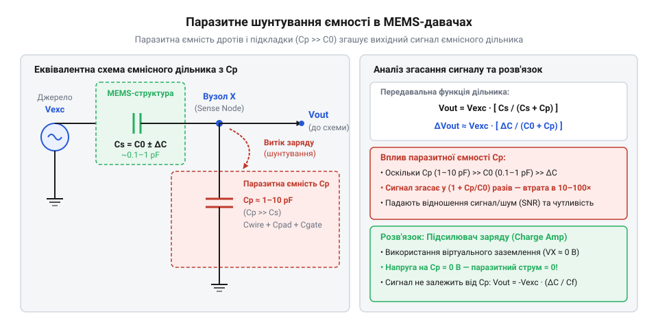
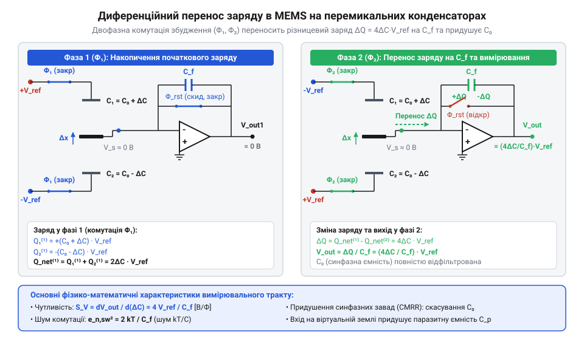
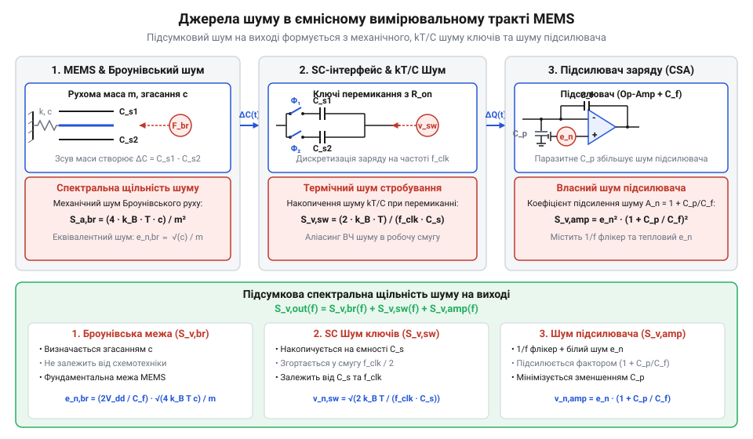

# Математична модель зчитування фемтофарадних змін ємності

<preknowlist>
- [GY-61 ADXL335 — 3-осьовий акселерометр](root:cat-hw-sensors/adxl335) — фізична будова диференціальних MEMS-конденсаторів та зв'язок геометричного зміщення обкладок зі зміною ємності
- [GY-521 / MPU-6050 — 6-осьовий IMU (акселерометр+гіроскоп)](root:cat-hw-sensors/mpu6050) — конструкція кремнієвого підвісу рухомої маси та механічні джерела коливань під дією зовнішніх сил
</preknowlist>

## Проблема вимірювання фемтофарадних змін ємності

У мікроелектромеханічних системах будь-який механічний рух перетворюється на електричний сигнал через зміну ємності. Наприклад, в [аналоговому акселерометрі ADXL335](root:cat-hw-sensors/adxl335) базова ємність плеча `C₀` становить близько `100 fF` (`100 × 10⁻¹⁵ F`), а під дією прискорення вона змінюється на величину `ΔC` порядку `1 fF` (`10⁻¹⁵ F`).

Найпростіший спосіб зчитати цю зміну — подати протифазну напругу збудження `+V_(ref)` та `-V_(ref)` на обкладки диференціального конденсатора й зняти сигнал із центрального вузла. Проте вимірювальна обкладка з'єднана з контактними площадками, мікропровідниками та вхідними каскадами, як у [цифровому датчику MPU-6050](root:cat-hw-sensors/mpu6050). Вони утворюють паразитну ємність `Cₚ` порядку `2`–`10 pF`, яка в тисячі разів перевищує `ΔC`.

Якщо верхня ємність `C₁ = C₀ + ΔC`, а нижня `C₂ = C₀ - ΔC`, то потенціал вимірювального вузла `V_(out)` визначає закон збереження заряду:

    V_(out) = V_(ref) × (C₁ - C₂) / (C₁ + C₂ + Cₚ)
    = V_(ref) × (2 × ΔC) / (2 × C₀ + Cₚ)      [підстановка C₁ та C₂]
    ≈ V_(ref) × (2 × ΔC) / Cₚ                 [нехтування 2 × C₀ << Cₚ]

Оскільки знаменник повністю визначається паразитною ємністю `Cₚ`, корисний сигнал зазнає катастрофічного згасання.

*Еквівалентна схема стаціонарного ємнісного дільника напруги, яка демонструє шунтування вимірювального вузла паразитною ємністю Cₚ та згасання корисного сигналу ΔC.*

**Розрахунок згасання сигналу на дільнику**

**Умови:** Напруга збудження `V_(ref) = 1.8 V`, зміна ємності `ΔC = 1 fF = 10⁻¹⁵ F`, паразитна ємність `Cₚ = 10 pF = 10⁻¹¹ F`.

    V_(out) = 1.8 × (2 × 10⁻¹⁵) / 10⁻¹¹
    = 0.36 × 10⁻³ V
    = 360 μV

Напруга в `360 μV` тоне в термічних шумах. До того ж `Cₚ` нестабільна: вона плаває від температури, деформацій корпусу та завад. Оскільки `V_(out)` обернено пропорційна `Cₚ`, навіть зміна `Cₚ` на `0.1%` створює похибку, що перекриває сигнал `ΔC`.

Стаціонарний дільник не здатен виділити фемтофарадну зміну ємності. Щоб усунути вплив `Cₚ`, статичне вимірювання напруги замінюють імпульсним переносом заряду на перемикальних конденсаторах (англ. @@en|switched capacitor@@, від *switch* — перемикати та *capacitor* — конденсатор) у підсилювач із віртуальною землею.

## Перенос заряду в схемах перемикальних конденсаторів

Схеми на перемикальних конденсаторах (англ. @@en|switched capacitor@@, від *switch* — перемикати та *capacitor* — конденсатор) ділять вимірювання на дві неперекривні тактові фази `Φ₁` та `Φ₂`, що унеможливлює наскрізне протікання струму.

У фазі заряджання `Φ₁` зовнішні обкладки диференціального MEMS-конденсатора підключаються до протифазних напруг `+V_ref` та `-V_ref`, а центральна рухома обкладка замикається на землю `0 V`. З урахуванням початкової ємності `C₀` та корисної зміни `ΔC` сумарний накопичений заряд `Q_sum⁽¹⁾` на центральній обкладці обчислюється додаванням зарядів верхньої `C₁ = C₀ + ΔC` та нижньої `C₂ = C₀ - ΔC` ємностей:

    Q_sum⁽¹⁾ = Q₁⁽¹⁾ + Q₂⁽¹⁾
    = (C₀ + ΔC) × V_ref + (C₀ - ΔC) × (-V_ref)
    = C₀ × V_ref + ΔC × V_ref - C₀ × V_ref + ΔC × V_ref      [розкриття дужок]
    = 2 × ΔC × V_ref                                        [взаємне знищення C₀ × V_ref]

Завдяки протифазному збудженню статичний заряд `C₀ × V_ref` скасовується, залишаючи лише корисну складову.

У фазі зчитування `Φ₂` перемикачі від'єднують центральну обкладку від землі та інжектують збережений заряд `ΔQ_in = 2 × ΔC × V_ref` у вхідний вузол підсилювача заряду (англ. @@en|charge amplifier@@, від *charge* — заряд та *amplifier* — підсилювач).

*Двохтактне перемикання диференціальної паралельної пари ємностей MEMS для накопичення та передачі різницевого заряду.*

За один цикл тактової частоти `f_clk` середній струм `I_avg` становить:

    I_avg = ΔQ_in × f_clk
    = 2 × ΔC × V_ref × f_clk

Перенос заряду створює еквівалентний опір `R_eq = 1 / (2 × ΔC × f_clk)` без термічного шуму опору Джонсона-Найквіста, що є критичним для чутливих пристроїв на кшталт [цифрового акселерометра ADXL345](root:cat-hw-sensors/adxl345).

## Передавальна функція та придушення завад

Інжектований заряд `ΔQ_in` надходить на вхід підсилювача, охопленого негативним зворотним зв'язком через ємність `C_f`. Завдяки високому підсиленню `A₀ >> 1` потенціал входу підтримується близьким до нуля — цей стан називають віртуальною землею (англ. @@en|virtual ground@@, від *virtual* — уявний).

Оскільки напруга на паразитові `Cₚ` дорівнює нулю (`V_in ≈ 0 V`), заряд на ньому не накопичується (`Q_p = Cₚ × 0 = 0`), і весь `ΔQ_in` протікає в `C_f`.

Вихідну напругу `V_(out)` та коефіцієнт передачі `K_v = V_(out) / ΔC` обчислюємо з інжектованого заряду:

    V_(out) = ΔQ_in / C_f
    = (2 × ΔC × V_(ref)) / C_f      [підстановка ΔQ_in = 2 × ΔC × V_(ref)]

    K_v = V_(out) / ΔC
    = (2 × V_(ref)) / C_f           [ділення на ΔC]

Вихідний сигнал залежить лише від опорної напруги `V_(ref)`, зсуву ємності `ΔC` та інтегральної ємності `C_f`. Паразитна ємність `Cₚ` з підсумкового виразу випадає. Детальний аналіз інтеграторів та оптимізацію струмів витоку дивіться у матеріалі про [підсилювачі заряду для MEMS-давачів](root:hw-sensing/charge-amplifier-mems).

У пристроях на кшталт [модулів Pololu IMU](root:cat-hw-sensors/pololu-imu) вимірювальний тракт зазнає впливу синфазних завад (англ. @@en|common-mode noise@@, від *common* — спільний, *mode* — режим, *noise* — шум) від пульсацій живлення `V_(cm)` та температури. При додаванні синфазної напруги `V_(cm)` сумарний заряд набуває вигляду:

    Q_sum = (C₀ + ΔC) × (V_(ref) + V_(cm)) + (C₀ - ΔC) × (-V_(ref) + V_(cm))
    = 2 × ΔC × V_(ref) + 2 × C₀ × V_(cm)      [розкриття дужок та групування]

Диференціальний підсилювач віднімає синфазну складову `2 × C₀ × V_(cm)`. Співвідношення диференціального `A_d` та синфазного `A_(cm)` підсилення визначає придушення завад:

    CMRR = 20 × lg(A_d / A_(cm))

Асиметрія ємностей `δC₀ / C₀ ≤ 0.01%` забезпечує @@en|CMRR@@ на рівні `80 dB`...`100 dB`. Межу чутливості задає просочування тактового сигналу (англ. @@en|clock feedthrough@@, від *clock* — тактовий сигнал, *feedthrough* — просочування) через паразитні ємності ключів, яке компенсують перехресними КМОН-ключами. Докладний математичний опис інжекції заряду каналу та схем компенсації наведено у статті про [паразитний перенос заряду в перемикальних ключах](root:hw-analog/switched-capacitor-clock-feedthrough).

## Електричний та механічний термічний шум

Зменшення ємності зворотного зв'язку `C_f` чи підвищення напруги збудження `V_(ref)` формально дозволяє вимірювати як завгодно малі зміни ємності `ΔC`. Однак у реальних системах фундаментальну межу чутливості визначає термічний шум (англ. @@en|thermal noise@@, від *thermal* — тепловий та *noise* — шум). У вимірювальному тракті діють два незалежні джерела термічних флуктуацій: електричний шум ключів і підсилювача та механічний Броунівський шум (англ. @@en|Brownian motion@@, від прізвища ботаніка *Brown* — Броун) рухомої маси MEMS.

**1. Електричний шум перемикальних ключів та підсилювача**

У фазі заряджання `Φ₁` струм тече через відкритий MOSFET-ключ із опором `R_(on)`. За теоремою Найквіста, резистор `R_(on)` генерує термічний шум зі спектральною щільністю напруги `S_v(f) = 4 × k × T × R_(on)`, де `k = 1.38 × 10⁻²³ J/K` — константа Больцмана, а `T` — температура в Кельвінах.

Цей шум фільтрується RC-колом із ключа `R_(on)` та ємності вузла `C` (базової ємності MEMS `C₀` або паразитної ємності) зі шумовою смугою `f_(BW) = 1 / (4 × R_(on) × C)`. Дисперсію шумової напруги `v_n²` отримують інтегруванням спектра по всій смузі частот:

    v_n² = ∫₀^∞ (4 × k × T × R_(on)) / (1 + (2 × π × f × R_(on) × C)²) df
    = (4 × k × T × R_(on)) × (1 / (4 × R_(on) × C))      [інтегрування лоренцевого спектра]
    = (k × T) / C                                        [скорочення опору R_(on)]

Величина опору `R_(on)` скорочується: накопичений на ємності шум залежить лише від температури та ємності — це ефект @@en|kT/C noise@@.

Через дискретизацію з тактовою частотою `f_(clk)` широкий спектр @@en|kT/C noise@@ накладається (англ. @@en|aliasing@@, від *alias* — псевдонім) в основну смугу `[0, f_(clk)/2]`. Еквівалентна спектральна щільність шуму дискретизації `S_(v,sw)(f)` на вхідному вузлі з ємністю `C_in ≈ 2 × C₀` дорівнює:

    S_(v,sw)(f) = (2 × k × T) / (C_in × f_(clk))

Перерахована до виходу підсилювача заряду, дисперсія становить `v_(n,out,elec)² = (k × T × C_in) / C_f²`. До неї додається власний вхідний шум підсилювача `e_(amp)` зі спектральною щільністю `S_(v,amp)`, підсилений коефіцієнтом `1 + C_in / C_f`. Математичне виведення накладання спектра шуму під час дискретизації описано у статті про [термічний шум kT/C у схемах перемикальних конденсаторів](root:hw-analog/switched-capacitor-kt-c-noise).

**2. Механічний Броунівський шум рухомої маси**

Другим джерелом є тепловий рух атомарної ґратки та молекул газу в герметичній камері MEMS, як у [6-осьовому IMU MPU-6050](root:cat-hw-sensors/mpu6050). За флуктуаційно-дисипативною теоремою (англ. @@en|fluctuation-dissipation theorem@@, від *fluctuation* — флуктуація та *dissipation* — розсіювання), елемент із коефіцієнтом демпфування `b` (англ. @@en|damping coefficient@@) генерує флуктуаційну силу зі спектральною щільністю:

    S_F(f) = 4 × k × T × b

Для маси `m` з резонансною частотою `ω₀ = √(k_s / m)` демпфування виражається через механічну добротність `Q` (англ. @@en|quality factor@@): `b = (m × ω₀) / Q`. Поділивши силу на масу `m`, отримуємо спектральну щільність еквівалентного шумового прискорення `S_a(f)`:

    S_a(f) = S_F(f) / m²
    = (4 × k × T × b) / m²                              [підстановка S_F = 4 × k × T × b]
    = (4 × k × T × m × ω₀) / (m² × Q)                    [підстановка b = (m × ω₀) / Q]
    = (4 × k × T × ω₀) / (m × Q)                         [скорочення маси m]

Спектральна щільність шуму прискорення (англ. @@en|spectral density@@) `ND_mech` дорівнює кореню з `S_a(f)`:

    ND_mech = √( (4 × k × T × ω₀) / (m × Q) )

Цей рух викликає механічне зміщення `x_n`, яке перетворюється на зміну ємності `ΔC_mech = (C₀ / d₀) × x_n` і створює вихідну шумову напругу `v_(n,out,mech)`. Докладний аналіз флуктуаційно-дисипативної теореми наведено у статті про [механічний тепловий шум у MEMS-структурах](root:hw-sensing/mems-brownian-noise).

*Еквівалентна схема зчитувального тракту, що об'єднує механічний Броунівський шум маси, термічний kT/C шум ключів перемикання та електричний шум операційного підсилювача.*

Оскільки електричний і механічний шуми статистично незалежні, їхні флуктуації додаються квадратично, даючи підсумкову спектральну щільність на виході:

    S_(v,total)(f) = S_(v,elec)(f) + S_(v,mech)(f)

## Порогова чутливість і межа роздільної здатності

Порогова чутливість (англ. @@en|noise floor@@, від *noise* — шум та *floor* — поріг) вимірювального тракту визначається співвідношенням між вихідним шумом та коефіцієнтом передачі напруги `K_v = (2 × V_(ref)) / C_f`.

Межа роздільної здатності (англ. @@en|limit of resolution@@) відповідає найменшому сигналу, при якому співвідношення сигнал/шум (англ. @@en|signal-to-noise ratio@@, SNR, від *signal* — сигнал та *noise* — шум) на виході дорівнює одиниці (`SNR = 1`).

**1. Гранична роздільна здатність за ємністю**

Мінімально розрізнювана зміна ємності `ΔC_min` досягається тоді, коли вихідна напруга від `ΔC` дорівнює середньоквадратичному шумові `v_(n,out,total)` у робочій смузі `B`:

    v_(n,out,total) = K_v × ΔC_min
    = ((2 × V_(ref)) / C_f) × ΔC_min                      [підстановка K_v]

Звідси порогова ємнісна чутливість `ΔC_min`:

    ΔC_min = (v_(n,out,total) × C_f) / (2 × V_(ref))

Або через спектральну щільність шуму ємності `ND_(ΔC)` (вимірюється в `fF/√Hz` чи `aF/√Hz`):

    ND_(ΔC) = (√(S_(v,total)) × C_f) / (2 × V_(ref))

**2. Еквівалентний фізичний рівень шуму**

Для сенсорів на кшталт [ADXL335](root:cat-hw-sensors/adxl335) чи [ADXL345](root:cat-hw-sensors/adxl345) ємнісний поріг перераховують у шумове прискорення `ND_a`.

Механіко-електрична чутливість `S_(C,a) = ΔC / a` випливає зі статичного зміщення `Δx = a / ω₀²`:

    S_(C,a) = (C₀ / d₀) × (1 / ω₀²)
    = C₀ / (d₀ × ω₀²)

де `d₀` — початковий зазор між обкладками.

Сумарний рівень шуму прискорення `ND_a` (в `m/s² / √Hz` чи `μg / √Hz`) дорівнює сумі механічної та електричної складових:

    ND_a = ND_(ΔC) / S_(C,a)
    = (ND_(ΔC) × d₀ × ω₀²) / C₀                           [підстановка S_(C,a)]
    = √( ND_(a,mech)² + ND_(a,elec)² )

де `ND_(a,mech) = √( (4 × k × T × ω₀) / (m × Q) )` — механічний поріг, а `ND_(a,elec) = (ND_(v,elec) × C_f × d₀ × ω₀²) / (2 × V_(ref) × C₀)` — електричний поріг фронтенду.

Для гіроскопів у [Pololu IMU](root:cat-hw-sensors/pololu-imu) та [MPU-9250](root:cat-hw-sensors/mpu9250) чутливість виражають у кутовій швидкості (`°/s / √Hz`).

**Розрахунок порогової чутливості вимірювального тракту**

**Умови:** `T = 300 K`, `m = 0.5 × 10⁻⁹ kg` (`0.5` мг), `f₀ = 5 kHz` (`ω₀ ≈ 31416 rad/s`), `Q = 10`, `d₀ = 1 μm = 10⁻⁶ m`, `C₀ = 100 fF = 10⁻¹³ F`, `C_f = 500 fF = 5 × 10⁻¹⁴ F`, `V_(ref) = 1.8 V`, `f_(clk) = 100 kHz`, `B = 100 Hz`.

    [1. Обчислення спектральної щільності механічного шуму ND_(a,mech)]
    S_(a,mech) = (4 × 1.38 × 10⁻²³ × 300 × 31416) / (0.5 × 10⁻⁹ × 10)
    = (5.202 × 10⁻¹⁶) / (5.0 × 10⁻⁹)
    = 1.040 × 10⁻⁷ m²/s⁴ / Hz
    ND_(a,mech) = √(1.040 × 10⁻⁷) ≈ 3.225 × 10⁻⁴ m/s² / √Hz
    ≈ 32.88 μg / √Hz                                      [перерахунок через g = 9.81 m/s²]

    [2. Обчислення спектральної щільності електричного шуму на виході ND_(v,elec)]
    C_in = 2 × C₀ = 200 fF = 2 × 10⁻¹⁴ F
    S_(v,sw) = (2 × 1.38 × 10⁻²³ × 300) / (2 × 10⁻¹⁴ × 100 000)
    = (8.28 × 10⁻²¹) / (2.0 × 10⁻⁹)
    = 4.14 × 10⁻¹² V²/Hz
    S_(v,elec) = S_(v,sw) × (C_in / C_f)²
    = 4.14 × 10⁻¹² × (200 / 500)²
    = 4.14 × 10⁻¹² × 0.16
    = 6.624 × 10⁻¹³ V²/Hz
    ND_(v,elec) = √(6.624 × 10⁻¹³) ≈ 8.139 × 10⁻⁷ V / √Hz

    [3. Обчислення електричного шумового прискорення ND_(a,elec)]
    S_(C,a) = 10⁻¹³ / (10⁻⁶ × (31416)²)
    = 10⁻¹³ / 986.96
    = 1.013 × 10⁻¹⁷ F / (m/s²)
    K_v = (2 × 1.8) / (5 × 10⁻¹⁴) = 7.20 × 10¹³ V/F
    S_(V,a) = K_v × S_(C,a) = 7.20 × 10¹³ × 1.013 × 10⁻¹⁷ = 7.294 × 10⁻⁴ V / (m/s²)
    ND_(a,elec) = ND_(v,elec) / S_(V,a)
    = (8.139 × 10⁻⁷) / (7.294 × 10⁻⁴)
    = 1.116 × 10⁻³ m/s² / √Hz
    ≈ 113.74 μg / √Hz

    [4. Сумарний рівень шуму у смузі 100 Hz]
    ND_(a,total) = √( ND_(a,mech)² + ND_(a,elec)² )
    = √( (3.225 × 10⁻⁴)² + (1.116 × 10⁻³)² )
    = √( 1.040 × 10⁻⁷ + 1.245 × 10⁻⁶ )
    = √( 1.349 × 10⁻⁶ )
    = 1.161 × 10⁻³ m/s² / √Hz ≈ 118.39 μg / √Hz
    a_(RMS,total) = ND_(a,total) × √B
    = 1.161 × 10⁻³ × √100
    = 1.161 × 10⁻² m/s² ≈ 1.18 mg

Розрахунок показує переважання електричного шуму `kT/C` над механічним Броунівським шумом (`113.74 μg/√Hz` проти `32.88 μg/√Hz`).

Для зменшення порогового шуму аналогового інтерфейсу застосовують чотири важелі:
1. **Підвищення тактової частоти `f_(clk)`**: розмазує енергію `kT/C` шуму по ширшій смузі, зменшуючи його щільність у робочій смузі. 2. **Збільшення опорної напруги `V_(ref)`**: підвищує крутизну `K_v`, зменшуючи еквівалентний вхідний шум. 3. **Вакуумування корпусу (підвищення `Q`)**: знижує демпфування `b` та пригнічує механічний шум. 4. **Оптимізація геометрії MEMS**: збільшення маси `m` та зменшення зазору `d₀` підвищує чутливість `S_(C,a)`.

Математична модель дозволяє розраховувати параметри аналогового інтерфейсу MEMS-давачів для передачі даних у [підсистему Industrial I/O](root:cat-hw-sensors/iio-subsystem-linux-kernel) в ядрі Linux.