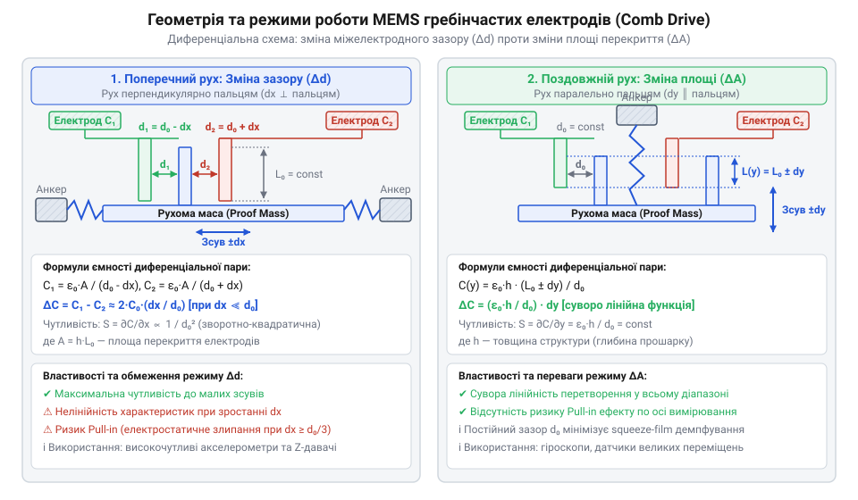
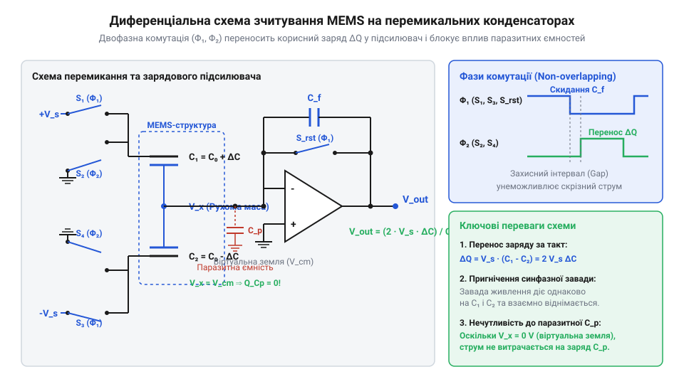
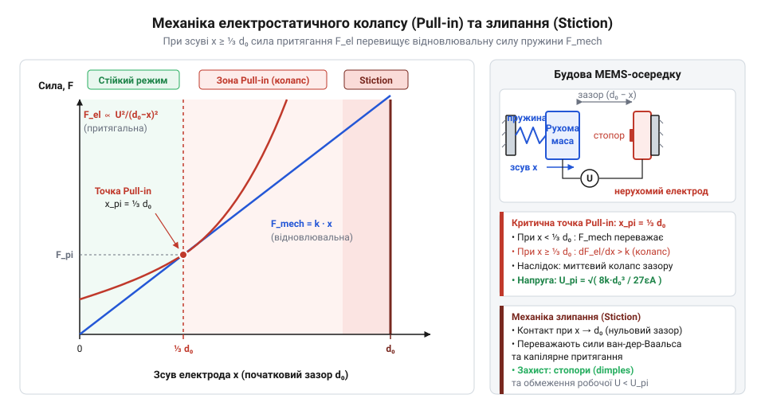
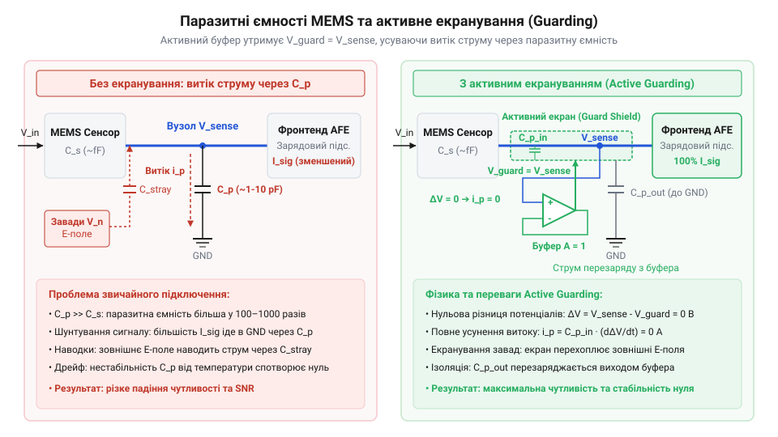

# Принципи ємнісного вимірювання в MEMS-структурах

<preknowlist>
- [GY-61 ADXL335 — 3-осьовий акселерометр](root:cat-hw-sensors/adxl335) — базові уявлення про аналоговий відгук 3-осьових ємнісних акселерометрів та принцип вимірювання прискорення
- [ADXL345 — 3-осьовий цифровий акселерометр](root:cat-hw-sensors/adxl345) — розуміння архітектури цифрового MEMS-акселерометра з вбудованим перетворювачем ємності в цифру
- [GY-521 / MPU-6050 — 6-осьовий IMU (акселерометр+гіроскоп)](root:cat-hw-sensors/mpu6050) — принцип поєднання ємнісних мікроструктур акселерометра та гіроскопа на єдиному кристалі
</preknowlist>

## Чому мікромеханічне вимірювання вимагає ємнісного підходу

Вимірювання механічних величин — прискорення, кутової швидкості, вібрацій чи тиску — у сучасній мікроелектроніці відбувається всередині кремнієвого кристала розміром у кілька квадратних міліметрів. Коли на пристрій діє зовнішня сила, внутрішня механічна структура відхиляється від положення рівноваги. Ключова фізична проблема мікромеханіки полягає у вимірюванні надзвичайно малих величин цього механічного зміщення: у типовому акселерометрі при прискоренні в 1 g (близько 9.81 м/с²) вимірювальна маса зсувається на відстань від часток нанометра до кількох нанометрів. Для порівняння, діаметр атома кремнію становить близько 0.2 нанометра, тобто вимірювальний тракт мусить реєструвати геометричний зсув, що дорівнює ширині кількох десятків атомних шарів.

Класичні методи реєстрації зсуву, які успішно працюють у макроскопічних приладах, виявляються непридатними для інтеграції в кремнієвий кристал через фізичні та технологічні обмеження мікромасштабу:

1. **Оптичні методи** (інтерферометрія чи реєстрація світлового потоку фотодіодами) забезпечують високу точність, проте вимагають інтеграції лазерних діодів, дзеркал, світловодів та фотоприймачів. Створення таких тривимірних оптичних систем у межах планарного напівпровідникового процесу катастрофічно здорожує виробництво, збільшує габарити корпусу та споживає десятки міліват енергії, що унеможливлює їхнє використання у портативних приладах. 2. **Індуктивні методи** (котушки змінної індуктивності та коаксіальні перетворювачі) спираються на магнітне поле. Надруковані на кремнії мікрокотушки мають вкрай низьку добротність, високий омічний опір тонких металевих провідників та низьку індуктивність. Для створення відчутного магнітного потоку потрібні струми у сотні міліампер, що призводить до локального перегріву кристала. Крім того, феромагнітні осердя неможливо ефективно сформувати у стандартному циклі мікрообробки. 3. **П'єзорезистивні методи** базуються на зміні електричного опору кремнієвого тензорезистора при його деформації. Хоча такі давачі прості у виготовленні, п'єзорезистори вимагають постійного протікання вимірювального струму (що створює постійне споживання енергії) і мають критичний недолік — сильний температурний дрейф опору кремнію. З цієї причини [п'єзорезистивний механізм зчитування](root:hw-sensing/mems-piezoresistive-vs-capacitive-sensing) застосовують переважно в давачах високого тиску, де великий вихідний сигнал компенсує температурну нестабільність, але рідко використовують у прецизійних акселерометрах.

Ємнісний принцип перетворення виявився ідеальним фізичним та технологічним рішенням для @@en|MEMS@@ (від англ. *Micro-Electro-Mechanical Systems*, мікро-електромеханічні системи). Кремній, особливо легований фосфором або бором, є чудовим провідником електричного струму й одночасно високоміцним механічним матеріалом. Якщо за допомогою мікрообробки сформувати у кремнієвій пластині рухому @@en|proof mass@@ (інертна маса, від англ. *proof* — випробувальний, перевірочний та *mass* — маса) та закріпити поруч непорушні електроди, утворені мікроскопічні повітряні або вакуумні зазори утворюють систему конденсаторів.

Ємнісний підхід володіє трьома фундаментальними перевагами у мікромасштабі:

* **Нульове статичне споживання енергії механічною структурою.** Сама ємнісна структура не споживає постійного струму. Енергія витрачається лише електронним трактом під час періодичного перезаряджання ємності високочастотним вимірювальним сигналом. * **Висока температурна стабільність.** Діелектрична проникність вакууму чи сухого газу, а також геометричні розміри кремнієвого каркаса мають мінімальний температурний коефіцієнт розширення порівняно з питомим опором напівпровідників. * **Масштабованість геометрії.** Ємність плоского конденсатора визначається класичним співвідношенням:

```
    C₀ = ε₀ · εᵣ · A ÷ d
```

Де:
* `C₀` — початкова (базова) ємність мікроструктури у фарадах (Ф);
* `ε₀` — електрична стала (діелектрична проникність вакууму), що дорівнює `8.854 × 10⁻¹² Ф/м`;
* `εᵣ` — відносна діелектрична проникність середовища у зазорі (для повітря або вакууму `εᵣ ≈ 1`);
* `A` — площа перекриття електродів у квадратних метрах (м²);
* `d` — відстань (міжелектродний зазор) у метрах (м).

У мікросистемах зазор `d` становить від 1 до 3 мікрометрів (мкм). Завдяки малому зазору навіть при мікроскопічній площі електродів `A` у кілька тисяч квадратних мікрометрів базова ємність однієї пари електродів сягає кількох фемтофарад (`1 фФ = 10⁻¹⁵ Ф`).

Розглянемо числовий приклад розрахунку базової ємності для одиничної пари мікроелектродів. Нехай висота кремнієвого електрода становить `h = 10 мкм` (`10 × 10⁻⁶ м`), довжина перекриття `L = 200 мкм` (`200 × 10⁻⁶ м`), а міжелектродний зазор `d = 1.5 мкм` (`1.5 × 10⁻⁶ м`).

Площа перекриття електродів `A`:

```
    A = h · L
      = (10 × 10⁻⁶ м) · (200 × 10⁻⁶ м)                      [множення геометричних розмірів]
      = 2 × 10⁻⁹ м²                                         [площа у квадратних метрах]
```

Підставивши площу в формулу плоского конденсатора, отримуємо початкову ємність `C₀`:

```
    C₀ = (8.854 × 10⁻¹² Ф/м) · 1 · (2 × 10⁻⁹ м²) ÷ (1.5 × 10⁻⁶ м)
       = 17.708 × 10⁻²¹ ÷ (1.5 × 10⁻⁶)                        [множення у чисельнику]
       = 11.805 × 10⁻¹⁵ Ф                                      [ділення на зазор]
       = 11.81 фФ                                            [переведення у фемтофаради]
```

Об'єднуючи десятки або сотні таких паралельних мікроелектродів у єдину структуру, інженери отримують загальну початкову ємність сенсора `C₀` в межах від `0.5 пФ` до `5 пФ` (`1 пФ = 10⁻¹² Ф`). 

Історично створення таких мікроструктур стало можливим наприкінці 1970-х та на початку 1980-х років, коли дослідники адаптували технології фотолітографії та хімічного травлення для формування тривимірних механічних елементів у кремнії. Про те, як лабораторії пройшли шлях від громіздких дослідних зразків до масових комерційних мікросхем на зразок [MPU-6050](root:cat-hw-sensors/mpu6050) чи [ADXL345](root:cat-hw-sensors/adxl345), розповідає [історія розвитку ємнісних технологій](root:cat-hw-sensors/mems-capacitive-sensing-principles/hist-mems-capacitive-evolution.md). Базовою технологічною основою для виготовлення сучасних ємнісних сенсорів є [технології поверхневої мікрообробки](root:hw-sensing/surface-micromachining), де рухомі кремнієві елементи формуються шляхом осадження шарів @@en|polysilicon@@ (полікристалічний кремній, від грец. *πολύς* — багатий, численний та лат. *silicium* — кремній) над жертовним шаром діоксиду кремнію з подальшим його витравлюванням.

Головне завдання вимірювального тракту ємнісного MEMS-сенсора полягає в тому, щоб надійно зареєструвати зміну ємності `ΔC`, яка становить від часток фемтофарада до кількох аттофарад (`1 аФ = 10⁻¹⁸ Ф`), на тлі вихідної ємності `C₀` та паразитних ємностей плати й корпусу. Для цього первинна мікромеханічна структура мусить забезпечувати високе @@en|aspect ratio@@ (відношення глибини до ширини зазору, від лат. *aspectus* — вигляд та *ratio* — співвідношення) та диференціальну топологію електродів.

## Механіка перетворення зсуву в ємнісний сигнал

Щоб перетворити зовнішній механічний вплив (прискорення, нахил або силу) у вимірюваний електричний сигнал, мікроструктура повинна послідовно виконати два перетворення: спочатку перевести фізичну силу у механічний зсув рухомої маси, а потім перетворити цей зсув у зміну електричної ємності.

Механічна частина ємнісного сенсора складається з трьох базових елементів:
1. Рухомої інертної маси `m` (@@en|proof mass@@);
2. Пружних кремнієвих підвісів із коефіцієнтом жорсткості `k` (кремнієвих пружин);
3. Демпфуючого середовища з коефіцієнтом в'язкого тертя `b` (газовий шар між структурою та підкладкою).

Коли корпус давача рухається з прискоренням `a`, інертність маси прагне втримати її на місці. Відносно корпусу на @@en|proof mass@@ діє інерційна сила `F_in = m · a`. Ця сила викликає зсув маси `x`, який розтягує або стискає пружні підвіси, викликаючи механічну відновлювальну силу `F_spring = k · x`. У статичному стані або на низьких частотах (значно нижчих за власну резонансну частоту структури `ω₀`) сили збалансовані:

```
    m · a = k · x
```

Виразивши зсув `x`, отримуємо базове рівняння механічної чутливості:

```
    x = m · a ÷ k
      = a ÷ ω₀²                                             [через резонансну частоту ω₀ = √(k/m)]
```

З цього виразу видно: щоб збільшити механічний зсув `x` при тому самому прискоренні `a`, потрібно або збільшувати інертну масу `m`, або зменшувати жорсткість підвісів `k`. Проте пом'якшення підвісів знижує резонансну частоту `ω₀` та звужує робочу смугу частот сенсора.

Після того як маса зсунулася на відстань `x`, необхідно перетворити цей зсув у зміну ємності `ΔC`. Для цього на рухомій масі та непорушній основі формують пальцеподібні електроди, що переплітаються, утворюючи @@en|comb drive@@ (гребінчаста структура електродів, від англ. *comb* — гребінець та *drive* — привід, рушій).

Однополярний конденсатор (з однією парою електродів) вкрай чутливий до синфазних завад: температурного розширення кремнію, дрейфу напруги живлення та паразитних ємностей. Тому в усіх сучасних MEMS-сенсорах (включаючи аналогові акселерометри на зразок [ADXL335](root:cat-hw-sensors/adxl335) та цифрові модулі серії [MPU-9250](root:cat-hw-sensors/mpu9250)) застосовують @@en|differential sensing@@ (диференціальне вимірювання).

Диференціальна комірка складається з трьох електродів: одного рухомого пальця, з'єднаного з @@en|proof mass@@, та двох непорушних пальців по боках. Це створює два послідовні конденсатори `C₁` та `C₂`. При зсуві маси ємність одного конденсатора зростає, а іншого — зменшується на таку ж величину.


*Будова диференційного гребінчастого електрода MEMS-структури: зсув рухомої маси змінює зазор або довжину перекриття між пальцями.*

Залежно від напрямку руху пальців відносно один одного, у MEMS-структурах використовують два основні механізми перетворення:

### 1. Зміна міжелектродного зазору (transverse mode)

У цій геометрії рухомі пальці зміщуються перпендикулярно до своєї площини — уздовж нормалі до непорушних електродів. У стані спокою зазор між рухомим пальцем та обома непорушними однаковий і дорівнює `d₀`.

Коли маса зсувається на відстань `x` праворуч, лівий зазор збільшується до `d₀ + x`, а правий зазор зменшується до `d₀ - x`.

Ємності двох диференціальних пліч визначаються рівняннями:

```
    C₁ = ε₀ · εᵣ · A ÷ (d₀ - x)                            [ємність зменшеного зазору]
    C₂ = ε₀ · εᵣ · A ÷ (d₀ + x)                            [ємність збільшеного зазору]
```

Знайдемо диференційну різницю ємностей `ΔC = C₁ - C₂`:

```
    ΔC = (ε₀ · εᵣ · A ÷ (d₀ - x)) - (ε₀ · εᵣ · A ÷ (d₀ + x))
       = ε₀ · εᵣ · A · ((d₀ + x) - (d₀ - x)) ÷ ((d₀ - x) · (d₀ + x))   [зведення до спільного знаменника]
       = ε₀ · εᵣ · A · (2 · x) ÷ (d₀² - x²)                           [раціоналізація знаменника]
```

Оскільки в робочому режимі зсув маси значно менший за початковий зазор (`x << d₀`), величиною `x²` у знаменнику можна знехтувати (`d₀² - x² ≈ d₀²`). Це дає лінійну наближену формулу:

```
    ΔC ≈ (2 · ε₀ · εᵣ · A ÷ d₀²) · x
       = 2 · C₀ · (x ÷ d₀)                                           [вираження через початкову ємність C₀]
```

Головні особливості режиму змінного зазору:
* **Надзвичайно висока чутливість.** Зміна ємності пропорційна `1 / d₀²`. Оскільки `d₀` становить близько 1–1.5 мкм, навіть найменший зсув `x = 0.1 нм` викликає помітний вихідний сигнал. * **Нелінійність при великих амплітудах.** Якщо зсув `x` перевищує `0.1 · d₀`, знаменник `d₀² - x²` викликає нелінійні спотворення сигналу. * **Ризик електростатичної нестабільності.** При наближенні рухомого пальця до непорушного виникає електростатичне притягання, яке при перевищенні порогу `x ≈ d₀ / 3` викликає @@en|pull-in@@ (електростатичний колапс). У цьому стані механічна сила пружини не здатна втримати масу, і пальці схлопуються, що може призвести до @@en|stiction@@ (поверхневе злипання). Читайте детальніше про [явище електростатичного колапсу](root:ph-electromagnetism/mems-electrostatic-actuation-pull-in) у мікроструктурах.

### 2. Зміна площі перекриття (lateral mode)

У цій геометрії рухомі пальці зміщуються паралельно до непорушних електродів. Міжелектродний зазор `d₀` залишається суворо постійним, але змінюється довжина перекриття пальців `L`.

Нехай у стані спокою початкова довжина перекриття дорівнює `L₀`. При зсуві маси на відстань `x` вздовж пальця довжина перекриття першого конденсатора стає `L₀ + x`, а другого — `L₀ - x`.

При висоті пальців `h` площа перекриття першого конденсатора дорівнює `A₁ = h · (L₀ + x)`, а другого — `A₂ = h · (L₀ - x)`.

Рівняння ємностей двох пліч:

```
    C₁ = ε₀ · εᵣ · h · (L₀ + x) ÷ d₀
    C₂ = ε₀ · εᵣ · h · (L₀ - x) ÷ d₀
```

Обчислимо диференційну різницю ємностей `ΔC = C₁ - C₂`:

```
    ΔC = (ε₀ · εᵣ · h · (L₀ + x) ÷ d₀) - (ε₀ · εᵣ · h · (L₀ - x) ÷ d₀)
       = (ε₀ · εᵣ · h ÷ d₀) · ((L₀ + x) - (L₀ - x))                   [винесення спільного множника]
       = (2 · ε₀ · εᵣ · h ÷ d₀) · x                                   [спрощення різниці довжин]
```

Головні особливості режиму змінної площі:
* **Абсолютна лінійність.** Вихідний сигнал `ΔC` суворо лінійно залежить від зсуву `x` на всьому діапазоні руху. У формулі немає вищих степенів чи виразових знаменників. * **Нижча чутливість.** Чутливість пропорційна `1 / d₀`, а не `1 / d₀²`, тому для отримання такого ж відгуку потрібна більша кількість пальців. * **Стійкість до електростатичного колапсу.** Оскільки зазор `d₀` не змінюється під час руху, небезпека схлопування пальців уздовж осі вимірювання відсутня.

Для зменшення коливань та забезпечення стабільності положення рухомої маси в обох режимах ключову роль відіграє @@en|squeeze-film damping@@ (демпфування стислим газовим прошарком). Динаміку руху газу у мікрозазорах та її вплив на амплітудно-частотну характеристику пояснює [модель демпфування газовим прошарком](root:ph-waves/squeeze-film-damping).

Повний математичний аналіз електромеханічного перетворення, включаючи крайові ефекти електричного поля та розрахунок динаміки привілейованих мод, містить [математична модель електромеханіки](root:cat-hw-sensors/mems-capacitive-sensing-principles/math-mems-capacitive-electro-mechanics.md).

## Схеми зчитування та підсилення фемтофарадного сигналу

Реєстрація електричного відгуку від мікромеханічних ємнісних структур зіштовхується з фізичним бар'єром: корисна диференціальна зміна ємності `ΔC` має порядок кількох фемтофарад (`1 фФ = 10⁻¹⁵ Ф`) або навіть аттофарад (`1 аФ = 10⁻¹⁸ Ф`). У той же час власна @@en|parasitic capacitance@@ (паразитна ємність, від грец. *παράσιτος* — наліпник та лат. *capacitas* — місткість) контактних площадок кремнієвого кристала, зварювальних провідників, виводів корпусу мікросхеми та трас друкованої плати `C_p` становить від `1 пФ` до `10 пФ`. Це означає, що паразитна ємність перевищує корисний вимірювальний сигнал у сотні або тисячі разів.

Якщо спробувати зчитати напругу з мікроструктури за допомогою ззвичайного підсилювача з високим вхідним опором, утвориться дільник напруги між ємністю сенсора `C₀` та паразитною ємністю `C_p`. Оскільки `C_p >> ΔC`, практично весь вимірювальний сигнал згасає на паразитному конденсаторі. Будь-яка коливальна зміна температури чи вологості, що зміщує значення `C_p`, призводить до дрейфу нульового рівня, який повністю перекриває корисний сигнал. Крім того, вимірювання ємності на постійному струмі неможливе: постійна напруга викликає накопичення статичного заряду, витоки через діелектрик та створює постійну електростатичну силу притягання між електродами.

Для вирішення цієї проблеми вимірювальний тракт будують на принципі активного AC-зчитування з використанням високочастотного опорного сигналу накачки (з частотою від сотень кілогерц до кількох мегагерц) та спеціалізованих топологій аналогового фронтенду.

Основою первинного підсилення фемтофарадних сигналів є @@en|charge amplifier@@ (підсилювач заряду, від англ. *charge* — заряд та *amplifier* — підсилювач). Схема будується на базі операційного підсилювача, у коло зворотного зв'язку якого включено конденсатор з відомою ємністю `C_f`.

Рухому масу сенсора підключають до інвертуючого входу операційного підсилювача, а на непорушні диференціальні електроди подають протифазні прямокутні або синусоїдальні напруги збудження `+V_ex` та `-V_ex`. Ключова фізична властивість цієї топології полягає у створенні ефекту @@en|virtual ground@@ (віртуальна земля, від лат. *virtualis* — можливий та англ. *ground* — земля). Завдяки високому коефіцієнту підсилення операційного підсилювача інвертуючий вхід утримується під потенціалом опорної напруги `V_ref`.

Оскільки потенціал центральної рухомої маси залишається нерухомим щодо змінної складової, паразитна ємність `C_p`, включена між рухомою масою та землею, перебуває під постійною напругою `V_ref`. Через `C_p` не протікає високочастотний вимірювальний струм, і паразитна ємність повністю виключається з рівняння підсилення!

Перенос заряду у схемі підсилювача заряду під дією напруги збудження `V_ex` описується рівнянням балансу заряду. Загальний заряд `Q_in`, що стікає з рухомої маси на інвертуючий вхід при зміні ємностей `C₁` та `C₂`, дорівнює:

```
    Q_in = V_ex · C₁ - V_ex · C₂
         = V_ex · (C₁ - C₂)                            [винесення амплітуди напруги збудження]
         = V_ex · ΔC                                   [вираження через зміну ємності ΔC]
```

Цей заряд не може пройти у вхідний каскад операційного підсилювача через його високий вхідний опір, тому він повністю перетікає в конденсатор зворотного зв'язку `C_f`. Вихідна напруга підсилювача `V_out` становить:

```
    V_out = V_ref - (Q_in ÷ C_f)
          = V_ref - (V_ex · ΔC ÷ C_f)                 [підстановка балансу заряду Q_in]
```

З отриманого виразу видно: коефіцієнт перетворення амплітуди визначається співвідношенням `ΔC / C_f` і абсолютно не залежить від паразитної ємності `C_p`. Щоб запобігти насиченню підсилювача постійними струмами витоку, паралельно конденсатору `C_f` підключають резистор високого опору `R_f` або періодично замкнені транзисторні ключі скидання.

У сучасних цифрових MEMS-сенсорах аналоговий фронтенд реалізують на базі @@en|switched-capacitor circuit@@ (схема на перемикальних конденсаторах, від англ. *switch* — перемикач та *capacitor* — конденсатор). Схема працює в дискретному часі з використанням двох неперекривних фаз тактування `Φ₁` та `Φ₂`.


*_Електрична принципова схема диференційного зчитування на перемикальних конденсаторах із підсилювачем заряду: двофазна комутація передає фемтофарадний заряд на конденсатор зворотного зв'язку, блокуючи вплив паразитних ємностей._*

Під час першої фази (`Φ₁`) ключі заряджають диференціальні ємності MEMS-структури `C₁` та `C₂` до опорних напруг, а конденсатор зворотного зв'язку `C_f` розряджається коротким замиканням. Під час другої фази (`Φ₂`) ключі перемикають електроди, і різничний заряд `ΔQ = V_ex · ΔC` інжектується в інтегруючий конденсатор `C_f`.

Отриманий імпульсний вихідний сигнал проходить через фазочутливий демодулятор та низькочастотний фільтр. Демодуляція перемножує AC-сигнал на тактову частоту `V_ex`, переносячи корисну інформацію про зсув маси у постійну напругу DC. При цьому застосовується техніка @@en|correlated double sampling@@ (корельована подвійна вибірка, від лат. *relatio* — співвідношення та англ. *sampling* — вибірка): різниця вибірок між фазами розряду та інтегрування віднімає низькочастотний 1/f-шум та напругу зсуву операційного підсилювача.

Детальний покроковий математичний розрахунок переносу заряду у двофазних схемах комутації містить [модель зчитування на перемикальних конденсаторах](root:cat-hw-sensors/mems-capacitive-sensing-principles/math-switched-capacitor-readout.md).

Практичні аспекти вибору операційних підсилювачів, ключів комутації та схемотехнічну побудову аналогового фронтенду продемонстровано в матеріалі про [проєктування аналогового тракту](root:cat-hw-sensors/mems-capacitive-sensing-principles/proj-mems-capacitive-signal-chain.md).

Конструктивні вимоги до підключення рухомих та нерухомих пальців MEMS до вимірювальної схеми деталізовано в [залізному інтерфейсі підключення](root:cat-hw-sensors/mems-capacitive-sensing-principles/api-mems-capacitive-pinout-hardware.md). Для цифрової обробки сформована аналогова напруга передається на CDC-перетворювач або АЦП; карту регістрів та SPI/I2C-протокол взаємодії розкрито у [карті регістрів перетворювача](root:cat-hw-sensors/mems-capacitive-sensing-principles/api-mems-capacitive-cdc-register-interface.md).

## Неідеальності та фізичні обмеження мікроструктур

Ідеалізований аналіз мікроелектромеханічних систем припускає, що кремнієві підвіси працюють як суворо лінійні пружини Гука, електричне поле між пальцями є однорідним, а навколишнє середовище не чинить опору руху. Проте у реальному мікросвіті при розмірах елементів у кілька мікрометрів на поведінку сенсора починають домінувати фізичні ефекти, невідчутні у макроскопічній інженерії.

Основними фізичними обмеженнями, які визначають межі стійкості, динамічний діапазон та надійність ємнісних MEMS-сенсорів, є:
1. Електростатичний колапс або pull-in ефект;
2. Поверхневе злипання елементів (stiction);
3. В'язке демпфування стислим газовим прошарком (squeeze-film damping).

Електростатичне притягання виникає через те, що для вимірювання ємності між електродами створюється різниця потенціалів `V`. Закон Кулона для плоского конденсатора визначає притягальну електростатичну силу `F_el`:

```
    F_el = 0.5 · ε₀ · εᵣ · A · V² ÷ (d₀ - x)²
```

Ключова небезпека полягає в нелінійності цієї сили: зі зменшенням зазору `d = d₀ - x` сила `F_el` зростає квадратично. Натомість механічна відновлювальна сила пружини `F_spring = k · x` зростає лише лінійно.

При збільшенні напруги `V` або зовнішнього механічного зсуву `x` структура досягає точки, де швидкість зростання електростатичної сили починає перевищувати жорсткість механічного підвісу (`dF_el / dx ≥ k`). У цій точці виникає @@en|pull-in effect@@ (електростатичний колапс, від англ. *pull* — тягти, *in* — всередину та лат. *effectus* — результат).

Знайдемо критичний зсув `x_crit`, при якому система втрачає механічну стійкість. Запишемо умови рівноваги сил та рівності їхніх похідних:

```
    k · x = 0.5 · ε₀ · εᵣ · A · V² ÷ (d₀ - x)²               [рівновага механічної та електростатичної сил]
    k = ε₀ · εᵣ · A · V² ÷ (d₀ - x)³                           [рівність похідних dF_spring/dx = dF_el/dx]
```

Поділивши перше рівняння на друге, отримуємо вираз для критичного зсуву `x_crit`:

```
    x = (0.5 · ε₀ · εᵣ · A · V² ÷ (d₀ - x)²) ÷ (ε₀ · εᵣ · A · V² ÷ (d₀ - x)³)
      = 0.5 · (d₀ - x)                                         [спрощення дробу]
    2 · x = d₀ - x                                             [помноження на 2]
    3 · x = d₀                                                 [перенесення змінних]
    x_crit = d₀ ÷ 3                                           [критична межа зсуву]
```

Отже, якщо під дією зовнішнього прискорення або вимірювальної напруги рухома маса зміщується більше ніж на одну третину початкового зазору (`x ≥ d₀ / 3`), механічна пружина більше не здатна втримати масу. Відбувається лавиноподібний колапс: рухомий палець миттєво притягується і вдаряється об непорушний електрод.


*_Залежність механічної та електростатичної сил від величини зсуву зазору: перетин лінійної механічної сили k·x та нелінійної електростатичної F_el визначає межу стійкості при x = d₀/3._*

Підставивши `x_crit = d₀ / 3` у рівняння рівноваги сил, дістаємо граничну напругу колапсу `V_pull_in`:

```
    V_pull_in = √( (8 · k · d₀³) ÷ (27 · ε₀ · εᵣ · A) )
```

Перевищення напруги `V_pull_in` призводить до фатального закорочення вимірювальних електродів. Повний фізичний розрахунок нестабільності мікромеханічних приводів описує матеріал про [електростатичне приводення та pull-in](root:ph-electromagnetism/mems-electrostatic-actuation-pull-in) у мікросистемах.

Коли внаслідок ефекту pull-in або сильного механічного удару рухома маса торкається непорушного кремнієвого електрода, виникає явище @@en|stiction@@ (поверхневе злипання, від поєднання англ. *static* — статичний та *friction* — тертя).

У мікромасштабі маса елементів вимірюється нанограмами, тому сила тяжіння є зневажливо малою. Проте при контакті гладких кремнієвих поверхонь на відстанях у кілька ангстрем починають домінувати короткосяжні поверхневі сили:
* @@en|van der Waals forces@@ (сили Ван-дер-Ваальса, на честь нідерландського фізика *Johannes Diderik van der Waals*) — міжмолекулярне притягання між атомами кремнію;
* Капілярні сили — конденсація вологи з атмосферного повітря у мікроскопічному зазорі між контактними площами;
* Електростатичне захоплення заряду в поверхневому діелектрику.

Якщо сумарна сила адгезії `F_adhesion` перевищує механічну відновлювальну силу розтягнутого підвісу `F_spring = k · d₀`, маса залишається навічно приклеєною до електрода, і сенсор повністю втрачає працездатність.

Для запобігання злипанню в технологічний процес виготовлення вводять @@en|anti-stiction bumpers@@ (протизлипальні виступи, від англ. *anti* — проти, *stiction* — злипання та *bumper* — виступ) — мікроскопічні кремнієві точки контакту сферичної або пірамідальної форми. Вони зменшують реальну площу фізичного контакту поверхонь `A_contact` в тисячі разів, знижуючи сили Ван-дер-Ваальса до рівня, який пружина легко долає після зняття напруги. Додатково поверхні кремнію покривають гідрофобними мономолекулярними плівками, що унеможливлює капілярне утримання вологи.

Третім критичним чинником є @@en|squeeze-film damping@@ (демпфування стислим газовим прошарком, від англ. *squeeze* — стискати, *film* — плівка, прошарок та *damping* — демпфування).

Коли диференціальні пальці зміщуються назустріч один одному, повітря або газ, що міститься в вузькому міжелектродному зазорі (`d₀ ≈ 1–2 мкм`), не встигає миттєво витекти з мікроканалу. Стискання газу створює підвищений тиск, який протидіє руху маси.

Поведінка газового прошарку визначається числом стискання Рейнольдса `σ`:

```
    σ = 12 · μ · ω · w² ÷ (P₀ · d₀²)
```

Де:
* `μ` — динамічна в'язкість газу у паскаль-секундах (`Па·с`);
* `ω` — кругова частота коливань маси у радіанах за секунду (`рад/с`);
* `w` — ширина пальця електрода у метрах (`м`);
* `P₀` — атмосферний чи внутрішній тиск у корпусі у паскалях (`Па`);
* `d₀` — міжелектродний зазор у метрах (`м`).

На низьких частотах коливань (`σ << 1`) газ встигає витікати у навколишній об'єм. Газовий прошарок працює як чисто в'язке демпфування з коефіцієнтом тертя `b_squeeze`:

```
    b_squeeze = 12 · μ · A · (w ÷ d₀)³
```

Сильна кубічна залежність `(w / d₀)³` означає, що при зменшенні зазору вдвічі опір руху зростає у 8 разів. Це демпфування визначає добротність `Q` механічної системи. Для акселерометрів тиск газу всередині герметичного корпусу підбирають так, щоб отримати критичне демпфування (`Q ≈ 0.707`). Це запобігає резонансному розгойдуванню маси при механічних ударах. Натомість у гіроскопах, де маса мусить безперервно здійснювати резонансні коливання, корпус герметизують під глибоким вакуумом (`P₀ < 1 Па`), досягаючи добротності `Q > 10000`.

На високих частотах (`σ >> 1`) газ не встигає витікати й стискається адіабатично, перетворюючись на газову пружину додаткової жорсткості `k_gas`, що зміщує резонансну частоту MEMS-структури. Фізико-математичні деталі газодинамічних процесів довше пояснює [модель демпфування газовим прошарком](root:ph-waves/squeeze-film-damping).

## Оцінка параметрів та завадозахист систем

Мікроелектромеханічна структура давача здатна реагувати на нанометрові зсуви рухомої маси (від латинського *probatio* — випробування, перевірка; англійською @@en|proof mass@@), генеруючи корисний відгук у вигляді зміни ємності гребінчастих електродів (англійською @@en|comb drive@@) порядку часток фемтофарада (10⁻¹⁵ Фарад). Проте на практиці цей вимірювальний елемент не існує ізольовано. Вхідні виводи мікросхеми, захисний корпус та мідні доріжки друкованої плати (англійською @@en|printed circuit board@@, @@en|PCB@@) володіють власною паразитною ємністю (англійською @@en|parasitic capacitance@@) розміром від 0.5 до 10 пікофарад (10⁻¹² Фарад), що у сотні й тисячі разів перевищує корисний сигнал. Якщо спробувати зчитати таку фемтофарадну зміну без попередньої оцінки параметрів сенсора та спеціальних заходів екранування, корисний сигнал повністю потоне у шумах та електричних завадах довкілля. Для побудови надійного вимірювального тракту інженер має послідовно оцінити ключові характеристики сенсора та розробити завадозахищену схему підключення.

Початковим параметром під час вибору MEMS-сенсора є його чутливість (від латинського *sensitivus* — той, що відчуває; англійською @@en|sensitivity@@), яку також називають масштабним коефіцієнтом (англійською @@en|scale factor@@). Чутливість визначає співвідношення між зміною вихідної величини та вимірюваним фізичним впливом, наприклад прискоренням чи кутовою швидкістю. Для аналогових елементів чутливість виражають у мілівольтах на одиницю прискорення (мВ/g) або у фемтофарадах на одиницю прискорення (fF/g), тоді як для цифрових датчиків її задають у кодових одиницях на g (LSB/g). У реальних умовах чутливість залежить від температури довкілля, що описують температурним коефіцієнтом чутливості (англійською @@en|TCS@@ — Temperature Coefficient of Sensitivity). Крім того, механічні асиметрії пружних підвісів викликають перехресну чутливість (англійською @@en|cross-axis sensitivity@@), коли прискорення вздовж однієї осі створює хибний сигнал на ортогональній осі. У якісних MEMS-структурах величина перехресної чутливості не перевищує 1–3%.

Другим критичним параметром є шумовий поріг (англійською @@en|noise floor@@), який визначає найменшу величину фізичного впливу, що може бути достовірно виявлена сенсором. Шумова складова складається з двох основних джерел: механічного броунівського шуму рухомої маси та електричних шумів підсилювача. Механічний шум виникає через хаотичні удари молекул газу прошарку, що демпфує масу (явище @@en|squeeze-film damping@@), тоді як електричний шум зумовлений тепловими флуктуаціями та флікер-шумом транзисторів аналогового фронтенду. Шумову характеристику задають у формі спектральної щільності шуму (від латинського *spectrum* — видіння, образ; англійською @@en|power spectral density@@, @@en|PSD@@), яка вимірюється в мкг/√Гц або fF/√Гц.

Щоб визначити повне середньоквадратичне значення шуму в робочій смузі частот, спектральну щільність множать на квадратний корінь із ширини смуги пропускання аналогового або цифрового фільтра. Розглянемо приклад розрахунку шумового порогу для ємнісного акселерометра з відомою спектральною щільністю шуму:

N_RMS = ND × √BW
= 150 × √100        [підстановка спектральної щільності ND = 150 мкг/√Гц та смуги BW = 100 Гц]
= 150 × 10         [обчислення квадратного кореня зі смуги частот]
= 1500 мкг          [обчислення добутку параметрів]
= 1.5 мг            [переведення одиниць у мілі-g]

Розраховане значення `N_RMS` показує, що при ширині смуги частот 100 Гц будь-які прискорення, менші за 1.5 мг, будуть маскуватися власним шумом системи. Звуження смуги пропускання фільтра дозволяє пропорційно знизити рівень шуму, однак це зменшує швидкодію сенсора.

Співвідношення між максимально припустимим сигналом без спотворень та шумовим порогом визначає динамічний діапазон (англійською @@en|dynamic range@@) пристрою. Максимальне значення вимірюваного діапазону (англійською @@en|full-scale range@@) обмежене геометричним зазором електродів та явищем електростатичного колапсу (англійською @@en|pull-in effect@@), коли перевищення допустимого зсуву маси призводить до її злипання (англійською @@en|stiction@@) з нерухомими пальцями. Порівнюючи ємнісний підхід із п'єзорезистивним у контексті [порівняльного аналізу принципів зчитування](root:hw-sensing/mems-piezoresistive-vs-capacitive-sensing), вибір MEMS-сенсора завжди є компромісом між високою чутливістю та широким динамічним діапазоном.

Найбільшою перешкодою під час передачі фемтофарадного сигналу від мікромеханічної структури до зчитувального підсилювача є паразитна ємність. Вона утворюється між сигнальним провідником та навколишніми заземленими шинами друкованої плати, металевою кришкою корпусу чи сусідніми лініями зв'язку. Паразитна ємність створює дільник напруги на вході підсилювача, шунтує корисний струм заряду та різко знижує коефіціент передачі вимірювального тракту.

Для нейтралізації впливу паразитних ємностей використовують техніку активного екранування (від старофранцузького *garder* — оберігати; англійською @@en|guarding@@), або повторюваного екрана (англійською @@en|driven shield@@). Принцип дії активного екранування полягає в тому, що чутливу високоімпедансну лінію оточують захисним провідником, на який подають напругу з виходу повторювача напруги із одиничним коефіцієнтом підсилення. Оскільки потенціал захисного провідника точно повторює потенціал сигнальної лінії, різниця потенціалів між ними дорівнює нулю. За законом Ома та рівнянням ємнісного струму, за відсутності різниці потенціалів струм витоку через паразитну ємність не протікає, що ефективно ізолює вимірювальну лінію.


*Схема впливу паразитних ємностей та активного екранування сигнальної лінії MEMS-сенсора.*

На схемі виразно видно, що без екранування паразитна ємність корпусу та друкованої плати сполучена паралельно з входом вимірювального підсилювача, відбираючи значну частку заряду. Застосування буферного підсилювача для збудження екрана еквівалентним потенціалом усуває падіння напруги на паразитному конденсаторі, роблячи його віртуально відсутнім для корисного змінного сигналу.

Окрім активного екранування, принципове значення має симетрія розводки диференційної пари. Ємнісні MEMS-структури виготовляють у вигляді диференціальних конденсаторів, де зсув маси збільшує одну ємність і на таку ж величину зменшує другу. Якщо доріжки від обох статичних електродів мають однакову довжину, ширину та однакову геометрію відносно шарів заземлення, їхні паразитичні ємності будуть рівними. У цьому випадку підсилювач заряду (англійською @@en|charge amplifier@@) або схема на перемикальних конденсаторах (англійською @@en|switched-capacitor circuit@@) сприймає паразитичну ємність як синфазну заваду й ефективно пригнічує її.

У сучасній мікроелектроніці аналоговий фронтенд (англійською @@en|analog front-end@@, @@en|AFE@@) та перетворювач ємності в цифру (англійською @@en|capacitance-to-digital converter@@, @@en|CDC@@) найчастіше інтегрують безпосередньо в один корпус із MEMS-кристалом. Прикладом такої інтеграції є [шестиосьовий модуль MPU-6050](root:cat-hw-sensors/mpu6050) або [цифровий акселерометр ADXL345](root:cat-hw-sensors/adxl345), де фемтофарадні вузли знаходяться на відстані кількох мікрометрів від підсилювача, мінімізуючи паразитну ємність до часток пікофарада. Для порівняння, за класичної схеми з [аналоговим акселерометром ADXL335](root:cat-hw-sensors/adxl345) вихідний сигнал передається аналоговою лінією, що вимагає ретельного проєктування друкованої плати та коротких доріжок.

При практичній інтеграції ємнісних MEMS-систем розробник повинен керуватися комплексом рішень: виконувати розрахунок підсилювального тракту, забезпечувати симетрію диференціальних ліній та контролювати налаштування цифрових фільтрів. Детальні математичні розрахунки та схемотехнічні блоки містить [проєктування вимірювального аналогового тракту](root:cat-hw-sensors/mems-capacitive-sensing-principles/proj-mems-capacitive-signal-chain.md). З'єднання зовнішніх виводів сенсора регламентує [довідник залізного інтерфейсу підключення](root:cat-hw-sensors/mems-capacitive-sensing-principles/api-mems-capacitive-pinout-hardware.md), а конфігурування внутрішніх режимів, частоти опитування та цифрового фільтрування здійснюється через [карту регістрів перетворювача ємності](root:cat-hw-sensors/mems-capacitive-sensing-principles/api-mems-capacitive-cdc-register-interface.md). Комплексна оцінка параметрів і грамотний завадозахист забезпечують максимальну точність вимірювання навіть у складних промислових умовах з високим рівнем електромагнітних завад.