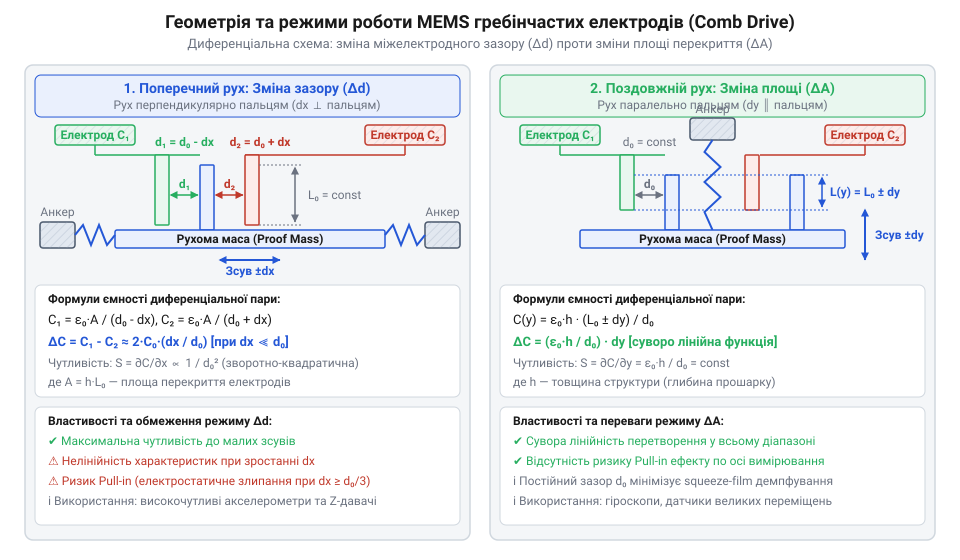
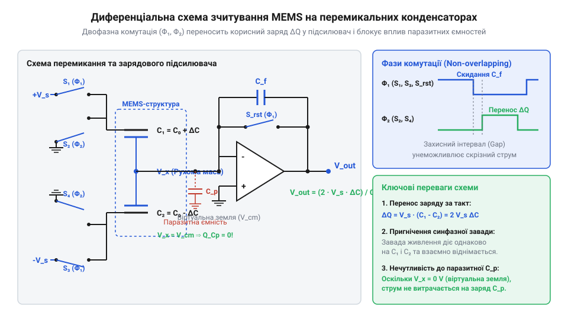
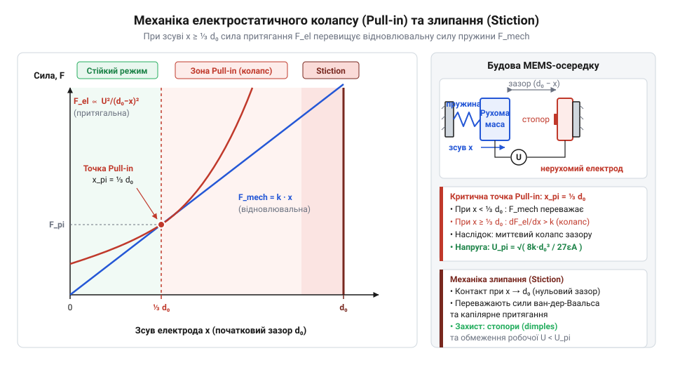

# Принципи ємнісного вимірювання в MEMS-структурах

<preknowlist>
- [GY-61 ADXL335 — 3-осьовий акселерометр](root:cat-hw-sensors/adxl335) — базові уявлення про аналоговий відгук 3-осьових ємнісних акселерометрів та принцип вимірювання прискорення
- [ADXL345 — 3-осьовий цифровий акселерометр](root:cat-hw-sensors/adxl345) — розуміння архітектури цифрового MEMS-акселерометра з вбудованим перетворювачем ємності в цифру
- [GY-521 / MPU-6050 — 6-осьовий IMU (акселерометр+гіроскоп)](root:cat-hw-sensors/mpu6050) — принцип поєднання ємнісних мікроструктур акселерометра та гіроскопа на єдиному кристалі
</preknowlist>

## Чому мікромеханіка вимагає ємнісного підходу

Вимірювання нанометрового зміщення інертної маси в кремнієвому кристалі під дією прискорення натрапляє на жорсткі обмеження мікромасштабу. Класичні макроскопічні підходи тут непридатні: тензорезистори вимагають протікання струму й дають високий тепловий шум та температурний дрейф нуля; індуктивність мікрокотушок прямує до нуля через омічні втрати; оптичні системи вимагають складних гетерогенних процесів, несумісних зі стандартною технологією виробництва напівпровідників.

Ємнісний підхід розв'язує ці проблеми. Конденсатор у статиці не споживає струму, а повітряний чи вакуумний зазор забезпечує виняткову температурну стабільність. Мікрообробка кремнію дозволяє формувати зазори в 1–2 мікрометри, що забезпечує початкову ємність (від лат. *capacitas* — місткість) фемтофарадного рівня (1 `fF` = 10⁻¹⁵ `F`) для @@en|MEMS@@-пристроїв (від англ. *Micro-Electro-Mechanical Systems* — мікроелектромеханічні системи). У цьому середовищі зсув рухомого елемента — @@en|proof mass@@ (інертної маси) — безпосередньо змінює геометрію конденсатора.

## Перетворення механічного зсуву в ємність

Ємність плоского конденсатора з площею електродів `A` та зазором `d` становить `C = ε₀ · ε_r · A / d`. Зсув рухомого електрода `x` змінює зазор до `d₀ - x`, через що ємність `C(x)` залежить від зміщення нелінійно.

У мікромеханіці використовують @@en|comb drive@@ (гребінчасті структури) у двох режимах:
- @@en|variable gap mode@@ (режим зміни зазору) дає високу чутливість `ΔC / Δx = ε₀ · A / d₀²`, але зберігає нелінійність;
- @@en|variable area mode@@ (режим зміни площі) змінює площу перекриття `A(x) = h · x` строго лінійно, але має нижчу чутливість.


*Геометрія гребінчастої мікроструктури: зміщення інертної маси змінює зазори d₁ та d₂, утворюючи лінійний диференційний сигнал.*

Поєднати чутливість і лінійність дозволяє @@en|differential topology@@ (диференційна топологія). Рухомий палець розміщують між двома нерухомими, формуючи конденсатори `C₁` та `C₂`. При зсуві `x` зазори стають `d₀ - x` та `d₀ + x`, а різниця ємностей дорівнює:

```
ΔC = C₁ - C₂
   = (ε₀ · A / (d₀ - x)) - (ε₀ · A / (d₀ + x))   [різниця ємностей]
   = ε₀ · A · (2 · x / (d₀² - x²))                [зведення до спільного знаменника]
```

Для малих зміщень `x ≪ d₀` доданком `x²` у знаменнику нехтують:

```
ΔC ≈ 2 · C₀ · (x / d₀)
```

Сигнал стає лінійним відносно `x`, а віднімання скасовує синфазні завади від температури й живлення. Такі структури працюють в [акселерометрах ADXL335](root:cat-hw-sensors/adxl335) та [модулях MPU-6050](root:cat-hw-sensors/mpu6050).

## Зчитування фемтофарадного сигналу підсилювачами заряду

Корисна зміна ємності `ΔC` у мікроструктурах становить одиниці фемтофарад (`fF`), тоді як паразитна ємність `C_p` підкладки, корпусу та плати сягає пікофарад (`pF`). Через `C_p >> ΔC` звичайний підсилювач напруги шунтує сигнал на землю.

Проблему усуває @@en|charge amplifier@@ (підсилювач заряду) з ємністю зворотного зв'язку `C_f`. Вхід підсилювача утворює @@en|virtual ground@@ (віртуальну землю) з постійним потенціалом. Вихідну напругу `V_out` за вхідної напруги `V_in` задає співвідношення:

```
V_out = - V_in · (ΔC / C_f)
```

Відсутність змінної напруги на вхідній лінії блокує струм через паразитну ємність `C_p`, ізолюючи вимірювальний тракт.


*Схема зчитування на перемикальних конденсаторах: віртуальна земля підсилювача заряду усуває вплив паразитних ємностей C_p.*

Практичне зчитування виконують схеми на @@en|switched-capacitor circuit@@ (перемикальних конденсаторах) на частотах 100 `kHz` — 1 `MHz`. Захист від витоків дає @@en|active guarding@@ (активне екранування), де буфер вирівнює потенціал екрану й лінії. Архітектура працює в [акселерометрі ADXL345](root:cat-hw-sensors/adxl345), поєднаному з [підсистемою IIO в Linux](root:cat-hw-sensors/iio-subsystem-linux-kernel).

## Фізичні обмеження та електростатичний колапс

Зменшення початкового зазору `d₀` підвищує чутливість, але викликає нелінійні обмеження. Прикладена напруга `V` створює між пальцями з площею перекриття `A` при зміщенні `x` @@en|electrostatic force@@ (електростатичну силу притягання):

```
F_el = (1/2) · (ε₀ · A / (d₀ - x)²) · V²
```

де `ε₀` — електрична стала. Їй протидіє механічна сила підвіски `F_mech = k · x` з жорсткістю `k` (@@en|spring constant@@).


*Криві механічної та електростатичної сил: при перевищенні зсуву d₀/3 виникає електростатичний колапс pull-in.*

Механічна сила зростає лінійно зі зміщенням `x`, тоді як електростатична — нелінійно. При `x_critical = d₀ / 3` приріст електростатичної сили перевищує `k`. Рівновага втрачається і виникає @@en|pull-in collapse@@ (електростатичний колапс): рухомий палець миттєво притягується до нерухомого.

Після доторку Ван-дер-Ваальсові та капілярні сили значно перевищують `F_mech`, викликаючи @@en|stiction@@ (поверхневе злипання; від англ. *sticky friction*). Для захисту застосовують механічні обмежувачі ходу та гідрофобні покриття.

Газ між пальцями створює @@en|squeeze-film damping@@ (демпфування стислим газовим прошарком). Його тиск задає @@en|quality factor@@ (добротність `Q`): критичне демпфування (`Q = 0.5`) запобігає резонансу акселерометра, а в гіроскопах для високої `Q` створюють вакуум. Динаміку мікроструктур ілюструють [Pololu IMU на базі LSM6DS33](root:cat-hw-sensors/pololu-imu) та [9-осьовий IMU MPU-9250](root:cat-hw-sensors/mpu9250).