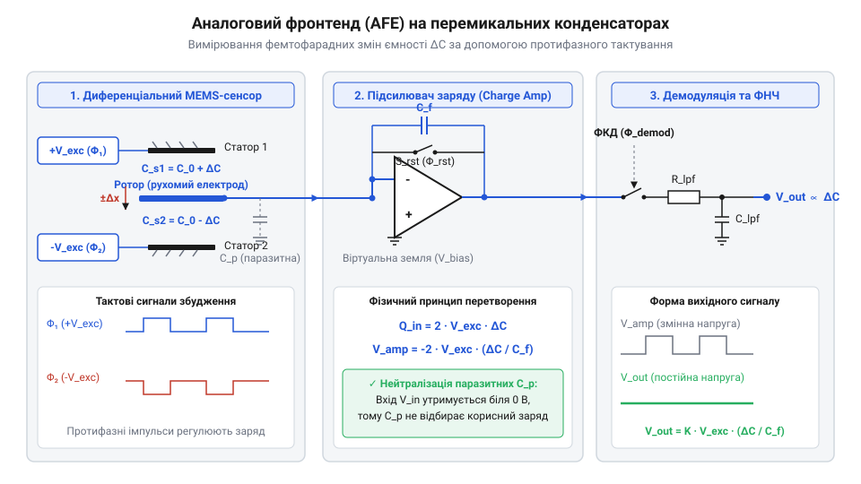
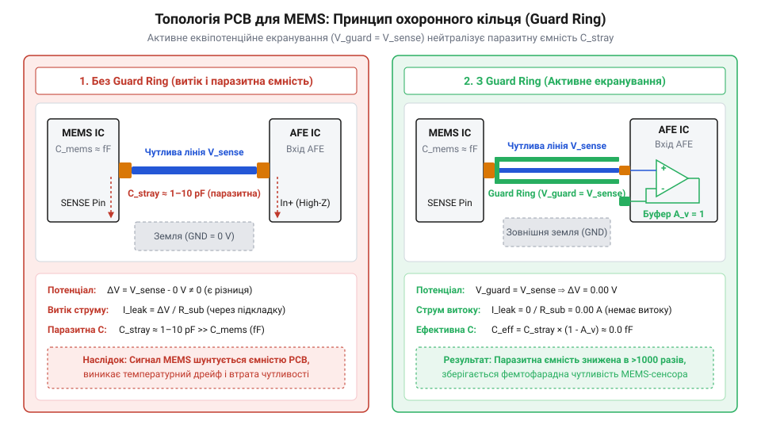

# Проєктування аналогового тракту зчитування та обробки сигналу для диференціального MEMS-ємнісного сенсора

<preknowlist>
- [GY-61 ADXL335 — 3-осьовий акселерометр](root:cat-hw-sensors/adxl335) — Принцип вимірювання прискорення за допомогою аналогового MEMS-сенсора та загальна конструкція ємнісного мосту.
- [ADXL345 — 3-осьовий цифровий акселерометр](root:cat-hw-sensors/adxl345) — Архітектура інтеграції аналогового фронтенду з аналого-цифровим перетворювачем у цифрових інерційних сенсорах.
</preknowlist>

## Проблема вимірювання фемтофарадних змін ємності

Робота мікроелектромеханічних систем (MEMS) часто ґрунтується на вимірюванні надзвичайно малих змін ємності. Коли рухома маса сенсора зміщується під дією прискорення або кутової швидкості, відстань між обкладками диференціального конденсатора змінюється, що призводить до відхилень ємності порядку кількох фемтофарад (1 фФ = 10⁻¹⁵ Ф). 

Безпосереднє вимірювання настільки мізерних величин є нетривіальним завданням. Проблема полягає в тому, що паразитні ємності самої друкованої плати, контактних майданчиків та вхідних каскадів мікросхем можуть сягати пікофарад (1 пФ = 1000 фФ), що на кілька порядків перевищує корисний сигнал. Крім того, низькочастотні шуми (зокрема, флікер-шум 1/f) та дрейфи нуля створюють значні перешкоди на низьких частотах, де зазвичай лежить спектр механічних коливань. 

Щоб подолати ці обмеження, необхідно перейти від прямого вимірювання напруги до диференціальної схеми з високочастотною модуляцією. Подача на обкладки MEMS-структури протифазних високочастотних сигналів дозволяє перенести корисний сигнал у вищу частотну область, де вплив низькочастотних шумів мінімальний, а диференціальне зчитування забезпечує ефективне пригнічення синфазних завад і паразитних наведень.

## Аналоговий фронтенд на перемикальних конденсаторах

Для перетворення крихітних змін заряду диференціального конденсатора в вимірювану напругу застосовується аналоговий фронтенд (AFE) на основі підсилювача заряду (Charge Sensitive Amplifier, CSA) з перемикальними конденсаторами.

Ця архітектура використовує принцип дискретного перенесення заряду. Під час однієї фази тактового сигналу (наприклад, 0°) обкладки диференціального конденсатора збуджуються протифазними напругами, а під час іншої (180°) їхня полярність змінюється на протилежну. У момент перемикання фаз відбувається перерозподіл зарядів у вимірювальному мості. Оскільки центральна рухома маса підключена до високоімпедансного інвертуючого входу операційного підсилювача, який утримується під потенціалом віртуальної землі, нескомпенсований заряд, що виникає через асиметрію ємностей при зміщенні маси, не може стекти на землю. Натомість цей залишковий заряд вимушено перетікає на конденсатор у ланцюзі зворотного зв'язку зарядового підсилювача, формуючи на його виході пропорційний рівень напруги. Обираючи оптимальну частоту збудження (часто понад 100 кГц), система виходить із зони сильного 1/f-шуму.

Для керування вимірювальним трактом можна використовувати мікроконтролер, який програмно генерує протифазні сигнали та зчитує відгук. У коді на мові C драйвер ініціалізує ШІМ-таймери та проводить калібрування зсуву нуля за допомогою ЦАП:

:::code proj-mems-capacitive-signal-chain/c/src/mems_capacitive.c

Ємності зворотного зв'язку в підсилювачі обираються так, щоб забезпечити високу чутливість (крутизну перетворення), але при цьому уникнути насичення вихідного каскаду. В результаті на виході AFE формується амплітудно-модульований сигнал, де амплітуда носія пропорційна вимірюваному зміщенню маси.

## Синхронна демодуляція та низькочастотна фільтрація

Отриманий високочастотний модульований сигнал потребує виділення корисної інформації про механічне зміщення. Це завдання вирішується за допомогою синхронної демодуляції, що працює синфазно з тактовим сигналом збудження MEMS-структури.

Фазочутливий демодулятор перемножує вихідний сигнал AFE на опорний меандр (або його цифрову копію у випадку програмної обробки). Математично цей процес можна пояснити на прикладі гармонічних сигналів: перемноження двох синфазних сигналів однакової частоти дає `sin(ω·t) · sin(ω·t) = 0.5 - 0.5·cos(2ω·t)`. Тут `0.5` — це постійна складова (DC), пропорційна корисній амплітуді, а другий доданок — високочастотна компонента на подвійній частоті. Таким чином, сигнали, що збігаються за фазою з носієм, утворюють постійну складову, тоді як несинхронні завади та шуми переносяться на вищі частоти.

Цей механізм також блискуче пригнічує квадратурні завади (наприклад, від паразитних струмів витоку), які зсунуті за фазою на 90°. Перемноження таких сигналів дає `sin(ω·t) · cos(ω·t) = 0.5·sin(2ω·t)`, що взагалі не містить DC-складової і легко відфільтровується.

Після демодуляції сигнал пропускається через фільтр низьких частот (ФНЧ). Фільтр видаляє високочастотні пульсації на подвійній частоті носія та інші шуми, залишаючи лише корисний низькочастотний сигнал, що відповідає фізичному руху MEMS-сенсора. Частота зрізу ФНЧ визначає корисну смугу пропускання сенсора (наприклад, від 0 до 100 Гц). 

Об'єктно-орієнтована реалізація драйвера на C++ забезпечує інкапсуляцію цих процесів та зручне керування режимами демодуляції:

:::code proj-mems-capacitive-signal-chain/cpp/include/mems_capacitive_driver.hpp

Сформований і відфільтрований аналоговий сигнал є готовим для оцифрування (якщо це не зроблено раніше) та використання в алгоритмах навігації чи стабілізації. Завдяки синхронному виділенню сигналу на тлі шумів та грамотному трасуванню плати з охоронними кільцями, досягається висока точність вимірювання навіть за наявності значних паразитних ємностей.

## Екранування та нейтралізація паразитних ємностей

Робота з MEMS-сенсорами стикається з критичною проблемою: зміна ємності під час руху мікромеханічних структур становить лічені фемтофаради (10⁻¹⁵ Ф), що співрозмірно або навіть менше за паразитні ємності самої друкованої плати. На високоімпедансних входах аналогового тракту, де вимірюється настільки слабкий сигнал, будь-який паразитний витік чи наводка від сусідніх цифрових ліній здатні повністю спотворити результат. 

Для захисту чутливих вузлів застосовується екранування та створення активних охоронних кілець (guard rings). Суть методу полягає в оточенні сигнальної лінії провідником, на який подається той самий потенціал (еквіпотенціальний сигнал), що й на самій сигнальній лінії. Оскільки різниця потенціалів між ними дорівнює нулю, струм витоку через паразитну ємність не протікає.

Трасування диференціальних ліній від MEMS-сенсора до підсилювача заряду (AFE) має бути абсолютно симетричним. Асиметрія довжини або ширини доріжок одразу вносить додаткову різницю ємностей, яку доведеться компенсувати при подальшому калібруванні. Крім того, аналогова й цифрова землі мають бути чітко розділені й з'єднані в одній точці (star grounding) під мікросхемою аналого-цифрового перетворювача для усунення перехресних завад по шині живлення.

## Калібрування та інтеграція вимірювального тракту

Навіть за ідеального трасування фізична MEMS-структура має технологічну асиметрію ємностей у стані спокою. Тому інтеграція вимірювального тракту вимагає процедури автокалібрування зсуву нуля, яка виконується мікроконтролером відразу після ініціалізації системи.

За допомогою цифро-аналогового перетворювача (ЦАП) підбирається компенсаційна напруга, яка вводиться у вимірювальний міст або на вхід підсилювача, балансуючи його. Метод бінарного пошуку дозволяє швидко (за N кроків, де N — розрядність ЦАП) знайти код, що зводить різницевий сигнал до мінімуму. 

:::code proj-mems-capacitive-signal-chain/c/src/mems_capacitive.c

Після встановлення нульового рівня в динаміці виконується синхронна демодуляція. Різницевий сигнал зчитується синхронно з двома фазами (0° і 180°) тактового збудження. Це дозволяє відкинути синфазні завади та низькочастотний флікер-шум. Подальше цифрове згладжування за допомогою експоненціального фільтра змінного середнього (EMA) стабілізує показання, знижуючи рівень високочастотних шумів.

:::code proj-mems-capacitive-signal-chain/c/src/main.c

Експериментальна верифікація зкаліброваного тракту підтверджує його здатність надійно реєструвати відгук MEMS-структури. Сигнал пропорційний мікромеханічному зміщенню, а розраховане відношення сигнал/шум та масштабні коефіцієнти дозволяють передати готові фізичні дані на рівень алгоритмів вищого порядку.