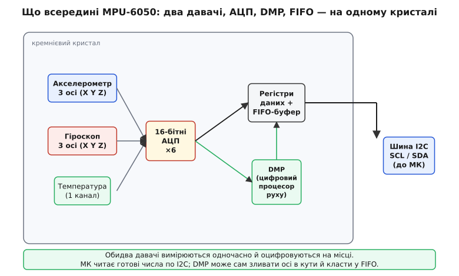
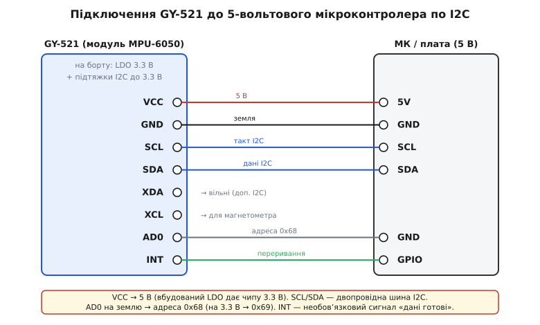
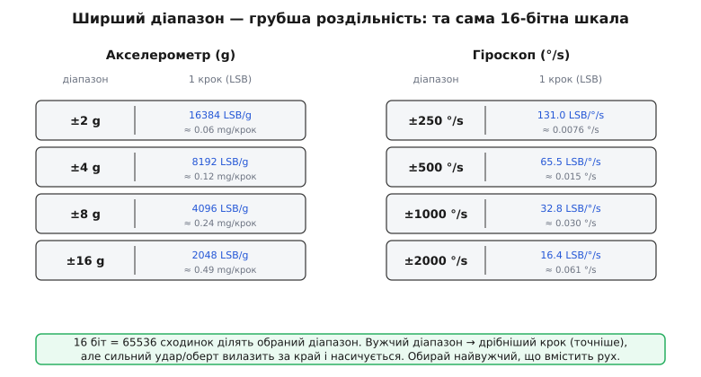

# GY-521 / MPU-6050 — 6-осьовий IMU (акселерометр+гіроскоп)

Модуль GY-521 на базі мікросхеми InvenSense MPU-6050 є найпопулярнішим у світі доступним інерційним вимірювальним блоком (IMU — Inertial Measurement Unit). Він поєднує на одному кремнієвому кристалі тривісний MEMS-акселерометр, тривісний MEMS-гіроскоп, прецизійний давач температури та цифровий співпроцесор руху DMP (Digital Motion Processor). Завдяки інтерфейсу I2C модуль дозволяє мікроконтролеру визначати просторову орієнтацію, кути нахилу та динаміку руху об'єкта.

## 1. Концепція 6-осьового IMU та призначення давачів

Для визначення просторового положення об'єкта в тривимірному просторі необхідні два принципово різні типи вимірювань:
- **Лінійне прискорення по трьох осях (X, Y, Z):** вимірюється акселерометром і слугує для виявлення ударів, вібрацій, лінійного переміщення та визначення вектора сили тяжіння Землі.
- **Кутова швидкість обертання навколо трьох осей (Yaw, Pitch, Roll):** вимірюється гіроскопом і показує швидкість повороту тіла в градусах за секунду (°/s).



Поєднання цих двох приладів називається 6-осьовим IMU (6 DoF — Degrees of Freedom, шість ступенів вільності). Жоден із сенсорів окремо не здатний надати надійний кут нахилу під час руху:
1. **Акселерометр** ідеально визначає напрямок «де низ» у повному спокої (за вектором тяжіння 1g), але під час руху змішує гравітацію з динамічним прискоренням і чутливий до високочастотних вібрацій.
2. **Гіроскоп** не реагує на лінійні прискорення та вібрації, видаючи чисту швидкість обертання, проте накопичує інтегральну похибку — дрейф нуля (Zero-rate drift), через що обчислений кут за кілька хвилин починає спливати.

## 2. Принцип дії кремнієвих MEMS-структур

Мікроелектромеханічні системи (MEMS) всередині MPU-6050 виготовлені за спеціальною технологією вертикальної інтеграції Насірі (Nasiri-Fabrication), що дозволила поєднати кремнієву механіку та стандартну CMOS-електроніку на рівні пластини:

- **MEMS-акселерометр:** складається з підвішеної на мікроскопічних кремнієвих пружинах інерційної маси з гребінчастими рухомими електродами, розташованими між нерухомими пластинами. Під дією прискорення маса зміщується, змінюючи диференціальну електричну ємність конденсаторів. Вбудована схема перетворює різницю ємностей у напругу, яка оцифровується 16-бітним АЦП.
- **MEMS-гіроскоп:** використовує коріолісову силу. Внутрішня кремнієва рамка безперервно коливається на резонансній частоті за допомогою електростатичного приводу. Коли сенсор починає обертатися навколо осі, перпендикулярно до напрямку коливань виникає сила Коріоліса, яка зміщує рамку в бік. Це бокове зміщення фіксується ємнісними давачами та перетворюється на вихідне число, пропорційне кутовій швидкості.

## 3. Схема підключення модуля GY-521 та шина I2C

Плата GY-521 містить стабілізатор напруги з малим падінням (LDO) на 3.3 В та підтягувальні резистори шини I2C номіналом 4.7 кОм. Модуль живиться напругою від 3.3 В до 5 В через контакт VCC.



Розпіновка контактів GY-521:
- **VCC:** вхід живлення (3.3–5 В).
- **GND:** спільний провід (земля).
- **SCL / SDA:** лінії синхронізації та даних шини I2C. Підключаються до відповідних I2C-виводів мікроконтролера.
- **XCL / XDA:** допоміжна шина I2C (Auxiliary I2C Master), до якої можна підключити зовнішній тривісний магнетометр (наприклад, HMC5883L або AK8963) для створення повноцінної 9-осьової системи орієнтації (AHRS).
- **AD0:** біт вибору адреси I2C. Якщо AD0 підключено до GND, адреса сенсора становить `0x68`. Якщо AD0 підтягнуто до VCC (3.3 В), адреса змінюється на `0x69`. Це дозволяє використовувати два незалежних сенсори MPU-6050 на одній шині I2C.
- **INT:** вихід апаратного переривання мікроконтролера (сигналізує про готовність нових даних, переповнення FIFO або спрацьовування детектора руху).

## 4. Шкали чутливості та переведення сирих даних

Кожен канал сенсора видає 16-бітне ціле число зі знаком (тип `int16_t`) у діапазоні від -32768 до +32767. Програмне переведення отриманого цілого значення у фізичні одиниці (g для прискорення та градуси за секунду для гіроскопа) здійснюється діленням на коефіцієнт чутливості (Sensitivity Scale Factor).



Сенсор підтримує 4 програмовані діапазони вимірювання для кожного блоку:

| Давач | Повна шкала (Full Scale) | Коефіцієнт чутливості (LSB) | Формула розрахунку |
| :--- | :--- | :--- | :--- |
| **Акселерометр** | ±2 g | **16384 LSB/g** | `a = raw / 16384.0` |
| | ±4 g | **8192 LSB/g** | `a = raw / 8192.0` |
| | ±8 g | **4096 LSB/g** | `a = raw / 4096.0` |
| | ±16 g | **2048 LSB/g** | `a = raw / 2048.0` |
| **Гіроскоп** | ±250 °/s | **131.0 LSB/(°/s)** | `w = raw / 131.0` |
| | ±500 °/s | **65.5 LSB/(°/s)** | `w = raw / 65.5` |
| | ±1000 °/s | **32.8 LSB/(°/s)** | `w = raw / 32.8` |
| | ±2000 °/s | **16.4 LSB/(°/s)** | `w = raw / 16.4` |

Для статичних вимірювань нахилу та побутових приладів завжди обирають найчутливіший діапазон: ±2g та ±250 °/s. Для швидкісних спортивних квадрокоптерів шкалу гіроскопа розширюють до ±2000 °/s, щоб уникнути насичення сенсора при різких переворотах.

Вбудований давач температури оцифровується тим самим АЦП і переводиться у градуси Цельсія за формулою:
```
T_celsius = (raw_temp / 340.0) + 36.53
```

## 5. Калібрування нуля та концепція сенсорного злиття

Перед використанням MPU-6050 у точних вимірювальних завданнях обов'язково виконуються процедури калібрування:
1. **Калібрування зміщення гіроскопа (Gyro Offset):** коли плата нерухомо лежить на столі, показання гіроскопа повинні дорівнювати нулю. Проте через механічні напруження кристала завжди існує постійне зміщення (наприклад, +2.5 °/s). Прошивка зчитує 500–1000 послідовних зразків у нерухомому стані, обчислює середнє арифметичне зміщення по осях X, Y, Z та віднімає його від кожного наступного вимірювання.
2. **Сенсорне злиття (Sensor Fusion):** для обчислення стабільного кута нахилу (тангажу та крен) застосовують **комплементарний фільтр** або **фільтр Калмана**. Гіроскоп забезпечує швидку та гладку реакцію на повороти без затримок, а акселерометр повільно коригує дрейф інтегратора, повертаючи розрахунковий кут до абсолютного вектора земного тяжіння:
   ```
   angle = 0.98 * (angle + gyro_rate * dt) + 0.02 * accel_angle
   ```
Це просте рівняння дозволяє системам стабілізації дронів, камер та роботів отримувати точну орієнтацію без складних обчислень.
