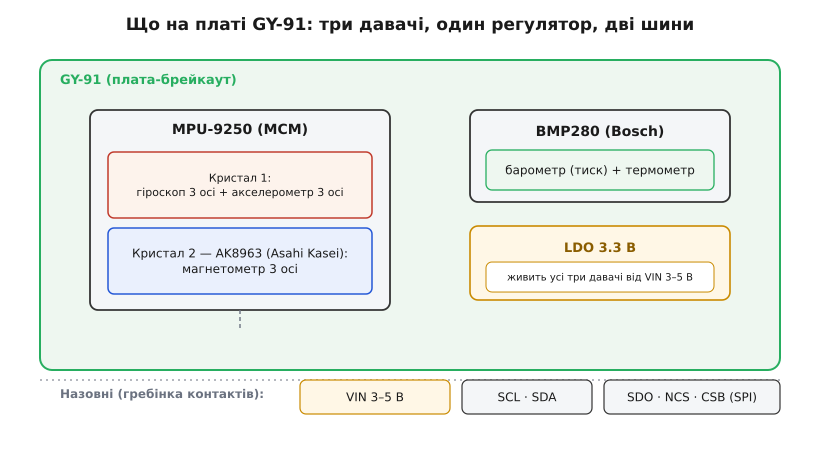
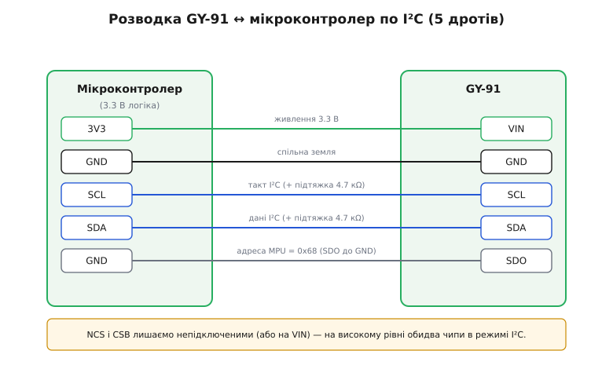

# GY-91 / MPU-9250 — 9/10-осьовий IMU (+BMP280)

<preknowlist>
- [GY-521 / MPU-6050 — 6-осьовий IMU (акселерометр+гіроскоп)](root:cat-hw-sensors/mpu6050) — принципи вимірювання прискорення й кутової швидкості та сенсорне злиття їхніх даних
- [GY-271 / HMC5883L — компас/магнетометр](root:cat-hw-sensors/hmc5883l) — використання 3-осьового магнетометра як абсолютного орієнтира напрямку на північ
</preknowlist>

## Чому орієнтація потребує кількох давачів

Визначення точного положення у просторі вимагає компенсації недоліків окремих сенсорів. Гіроскоп швидко реагує на поводження пристрою, але накопичує часовий дрейф при інтегруванні кутової швидкості. Акселерометр показує вектор сили тяжіння для обчислення крену та тангажу, але чутливий до вібрацій і поштовхів. Коли [шестиосьовий інерційний модуль](root:cat-hw-sensors/mpu6050) визначає кути нахилу, йому бракує прив'язки до сторін світу, а [окремий цифровий компас](root:cat-hw-sensors/hmc5883l) легко збивається зовнішнім залізом чи магнітними завадами. Для визначення висоти польоту потрібен ще й барометр. Модуль @@en|GY-91@@ об'єднує вимірювання 10 осей на одній платі для підключення алгоритмів сенсорного злиття. Способи об'єднання показань вектора сили тяжіння й кутової швидкості описують [алгоритми сенсорного злиття](root:math-probability/sensor-fusion) для стабільної орієнтації.

## Двокристальна будова MPU-9250 та BMP280

Плату @@en|GY-91@@ побудовано на трьох окремих чипах, розміщених у єдиній конструкції. В основі інерційного блоку лежить @@en|MPU-9250@@ — пристрій типу @@en|MCM@@ (від @@en|Multi-Chip Module@@ — багатокристальний модуль), всередині корпусу якого встановлено два кремнієві кристали: шестиосьовий давач прискорення й обертання та триосьовий магнетометр @@en|AK8963@@. Поруч на платі розташовано барометр @@en|BMP280@@. Вбудований регулятор живлення @@en|LDO@@ (від @@en|Low Dropout@@ — регулятор із малою спадною напругою) на 3.3 В дає змогу подавати на вхід 3–5 В. Суміщення кристалів забезпечує жорстке механічне узгодження осей вимірювань усіх сенсорів.

*Розподіл кремнієвих кристалів MPU-9250 та барометра BMP280 на спільній друкованій платі.*

## Шини зв'язку та адресація пристроїв

Модуль підтримує шини @@en|I²C@@ та @@en|SPI@@. При використанні @@en|I²C@@ кожен пристрій має власний ідентифікатор: акселерометр із гіроскопом @@en|MPU-9250@@ відповідають за адресою `0x68`, магнетометр @@en|AK8963@@ — за `0x0C`, а барометр @@en|BMP280@@ — за `0x76`. Перевірку наявності чипа виконують зчитуванням регістра @@en|WHO_AM_I@@ за адресою `0x75`, який повертає значення `0x71`. Для доступу до магнетометра застосовують режим @@en|Bypass@@ для прямої адресації з мікроконтролера або режим вбудованого майстра, у якому @@en|MPU-9250@@ сам опитує @@en|AK8963@@. Шина @@en|I²C@@ обмежена частотою 400 кГц, тоді як @@en|SPI@@ дає змогу налаштовувати регістри на 1 МГц та вичитувати дані на швидкості до 20 МГц.

## Правила живлення та узгодження рівнів

Подача живлення на вивід @@en|VIN@@ у межах 3–5 В є безпечною завдяки вбудованому регулятору, але всі сигнальні лінії модуля залишаються 3.3-вольтовими. Пряме підключення до мікроконтролерів із 5-вольтовою логікою може призвести до деградації напівпровідникових структур давачів. Лінії шини потребують підтягувальних резисторів до напруги 3.3 В або двонапрямних конвертерів рівнів. Для фіксації режиму @@en|I²C@@ виводи вибору чипа @@en|NCS@@ та @@en|CSB@@ необхідно підтягнути до високого рівня 3.3 В.

*Схема безпечного підключення GY-91 до шини I²C з підтяжкою ліній вибору чипа.*

## Масштабування даних та особливості експлуатації

Давачі віддають вимірювання у вигляді 16-бітного знакового цілого числа з регістрів. Для переведення в фізичні одиниці сирі значення ділять на розрахунковий коефіцієнт @@en|LSB@@ (від @@en|Least Significant Bit@@ — молодший значущий розряд): при чутливості `±2 g` для акселерометра він становить `16384 LSB/g`, а при `±250 °/s` для гіроскопа — `131 LSB/(°/s)`. Для магнетометра кожен крок дорівнює `0.15 мкТ/LSB` з урахуванням заводських коефіцієнтів калібрування @@en|ASA@@. Зважайте, що @@en|MPU-9250@@ має статус @@en|EoL@@ (від @@en|End of Life@@ — кінець життєвого циклу) і не має прямої регістрової сумісності з наступником @@en|ICM-20948@@, але плата @@en|GY-91@@ залишається популярною у польотних контролерах та балансувальних роботах. Деталі архітектури оновленого 9-осьового модуля наведено в описі [сучасного датчика ICM-20948](root:cat-hw-sensors/icm20948), який змінив застарілу серію.
