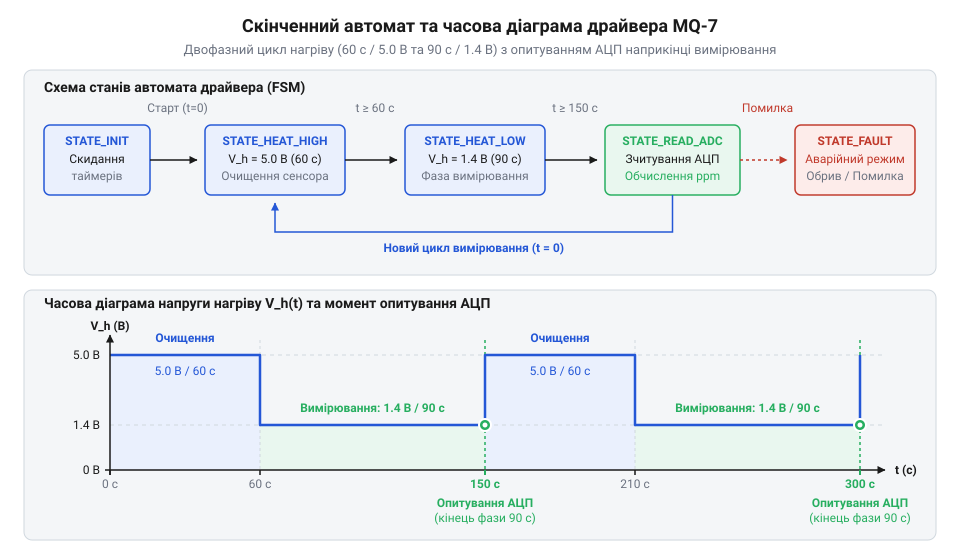
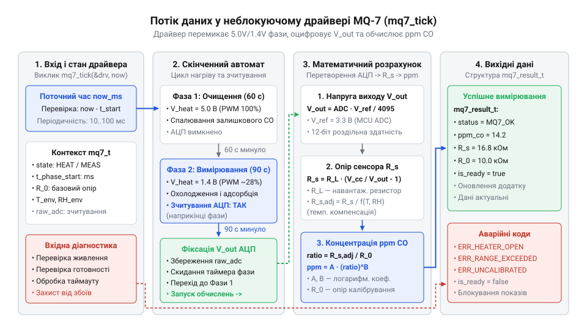

# Програмний інтерфейс драйвера MQ-7: керування циклами нагріву та обробка сигналів

<preknowlist>
- [Родина MQ (напівпровідникові давачі газу)](root:cat-hw-sensors/mq-family) — фізичний принцип зміни опору напівпровідника під дією CO та загальні температурні характеристики
- [MQ — давач газу (Keyes K869051)](root:cat-hw-sensors/mq-gas) — схемотехніка вимірювального дільника напруги та електричні параметри нагрівача
</preknowlist>

## Проблема блокування систем вимірювання CO

Вимірювання концентрації чадного газу (@@en|carbon monoxide@@, CO) є критично важливою задачею для систем безпеки, оскільки цей газ не має кольору та запаху, а його накопичення в приміщенні становить пряму загрозу життю. Для виявлення CO застосовують напівпровідникові сенсори серії MQ-7. Фізичний принцип їхньої роботи вимагає циклічного двоетапного нагріву: 60 секунд при напрузі живлення нагрівача 5.0 В та 90 секунд при зниженій напрузі 1.4 В. Сумарна тривалість одного вимірювального циклу становить 150 секунд.

Прямолінійний підхід до програмування керування давачем полягає у послідовному виклику функцій затримки:

```cpp
// Прямолінійне, але хибне блокуюче керування
digitalWrite(HEATER_PIN, HIGH); // 5.0 В на нагрівач
delay(60000);                   // Очікування 60 секунд
analogWrite(HEATER_PIN, 71);    // ~1.4 В (ШІМ-заповнення 28%)
delay(90000);                   // Очікування 90 секунд
int raw_adc = analogRead(ADC_PIN);
```

Використання процедур блокування на зразок `delay()` протягом 150 секунд створює катастрофічну проблему для мікроконтролера (англ. @@en|microcontroller unit@@, MCU). Протягом цього тривалого інтервалу процесор виконує порожній цикл очікування, втрачаючи здатність реагувати на будь-які зовнішні події. У реальних вбудованих системах (англ. @@en|embedded systems@@) це призводить до пропущення переривань від користувацьких кнопок, зависання мережевих протоколів, відсутності відгуку на запити шин зв'язку та навіть до спрацьовування сторожового таймера (англ. @@en|watchdog timer@@).

Ще небезпечнішим є той факт, що при блокуванні процесора система не зможе миттєво обробити сигнали від інших критичних сенсорів. Наприклад, якщо під час очищення MQ-7 виникне локальне займання, сигнал від [оптичного давача полумʼя](root:cat-hw-sensors/ky-026-flame) буде знехтуваний, а тривожна сигналізація не увімкнеться вчасно.

Для забезпечення високої реактивності та надійності системи вимірювання CO програмний модуль (драйвер, англ. @@en|driver@@, від @@en|drive@@) повинен бути побудований за неблокуючою архітектурою на основі скінченного автомата (лат. @@la|automatus@@, від грец. @@el|automatos@@, англ. @@en|finite state machine@@). Драйвер виконує свої операції короткими неподільними кроками (тиками, англ. @@en|tick@@), відстежуючи плин часу за допомогою системних таймерних міток без блокування основного потоку виконання `main loop`.

## Архітектура автомата станів та циклу нагріву

Неблокуюча робота з давачем MQ-7 спирається на чітко визначений скінченний автомат станів, який описує всі фази життя вимірювального циклу. Цикл розбивається на два головні часові етапи: фазу високотемпературного очищення (англ. @@en|purge phase@@) та фазу низькотемпературного вимірювання (англ. @@en|measurement phase@@).

Під час фази очищення (5.0 В, 60 секунд) нагрівальний елемент досягає температури близько 400 °C. Це необхідно для десорбції молекул газу та продуктів окиснення, що накопичилися на поверхні діоксиду олова. У цій фазі вимірювальний опір сенсора `R_s` не відображає реальну концентрацію CO, тому опитування аналогово-цифрового перетворювача (АЦП, англ. @@en|analog-to-digital converter@@) заборонене.

Після завершення 60 секунд автомат перемикає живлення нагрівача на знижену напругу 1.4 В (зазвичай шляхом модуляції ширини імпульсів, ШІМ, англ. @@en|pulse-width modulation@@ з коефіцієнтом заповнення близько 28%). Тривалість низьковольтного нагріву становить 90 секунд. Протягом перших 88 секунд цієї фази сенсор поступово охолоджується до робочої температури близько 150 °C, при якій молекули CO вибірково адсорбуються на його поверхні. Точний замір напруги АЦП виконується виключно наприкінці вимірювальної фази — в останній 1–2 секунди інтервалу, коли тепловий режим та хімічна рівновага повністю стабілізувалися.


*Граф станів драйвера MQ-7 та часова діаграма двоетапного нагріву із заморожуванням замірів до моменту термостабілізації наприкінці низьковольтної фази.*

Основними станами автомата є:
1. `MQ7_STATE_PREHEAT`: Початковий прогрів після увімкнення живлення для виходу сенсора на стабільний режим. 2. `MQ7_STATE_HIGH_HEAT`: Фаза високотемпературного очищення (5.0 В, 60 с, ШІМ 100%). 3. `MQ7_STATE_LOW_HEAT`: Фаза низькотемпературної адсорбції CO (1.4 В, 90 с, ШІМ ~28%). 4. `MQ7_STATE_READING`: Миттєвий стан зчитування аналогового сигналу АЦП наприкінці фази `LOW_HEAT`. 5. `MQ7_STATE_FAULT`: Аварійний стан при виявленні несправності кола нагрівача або часових збоїв.

Перехід між станами здійснюється шляхом порівняння поточного часу мікроконтролера з часовою міткою останнього переключення `last_state_change_ms`. Це дає змогу драйверу обробляти часові інтервали без затримки виконання інших процесів системи.

## Ініціалізація та конфігурація структури драйвера

Для забезпечення гнучкості та переношуваності драйвера між різними мікроконтролерними платформами цілісно відокремлюють параметри апаратного забезпечення від внутрішнього стану драйвера. Згідно з рекомендаціями для [родини напівпровідникових давачів](root:cat-hw-sensors/mq-family), конфігурація описується окремою структурою даних.

Структура конфігурації визначає параметри АЦП, пінів керування, напруги живлення та значення навантажувального резистора `R_L`:

```c
// Конфігураційна структура драйвера MQ-7
typedef struct {
    uint8_t adc_channel;          // Номер каналу АЦП
    uint8_t pwm_gpio_pin;         // Пін керування ключем нагрівача (ШІМ)
    float v_ref_mv;               // Опорна напруга АЦП у мілівольтах (наприклад, 3300.0f)
    uint32_t adc_max_value;       // Максимальне значення АЦП (4095 для 12-біт)
    float rl_kohm;                // Опір навантажувального резистора R_L у кОм (наприклад, 10.0f)
    float r0_kohm;                // Базовий опір R_0 у чистому повітрі (кОм)
    uint32_t high_heat_time_ms;   // Тривалість фази 5.0 В (60000 мс)
    uint32_t low_heat_time_ms;    // Тривалість фази 1.4 В (90000 мс)
} mq7_config_t;
```

Внутрішній стан драйвера зберігає поточний стан автомата, часові мітки, виміряні величини та прапорці готовності даних:

```c
// Структура внутрішнього стану драйвера MQ-7
typedef struct {
    mq7_config_t config;          // Копія конфігурації
    mq7_state_t state;            // Поточний стан FSM
    uint32_t last_state_change_ms;// Часова мітка переходу стану
    uint32_t last_tick_ms;        // Часова мітка останнього виклику tick()
    uint16_t raw_adc_value;       // Останнє сире значення АЦП
    float rs_kohm;                // Поточний обчислений опір сенсора R_s
    float co_ppm;                 // Обчислена концентрація CO в ppm
    bool data_ready;              // Прапорець наявності свіжого вимірювання
    mq7_error_t error_code;       // Код останньої помилки
} mq7_t;
```

Функція ініціалізації `mq7_init()` приймає вхідні налаштування, перевіряє їх коректність, налаштовує таймер ШІМ та переводить автомат у початковий стан `MQ7_STATE_HIGH_HEAT`.

Розглянемо реалізацію ініціалізації двома мовами у вигляді вкладок:

:::tabs
@tab C (ESP-IDF)
:::code api-mq7-driver/c/esp-idf/mq7-init.c
@tab C++ (Arduino)
:::code api-mq7-driver/cpp/arduino/mq7state.cpp
:::

## Періодичний крок виконання та зчитування даних

Серцем неблокуючого драйвера є функція `mq7_tick()`. Вона має викликатися у головному циклі програми якомога частіше (наприклад, у кожній ітерації `loop()` або за періодичним таймером кожні 10–50 мілісекунд).

Функція `mq7_tick()` виконує такі кроки:
1. Перевіряє поточний час та обчислює інтервал з моменту останнього переходу стану. 2. Якщо автомат перебуває у стані `MQ7_STATE_HIGH_HEAT` і 60 секунд вичерпано, змінює рівень ШІМ на 28% (~1.4 В на нагрівачі) та переходить у стан `MQ7_STATE_LOW_HEAT`. 3. Якщо автомат перебуває у стані `MQ7_STATE_LOW_HEAT` і 90 секунд добігають кінця (наприклад, за 200 мс до завершення фази), драйвер виконує опитування АЦП, розраховує опір `R_s` та концентрацію `ppm`, після чого встановлює прапорець `data_ready = true`. 4. Після завершення 90 секунд низького нагріву автомат перемикає ШІМ назад на 100% і повертається до стану `MQ7_STATE_HIGH_HEAT` для початку нового 150-секундного циклу.


*Конвеєр обробки давача у виклику mq7_tick(): оцінка часових інтервалів, зчитування АЦП, обчислення поточного опору сенсора та оновлення вихідної структури.*

Нижче наведено повну реалізацію функції тику та методів зчитування виміряних даних:

:::tabs
@tab C (ESP-IDF)
:::code api-mq7-driver/c/esp-idf/mq7-process-measurement.c
@tab C++ (Arduino)
:::code api-mq7-driver/cpp/arduino/snippet-4.cpp
:::

## Калібрування R0 та температурна компенсація

Точність вимірювання концентрації CO повністю залежить від правильності визначення базового опору сенсора у чистому повітрі `R_0`. Як описує [схемотехніка давачів газу](root:cat-hw-sensors/mq-gas), вимірювальний елемент сенсора утворює дільник напруги із постійним навантажувальним резистором `R_L`.

Напруга на виході дільника `V_out` обчислюється з виміряного значення АЦП, після чого визначається опір сенсора `R_s`:

    V_out = (ADC_raw / ADC_max) * V_cc
    R_s = R_L * (V_cc - V_out) / V_out         [формула вимірювального дільника напруги]

Для давача MQ-7 співвідношення опору сенсора у чистому повітрі `R_s_clean` до базового опору `R_0` є специфікованою константою виробника і становить приблизно 27.0 (при температурі 20 °C та відносній вологості 65%). 

Процедура калібрування виконується у приміщенні із завідомо чистим повітрям після витримування давача у робочому режимі щонайменше 10–15 хвилин (кілька повних 150-секундних циклів). Розрахунок `R_0` здійснюється за формулою:

    R_0 = R_s_clean / 27.0                      [калібрувальне значення опору в чистому повітрі]

Знайдене значення `R_0` зберігається у незмінній пам'яті мікроконтролера (EEPROM або NVS) і використовується при кожному запуску пристрою. Про методи запису та зчитування коефіцієнтів у EEPROM та flash-пам'яті дивіться матеріал про [збереження калібрувальних коефіцієнтів у енергонезалежній пам'яті](root:sys-fw/nvs-calibration-storage).

Після визначення `R_0` поточна концентрація чадного газу у частках на мільйон (англ. @@en|parts per million@@, ppm) розраховується за степеневою залежністю:

    ratio = R_s / R_0                          [відношення поточного опору до базового]
    ppm = 98.53 * (ratio ^ -1.52)              [степенева формула розрахунку концентрації CO]

Однак опір `R_s` напівпровідникового матеріалу залежить не лише від концентрації CO, а й від температури `T` та відносної вологості повітря `H`. Якщо температура навколишнього середовища відхиляється від еталонних 20 °C, драйвер повинен застосовувати температурну компенсацію. Поправковий коефіцієнт `K(T, H)` обчислюється за апроксимаційною таблицею або лінійною формулою:

    ratio_corr = (R_s / R_0) / K_temp_hum      [температурно-компенсоване відношення]
    ppm_corr = 98.53 * (ratio_corr ^ -1.52)     [скоригована концентрація CO]

Застосування компенсації дає змогу уникнути хибних спрацьовувань тривоги при коливаннях температури в приміщенні від 0 °C до +50 °C. Докладніше про термодинамічні залежності опору сенсорів та алгоритми обчислення поправкових коефіцієнтів читайте у статті про [температурну та вологісну компенсацію давачів газу](root:cat-hw-sensors/mq7-temperature-humidity-compensation).

## Діагностика та обробка виняткових ситуацій

Надійність роботи драйвера в критичних системах безпеки вимагає постійної самодіагностики апаратного стану давача та дотримання часових регламентів.

Драйвер MQ-7 ідентифікує такі основні виняткові ситуації:

1. **Обрив або замикання кола нагрівача (англ. @@en|open circuit@@):**
   Якщо транзисторний ключ нагрівача пошкоджено або нагрівальний елемент перегорів, сенсор залишається холодним. При цьому хімічна реакція відновлення не відбувається, а опір `R_s` стає надто високим або прямує до нескінченності (`V_out ≈ 0`). Якщо обчислене значення `R_s < 0.5 кОм` або `R_s > 500.0 кОм`, драйвер фіксує помилку `MQ7_ERR_HEATER_FAULT`.

2. **Затримки та збої періодичності тиків (англ. @@en|jitter@@):**
   Якщо основний потік виконання `main loop` виявився заблокованим іншим завданням і функція `mq7_tick()` не викликалася триваліший час, ніж допустимий поріг (наприклад, понад 2.0 секунди), температурний профіль нагріву сенсора порушується. Драйвер виявляє цю умову:

    delta_t = current_time_ms - last_tick_ms   [інтервал між викликами тику]
    delta_t > 2000 мс                          [умова перевищення допустимого відхилення часу]

   У разі виявлення такого часового зсуву поточний вимірювальний цикл скасовується, встановлюється код помилки `MQ7_ERR_TIMEOUT`, а автомат примусово скидається до початкової фази високого нагріву `MQ7_STATE_HIGH_HEAT`.

3. **Неприпустиме значення базового опору `R_0`:**
   При виконанні процедури калібрування значення `R_0` має перебувати в межах заводського допуску (зазвичай від 2.0 кОм до 20.0 кОм). Якщо отримане значення виходить за ці межі, це свідчить про фізичну деградацію сенсорного елемента або забруднення повітря CO під час калібрування.

При виникненні будь-якої з перелічених помилок драйвер вимикає ШІМ нагрівача (переводить у безпечний стан 0%), скидає прапорець `data_ready` та сповіщає верхній рівень ПЗ про несправність системи моніторингу CO.