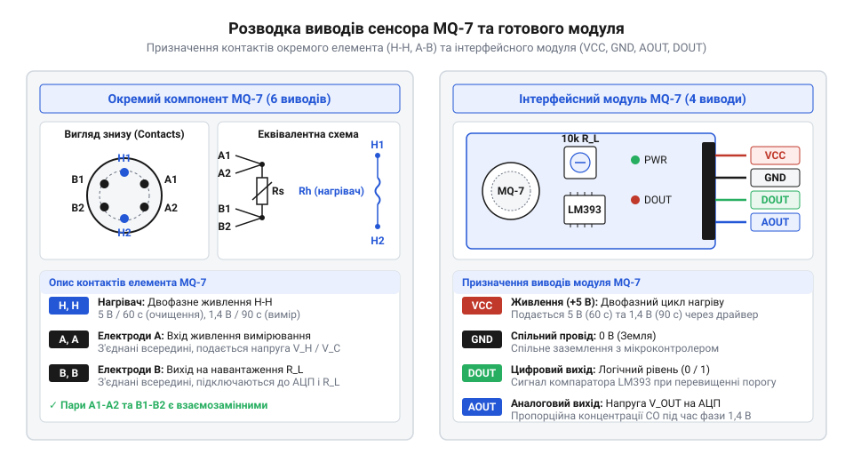
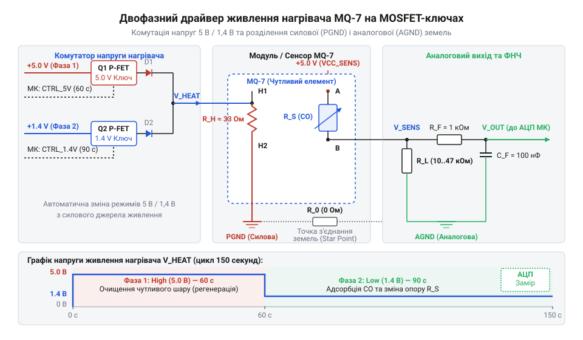

# Апаратний інтерфейс MQ-7: розводка, параметри нагрівача та схема керованого живлення

<preknowlist>
- [Родина MQ (напівпровідникові давачі газу)](root:cat-hw-sensors/mq-family) — Принцип зміни опору діоксиду олова під дією відновлювальних газів та базову структуру напівпровідникових елементів.
- [MQ — давач газу (Keyes K869051)](root:cat-hw-sensors/mq-gas) — Стандартне компонування виводів аналогово-цифрових модулів давачів газу та принцип роботи компаратора DOUT.
</preknowlist>

## Необхідність циклічного нагріву для виявлення CO

Якщо підключити напівпровідниковий давач чадного газу @@en|MQ-7@@ до постійної напруги 5 В, як це робиться для більшості інших сенсорів газу, пристрій швидко втрачає здатність виявляти @@en|CO@@. Перші кілька хвилин аналоговий вихід показує зміну опору, але згодом чутливість падає майже до нуля, а показання стають нестабільними.

Причина полягає у фізико-хімічних властивостях чутливого шару на основі діоксиду олова (від лат. @@la|stannum@@ — олово, @@en|SnO₂@@). У звичайних [напівпровідникових давачах газу](root:cat-hw-sensors/mq-family) робочий матеріал нагрівається до сталої високої температури, за якої відбуваються хімічні реакції відновлення. Проте молекула чадного газу за високих температур активного нагріву швидко окислюється поверхневими іонами кисню ще до утворення стійкого адсорбційного комплексу, а сама матриця @@en|SnO₂@@ засліплюється й отруюється іншими газами та вологою. Для виправлення цього явища потрібен двофазний температурний режим.

Низькотемпературна фаза (приблизно 150 °C) забезпечує вибіркову адсорбцію чадного газу. За такої температури молекули @@en|CO@@ зв'язуються з поверхневими іонами кисню на кристалічних ґратках діоксиду олова, віддаючи електрони в зону провідності. Це приводить до відчутного зниження внутрішнього опору сенсора `R_s`. Однак тривале перебування при 150 °C спричиняє накопичення продуктів реакції та сторонніх газів, які заповнюють усі активні центри напівпровідника, через що вимірювальний шар виснажується.

Щоб звільнити поверхню, застосовують високотемпературну фазу очищення (приблизно 400 °C). Під дією високої температури всі адсорбовані молекули газу та волога вигорають і десорбуються з поверхні, відновлюючи вихідну матрицю @@en|SnO₂@@.

Апаратна реалізація такого процесу вимагає циклічного перемикання напруги на нагрівальному елементі сенсора:
1. **Фаза очищення (регенерації)**: На нагрівач подається напруга 5.0 В ± 0.1 В тривалістю **60 секунд**. Нагрівальна спіраль розжарює тонкоплівковий елемент до 400 °C, випаровуючи накопичені домішки та регенеруючи поверхню. 2. **Фаза вимірювання (адсорбції)**: Напруга знижується до 1.4 В ± 0.1 В і утримується протягом **90 секунд**. Температура знижується до 150 °C, створюючи умови для вибіркового зв'язування @@en|CO@@.

Повний цикл вимірювання триває 150 секунд. Ключовою вимогою до джерела живлення є точне дотримання напругових рівнів (5 В та 1.4 В) і стійкість до струмових кидків під час перемикання фаз.

## Розводка виводів модуля та компонента MQ-7

Працюючи з сенсором @@en|MQ-7@@, розробник може зустріти дві фізичні форми виконання: окремий шестипіновий керамічний компонент (колбу) або готову друковану плату (модуль) із чотирма контактами. Спроба підключити модуль за стандартною схемою живлення 5 В призводить до того, що нагрівач постійно працює у високотемпературному режимі очищення, унеможливлюючи вимірювання чадного газу.

Індивідуальний сенсор @@en|MQ-7@@ виконано у круглому керамічному корпусі типу @@en|TO-5@@ із захисною металевою сіткою. З нижньої сторони знаходяться шість виводів, розташованих колом:
- Виводи **H** та **H** (виводи нагрівача): Підключені до внутрішньої ніхромової спіралі. Опір спіралі `R_H` становить близько 33 Ом. Живлення нагрівача подається саме між цими двома контактами, незалежно від полярності. - Виводи **A1**, **A2** та **B1**, **B2** (вимірювальні контакти): Виводи **A1** та **A2** внутрішньо з'єднані між собою і підключені до одного краю чутливого напівпровідникового шару. Виводи **B1** та **B2** також з'єднані всередині й підключені до протилежного краю шару.

У схемі вимірювання контакти групи **A** підключають до напруги живлення вимірювального кола `V_c` (5 В), а контакти групи **B** з'єднують із навантажувальним резистором `R_L`, другий кінець якого заземлюють.


*Розводка контактів сенсора MQ-7 в індивідуальному корпусі та на платі модуля.*

На відміну від окремого компонента, [типовий модуль MQ-7](root:cat-hw-sensors/mq-gas) пропонує чотири вихідні контакти:
1. `VCC` — шина живлення всієї плати. 2. `GND` — спільна земля. 3. `AOUT` — аналоговий вихід із дільника між опором сенсора `R_s` та резистором `R_L`. 4. `DOUT` — цифровий вихід зі вбудованого компаратора (на базі мікросхеми @@en|LM393@@), поріг спрацьовування якого налаштовується підлаштовним потенціометром.

Апаратна пастка більшості дешевих модулів полягає у тому, що лінія живлення нагрівача `H` жорстко розведена на друкованій платі до загального контакту `VCC`. Якщо подати на `VCC` імпульсну напругу 1.4 В для фази вимірювання, компаратор @@en|LM393@@ втрачає працездатність через вихід за межі робочої напруги. Тому для повноцінного використання модуля необхідно або живити весь модуль від керованого джерела (і знімати тільки аналоговий сигнал `AOUT`), або перерізати доріжку живлення нагрівача на платі та вивести окремий дріт керування нагріванням.

## Розрахунок опору навантаження для АЦП

Опір чутливого шару `R_s` давача @@en|MQ-7@@ неможливо виміряти аналогово-цифровим перетворювачем (від англ. @@en|analog-to-digital converter@@ — @@en|ADC@@ / АЦП) напряму, оскільки мікроконтролер вимірює напругу, а не опір. Для перетворення зміни опору в напруговий сигнал формують послідовний дільник, у якому чутливий елемент з'єднують із постійним навантажувальним резистором `R_L`.

Схема дільника складається з послідовно увімкнених опору сенсора `R_s` та опору навантаження `R_L`, до яких прикладено вимірювальну напругу `V_c` (зазвичай 5.0 В). Вихідний аналоговий сигнал `U_out` знімається з вузла між `R_s` та `R_L`.

Напруга `U_out` визначається за формулою дільника:

```
U_out = V_c × R_L / (R_s + R_L)
```

де:
- `V_c` — напруга живлення вимірювального кола (Вольт);
- `R_s` — опір напівпровідникового шару сенсора (Ом);
- `R_L` — опір навантажувального резистора (Ом);
- `U_out` — вихідна аналогова напруга на контакті `AOUT` (Вольт).

Для обчислення поточного опору сенсора `R_s` за відомою напругою `U_out` формулу перетворюють:

```
R_s = R_L × (V_c - U_out) / U_out
    = R_L × (V_c / U_out - 1)    [винесення U_out за дужки]
```

Вибір величини `R_L` визначає чутливість схеми та динамічний діапазон входів АЦП. Для @@en|MQ-7@@ опір у чистому повітрі `R_0` становить від 2 кОм до 20 кОм (типове значення близько 10 кОм). За наявності чадного газу концентрацією 100 ppm (від англ. @@en|parts per million@@ — частин на мільйон) опір `R_s` зменшується приблизно в 3–10 разів і падає до 2–20 кОм.

Якщо обрати опір `R_L` занадто малим (наприклад, 1 кОм), вихідна напруга `U_out` буде близькою до нуля, а корисний сигнал займатиме лише невелику частину розрядності АЦП. Якщо ж обрати `R_L` занадто великим (наприклад, 100 кОм), напруга `U_out` швидко досягне значення `V_c` навіть за низьких концентрацій газу, що призведе до насичення сигналу.

Оптимальне значення `R_L` має бути сумірним з опором сенсора `R_0` у повітрі або середнім геометричним між мінімальним та максимальним `R_s`. На практиці обирають резистор із діапазону від 10 кОм до 47 кОм.

**Обчислення вихідної напруги для типових умов**

Умови: Напруга живлення вимірювального кола `V_c = 5.0` В, обрано опір навантаження `R_L = 10.0` кОм.

Крок 1. Обчислення вихідної напруги `U_out` у чистому повітрі за опору сенсора `R_s = 10.0` кОм:

```
U_out = 5.0 × 10.0 / (10.0 + 10.0)
      = 50.0 / 20.0               [додавання опорів у знаменнику]
      = 2.50                      [вихідна напруга у вольтах]
```

Висновок: Сигнал у чистому повітрі перебуває посередині діапазону 0–5 В.

Крок 2. Обчислення вихідної напруги `U_out` при появі @@en|CO@@ (концентрація 100 ppm), коли опір `R_s` знижується до `2.0` кОм:

```
U_out = 5.0 × 10.0 / (2.0 + 10.0)
      = 50.0 / 12.0               [додавання опорів у знаменнику]
      = 4.17                      [вихідна напруга у вольтах]
```

Висновок: При зміні концентрації від нуля до 100 ppm вихідна напруга зростає з 2.50 В до 4.17 В. Це дає розмах сигналу 1.67 В, що легко узгоджується з АЦП мікроконтролера. Обчислені значення напруги надалі використовують у [програмі калібрування](root:cat-hw-sensors/mq7-software-calibration).

## Схеми драйверів керованого живлення нагрівача

Реалізація двофазного циклу вимагає апаратури, здатної надійно комутувати струм нагрівача (до 180 мА при 5 В) і підтримувати стабільні рівні 5.0 В та 1.4 В без внесення завад у вимірювальне коло АЦП. Ззвичайний вихід мікроконтролера не здатний видавати такий струм напряму, тому застосовують спеціалізовані драйвери.

Найбільш поширеними є два схемотехнічні підходи:
1. **Дволінійне комутування на MOSFET-ключах**:
   Використовують регулятор напруги (наприклад, лінійний регулятор @@en|LM317@@ або @@en|LM1117-ADJ@@), налаштований на фіксований вихід 1.4 В. Нагрівач постійно підключений до лінії 1.4 В через розв'язувальний діод. Паралельно увімкнено P-канальний або N-канальний @@en|MOSFET@@ (від англ. @@en|metal-oxide-semiconductor field-effect transistor@@ — метало-оксид-напівпровідниковий польовий транзистор) ключ, керований виводом @@en|GPIO@@ мікроконтролера. Коли ключ відкритий, на нагрівач подається 5.0 В; коли закритий — напруга падає до 1.4 В.

2. **ШІМ-керування з активною фільтрацією**:
   Нагрівач живиться від шини 5 В через силовий транзистор, на затвор якого подається сигнал широтно-імпульсної модуляції (від англ. @@en|pulse-width modulation@@ — @@en|PWM@@ / ШІМ). Двофазний режим реалізують зміною коефіцієнта заповнення імпульсів:
   - За 100% заповнення діюча напруга становить 5.0 В (фаза 60 с). - Для отримання еквівалентної діючої напруги 1.4 В розраховують коефіцієнт заповнення `D`:

```
D = (V_target / V_supply)²
  = (1.4 / 5.0)²                  [підстановка напруг 1.4 В та 5.0 В]
  = 0.28²                         [ділення напруг]
  = 0.0784                        [коефіцієнт у частках]
```

У відсотках коефіцієнт заповнення `D` становить 7.84%. Пряме подання імпульсного ШІМ-сигналу на нагрівач без фільтрації створює потужні високочастотні наведення у вимірювальному колі `AOUT`. Тому після транзистора обов'язково встановлюють згладжувальний LC-фільтр (дросель та конденсатор) для перетворення ШІМ на постійну напругу.


*Схема драйвера керованого живлення нагрівача на базі MOSFET-ключа.*

Важливим принципом проектирования друкованої плати є розділення силової землі (`PGND` / від англ. @@en|power ground@@) та аналогової землі (`AGND` / від англ. @@en|analog ground@@). Струм нагрівача, що протікає через силову землю, створює падіння напруги на паразитному опорі доріжок. Якщо аналогова земля АЦП з'єднана з силовою землею в довільному місці, це падіння напруги додається до сигналу `AOUT`, спричиняючи хибні показання. Обидві землі з'єднують лише в одній точці — безпосередньо біля виходу джерела живлення («зіркова земля»).

Нижче наведено приклад коду керування таймінгом двофазного циклу для платформ @@en|Arduino@@ та @@en|ESP-IDF@@:

:::tabs
:::code api-mq7-hardware/cpp/arduino/setup.cpp
:::code api-mq7-hardware/c/esp-idf/mq7-heater-task.c
:::

## Усунення апаратних збоїв та завад живлення

Під час роботи драйвера живлення нагрівача розробники нерідко стикаються з раптовими перезавантаженнями мікроконтролера, хаотичними збоями АЦП або високим рівнем завад у сигналі `AOUT`. Причиною більшості таких проблем є імпульсний характер споживання струму та температурна інерція напівпровідникового елемента.

Подібно до схем розводки, які використовуються в [інших аналогових давачах](root:cat-hw-sensors/ky-026-flame), збереження чистоти сигнальної лінії вимагає цілеспрямованої фільтрації.

Основними джерелами апаратних збоїв є:
1. **Падіння та осідання напруги живлення**:
   У момент увімкнення фази нагріву 5 В холодний нагрівач давача споживає піковий струм понад 200 мА. Якщо джерело живлення має недостатній запас потужності або довгі з'єднувальні провідники, напруга на шині 5 В просідає нижче порога спрацьовування детектора просідання живлення (від англ. @@en|brown-out detector@@ — @@en|BOD@@) мікроконтролера, спричиняючи його перезапуск.

   Для усунення осідання поруч із драйвером нагрівача встановлюють електролітичний згладжувальний конденсатор ємністю 470–1000 мкФ з низьким еквівалентним послідовним опором (від англ. @@en|equivalent series resistance@@ — @@en|ESR@@), паралельно з яким вмикають керамічний конденсатор ємністю 0.1 мкФ для шунтування високочастотних завад.

2. **Завади та пульсації на аналоговому виході `AOUT`**:
   Робота ШІМ-регуляторів або сусідніх цифрових кіл наводить високочастотні шуми на високоомну лінію `AOUT`. Для очищення сигналу безпосередньо перед входом АЦП мікроконтролера монтують пасивний низькочастотний @@en|RC-фільтр@@ (резистор 1 кОм та конденсатор 100 нФ).

   Частоту зрізу фільтра `f_c` обчислюють за формулою:

```
f_c = 1 / (2 × π × R × C)
    = 1 / (2 × 3.14159 × 1000 × 100 × 10⁻⁹)    [підстановка R=1000 Ом та C=100 нФ]
    = 1 / (6.28318 × 10⁻⁴)                     [множення у знаменнику]
    = 1591.55                                  [значення частоти у герцах]
```

Отримана частота зрізу близько 1.59 кГц ефективно зрізає високочастотні завади ШІМ та імпульсних джерел, не затримуючи повільну зміну концентрації газу.

3. **Температурна інерція та вибір моменту вимірювання**:
   Після перемикання з напруги 5.0 В на 1.4 В керамічна колба сенсора не охолоджується миттєво. Процес охолодження від 400 °C до 150 °C триває близько 30–40 секунд. Зчитування даних з АЦП на початку фази 1.4 В призводить до суттєвих похибок, оскільки хімічна рівновага на поверхні @@en|SnO₂@@ ще не встановилася.

   Апаратне та програмне правило: вимірювання напруги `AOUT` необхідно виконувати суворо наприкінці 90-секундної фази вимірювання (на 80–89 секунді), коли температура стабілізувалася на рівні 150 °C.

4. **Оптимізація трасування друкованої плати**:
   Доріжку аналогового сигналу `AOUT` слід робити якомога коротшою, огороджуючи її захисним заземленим провідником або мідним полігоном аналогової землі `AGND`. Силові доріжки живлення нагрівача мають мати ширину не менше 0.8–1.0 мм для зменшення паразитного опору та індуктивності.