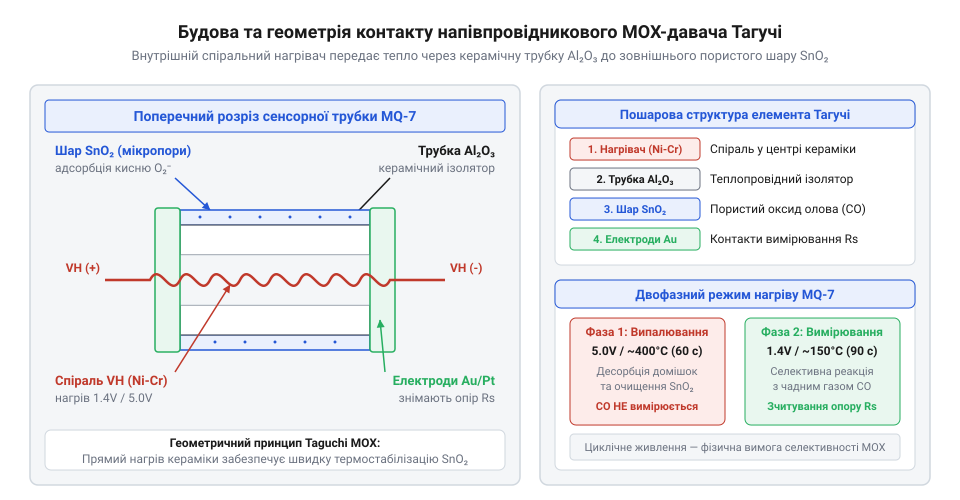
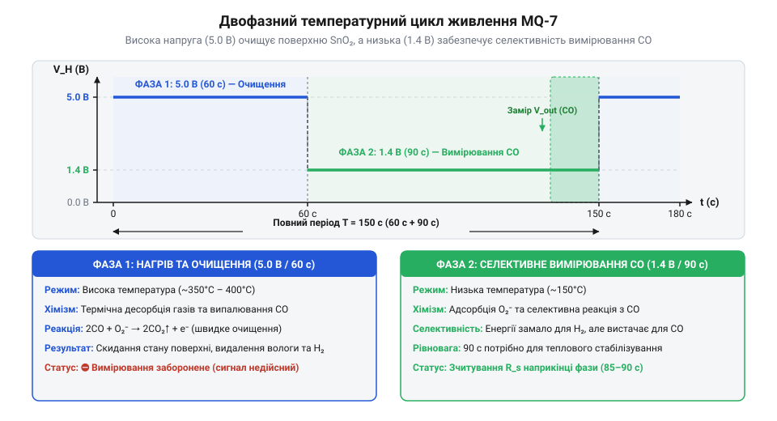

# Еволюція напівпровідникових давачів газу та винайдення циклічного нагріву

<preknowlist>
- [Родина MQ (напівпровідникові давачі газу)](root:cat-hw-sensors/mq-family) — Загальне призначення та базова класифікація MOX-давачів у сучасній електроніці
- [MQ — давач газу (Keyes K869051)](root:cat-hw-sensors/mq-gas) — Принцип підключення аналогового модуля та робота нагрівача
</preknowlist>

## Небезпека витоків та невидимий газ

В урбанізованому місті 1950-х років побутовий газ упевнено входив у тисячі помешкань та промислових цехів. Масова газифікація принесла дешеве тепло й зручність, але разом із ними створила постійну невидиму загрозу. Побутовий газ тих часів — @@en|коксовий газ@@ (англ. *coal gas*) чи природна суміш вуглеводнів — містив метан, пропан і отруйний @@en|чадний газ@@ (англ. *carbon monoxide*, CO). Непомітне витікання вибухонебезпечної суміші через пошкоджені труби чи згаслий пальник упевнено наближало концентрацію газу до порогу вибуху. Достатньо було найменшої іскри від вимикача світла, щоб цілий житловий будинок перетворився на згарище.

Ще підступнішою проблемою виявився сам @@en|чадний газ@@. Він утворюється під час неповного згоряння будь-якого вуглеводневого палива в умовах дефіциту кисню — у печах, газових колонках чи двигунах внутрішнього згоряння. @@en|Чадний газ@@ не має ані кольору, ані запаху, ані смаку. Потрапляючи до легенів, CO миттєво зв'язується з гемоглобіном крові, створюючи карбоксигемоглобін. Спорідненість гемоглобіну до чадного газу у 200 разів вища, ніж до кисню, тому навіть мізерна концентрація @@en|чадного газу@@ у повітрі блокує транспортування кисню до тканин мозку та серця. Людина втрачає свідомість і гине від гіпоксії ще до того, як усвідомить небезпеку.

У середині XX століття промислові прилади для аналізу газів уже існували, але вони були громіздкими, дорогими й вимагали складного обслуговування. Вчені застосовували спектрометрію в інфрачервоному діапазоні, вологий хімічний аналіз чи оптичні вимірювачі. Такі системи коштували сотні доларів, займали цілі лабораторні стійки й вимагали постійної заміни хімічних реактивів. У домашніх умовах єдиним захистом тривалий час лишалися спеціальні одоранти — смердючі домішки на основі меркаптанів, які додавали до побутового газу. Проте одоранти не рятували під час сну, а @@en|чадний газ@@ від несправного димаря взагалі не містив жодних запахів.

Примітивні пожежні сповіщувачі того часу також не вирішували проблему витоку. Наприклад, [прості оптичні датчики](root:cat-hw-sensors/ky-026-flame) реагують лише тоді, коли полум'я вже спалахнуло і вибух чи пожежа сталися. Створити пристрій, який попереджав би про накопичення невидимого газу до катастрофи, у 1950-х роках було неможливо без кардинально нового підходу. Виникла гостра інженерна потреба: розробити компактний, твердотільний і наддешевий сенсор без рухомих частин чи рідких реактивів, здатний працювати безперервно 24 години на добу та споживати мінімум електроенергії.

## Відкриття Тагучі та керамічні SnO₂-сенсори

Розв'язання цієї проблеми знайшов японський винахідник @@ja|Наойоші Тагучі@@ (яп. 田口尚義, Taguchi Naoyoshi). У листопаді 1968 року він запатентував спосіб виявлення газів за допомогою напівпровідникових металооксидів і заснував компанію @@ja|Figaro Engineering@@ (яп. フィガロ技研株式会社, Figaro Giken). @@ja|Наойоші Тагучі@@ виявив, що полікристалічний @@en|діоксид олова@@ (англ. *tin dioxide*, SnO₂) змінює свій електричний опір на кілька порядків під час контакту з молекулами газів-відновників у навколишньому повітрі. Це відкриття започаткувало клас пристроїв, які сьогодні називають @@en|MOX-давач@@ (англ. *metal-oxide semiconductor*, металооксидний напівпровідник).


*Конструкція класичного MOX-сенсора першого покоління з керамічним циліндром, внутрішньою спіраллю нагрівання та зовнішнім чутливим шаром.*

Фізичний механізм роботи @@en|MOX-давач@@ ґрунтується на поверхневих електронних явищах. Чистий @@en|діоксид олова@@ є напівпровідником n-типу. Щоб сенсор почав реагувати на газ, його необхідно нагріти до високої температури — від 300°C до 400°C. При такій температурі молекули кисню з атмосферного повітря захоплюють вільні електрони з зони провідності SnO₂ і осідають на поверхні кристалітів у вигляді негативно заряджених іонів. Цей процес називається @@en|хемосорбція@@ (грец. *chemia* — хімія та лат. *sorbere* — поглинати).

Накопичення негативного заряду на поверхні зерен SnO₂ утворює @@en|збіднений шар@@ (англ. *depletion layer*) — область, з якої витіснені носії заряду. Між сусідніми мікроскопічними кристалами виникають потенціальні бар'єри, які заважають проходженню струму. У чистому повітрі опір шару SnO₂ сягає сотень кілоом. Коли ж у повітрі з'являється газ-відновник (наприклад, метан CH₄, пропан або @@en|чадний газ@@ CO), його молекули вступають у хімічну реакцію з хемосорбованими іонами кисню. Газ окислюється, а захоплені електрони повертаються назад у зону провідності SnO₂. Потенціальні бар'єри між зернами миттєво знижуються, @@en|збіднений шар@@ тоншає, і загальний електричний опір напівпровідника стрімко падає.

Конструктивно перший сенсор @@ja|Наойоші Тагучі@@, відомий під торговою маркою @@en|TGS@@ (англ. *Taguchi Gas Sensor*, газовий сенсор Тагучі), складався з пористої керамічної трубки з оксиду алюмінію Al₂O₃. Всередину трубки вставляли ніхромову спіраль нагрівача, яка розжарювала кераміку до робочої температури. На зовнішню поверхню трубки наносили тонкий шар порошку SnO₂ з додаванням каталізаторів (паладію або платини) та виводили золоті електроди для зчитування опору. Зовні конструкцію захищали двома шарами металевої сітки, яка виконувала роль вогнеперешкодника, унеможливлюючи займання довколишнього газу від гарячого нагрівача. Докладніше про історію створення та розробку перших модифікацій читайте у статті про [огляд винайдення та еволюції перших японських сенсорів серії TGS](root:cat-hw-sensors/tgs-sensors).

Винайдення @@ja|Наойоші Тагучі@@ дозволило вперше створити масові побутові сигналізатори газу. Згодом конструкцію мініатуризували, що привело до створення [широкої родини напівпровідникових](root:cat-hw-sensors/mq-family) сенсорів. Проте перші сенсори @@en|TGS@@ від @@ja|Figaro Engineering@@ працювали в стаціонарному режимі — нагрівач підключили до постійної напруги 5V, утримуючи поверхню при незмінній температурі. Практична експлуатація швидко виявила фундаментальні фізико-хімічні обмеження такого підходу.

## Фізичні обмеження стаціонарного температурного режиму

Постійний нагрів чутливого шару до температури близько 350°C–400°C чудово працює для виявлення горючих вуглеводнів, але виявляється непридатним для селективного аналізу @@en|чадного газу@@. Головною перешкодою стаціонарного режиму є висока @@en|перехресна чутливість@@ (англ. *cross-sensitivity*). При високій температурі енергії активації вистачає для окислення практично будь-яких газів-відновників. Напівпровідниковий шар однаково активно реагує на метан, пропан, водень H₂ та пари етилового спирту C₂H₅OH. Якщо сенсор налаштовано на стаціонарний нагрів, прилад не здатен відрізнити смертельну концентрацію CO від випарів алкоголю чи побутової хімії під час прибирання.

Знизити робочу температуру нагрівача настільки, щоб окислювати лише @@en|чадний газ@@, також неможливо через фізико-хімічні властивості SnO₂. Реакція окислення CO має найвищу швидкість при порівняно низьких температурах — від 100°C до 150°C. Проте при такій низькій температурі з'являються дві нездоланні проблеми:
1. Водяна пара та важкі органічні молекули з повітря міцно адсорбуються на поверхні діоксиду олова і не можуть самостійно десорбуватися через брак теплової енергії. Чутливий шар швидко «отруюється» і повністю втрачає чутливість до газів. 2. Швидкість регенерації хемосорбованого кисню при 150°C вкрай низька. Після першої ж реакції з CO поверхня виснажується, опір залишається низьким, і сенсор «засліплюється», відновлюючи свою працездатність годинами.

Виникла фізична дилема. При високому постійному нагріві поверхня SnO₂ залишається чистою та стабільною, але @@en|MOX-давач@@ втрачає селективність і реагує переважно на водень та вуглеводні. При низькому постійному нагріві сенсор стає чутливим саме до CO, але неминуче отруюється вологою й забрудненнями за лічені хвилини. Окрім цього, тривале утримання напівпровідника при одній високій температурі прискорює термічне спекання кристалітів SnO₂ — зерна укрупнюються, робоча площа поверхні зменшується, і давач зазнає незворотного дрейфу параметрів.


*Часова залежність напруги нагрівача у двофазному режимі циклічного нагріву для розділення хімічних реакцій на поверхні сенсора.*

Виходом із цього фізико-хімічного глухого кута стала відмова від стаціонарного температурного режиму на користь часового розділення процесів. Інженери запропонували @@en|двофазний циклічний нагрів@@ (англ. *two-phase thermal cycling*). Ідея полягає у послідовному чергуванні двох температурних фаз: високонагрівальної фази очищення та низьконагрівальної фази вимірювання. На відміну від [стандартного аналогового модуля](root:cat-hw-sensors/mq-gas), де нагрівач підключений до стаціонарної напруги, спеціалізовані сенсори для CO вимагають динамічного керування живленням нагрівального елемента.

## Двофазний нагрів та фізика часових інтервалів

Спроба виявляти чадний газ за допомогою металооксидного сенсора при постійній температурі нагрівача стикається з фізичним глухим кутом. Напівпровідниковий @@en|MOX-давач@@ (від англ. *Metal-Oxide Semiconductor*, металооксидний напівпровідник) на основі діоксиду олова `SnO₂` має різну хімічну активність залежно від ступеня нагріву. Якщо утримувати високу температуру постійно (напруга живлення нагрівача 5 В, температура близько 350–500 °C), поверхня оксиду реагує абсолютно на всі гази-відновники. При такому стаціонарному нагріві реакція на водень, пари спирту чи метан виявляється значно сильнішою, ніж на чадний газ, що унеможливлює селективний вимір. Якщо ж живити нагрівач постійно низькою напругою (близько 1.4 В, температура 150–200 °C), селективність до чадного газу зростає, але поверхня сенсора миттєво накопичує вологу та сторонні органічні сполуки. Без термоочищення активні центри `SnO₂` швидко блокуються, і чутливість пристрою падає до нуля.

Щоб подолати цей хімічний конфлікт, у сенсорі @@en|MQ-7@@ (від англ. *MQ series sensor*, позначення серії напівпровідникових давачів) застосовують двофазний циклічний режим живлення нагрівача, де послідовно чергуються два різні температурні стани:

1. **Фаза високотемпературного очищення (5 В протягом 60 секунд)**. На спіраль нагрівача подається повна напруга живлення 5 В, розганяючи температуру чутливого шару до 500 °C. При такій температурі відбувається інтенсивне випалювання та @@la|десорбція@@ (від лат. *desorptio*, де *de-* означає «відділення» та *sorbere* — «поглинати») усіх накопичених молекул вологи, спиртів та продуктів попередніх реакцій. Висока температура скидає стан поверхні `SnO₂` до початкового чистого рівня та насичує її іонами кисню.

2. **Фаза селективного вимірювання (1.4 В протягом 90 секунд)**. Напруга нагрівача знижується до 1.4 В, що охолоджує робочу зону до 150–200 °C. При такій помірній температурі водень та вуглеводні не мають достатньої енергії активації для вступу в реакцію, тоді як для молекул чадного газу створюються ідеальні умови. Відбувається процес @@la|адсорбції@@ (від лат. *adsorptio*, де *ad-* означає «до, при» та *sorbere* — «поглинати»), після чого чадний газ вступає у поверхневу реакцію, яку називають @@la|хемосорбція@@ (від дав.-гр. *khemeia* — хімія та лат. *sorbere* — поглинати). *χημεία* — хімія та лат. *sorbere* — поглинати).

Під час фази вимірювання на поверхні кристалу реагують молекула чадного газу `CO` та іон поверхневого кисню `O₂⁻`, утворюючи молекулу вуглекислого газу `CO₂` та вільний електрон `e⁻`:

```
2 CO + O₂⁻
= 2 CO₂ + e⁻             [окиснення чадного газу та вивільнення електрона]
```

Цей вираз показує хімічний механізм зниження електричного опору: утворений електрон `e⁻` повертається у зону провідності `SnO₂`, зменшуючи потенціальний бар'єр між зернами напівпровідника. У результаті загальний опір сенсора падає, що дозволяє виміряти концентрацію газу.

Тривалість фаз у 60 та 90 секунд зумовлена фізичними константами пристрою. Час у 60 секунд при напрузі 5 В потрібен керамічній підкладці, щоб повністю прогрітися й повністю завершити @@la|десорбцію@@ забруднень з усіх мікропор. Інтервал у 90 секунд при 1.4 В складається з двох етапів: перші 20–30 секунд йдуть на фізичне охолодження елемента від 500 °C до 150 °C, а решта 60 секунд потрібні для встановлення динамічної рівноваги @@la|адсорбції@@ чадного газу. Вимірювання сигналу проводиться виключно наприкінці 90-секундного інтервалу. Завдяки цьому, як і в інших представників [серії напівпровідникових сенсорів](root:cat-hw-sensors/mq-family), досягається стабільність і відтворюваність показників.

## Спростування міфів про лінійку MQ

Навколо пристроїв @@en|MQ-7@@ та всієї лінійки напівпровідникових сенсорів у спільноті розробників склалася низка стійких технічних та історичних міфів. Розуміння реальної фізики й історії розробки дозволяє уникнути грубих помилок під час проектування систем моніторингу довкілля.

Перший міф стверджує, ніби серія MQ є сучасним дешевим китайським винаходом без глибокого наукового підґрунтя. Насправді фізичний принцип металооксидного зондування та метод циклічного нагріву для виявлення чадного газу розробила японська компанія @@ja|Figaro Engineering@@ (від англ. *Figaro Engineering Inc.*, компанія-піонер газових сенсорів) ще у XX столітті на основі патентів Наойоші Тагучі. Класична серія @@en|TGS@@ (від англ. *Taguchi Gas Sensor*, газовий сенсор Тагучі) заклала всі хімічні принципи роботи `SnO₂`. Китайські підприємства, зокрема компанія @@en|Hanwei Electronics@@ (від англ. *Zhengzhou Hanwei Electronics*, китайський виробник сенсорів), лише стандартизували ці технології у масових та доступних металокерамічних корпусах серії MQ. Тобто @@en|MQ-7@@ — це масова реалізація класичної японської фізико-хімічної школи.

Другий міф стосується програмного забезпечення: початківці часто вважають затримки в 60 та 90 секунд у коді мікроконтролера довільним рішенням автора бібліотеки або неефективним кодом. Спроби скоротити ці інтервали для «прискорення» роботи приладу призводять до повного спотворення результатів. Якщо зчитувати аналоговий сигнал під час 60-секундної фази очищення, давач покаже реакцію на сторонні гази замість чадного газу. Якщо ж виключити фазу живлення 5 В задля економії енергії, чутливий шар @@en|MOX-давачів@@ за кілька годин отруїться вологою, і пристрій припинить реагувати на небезпеку. Програмний алгоритм двофазного керування є не довільною затримкою, а суворим дотриманням часових констант хімічних реакцій та термодинаміки.

Третій міф виникає при спробі використовувати пристрій як точний лабораторний аналізатор «із коробки». На відміну від простих схематичних рішень на кшталт [аналогового модуля газу](root:cat-hw-sensors/mq-gas), де вимірюється лише пороговий рівень, @@en|MQ-7@@ вимагає врахування фізичних обмежень технології. Базовий опір `SnO₂` змінюється залежно від вологості, температури навколишнього середовища та тривалості попереднього збереження давача. Надійний вимірювальний прилад потребує обов'язкового попереднього прогріву протягом 24–48 годин, програмної компенсації температури й вологості та періодичного калібрування нульової точки. Урахування цих фізичних фактів перетворює просту деталь на надійну ланку систем безпеки.