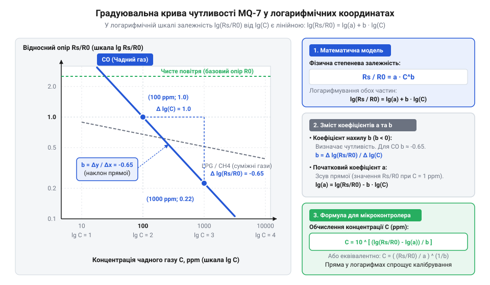
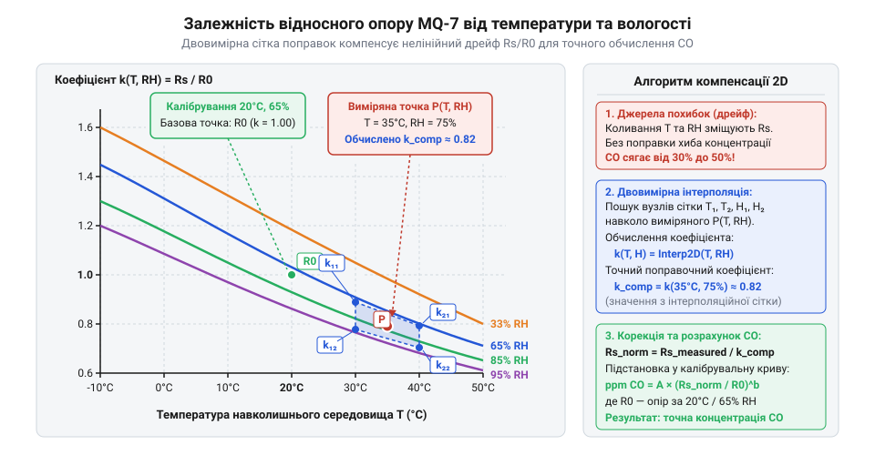

# Математичне моделювання характеристики чутливості та розрахунок ppm для MQ-7

<preknowlist>
- [Родина MQ (напівпровідникові давачі газу)](root:cat-hw-sensors/mq-family) — фізичний принцип зміни опору SnO2 та двохфазний режим нагріву MQ-7.
- [MQ — давач газу (Keyes K869051)](root:cat-hw-sensors/mq-gas) — електрична схема аналогового дільника напруги з навантажувальним резистором RL.
</preknowlist>

## Нелінійність напруги та вимірювання концентрації

Уявіть практичну задачу: ви підключили аналоговий вихід давача чадного газу @@en|MQ-7@@ (від англ. *MQ-7 Carbon Monoxide Sensor*) до аналого-цифрового перетворювача (@@en|ADC@@, від англ. *Analog-to-Digital Converter* — аналого-цифровий перетворювач) мікроконтролера та отримуєте числові відліки напруги. У чистому повітрі виміряна напруга становить, наприклад, 0.45 В, а під час появи чадного газу @@en|CO@@ (від англ. *carbon monoxide* — оксид вуглецю) зростає до 1.5 В або 2.5 В. Найперша інтуїтивна думка — застосувати просту лінійну пропорцію чи функцію масштабування на зразок `map()`, щоб перетворити мілівольти безпосередньо у значення концентрації @@en|PPM@@ (від англ. *parts per million* — частин на мільйон). Однак такий підхід призводить до катастрофічних похибок вимірювання.

Причина полягає у фізико-хімічній природі чутливого елемента. Основу давача @@en|MQ-7@@ складає тонкоплівковий шар діоксиду олова @@en|SnO2@@ (від лат. *Stannum* — олово). У чистому повітрі молекули кисню адсорбуються на поверхні напівпровідника n-типу, захоплюють вільні електрони з зони провідності та створюють високий потенціальний бар'єр для електричного струму. Коли у повітрі з'являються молекули @@en|CO@@, вони вступають у окиснювально-відновну реакцію з адсорбованим киснем, вивільняючи електрони назад у кристал. У результаті електричний опір чутливого шару `R_s` (від англ. *sensor resistance* — опір давача) зменшується. Проте це зменшення опору відбувається нелінійно: при малих концентраціях газу (від 20 до 100 ppm) опір падає стрімко, а при високих (від 500 до 1000 ppm) зміна опору сповільнюється через насичення активних центрів адсорбції. Спроба виміряти такий процес лінійно на виході @@en|ADC@@ викривить реальні показники в кілька разів.

Щоб перейти від виміряного аналогового сигналу до реальної концентрації газу, спочатку необхідно вирахувати поточний фізичний опір чутливого елемента `R_s`. На платі модуля давач підключається як плече у [стандартний аналоговий дільник](root:cat-hw-sensors/mq-gas) напруги з навантажувальним резистором `R_L` (від англ. *load resistor* — опір навантаження), номінал якого зазвичай становить 10 кОм (або регулюється підлаштовувальним резистором від 10 до 47 кОм).

Розглянемо виведення формули розрахунку `R_s` для типової схеми дільника, де навантажувальний резистор `R_L` підключений між аналоговим виходом і землею, а чутливий елемент `R_s` — між напругою живлення `V_cc` та аналоговим виходом. Напруга живлення схеми становить `V_cc` (зазвичай 5.0 В), а напруга на навантажувальному резисторі `V_out` зчитується мікроконтролером.

За законом Ома струм `I`, що протікає через послідовно з'єднані резистори `R_s` та `R_L`, виражається як:

```text
I = V_cc ÷ (R_s + R_L)
```

Вихідна напруга дільника `V_out`, яка падає на резисторі `R_L`, становить:

```text
V_out = I × R_L
      = V_cc × R_L ÷ (R_s + R_L)       [підстановка виразу для струму I]
```

Виведемо опір чутливого елемента `R_s` із цієї рівності шляхом послідовних алгебраїчних перетворень:

```text
V_out × (R_s + R_L) = V_cc × R_L
V_out × R_s + V_out × R_L = V_cc × R_L   [розкриття дужок у лівій частині]
V_out × R_s = V_cc × R_L - V_out × R_L   [перенесення відомого доданку вправо]
V_out × R_s = (V_cc - V_out) × R_L       [винесення навантажувального опору R_L за дужки]
R_s = ((V_cc - V_out) ÷ V_out) × R_L     [ділення обох частин на напругу V_out]
```

Отримане співвідношення показує, що для визначення опору `R_s` не обов'язково знати абсолютне значення струму: достатньо виміряти співвідношення між напругою живлення `V_cc` та вихідною напругою дільника `V_out`.

Якщо мікроконтролер зчитує напругу через аналого-цифровий перетворювач, виразимо напруги через цифрові відліки @@en|ADC@@. Нехай `ADC` — поточне цифрове значення зчитування (наприклад, від 0 до 1023 для 10-бітного перетворювача), а `ADC_max` — максимально можливе значення відліку (1023 для 10 біт або 4095 для 12 біт). Оскільки `V_out = (ADC ÷ ADC_max) × V_cc`, підставимо це у виведене рівняння:

```text
R_s = ((V_cc - (ADC ÷ ADC_max) × V_cc) ÷ ((ADC ÷ ADC_max) × V_cc)) × R_L
    = ((1 - (ADC ÷ ADC_max)) ÷ (ADC ÷ ADC_max)) × R_L    [скорочення напруги живлення V_cc]
    = ((ADC_max - ADC) ÷ ADC) × R_L                      [знесення спільного знаменника ADC_max]
```

Розглянемо практичний розрахунок на конкретному прикладі. Нехай схема живиться напругою `V_cc = 5.0` В, навантажувальний резистор становить `R_L = 10.0` кОм, а 10-бітний @@en|ADC@@ мікроконтролера повернув значення `ADC = 341` відліків (що відповідає напрузі `V_out = 341 ÷ 1023 × 5.0 = 1.667` В). Обчислимо поточний опір чутливого елемента `R_s`:

```text
R_s = ((1023 - 341) ÷ 341) × 10.0
    = (682 ÷ 341) × 10.0                 [віднімання поточних відліків АЦП від максимальних]
    = 2.0 × 10.0                         [ділення різниці відліків на поточне значення]
    = 20.0 кОм                           [обчислення підсумкового опору сенсора]
```

Отже, знаючи номінал навантажувального резистора `R_L` та відліки @@en|ADC@@, ми завжди можемо точнісінько обчислити поточний електричний опір чутливого шару `R_s`. Однак сам по собі опір `R_s` ще не дає відповіді про кількість газу у повітрі. Для перетворення `R_s` на значення концентрації @@en|PPM@@ потрібна математична модель градуювальної кривої давача.

## Степенева модель та лінеаризація градуювання

Виробник давача @@en|MQ-7@@ надає у технічній документації (@@en|datasheet@@, від англ. *data sheet* — аркуш технічних даних) графік чутливості, який описує залежність опору сенсора від концентрації газу. На цьому графіку по осі абсцис відкладено концентрацію @@en|CO@@ у логарифмічному масштабі (від 20 до 1000 ppm), а по осі ординат — відносний опір `R_s / R_0`. Величина `R_0` (від англ. *baseline resistance* — базовий опір) являє собою опір сенсора у чистому повітрі за еталонних умов.

Використання безрозмірного відношення `R_s / R_0` замість абсолютного опору `R_s` є ключовим математичним прийомом. Технологічний розкид при виготовленні напівпровідникових [давачів родини MQ](root:cat-hw-sensors/mq-family) призводить до того, що опір `R_s` у різних екземплярів може відрізнятися у кілька разів. Проте відносна зміна опору `R_s / R_0` при зміні концентрації газу залишається стабільною і підпорядковується єдиній фізичній закономірності для цієї серії давачів.

У фізичній хімії адсорбційні процеси на поверхні окисних напівпровідників описуються степеневою залежністю (англ. *power-law model*). Зв'язок між відносним опором `y = R_s / R_0` та концентрацією газу `C` (у ppm) виражається формулою:

```text
R_s / R_0 = a × Cᵇ
```

де `a` — безрозмірний коефіцієнт масштабу кривої, а `b` — показник степеня, який визначає кут нахилу градуювальної характеристики. Оскільки для n-типу напівпровідника @@en|SnO2@@ опір зменшується із зростанням концентрації відновлювального газу @@en|CO@@, показник степеня є від'ємним числом (`b < 0`).

Працювати зі степеневою функцією безпосередньо незручно, оскільки вона нелінійна і вимагає обчислення дробових степенів. Для спрощення математичного аналізу та визначення коефіцієнтів застосовують метод логарифмічної лінеаризації (@@en|linearization@@, від лат. *linearis* — лінійний). Продемонструємо виведення лінійного рівняння шляхом прологарифмування обох частин степеневої рівності за основою 10:

```text
lg(R_s / R_0) = lg(a × Cᵇ)
              = lg(a) + lg(Cᵇ)           [застосування властивості логарифма добутку]
              = lg(a) + b × lg(C)        [винесення показника степеня b за знак логарифма]
```

Зробимо заміну змінних: позначимо `Y = lg(R_s / R_0)`, `X = lg(C)`, а сталу величину `lg(a)` позначимо як `A_0`. У результаті отримуємо класичне рівняння прямої лінії:

```text
Y = b × X + A_0
```

Це означає, що якщо побудувати графік залежності `lg(R_s / R_0)` від `lg(C)` у подвійних логарифмічних координатах (англ. *log-log plot*), викривлена степенева крива перетворюється на ідеально пряму лінію з кутовим коефіцієнтом `b` та початковим зсувом `A_0`.


*Графік чутливості MQ-7 у подвійних логарифмічних координатах: лінеаризація степеневої кривої дозволяє визначити коефіцієнти апроксимації a та b за двома точками.*

Для розрахунку коефіцієнтів апроксимації `a` та `b` достатньо зняти з градуювального графіка з документації дві точки з відомими координатами `(C_1, y_1)` та `(C_2, y_2)`.

Візьмемо дві контрольні точки для кривої @@en|CO@@ з опису давача @@en|MQ-7@@:
- Перша точка (низька концентрація): `C_1 = 100` ppm, відносний опір `y_1 = (R_s / R_0)_1 = 1.0`. - Друга точка (висока концентрація): `C_2 = 1000` ppm, відносний опір `y_2 = (R_s / R_0)_2 = 0.09`.

Переведемо ці значення у логарифмічні координати `X` та `Y` (де `lg` позначає десятковий логарифм, від грец. *logos* — відношення та *arithmos* — число):

```text
X_1 = lg(100) = 2.0
Y_1 = lg(1.0) = 0.0

X_2 = lg(1000) = 3.0
Y_2 = lg(0.09) ≈ -1.0458
```

Кутовий коефіцієнт `b` дорівнює відношенню приросту логарифма опору до приросту логарифма концентрації:

```text
b = (Y_2 - Y_1) ÷ (X_2 - X_1)
  = (-1.0458 - 0.0) ÷ (3.0 - 2.0)         [підстановка логарифмічних координат двох точок]
  = -1.0458 ÷ 1.0                         [обчислення різниці координат]
  = -1.0458                               [значення кутового коефіцієнта n-напівпровідника]
```

Тепер знайдемо коефіцієнт `A_0 = lg(a)` та сам коефіцієнт `a`, підставивши значення першої точки `(X_1, Y_1)` і знайдений коефіцієнт `b`:

```text
lg(a) = Y_1 - b × X_1
      = 0.0 - (-1.0458) × 2.0             [підстановка координат першої точки та кута b]
      = 2.0916                            [обчислення логарифма масштабного коефіцієнта]
a = 10²ˑ⁰⁹¹⁶
  ≈ 123.48                                [піднесення 10 до степеня lg(a)]
```

Маючи коефіцієнти `a = 123.48` та `b = -1.0458`, виведемо підсумкову розрахункову формулу для знаходження концентрації газу `C` за поточним значенням відносного опору `R_s / R_0`.

Виразимо логарифм концентрації `lg(C)` з прологарифмованого рівняння:

```text
lg(R_s / R_0) = lg(a) + b × lg(C)
b × lg(C) = lg(R_s / R_0) - lg(a)        [перенесення доданку lg(a) у ліву частину]
lg(C) = (lg(R_s / R_0) - lg(a)) ÷ b      [ділення на кутовий коефіцієнт b]
```

Потім потенціюємо вираз за основою 10, щоб одержати безпосереднє значення концентрації `C` у ppm:

```text
C = 10^((lg(R_s / R_0) - lg(a)) ÷ b)
```

Альтернативно, той самий вираз можна записати у чистій степеневій формі без обчислення логарифмів під час кожного вимірювання:

```text
R_s / R_0 = a × Cᵇ
Cᵇ = (R_s / R_0) ÷ a                      [ділення на масштабний коефіцієнт a]
C = ((R_s / R_0) ÷ a)^(1 / b)             [піднесення обох частин до степеня 1/b]
```

Проведемо числову перевірку алгоритму. Припустимо, що обчислений опір сенсора `R_s` поділений на базовий опір `R_0` дав відношення `R_s / R_0 = 0.4`. Розрахуємо концентрацію @@en|CO@@:

```text
lg(R_s / R_0) = lg(0.4) ≈ -0.3979
lg(C) = (-0.3979 - 2.0916) ÷ (-1.0458)
      = -2.4895 ÷ (-1.0458)               [додавання від'ємних логарифмів у чисельнику]
      = 2.3805                            [ділення двох від'ємних чисел]
C = 10²ˑ³⁸⁰⁵
  ≈ 240.2 ppm                             [піднесення 10 до степеня]
```

Отже, математична модель дозволяє за відомими коефіцієнтами `a` і `b` обчислити точну концентрацію @@en|CO@@. Проте для практичного обчислення залишається єдине невідоме число: як саме визначити еталонне значення `R_0` для нашого конкретного давача?

## Калібрування базового опору в повітрі

Навіть якщо ви ідеально розрахували коефіцієнти степеневої апроксимації `a` та `b`, ви не зможете виміряти концентрацію газу без знання індивідуального базового опору `R_0`. У технічній документації на давач @@en|MQ-7@@ вказано лише усереднений діапазон `R_0` (наприклад, від 2 кОм до 20 кОм). Через заводський розкид товщини плівки @@en|SnO2@@, площі контакту електродів та опору внутрішнього нагрівача два сусідніх давачі з однієї партії матимуть суттєво різні значення базового опору.

Базовий опір `R_0` — це електричний опір чутливого елемента конкретного екземпляра давача, виміряний у чистому повітрі за нормальних умов (температура 20 °C, відносна вологість 65%, вміст кисню 20.9%). Якщо у розрахункову формулу підставити стандартне усереднене значення (наприклад, 10 кОм), а реальний опір вашого екземпляра становить 15 кОм, підсумкова обчислена концентрація @@en|PPM@@ буде помилковою у кілька разів.

Процедура калібрування (@@en|calibration@@, від араб. *qālib* через фр. *calibre* — форма, шаблон) полягає у визначенні індивідуального `R_0` в умовах відомого середовища. Оскільки створити у звичайній лабораторії еталонну газову суміш із точним вмістом @@en|CO@@ складніше, ніж забезпечити чистоту звичайного повітря, калібрування виконують у чистому атмосферному середовищі, де концентрація чадного газу практично дорівнює нулю.

З графіку чутливості в даташиті відомо, що у чистому повітрі відносний опір давача `R_s / R_0` є фіксованою величиною, яку ми позначимо як `Ratio_air`. Для давача @@en|MQ-7@@ це значення за замовчуванням дорівнює приблизно 27.5 (або інше число, вказане на характеристичній кривій чистої атмосфери).

Виведемо математичний алгоритм калібрування `R_0`:

```text
Ratio_air = R_s_air ÷ R_0
```

де `R_s_air` — це фактичний опір чутливого елемента, виміряний давачем під час перебування у чистому повітрі.

Перегрупувавши співвідношення, отримуємо формулу для розрахунку індивідуального еталонного опору `R_0`:

```text
R_0 = R_s_air ÷ Ratio_air
```

Отже, процедура калібрування зводиться до двох послідовних кроків:
1. Помістити давач у чисте повітря, почекати завершення фази прогріву та виміряти поточний опір `R_s_air` за формулою з першого розділу. 2. Поділити отриманий опір `R_s_air` на табличний коефіцієнт `Ratio_air`.

Розглянемо практичний приклад обчислення `R_0`. Припустимо, ми проводимо калібрування пристрою. Навантажувальний резистор дільника становить `R_L = 10.0` кОм, живильна напруга `V_cc = 5.0` В. У чистому повітрі після прогріву 10-бітний @@en|ADC@@ показує відлік `ADC_air = 92` (що відповідає напрузі `V_out = 92 ÷ 1023 × 5.0 = 0.45` В).

Крок 1. Обчислимо опір чутливого елемента у чистому повітрі `R_s_air`:

```text
R_s_air = ((1023 - 92) ÷ 92) × 10.0
        = (931 ÷ 92) × 10.0              [віднімання відліків АЦП у чистому повітрі]
        = 10.1196 × 10.0                 [ділення відліків АЦП]
        = 101.2 кОм                      [значення опору сенсора у чистому повітрі]
```

Крок 2. Знаючи, що для давача @@en|MQ-7@@ коефіцієнт `Ratio_air = 9.83`, розрахуємо індивідуальне значення `R_0`:

```text
R_0 = 101.2 ÷ 9.83
    = 10.295 кОм                         [обчислення базового еталонного опору R_0]
```

Знайдене значення `R_0 = 10.3` кОм зберігають у неенергонезалежній пам'яті мікроконтролера (наприклад, у @@en|EEPROM@@, від англ. *Electrically Erasable Programmable Read-Only Memory*, або @@en|Flash@@-пам'яті [мікроконтролера Arduino](root:cat-hw-sensors/mq-gas)). При кожному наступному вимірюванні робоча програма зчитує збережене значення `R_0`, обчислює поточний відносний опір `R_s / R_0` і за формулою з другого розділу розраховує концентрацію @@en|CO@@.

Слід пам'ятати про джерела вимірювальних похибок:
1. **Тимчасовий дрейф опору**: з часом та через деградацію тонкоплівкового покриття `R_0` поступово змінюється, тому процедуру калібрування в чистому повітрі рекомендується повторювати періодично. 2. **Температурно-вологісні коливання**: зміна температури та вологості навколишнього середовища зміщує базову лінію опору `R_s`. Для точних вимірювань обчислений опір `R_s` множать на корегувальний коефіцієнт з двовимірної сітки поправок, а детальніший розрахунок винесено в [алгоритм температурної компенсації](root:cat-hw-sensors/mq7-temperature-humidity-compensation).

Завдяки первинному калібруванню `R_0` математична модель повністю адаптується до конкретного фізичного екземпляра давача, забезпечуючи високу точність визначення концентрації чадного газу в реальних умовах.

## Температуро-вологісна компенсація характеристичних показів

Ідеальна математична модель давача передбачає, що опір чутливого шару `` `R_s` `` залежить виключно від концентрації чадного газу `@@en|CO@@`. Проте в реальних умовах експлуатації показники напівпровідникового матеріалу `@@en|SnO2@@` зазнають потужного впливу температури та відносної вологості навколишнього повітря. Напівпровідниковий керамічний шар працює на основі хімічної `@@lat|адсорбції@@` (з @@lat|adsorptio@@ — поглинання поверхнею) молекул кисню. Коли температура довкілля підвищується, кінетична енергія носіїв заряду зростає, а частина адсорбованого кисню залишає поверхню через процес `@@lat|десорбції@@` (з @@lat|desorptio@@ — видалення сорбованого). Водночас молекули вологи `H₂O` з повітря осідають на поверхні кристалітів `@@en|SnO2@@`, віддають свої електрони в зону провідності та конкурують із молекулами газу за активні центри. У результаті за високої вологості опір `` `R_s` `` стрімко падає навіть за абсолютно незмінної концентрації `@@en|CO@@`, що призводить до хибного завищення обчислених значень `@@en|ppm@@`. Ця фізична властивість є спільною для багатьох [напівпровідникових давачів родини MQ](root:cat-hw-sensors/mq-family).

Для урахування кліматичного спотворення виробник надає в `@@en|datasheet@@` сітку експериментальних кривих, які описують залежність відносного опору від температури та вологості.


*Залежність відносного опору давача від температури та вологості навколишнього середовища, яка показує суттєве відхилення характеристик за екстремальних умов.*

Ця графічна залежність визначає поправковий коефіцієнт `` `K(T, RH)` ``, який показує відношення опору за поточних умов до опору за стандартних лабораторних умов (20 °C та 65% відносної вологості). Щоб очистити виміряне значення опору `` `R_s` `` від впливу довкілля, його необхідно поділити на цей коефіцієнт.

Оскільки `@@en|datasheet@@` містить табличні дані лише для дискретних точок (наприклад, температури −10 °C, 0 °C, 10 °C, 20 °C, 40 °C та вологості 33%, 65%, 85%), для довільної проміжної точки `(T, RH)` застосовують математичний метод `@@en|білінійної інтерполяції@@` (з @@en|bilinear interpolation@@ — послідовна лінійна інтерполяція за двома осями).

Спершу знаходять вузли сітки, що оточують поточне значення: за температурою `T₁ ≤ T ≤ T₂` та за вологістю `RH₁ ≤ RH ≤ RH₂`. Обчислення виконують у два етапи: спочатку інтерполюють поправкові коефіцієнти вздовж осі вологості для обох граничних температур `T₁` та `T₂`, після чого здійснюють підсумкову інтерполяцію вздовж осі температур.

Формула послідовного обчислення коефіцієнта `` `K(T, RH)` `` має такий вигляд:

```
K(T₁, RH) = K₁₁ + (RH - RH₁) × (K₁₂ - K₁₁) ÷ (RH₂ - RH₁)   [інтерполяція по RH для T₁]
K(T₂, RH) = K₂₁ + (RH - RH₁) × (K₂₂ - K₂₁) ÷ (RH₂ - RH₁)   [інтерполяція по RH для T₂]
K(T, RH)  = K(T₁, RH) + (T - T₁) × (K(T₂, RH) - K(T₁, RH)) ÷ (T₂ - T₁)  [інтерполяція по T]
```

Де `K₁₁`, `K₁₂`, `K₂₁`, `K₂₂` — експериментальні поправкові значення в чотирьох опорних вузлах сітки. Зкорригований опір сенсора `` `R_s_corr` `` обчислюють як:

```
R_s_corr = R_s ÷ K(T, RH)   [компенсація температурно-вологісного спотворення]
```

Програмна реалізація білінійної інтерполяції на мікроконтролері вимагає збереження компактної таблиці коефіцієнтів та граничних перевірок, щоб запобігти виходу за межі вимірювальної сітки.

:::tabs
@tab C (ESP-IDF)
:::code math-mq7-characteristic-curve/c/esp-idf/calculate-k-factor.c
@tab C++ (Arduino)
:::code math-mq7-characteristic-curve/cpp/arduino/getcorrectionfactor.cpp
:::

Завдяки впровадженню алгоритму кліматичної компенсації виміряне значення опору `` `R_s` `` зводиться до вихідних лабораторних умов, що забезпечує стабільність розрахунку концентрації газу незалежно від пори року та клімату в приміщенні.

## Наскрізний розрахунок і границі точності

Повний математичний конвеєр перетворення фізичної величини на концентрацію чадного газу об'єднує всі окремі обчислювальні блоки в єдиний послідовний алгоритм. Обчислення починаються з вимірювання електричної напруги на виході аналогового дільника, характерного для [перетворення сигналу в давачах газу](root:cat-hw-sensors/mq-gas), і завершуються визначенням об'ємної частки `@@en|CO@@` у підсумкових одиницях `@@en|ppm@@`.

Повний процес перетворення складається з восьми впорядкованих кроків:
1. Зчитування цифрового коду `N_adc` з `@@en|АЦП@@` мікроконтролера. 2. Розрахунок аналогової напруги `V_out` на навантажувальному резисторі `` `R_L` ``. 3. Обчислення поточного опору чутливого елемента `` `R_s` ``. 4. Зчитування кліматичних параметрів (температури `T` та відносної вологості `RH`). 5. Розрахунок поправкового коефіцієнта `` `K(T, RH)` `` за допомогою двовимірної інтерполяції. 6. Обчислення зкорригованого опору `` `R_s_corr` = R_s ÷ K(T, RH)``. 7. Розрахунок відносного опору `` `Ratio` = R_s_corr ÷ R_0 ``, де базовий опір `` `R_0` `` прочитано з нелетючої пам'яті `@@en|EEPROM@@` або `@@en|Flash@@`. 8. Обчислення підсумкової концентрації за `@@en|степеневою моделлю@@`: `C = a × (Ratio)^b`.

Розглянемо числовий приклад наскрізного розрахунку для реальних умов експлуатації.

**Умови вимірювання:**
- Напруга живлення дільника: `V_cc = 5.00 В`
- Опорна напруга `@@en|АЦП@@`: `V_ref = 5.00 В`
- Розрядність `@@en|АЦП@@`: 10 біт (`N_max = 1023`)
- Опір навантаження: `R_L = 10.0 кОм`
- Калібрований базовий опір у пам'яті: `R_0 = 33.0 кОм`
- Показник `@@en|АЦП@@`: `N_adc = 410`
- Температура та вологість: `T = 30 °C`, `RH = 65%`
- Коефіцієнти апроксимації кривої `@@en|MQ-7@@`: `a = 19.32`, `b = -1.52`

Покрокове математичне обчислення концентрації газу виглядає так:

```
V_out    = 410 × 5.00 ÷ 1023 = 2.003 В           [перетворення коду АЦП у напругу]
R_s      = 10.0 × (5.00 - 2.003) ÷ 2.003 = 14.96 кОм [розрахунок опору датчика]
K_env    = 0.925                                 [інтерполяція K(30 °C, 65% RH)]
R_s_corr = 14.96 ÷ 0.925 = 16.17 кОм             [кліматична компенсація опору]
Ratio    = 16.17 ÷ 33.0 = 0.490                  [відношення опорів R_s / R_0]
C_ppm    = 19.32 × (0.490)⁻¹·⁵² = 57.4 ppm       [степеневий розрахунок концентрації]
```

У результаті обчислювальний конвеєр перетворює значення АЦП `410` на скориговану концентрацію `57.4 ppm` чадного газу.

Зведемо весь розрахунковий конвеєр у цілісну функцію обчислення концентрації.

:::tabs
@tab C (ESP-IDF)
:::code math-mq7-characteristic-curve/c/esp-idf/mq7-calculate-ppm.c
@tab C++ (Arduino)
:::code math-mq7-characteristic-curve/cpp/arduino/mq7config.cpp
:::

Незважаючи на математичну строгість моделі, підсумкова точність вимірювання фізичного давача обмежена кількома джерелами похибок. Розуміння цих обмежень критично важливе для оцінки надійності розрахованих даних `@@en|ppm@@`.

Основні чинники залишкової похибки включають:
- **`@@lat|квантування@@` (з @@lat|quantitas@@ — кількість) та шум `@@en|АЦП@@`:** Похибка вимірювання напруги біля меж діапазону призводить до нелінійного посилення похибки опору `` `R_s` ``. - **`@@nl|дрейф@@` (з @@nl|drijven@@ — плавати, відхилятися) базового опору `` `R_0` ``:** З часом напівпровідниковий шар `@@en|SnO2@@` деградує під дією постійного нагріву та хімічного забруднення поверхні. Це викликає зміщення `` `R_0` `` до 5–10% на рік, що вимагає періодичного повторного `@@fr|калібрування@@` (з @@fr|calibrer@@ — вимірювати калібр). - **`@@en|перехресна чутливість@@` (з @@en|cross-sensitivity@@ — чутливість до кількох речовин):** Давач `@@en|MQ-7@@` реагує не лише на `@@en|CO@@`, а й на інші відновлювальні гази — водень (`H₂`), метан (`CH₄`) та пари спирту. - **Динаміка двохфазного нагріву:** Для `@@en|MQ-7@@` критично дотримуватися циклу живлення нагрівача (60 секунд при 5.0 В та 90 секунд при 1.5 В), як це робиться у складних сигналізаторах поєднання з [вимірювачами полум'я](root:cat-hw-sensors/ky-026-flame). Зчитування показників допускається виключно наприкінці низьковольтної фази 1.5 В, коли напівпровідникова поверхня досягає потрібного стану `@@lat|адсорбції@@`. Для поглибленого вивчення причин реагування матеріалу SnO2 на сторонні гази та методів фільтрації вимірювань перегляньте матеріал про [перехресну чутливість напівпровідникових давачів газу](root:cat-hw-sensors/gas-sensor-cross-sensitivity).

У підсумку, навіть за повної температурної компенсації та індивідуального калібрування, результуюча відносна точність напівпровідникових давачів типу `@@en|MQ-7@@` становить приблизно ±15…20%. Вони призначені для виявлення небезпечних тенденцій та витоків газу, а не для прецизійних лабораторних аналізів.