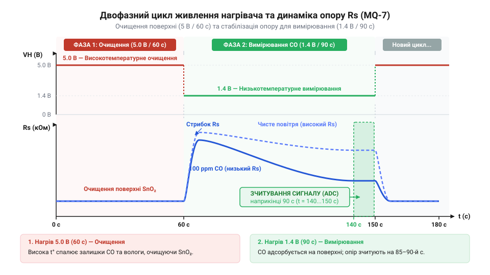
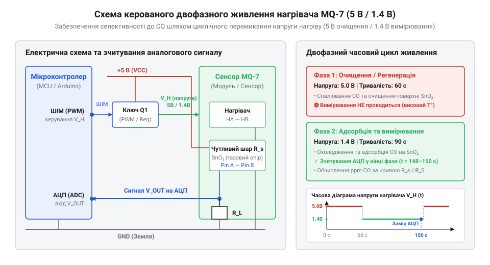
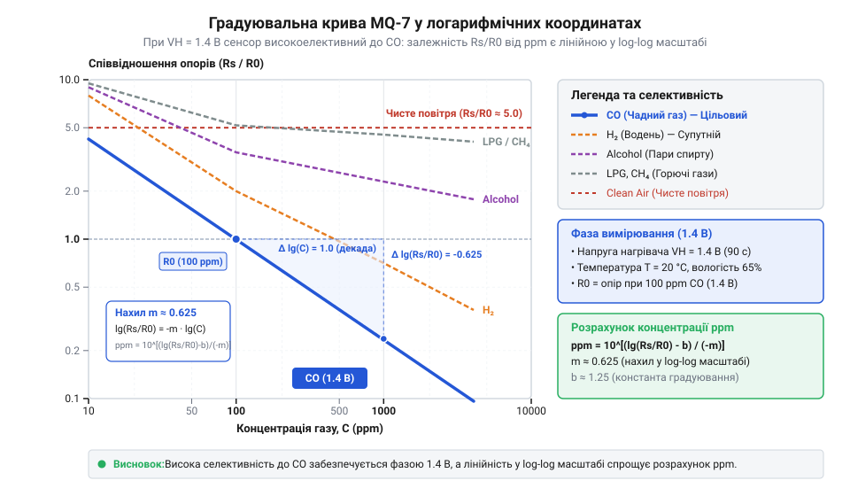
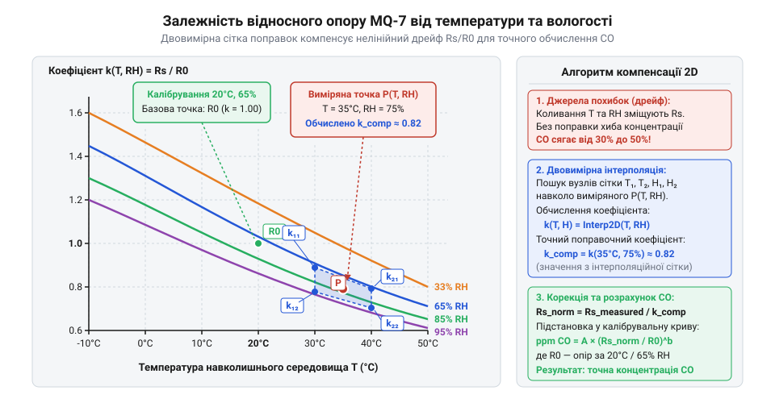
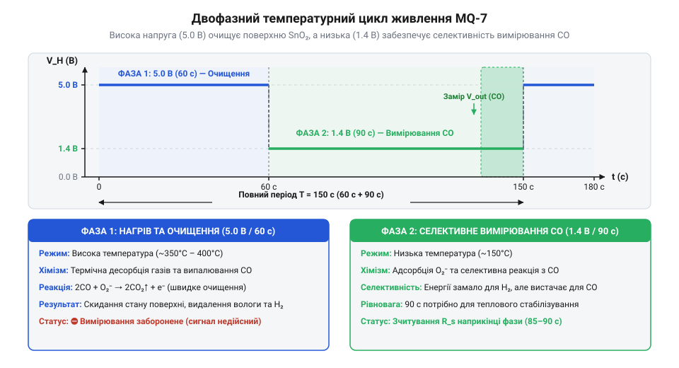

# MQ-7 — давач чадного газу (CO)

<preknowlist>
- [Родина MQ (напівпровідникові давачі газу)](root:cat-hw-sensors/mq-family) — загальний принцип роботи металооксидних (MOS) напівпровідникових елементів, роль вбудованого нагрівача та вимірювального дільника опору.
- [MQ — давач газу (Keyes K869051)](root:cat-hw-sensors/mq-gas) — типова схема модуля з компаратором, призначення чотирьох виводів (VCC, GND, AO, DO) та первинне налаштування чутливості.
</preknowlist>

## Чому постійний нагрів не виявляє CO

Виток чадного газу (оксиду вуглецю(II), @@en|carbon monoxide@@, @@en|CO@@) належить до найнебезпечніших побутових та промислових загроз. Цей газ не має ані кольору, ані запаху, ані смаку, але легко зв'язується з гемоглобіном крові, блокуючи перенесення кисню до тканин організму. Своєчасне виявлення навіть мікроскопічних концентрацій чадного газу у повітрі приміщення є критичною задачею систем аварійної вентиляції та пожежної безпеки.

Більшість доступних напівпровідникових давачів газу, зокрема з [широкої родини металооксидних давачів](root:cat-hw-sensors/mq-family), побудовані на основі тонкого керамічного циліндра з нанесеним чутливим шаром оксиду олова (`SnO₂`). Оксид олова належить до класу металооксидних напівпровідників (від давньогрецьких *metallon* — метал, *oxys* — кислий та латинського *semiconductor* — напівпровідник, @@en|metal-oxide semiconductor@@, @@en|MOS@@). У [типовому газовому давачі](root:cat-hw-sensors/mq-gas) базової серії всередині керамічної трубки розміщено спіраль нагрівача, яка підключена до постійної напруги 5.0 В. Постійне живлення підтримує робочу температуру чутливого шару на рівні близько 300°C–400°C, що чудово підходить для виявлення метану, пропану чи водню. Особливості конструкції та порівняння селективності різних моделей висвітлює [оглядова стаття про напівпровідникові давачі газів серії MQ](root:cat-hw-sensors/mq-family).

Однак виявляти чадний газ за постійної високої температури нагрівача виявляється неможливим з огляду на особливості хімічних реакцій на поверхні оксиду олова. При температурі 300°C–400°C кисень із навколишнього повітря активно зв'язується з поверхнею `SnO₂`, захоплюючи вільні електрони з провідної зони напівпровідника та утворюючи негативно заряджені іони кисню. Коли молекула чадного газу потрапляє на таку гарячу поверхню, вона миттєво окислюється до вуглекислого газу (`CO₂`). Проте при високій температурі з аналогічною або навіть більшою швидкістю реагують інші відновлювальні гази — водень (`H₂`), метан (`CH₄`), пари спирту та молекули водяної пари (`H₂O`). У результаті сенсор повністю втрачає селективність (від латинського *selectio* — вибір, @@en|selectivity@@): він не здатен відрізнити смертельний виток чадного газу від коливань вологості чи наявності побутових випарів.

Якщо ж спробувати знизити напругу живлення нагрівача й утримувати сенсор постійно при низькій температурі (близько 150°C, що відповідає живленню нагрівача напругою 1.4 В), виникає інша фізична перешкода. При такій температурі чадний газ дійсно вибірково зв'язується з поверхнею `SnO₂`, однак побічні продукти реакції та молекули води не здатні самостійно залишити чутливий шар. Активні центри кристалічної ґратки оксиду олова швидко забруднюються і блокуються неотруєними залишками речовин. Внаслідок цього базовий опір сенсора починає неконтрольовано дрейфувати, а чутливість елемента до нових молекул CO швидко падає до нуля.

Проблема неможливості селективного виявлення чадного газу за стаціонарних температурних умов довго залишалася бар'єром для створення доступних побутових газоаналізаторів. Історичний прорив стався завдяки розробкам під керівництвом [винахідника металооксидних давачів](root:cat-hw-sensors/mq-7-co/hist-taguchi-co-sensing.md), коли було запропоновано принципово новий підхід — динамічний двофазний цикл нагріву. Ідея полягає у послідовному чергуванні двох температурних режимів: висока температура використовується для термічного очищення та регенерації поверхового шару, а низька температура — безпосередньо для вибіркового вимірювання концентрації чадного газу.

## Хімосорбція оксиду олова та двофазний цикл

Мікроскопічний механізм роботи чутливого елемента @@en|MQ-7@@ ґрунтується на явищі хемосорбції (від латинського *chemia* — хімія та *sorbere* — поглинати, @@en|chemisorption@@) на межі між дисперсними кристалітами оксиду олова (`SnO₂`) та оточуючим газом. Оксид олова є напівпровідником n-типу, в якому основними носіями заряду виступають вільні електрони провідності.

Під час перебування сенсора у повітрі молекули кисню осідають на поверхні кристалітів через процес адсорбції (від латинського *ad-* — на, при та *sorbere* — поглинати, @@en|adsorption@@). Захоплюючи електрони з об'єму напівпровідника, іони кисню створюють на поверхні кожної мікрочастинки `SnO₂` так званий збіднений електронний шар (потенціальний бар'єр). Через виникнення цих потенціальних бар'єрів між сусідніми кристалами загальний електричний опір сенсора `Rs` у чистому повітрі стає дуже високим.

Коли в навколишньому середовищі з'являються молекули чадного газу, вони вступають у хімічну взаємодію з адсорбованими іонами кисню. Внаслідок реакції окиснення молекула CO перетворюється на вуглекислий газ (`CO₂`), а зв'язаний раніше електрон повертається назад у зону провідності `SnO₂`:

```
CO + O⁻ (адсорбований) → CO₂ (газ) + e⁻
```

Повернення електронів зменшує товщину збідненого шару та знижує висоту потенціальних бар'єрів між кристалітами. Як наслідок, внутрішній електричний опір чутливого елемента `Rs` стрімко падає. Величина цього падіння чітко пропорційна кількості молекул чадного газу, що вступили в реакцію.

Щоб забезпечити високу селективність саме до CO та запобігти отруєнню чутливого шару, давач @@en|MQ-7@@ працює у суворо синхронізованому 150-секундному двофазному циклі живлення нагрівача:

1. **Фаза високої температури (5.0 В ± 0.1 В протягом 60 секунд)**. Нагрівач споживає максимальну потужність (близько 350 мВт), розігріваючи керамічну трубку до температури 300°C–400°C. У цій фазі відбувається повна десорбція (від латинського *de-* — видалення та *sorbere* — поглинати, @@en|desorption@@) вологи, окиснення накопичених органічних залишків та термічна регенерація активних центрів `SnO₂`. Поверхня повністю очищається й знову насичується іонами кисню. Зчитування аналогового сигналу під час цих 60 секунд є неінформативним і програмно ігнорується. 2. **Фаза низької температури (1.4 В ± 0.1 В протягом 90 секунд)**. Напруга нагрівача знижується до 1.4 В (потужність близько 50 мВт), і температура сенсора опускається до оптимуму близько 150°C. У цьому температурному вікні реагувати з поверхневим киснем здатен практично лише чадний газ. Протягом перших 60–80 секунд цієї фази опір `Rs` плавно знижується відповідно до рівня CO та стабілізується.


*Двофазний 150-секундний цикл живлення нагрівача MQ-7: фаза випалювання (5 В, 60 с) відновлює чистий стан поверхового шару, а фаза вимірювання (1.4 В, 90 с) забезпечує стабілізацію опору Rs наприкінці інтервалу.*

Критично важливо виконувати вимірювання аналогової напруги строго наприкінці низькотемпературної фази — у часовому вікні між 140-ю та 150-ю секундами від початку повного циклу (або між 80-ю та 90-ю секундами низьковольтної фази). Заміри, зчитані раніше цього моменту, відображають перехідний тепловий процес і призводять до грубих помилок у розрахунках.


*Принципова електрична схема керування двома рівнями живлення нагрівача MQ-7 (5 В та 1.4 В) за допомогою транзистора та вимірювання напруги Vout на дільнику опору.*

Апаратна реалізація такого живлення вимагає керованого схемотехнічного вузла. Докладні [параметри нагрівача та розводку](root:cat-hw-sensors/mq-7-co/api-mq7-hardware.md) наведено у відповідній довідці. Для автоматичної зміни напруги живлення мікроконтролер використовує ключ на польовому або біполярному транзисторі з регулюванням широтно-імпульсною модуляцією (від англійського @@en|Pulse-Width Modulation@@, @@en|PWM@@) або двоканальним джерелом живлення. Повний [алгоритм перемикання фаз драйвера](root:cat-hw-sensors/mq-7-co/api-mq7-driver.md) реалізується програмним таймером мікроконтролера.

## Розрахунок концентрації газу за опором

Щоб перетворити виміряну аналогову напругу в реальне значення концентрації чадного газу у частинках на мільйон (від англійського @@en|parts per million@@, `ppm`), необхідно зрозуміти схему вимірювального дільника та логарифмічну характеристику чутливості сенсора.

Електрична схема модуля @@en|MQ-7@@ включає чутливий елемент з опором `Rs`, підключений послідовно з фіксованим навантажувальним резистором `R_L` до джерела постійної напруги `V_in` (зазвичай 5.0 В). Аналогова напруга `V_out` знімається з точки з'єднання між сенсором та резистором `R_L`.

Опір чутливого елемента `Rs` обчислюють з рівняння напруги потенціометричного дільника, де фіксований резистор `R_L` підключено послідовно із сенсором до спільного заземлення.

```
V_out = V_in × R_L / (Rs + R_L)             [напруга на вимірювальному резисторі]
V_out × (Rs + R_L) = V_in × R_L             [помноження обох частин на знаменник]
Rs × V_out = V_in × R_L - V_out × R_L       [розкриття дужок та виділення Rs]
Rs = R_L × (V_in - V_out) / V_out           [ізоляція опору сенсора Rs]
```

Отриманий вираз показує, що при зростанні концентрації чадного газу опір `Rs` зменшується, що призводить до відповідного зростання вихідної аналогової напруги `V_out`.

Однак абсолютне значення опору `Rs` варіюється від одного екземпляра давача до іншого через заводський розкид товщини металооксидної плівки. Тому для точних обчислень використовують відносне співвідношення `Rs / R₀`, де `R₀` — це базовий опір конкретного сенсора у калібрувальному середовищі з відомою концентрацією (або в чистому повітрі) за стандартної температури (20°C) та відносної вологості (65%).

За логарифмічною графічною характеристикою з технічного паспорта @@en|MQ-7@@ залежність відносного опору `Rs / R₀` від концентрації чадного газу у масштабі log-log описується лінійним рівнянням:

```
log₁₀(Rs / R₀) = m × log₁₀(ppm) + b
```

де `m` — кутовий коефіцієнт нахилу кривої (для @@en|MQ-7@@ він від'ємний і становить приблизно -0.77), а `b` — константа зсуву по осі ординат (приблизно 1.33 у діапазоні концентрацій 50–4000 ppm).

Для отримання концентрації чадного газу у значенні `ppm` необхідно проінвертувати логарифмічну залежність графіку чутливості, виділивши шукану величину.

```
log₁₀(Rs / R₀) = m × log₁₀(ppm) + b          [логарифмічна модель залежності]
log₁₀(ppm) = (log₁₀(Rs / R₀) - b) / m       [виділення логарифма концентрації]
ppm = 10 ^ ((log₁₀(Rs / R₀) - b) / m)        [піднесення основи 10 до степеня]
```

Отримане рівняння дає змогу мікроконтролеру за один математичний крок перераховувати виміряне співвідношення опорів `Rs / R₀` у точне значення концентрації CO в діапазоні від 20 ppm до 2000 ppm.


*Характеристика чутливості MQ-7 у логарифмічних координатах: відносний опір Rs/R0 спадає зі зростанням концентрації CO від 10 до 1000 ppm, демонструючи високу селективність порівняно з воднем H2 та зрідженим газом.*

Докладні [апроксимаційні рівняння кривої](root:cat-hw-sensors/mq-7-co/math-mq7-characteristic-curve.md) та виведення експоненційних коефіцієнтів розібрано в окремому математичному довіднику.

Для забезпечення стабільності вимірювань критично враховувати два фактори:
- **Попередній прогрів (Burn-in)**. Новий сенсор @@en|MQ-7@@ вимагає первинного безперервного прогріву під напругою 5.0 В протягом 24–48 годин для стабілізації кристалічної ґратки та випалювання заводських технологічних домішок. Крім того, перед виконанням вимірювань під час кожного холодного запуску пристрій має пройти щонайменше 3–5 повних 150-секундних циклів для досягнення теплового балансу. - **Вплив температури та вологості**. Зміни температури навколишнього середовища та відносної вологості істотно зміщують вихідну характеристику. Загальні принципи [калібрування та температуро-вологісної компенсації](root:hw-sensing/gas-sensor-calibration-compensation) дозволяють коригувати розраховане значення `R₀` за допомогою додаткових температурних датчиків.

Наведена нижче програма показує реалізацію математичного розрахунку опору `Rs` та значення `ppm` мовами C та C++:

:::tabs
=== C (ESP-IDF)
:::code mq-7-co-d/c/esp-idf/mq7-calculate-rs.c
=== C++ (Arduino)
:::code mq-7-co-d/cpp/arduino/calculaters.cpp
:::

Під час [збирання завершеного монітора](root:cat-hw-sensors/mq-7-co/proj-mq7-co-monitor.md) ці обчислювальні функції інтегруються у цикл опитування таймера мікроконтролера разом із звуковою та світловою сигналізацією перевищення безпечного порогу CO.

## Вплив довкілля та програмне калібрування

Уявіть ситуацію, коли автономний аналізатор повітря, розміщений у кімнаті з газовим котлом, бездоганно працює влітку при температурі 20 °C і відносній вологості 50%, але взимку під час ввімкнення опалення починає видавати хибні тривожні сигнали про перевищення концентрації чадного газу. Сам елемент з @@en|оксиду олова@@ (SnO₂) реагує не лише на молекули CO, а й на термічну енергію навколишнього середовища та присутність водяної пари. Якщо мікроконтролер обчислює концентрацію газу за фіксованими значеннями опору без урахування кліматичних коливань, похибка вимірювання може досягати десятків і сотень відсотків, перетворюючи давач на джерело паніки або, що значно небезпечніше, сліпий прилад.

Причина цього полягає в молекулярній фізиці поверхневої @@en|хемосорбції@@. Вимірювальний шар сенсора SnO₂ у робочому стані заповнений негативно зарядженими іонами кисню, які відбирають електрони з провідної зони напівпровідника. Підвищення @@en|відносної вологості@@ (англ. *relative humidity* — частка водяної пари у повітрі відносно максимально можливої) призводить до того, що молекули води H₂O адсорбуються на поверхні оксиду олова та дисоціюють з утворенням гідроксильних груп OH⁻. Ці групи віддають електрони назад у кристал або витісняють негативні іони кисню, знижуючи електричний опір сенсора `Rₛ` навіть за повної відсутності чадного газу. Зміна @@en|температури навколишнього середовища@@ змінює кінетичну енергію газових молекул і прискорює десорбцію кисню. У результаті без належної корекції вологе та тепле повітря маскується під високу концентрацію токсичного газу. Для урахування таких факторів у загальній теорії газових аналізаторів застосовується [температурно-вологісна компенсація](root:hw-sensing/gas-sensor-calibration-compensation).

Для нейтралізації впливу довкілля виробники давачів надають матрицю нормованих поправок. Експериментальний коефіцієнт компенсації `K(T, RH)` визначається як відношення опору елемента за поточних температури `T` та вологості `RH` до його базового опору за стандартних умов (20 °C та 65% відносної вологості). Графік залежності цього коефіцієнта від зовнішніх умов показано на фігурі.


*Вплив зміни температури та відносної вологості довкілля на коефіцієнт компенсації опору сенсора MQ-7.*

Першим кроком математичної обробки зчитаного сигналу є приведення виміряного опору `Rₛ` до еквівалентного значення за стандартних умов `Rₛ,comp`. Значення коефіцієнта `K(T, RH)` обчислюється шляхом двовимірної інтерполяції за даними зовнішнього давача температури та вологості.

Розрахунок скоригованого опору виконується за формулою:

```
R_s_comp
= R_s / K(T, RH)      [застосування температурно-вологісного коефіцієнта]
```

Отримане значення `Rₛ,comp` очищене від кліматичних зсувів і використовується для визначення співвідношення `Rₛ,comp / R₀`. Щоб математично перетворити це відношення опорів на ppm, застосовують [метод логарифмічної апроксимації](root:cat-hw-sensors/mq-7-co/math-mq7-characteristic-curve.md).

Окрім миттєвих коливань довкілля, існує фактор часового зсуву параметрів. Якщо давач тривалий час перебував у знеструмленому стані, на його прохолодній керамічній підкладці конденсується волога та осідають побутові мікродомішки. При першому ввімкненні вимірювання будуть хаотичними, доки нагрівальний елемент повністю не випарує забруднення та не відновить хімічну рівновагу поверхні SnO₂. Необхідний @@en|попередній прогрів@@ (англ. *preheating* — витримка під напругою перед зчитуванням) для нового сенсора становить не менше 48 годин безперервної роботи, а при щоденному запуску — щонайменше 3–5 хвилин. Детальні методики первинного випалювання та щоденного підготовчого прогріву описує [попередній прогрів та випалювання напівпровідникових давачів](root:hw-sensing/gas-sensor-preheating-burn-in).

З часом, через деградацію нагрівальної спіралі та мікроструктурні зміни в напівпровідниковому шарі, виникає @@en|дрейф нуля@@ (англ. *zero drift* — повільне відхилення базового опору у чистому повітрі від початкового значення). Якщо базовий опір `R₀` жорстко зашити в прошивку мікроконтролера як константу, то через кілька місяців експлуатації виміряні значення ppm суттєво викривляться.

Для підтримки точності приладу необхідно періодично виконувати @@en|калібрування@@ (англ. *calibration* — процедура визначення реального базового опору). Згідно з специфікацією MQ-7, у @@en|чистому повітрі@@ (англ. *clean air* — середовище без домішок CO з нормальним вмістом кисню) при 20 °C та 65% вологості відношення опору сенсора `Rₛ` до базового опору `R₀` є стабільним коефіцієнтом і дорівнює приблизно 27.

Процедура програмного калібрування полягає у вимірюванні опору `Rₛ,clean` наприкінці вимірювальної фази в завідомо чистому середовищі та обчисленні базового значення `R₀`:

```
R_0
= R_s_clean / 27      [розрахунок базового опору у чистому повітрі]
```

Отримане значення `R₀` записується в неенергонезалежну пам'ять мікроконтролера і використовується в подальших робочих циклах для обчислення концентрації чадного газу.

## Керування циклом живлення та зчитування

Спроба спростити схему включення MQ-7 і заживити його нагрівач постійною напругою 5.0 В призводить до повної втрати чутливості до чадного газу: при високій температурі молекули CO не можуть утворити міцний хемосорбційний зв'язок із поверхнею оксиду олова. Натомість тривале утримання нагрівача під низькою напругою 1.4 В спричиняє поступове отруєння поверхні надлишково адсорбованими молекулами вологи та чадного газу, які не встигають окислюватися і десорбувати. Для відновлення селективності сенсор MQ-7 вимагає суворого дотримання 150-секундного двофазного циклу: 60 секунд високотемпературного очищення при напрузі 5.0 В та 90 секунд низькотемпературного вимірювання при напрузі 1.4 В.

Найпоширеніша помилка під час розробки алгоритмів опитування MQ-7 — зчитування аналогового сигналу з виводу AO одразу після перемикання живлення нагрівача з 5.0 В на 1.4 В. При зміні напруги нагрівальний елемент охолоджується не миттєво: теплова інерція керамічної трубки становить десятки секунд. Протягом перших 80 секунд фази низького нагріву температура SnO₂ продовжує знижуватися, а адсорбція кисню та чадного газу перебуває в нестабільному перехідному стані. Опір сенсора `Rₛ` у цей період інтенсивно змінюється навіть за постійної концентрації CO.

Лише наприкінці 90-секундної вимірювальної фази (у часовому інтервалі від 140 до 150 секунди від початку загального циклу) температура чутливого шару стабілізується на рівні приблизно 150 °C, а хімічна реакція хемосорбції досягає динамічної рівноваги. Саме в це коротке 10-секундне вікно вимірювальна напруга потенціометричного дільника відображає реальний вміст чадного газу. Часову послідовність процесів нагріву та моменти зчитування показує часова діаграма.


*Часова діаграма 150-секундного двофазного циклу живлення нагрівача MQ-7 та виділене вікно зчитування АЦП наприкінці фази низької напруги.*

Для забезпечення двофазного живлення нагрівача використовують дві основні схемотехнічні концепції: широтно-імпульсну модуляцію (@@en|PWM@@) або дискретну комутацію двох ліній живлення. При використанні @@en|PWM@@ мікроконтролер генерує сигнал з коефіцієнтом заповнення 100% під час 60-секундної фази (що дає 5.0 В) та знижує коефіцієнт заповнення до 28% під час 90-секундної фази 1.4 В. Альтернативним і більш надійним рішенням є використання лінійного регулятора на 1.4 В та силових ключових транзисторів, які перемикаються GPIO-виводом мікроконтролера. Щоб розібратися у схемотехнічних нюансах підключення та виборі ключів, перегляньте [апаратні параметри нагрівача](root:cat-hw-sensors/mq-7-co/api-mq7-hardware.md).

З боку програмного забезпечення реалізація 150-секундного циклу вимагає використання асинхронного скінченного автомата. Використання блокуючих затримок на 60 або 90 секунд є неприпустимим, оскільки це заморожує мікроконтролер і унеможливлює обслуговування інших задач пристрою. Програма повинна відслідковувати системний таймер або використовувати апаратний таймер-переривання, здійснюючи перемикання режимів нагріву та фіксуючи покази АЦП строго на 145–150 секунді циклу. Загальну структуру побудови програмного забезпечення описує [драйвер опитування сенсора](root:cat-hw-sensors/mq-7-co/api-mq7-driver.md).

Нижче наведено приклад асинхронного керування циклом живлення MQ-7 та вибіркового зчитування даних для двох популярних платформ.

:::tabs
:::code mq-7-co-d/cpp/arduino/initmq7.cpp
:::code mq-7-co-d/c/esp-idf/mq7-timer-task.c
:::

Розуміння потреби в такому циклічному нагріві формувалося роками розвитку металооксидної сенсорики. Фундаментальні основи напівпровідникового аналізу газів заклав японський винахідник Наойосі Тагучі у 1960-х роках, створивши перші комерційні сенсори SnO₂. Згодом інженери виявили, що висока температура необхідна для миттєвого очищення поверхні від адсорбованих продуктів, а низька — для вибіркової хемосорбції токсичних сполук, що й стало основою сучасного двофазного живлення MQ-7. Про історичні етапи формування цієї технології розповідає [історія розробки сенсорів](root:cat-hw-sensors/mq-7-co/hist-taguchi-co-sensing.md). Практичну об'єднану систему на основі цього циклу із сигналізацією та дисплеєм ви знайдете у [проєкті монітора чадного газу](root:cat-hw-sensors/mq-7-co/proj-mq7-co-monitor.md).

Оцінюючи межі застосування MQ-7, важливо усвідомлювати його фізичні обмеження. Напівпровідникові давачі газу серії MQ мають @@en|перехресну чутливість@@ (англ. *cross-sensitivity* — реакція сенсора на сторонні гази, крім цільового). MQ-7 реагує не лише на CO, а й на високі концентрації водню H₂, метану та парів спирту. Крім того, термін служби напівпровідникового шару становить від 2 до 5 років, після чого відносний опір втрачає стабільність. З цієї причини MQ-7 є чудовим рішенням для побутових індикаторів безпеки, контролерів вентиляції та навчальних проєктів, але не може застосовуватися як єдиний сертифікований сенсор у медичних приладах або промислових системах аварійного відключення без дублювання професійними електрохімічними давачами.