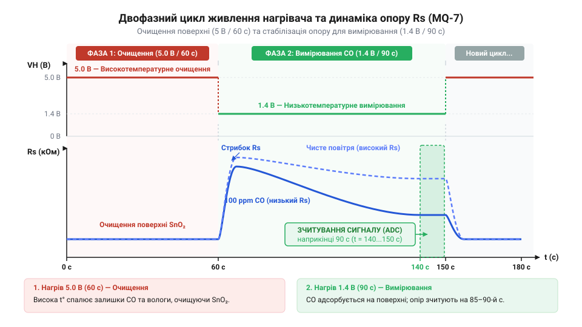
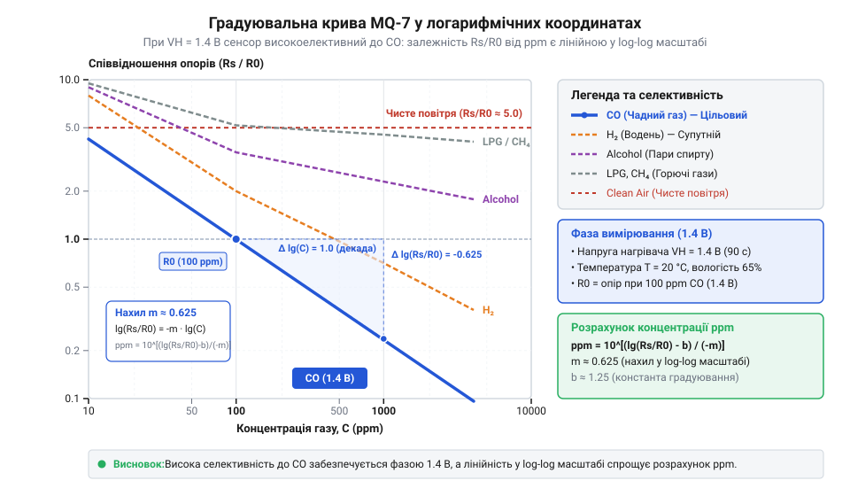
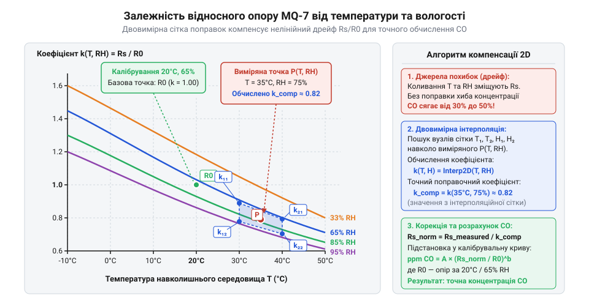

# MQ-7 — давач чадного газу (CO)

<preknowlist>
- [Родина MQ (напівпровідникові давачі газу)](root:cat-hw-sensors/mq-family) — загальний принцип роботи металооксидних напівпровідникових елементів, роль вбудованого нагрівача та вимірювального дільника опору
- [MQ — давач газу (Keyes K869051)](root:cat-hw-sensors/mq-gas) — типова схема модуля з компаратором, призначення виводів живлення й сигналу та налаштування чутливості
</preknowlist>

## Чому постійний нагрів не виявляє CO

Чадний газ (@@en|CO@@) — небезпечна отрута без запаху. У [напівпровідникових давачах](root:cat-hw-sensors/mq-family) опір оксиду олова (@@la|SnO₂@@) змінюється від газу, але постійний нагрів для @@en|CO@@ непридатний.

За високої температури (350–450 °C) давач @@en|MQ-7@@ втрачає @@la|селективність@@ (лат. @@la|selectio@@ — вибір) і реагує на будь-які гази-відновники чи вологу.

За постійної низької температури (150 °C) вибірковість з'являється, але припиняється @@la|десорбція@@ (лат. @@la|de-@@ — зняття, @@la|sorbere@@ — поглинати). Продукти реакції отруюють поверхню. Тому потрібен двофазний цикл: високий нагрів очищує шар, а низький — вимірює концентрацію.

## Хімосорбція та двофазний цикл нагріву

В основі роботи @@en|MQ-7@@ лежить хемосорбція (англ. @@en|chemisorption@@, від давньогрец. @@grc|χημεία@@ — хімія та лат. @@la|sorbere@@ — поглинати) газів на поверхні n-типу напівпровідника @@la|SnO₂@@. У чистому повітрі атмосферний кисень захоплює електрони з зони провідності й адсорбується на межах кристалітів у вигляді негативних іонів. Це утворює високий @@en|потенціальний бар'єр@@ для проходження струму, і опір `Rs` зростає. Молекули чадного газу реагують із цими іонами кисню (`CO + O⁻ → CO₂ + e⁻`), повертаючи електрони в кристал, що знижує потенціальний бар'єр і зменшує опір `Rs`.

Для стабільності й вибірковості [поверхневої хемосорбції](root:hw-sensing/mox-chemisorption) нагрівач @@en|MQ-7@@ працює за 150-секундним двофазним циклом:

1. **Фаза випалювання (5.0 В / 60 секунд):** При ~350–450 °C відбувається @@la|десорбція@@ — волога та побічні продукти вигорають, очищаючи поверхню @@la|SnO₂@@. 2. **Фаза вимірювання (1.4 В / 90 секунд):** При ~150 °C поверхня проявляє максимальну @@la|селективність@@ до @@en|CO@@.


*Двофазний цикл живлення нагрівача MQ-7 зі зчитуванням аналогового сигналу наприкінці низькотемпературної фази.*

Одразу після переходу на 1.4 В зчитувати сигнал не можна: корпусу потрібен час на термічну стабілізацію. Вихідну напругу фіксують наприкінці фази — між 85-ю та 90-ю секундами. Цикл керується асинхронно без затримки основного потоку:

:::tabs
@tab C++ (Arduino)
:::code mq-7-co/cpp/arduino/setup.cpp
@tab C (ESP-IDF)
:::code mq-7-co/c/esp-idf/mq7-control-task.c
:::

## Обчислення концентрації чадного газу

Чутливий елемент `Rs` утворює потенціометричний дільник із навантажувальним резистором `Rl` [на платі давача](root:cat-hw-sensors/mq-gas). За вихідною напругою `Vout` опір `Rs` виражають із рівняння дільника:

```
Vout = Vcc · Rl ÷ (Rs + Rl)                [рівняння дільника]
Rs   = Rl · (Vcc - Vout) ÷ Vout            [вираження Rs]
```

Через виробничий розкид параметрів покази нормують відносним співвідношенням `Rs ÷ R₀`, де `R₀` — опір чутливого шару в чистому повітрі. Співвідношення `Rs ÷ R₀` пов'язане з концентрацією `C` у ppm (англ. @@en|parts per million@@ — частинок на мільйон) степеневою залежністю:

```
Rs ÷ R0  = A · Cᵇ                           [степенева залежність]
log₁₀(Rs ÷ R0) = log₁₀(A) + b · log₁₀(C)   [логарифмування залежності]
log₁₀(C)       = (log₁₀(Rs ÷ R0) - log₁₀(A)) ÷ b [вираження логарифма концентрації C]
```

Значення коефіцієнта `A` та від'ємного нахилу `b` визначають із графічної характеристики чутливості давача.


*Графік залежності співвідношення опорів Rs/R0 від концентрації газів у логарифмічному масштабі.*

Новий давач @@en|MQ-7@@ вимагає первинного випалювання тривалістю 48 годин під напругою 5.0 В для стабілізації кристалічної ґратки та вигорання технологічних зв'язуючих речовин.

## Вплив довкілля та калібрування давача

Адсорбція молекул води (`H₂O`) на поверхні @@la|SnO₂@@ віддає електрони в зону провідності, зменшуючи опір `Rs` незалежно від наявності @@en|CO@@. Для компенсації виміряне співвідношення опорів ділять на температурно-вологісний коефіцієнт `K(T, RH)`:

```
(Rs ÷ R0)ₖₒᵣ = (Rs ÷ R0) ÷ K(T, RH)       [кліматична корекція співвідношення опорів]
```


*Залежність коефіцієнта корекції від температури та вологості.*

Деградація кристалів та накопичення пилу викликають дрейф нуля (англ. @@en|zero drift@@). Тому опір `R₀` періодично калібрують (франц. @@fr|calibrer@@ — вимірювати калібр) у чистому повітрі й перезаписують у пам'ять контролера.

Через перехресну чутливість (англ. @@en|cross-sensitivity@@) до водню (`H₂`), спирту й парафінів @@en|MQ-7@@ може давати хибні тривоги при 150 °C. Через це давач придатний для побутового моніторингу, а в пожежній безпеці його комбінують з [оптичними давачами полум'я](root:cat-hw-sensors/ky-026-flame) та давачами диму.