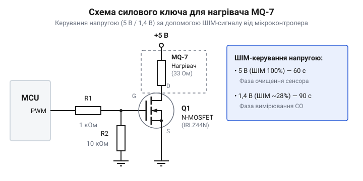
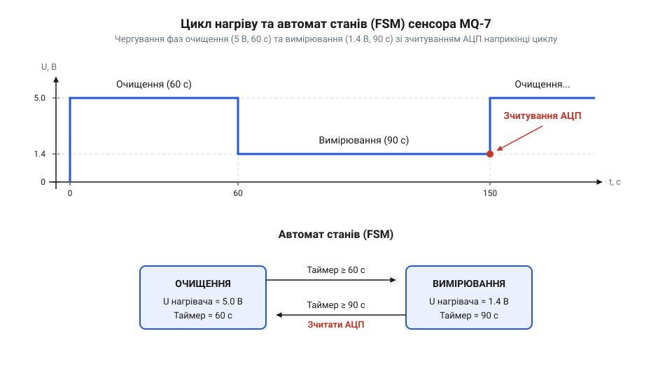

# Проєктування автономного монітора чадного газу з керованим двофазним живленням

<preknowlist>
- [Родина MQ (напівпровідникові давачі газу)](root:cat-hw-sensors/mq-family) — Принцип дії напівпровідникових сенсорів на базі SnO2 та принципи зміни опору чутливого елемента від наявності відновлювальних газів.
- [MQ — давач газу (Keyes K869051)](root:cat-hw-sensors/mq-gas) — Базове підключення аналогового дільника напруги та зчитування сигналу на АЦП мікроконтролера.
</preknowlist>

## Чому стале живлення не виявляє чадний газ

Коли напівпровідниковий давач чадного газу MQ-7 підключають до постійної напруги живлення нагрівача, його чутливий елемент на базі діоксиду олова (SnO2) швидко втрачає здатність реагувати на чадний газ через насичення та отруєння активної поверхні молекулами кисню та побічними газами. За сталої високої температури датчик реагує переважно на водень, метан та пари спирту, повністю маскуючи небезпечні концентрації монооксиду вуглецю (CO). Для відновлення чутливості до CO необхідно чергувати періоди високотемпературного очищення та низькотемпературного вимірювання.

Задля стабільної роботи сенсора застосовують двофазний температурний цикл живлення нагрівача:
1. **Фаза очищення (High Voltage):** нагрівач живиться номінальною напругою 5.0 В протягом 60 секунд. Поверхня SnO2 нагрівається приблизно до 300...350 °C, що викликає інтенсивне випаровування забруднень, десорбцію побічних сполук та регенерацію шару хемосорбованого кисню.
2. **Фаза вимірювання (Low Voltage):** напруга нагрівача знижується до 1.4 В протягом 90 секунд. Температура чутливого шару падає приблизно до 150 °C. Саме за цієї температури чадний газ CO вибірково окиснюється адсорбованим киснем, змінюючи опір напівпровідника, тоді як молекули метану та інших газів не вступають у реакцію.

Опитування АЦП здійснюється строго наприкінці 90-секундної фази охолодження, коли температура та опір напівпровідника досягають квазістаціонарного стану.

## Схемотехніка двофазного живлення нагрівача MQ-7

Опір нагрівальної спіралі MQ-7 становить приблизно 33 Ом, через що за напруги 5.0 В струм споживання сягає 150 мА. Жоден стандартний GPIO мікроконтролера не здатен віддати такий струм, тому комутація здійснюється через силове ключове коло на базі N-канального MOSFET-транзистора з логічним рівнем відкривання затвора (Logic-Level, наприклад 2N7002, IRLML2502 або IRLZ44N).

Для формування зниженої напруги 1.4 В без застосування громіздких регуляторів напруги використовується апаратний ШІМ мікроконтролера. Середньоквадратична еквівалентна потужність нагрівання регулюється коефіцієнтом заповнення ШІМ (Duty Cycle).



Схема включає струмообмежувальний резистор у колі затвора (100...220 Ом) для запобігання перевантаженню виводу МК під час перезаряджання ємності затвора, а також підтягувальний резистор 10...100 кОм до землі (Pull-Down), що гарантує надійне закриття транзистора під час скидання або перезавантаження процесора. Опір відкритого каналу транзистора `Rds(on)` має бути мінімальним (менше 0.1 Ом), щоб уникнути паразитного падіння напруги та перегріву ключа.

## Автомат станів прошивки для керування циклами

Для чіткої витримки 60-секундної фази нагріву та 90-секундної фази вимірювання без блокування основного циклу програми використовується неблокуючий автомат скінченних станів (FSM).



Автомат станів має три ключові фази:
1. `MQ7_STATE_HEATING`: на ШІМ встановлюється 100% заповнення (5.0 В). Таймер відраховує 60 секунд.
2. `MQ7_STATE_COOLING`: на ШІМ встановлюється коефіцієнт близько 28% (еквівалент 1.4 В). Таймер відраховує перші 88–89 секунд фази вимірювання.
3. `MQ7_STATE_READING`: в останні 1–2 секунди низьковольтної фази запускається осереднення вибірок АЦП, розраховується опір `Rs`, визначається концентрація у ppm і перевіряються пороги тривоги. Після цього автомат повертається у стан нагріву.

Такий підхід дозволяє мікроконтролеру обслуговувати дисплей, обмінюватися даними по мережі або переходити в режим сну між таками таймера.

## Калібрування та перерахунок АЦП у ppm

Вихідний сигнал давача знімається з резистивного дільника, утвореного опором чутливого шару `Rs` та навантажувальним резистором `RL` (типово 10 кОм). Опір сенсора розраховується за формулою:

```
Rs = RL * (Vcc - Vout) / Vout
```

де `Vout` — напруга, оцифрована АЦП, а `Vcc` — опорна напруга живлення дільника (5.0 В).

Для точного перерахунку опору в концентрацію CO в одиницях ppm використовується ступенева залежність:

```
ppm = A * (Rs / R0)^B
```

де `R0` — опір давача у чистому калібрувальному повітрі, а коефіцієнти `A` та `B` визначаються за логарифмічною кривою чутливості з технічного опису сенсора (для MQ-7 типово `B ≈ -1.5`). Перед першим використанням давач має пройти 48-годинний первинний відпал (Burn-in) для стабілізації кристалічної решітки оксиду олова, після чого виконується запис опорного `R0` в EEPROM.

## Аварійна сигналізація та автономне живлення

Отримане значення концентрації порівнюється із санітарними та аварійними порогами безпеки:
- **До 20 ppm:** нормальний фоновий рівень безпечного середовища.
- **50 ppm:** гранично допустима концентрація (ГДК) для робочої зони за 8-годинну зміну. Активується попереджувальна світлова індикація.
- **100...200 ppm:** небезпечна концентрація. Запуск звукового зумера (buzzer) та передача сигналу аварії.
- **Понад 400 ppm:** критична загроза життю. Безперервний сигнал тривоги та спрацьовування реле аварійної вентиляції або перекриття газового клапана.

Для батарейного живлення мікроконтролер може переходити в режим низького енергоспоживання під час пасивних секунд витримки циклів, пробуджуючись лише за системними перериваннями таймера.

## Повний вихідний код реалізації

Нижче наведено робочі реалізації драйвера та приклади монітора чадного газу мовами C та C++.

:::tabs
@tab C
:::code proj-mq7-co-monitor/c/main.c
@tab C++
:::code proj-mq7-co-monitor/cpp/examples/main.cpp
:::

## Висновки

Реалізація надійного монітора чадного газу на сенсорі MQ-7 вимагає суворого дотримання двофазного температурного режиму: високотемпературного очищення при 5.0 В та низькотемпературного селективного вимірювання при 1.4 В. Застосування силового MOSFET-ключа з ШІМ-керуванням забезпечує ефективну комутацію нагрівача. Неблокуючий автомат станів гарантує точне дотримання часових інтервалів 60 с / 90 с без зависання прошивки, а процедура калібрування базового опору R0 та ступенева інтерполяція дозволяють точно обчислювати концентрацію CO в ppm для своєчасного захисту життя та здоров'я людей.